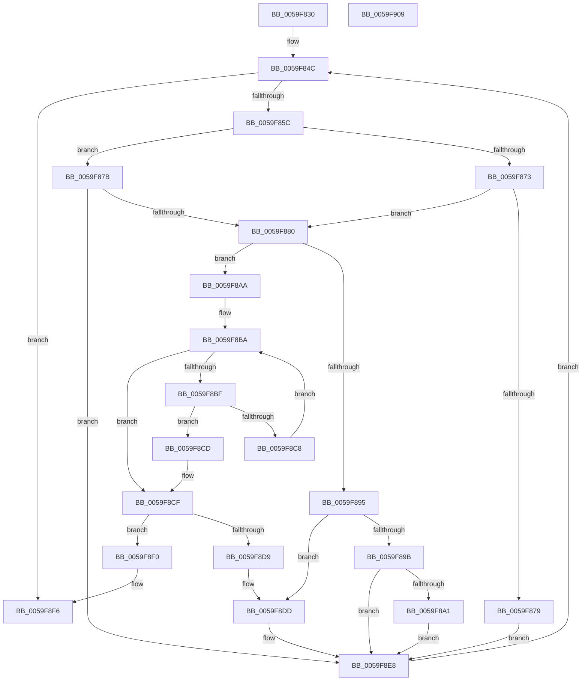

# IopLiveDumpValidateProtectedProcessExclusions

- RVA: `0x0059F830`–`0x0059F90A` (길이 `218` bytes)
- VA: `0x000000014059F830`
- 실행 섹션: `.text`
- PDB 이름 있음: `예`; PDB Function 태그: `아니요`
- unwind 정보 RVA: `0x00060BC4`
- 디코드: `63`개 명령, `218/218` bytes 표시
- 미해석 바이트: `0` (있으면 어셈블리에 `.byte`로 보존)

> 이 문서는 커널 이미지의 기계어와 PDB 기호를 분석해 생성했습니다. 4번과 5번은 함수 원형과 자료형을 바이너리 사용 방식에서 추정한 C 해석이며 원본 소스 복구 결과는 아닙니다.

## 1. Dependencies

- 직접 호출 지점: **1**; 고유 호출 대상: **1**
- 직접 호출자로 확인된 함수: **1**
- RIP 상대 이미지 참조: **1**

### Outgoing calls
- `0x0059F88B` → [IopLiveDumpLookupProcessFilter](IopLiveDumpLookupProcessFilter_function_0059CC0C.md) (function, `0x0059CC0C`)

### Direct callers
- [IopLiveDumpEndMirroringCallback](IopLiveDumpEndMirroringCallback_function_0059B990.md) at `0x0059BA20`

### Static image references
- `0x0059F83F` → RVA `0x00F067C0` (`.data`; read)

## 2. Other-region calls and transfers

- 다른 실행 섹션으로 향하는 call: **0**
- 별도 외부 분기/꼬리 이동을 확인하지 못했습니다.

## 3. Assembly (complete function range)

```asm
0059F830  48 89 5C 24 08                  mov qword ptr [rsp + 8], rbx
0059F835  48 89 74 24 10                  mov qword ptr [rsp + 0x10], rsi
0059F83A  57                              push rdi
0059F83B  48 83 EC 20                     sub rsp, 0x20
0059F83F  4C 8B 1D 7A 6F 96 00            mov r11, qword ptr [rip + 0x966f7a]
0059F846  48 8B F1                        mov rsi, rcx
0059F849  45 33 D2                        xor r10d, r10d
0059F84C  48 8D 05 6D 6F 96 00            lea rax, [rip + 0x966f6d]
0059F853  4C 3B D8                        cmp r11, rax
0059F856  0F 84 9A 00 00 00               je 0x14059f8f6
0059F85C  49 8D 9B 28 FE FF FF            lea rbx, [r11 - 0x1d8]
0059F863  8A 83 FA 05 00 00               mov al, byte ptr [rbx + 0x5fa]
0059F869  8A C8                           mov cl, al
0059F86B  80 E1 07                        and cl, 7
0059F86E  80 F9 02                        cmp cl, 2
0059F871  75 08                           jne 0x14059f87b
0059F873  24 F0                           and al, 0xf0
0059F875  3C 70                           cmp al, 0x70
0059F877  75 07                           jne 0x14059f880
0059F879  EB 6D                           jmp 0x14059f8e8
0059F87B  80 F9 01                        cmp cl, 1
0059F87E  75 68                           jne 0x14059f8e8
0059F880  8B BB D0 01 00 00               mov edi, dword ptr [rbx + 0x1d0]
0059F886  48 8B CE                        mov rcx, rsi
0059F889  8B D7                           mov edx, edi
0059F88B  E8 7C D3 FF FF                  call 0x14059cc0c
0059F890  48 85 C0                        test rax, rax
0059F893  74 15                           je 0x14059f8aa
0059F895  48 39 58 18                     cmp qword ptr [rax + 0x18], rbx
0059F899  75 42                           jne 0x14059f8dd
0059F89B  83 78 20 02                     cmp dword ptr [rax + 0x20], 2
0059F89F  74 47                           je 0x14059f8e8
0059F8A1  C7 40 20 02 00 00 00            mov dword ptr [rax + 0x20], 2
0059F8A8  EB 3E                           jmp 0x14059f8e8
0059F8AA  48 8D 96 B0 04 00 00            lea rdx, [rsi + 0x4b0]
0059F8B1  4D 8B C2                        mov r8, r10
0059F8B4  48 8B 02                        mov rax, qword ptr [rdx]
0059F8B7  41 8A CA                        mov cl, r10b
0059F8BA  48 3B C2                        cmp rax, rdx
0059F8BD  74 10                           je 0x14059f8cf
0059F8BF  4C 8B C0                        mov r8, rax
0059F8C2  44 39 50 20                     cmp dword ptr [rax + 0x20], r10d
0059F8C6  74 05                           je 0x14059f8cd
0059F8C8  48 8B 00                        mov rax, qword ptr [rax]
0059F8CB  EB ED                           jmp 0x14059f8ba
0059F8CD  B1 01                           mov cl, 1
0059F8CF  F6 D9                           neg cl
0059F8D1  48 1B C0                        sbb rax, rax
0059F8D4  49 23 C0                        and rax, r8
0059F8D7  74 17                           je 0x14059f8f0
0059F8D9  48 89 78 10                     mov qword ptr [rax + 0x10], rdi
0059F8DD  C7 40 20 02 00 00 00            mov dword ptr [rax + 0x20], 2
0059F8E4  48 89 58 18                     mov qword ptr [rax + 0x18], rbx
0059F8E8  4D 8B 1B                        mov r11, qword ptr [r11]
0059F8EB  E9 5C FF FF FF                  jmp 0x14059f84c
0059F8F0  41 BA 1A 00 00 80               mov r10d, 0x8000001a
0059F8F6  48 8B 5C 24 30                  mov rbx, qword ptr [rsp + 0x30]
0059F8FB  41 8B C2                        mov eax, r10d
0059F8FE  48 8B 74 24 38                  mov rsi, qword ptr [rsp + 0x38]
0059F903  48 83 C4 20                     add rsp, 0x20
0059F907  5F                              pop rdi
0059F908  C3                              ret
0059F909  CC                              int3
```

## 4. C-style interpretation (structured pseudocode)

```c
__int64 __fastcall IopLiveDumpValidateProtectedProcessExclusions(__int64 a1)
{
    __int64 result;
    __int64 v_r10;
    __int64 v_rsp;
    unsigned __int64 v_stack_p10;
    unsigned __int64 v_stack_p8;

    v_stack_p8 = v_rbx;
    v_stack_p10 = v_rsi;
    v_rsp = (v_rsp) - (32);
    v_r10 = 0;
loc_0059F84C:
    if ((*(unsigned __int64 *)(v_rip + 9858938)) == (v_rip + 9858925)) goto loc_0059F8F6;
    a1 = (unsigned __int8)(((unsigned __int8)(*(unsigned __int8 *)(*(unsigned __int64 *)(v_rip + 9858938) - 472 + 1530))) & (7));
    if (((unsigned __int8)(a1)) != 2) goto loc_0059F87B;
    result = (unsigned __int8)((*(unsigned __int8 *)(*(unsigned __int64 *)(v_rip + 9858938) - 472 + 1530)) & (240));
    if (((unsigned __int8)(result)) != 112) goto loc_0059F880;
    goto loc_0059F8E8;
loc_0059F87B:
    if (((unsigned __int8)(a1)) != 1) goto loc_0059F8E8;
loc_0059F880:
    result = IopLiveDumpLookupProcessFilter(a1, (unsigned int)((unsigned int)((unsigned int)(*(unsigned int *)(*(unsigned __int64 *)(v_rip + 9858938) - 472 + 464)))), a3, a4);
    if (result == 0) goto loc_0059F8AA;
    if ((*(unsigned __int64 *)(result + 24)) != (*(unsigned __int64 *)(v_rip + 9858938) - 472)) goto loc_0059F8DD;
    if ((*(unsigned int *)(result + 32)) == 2) goto loc_0059F8E8;
    *(unsigned int *)(result + 32) = 2;
    goto loc_0059F8E8;
loc_0059F8AA:
loc_0059F8BA:
    if ((*(unsigned __int64 *)(a1 + 1200)) == (a1 + 1200)) goto loc_0059F8CF;
    if ((*(unsigned int *)(*(unsigned __int64 *)(a1 + 1200) + 32)) == 0) goto loc_0059F8CD;
    goto loc_0059F8BA;
loc_0059F8CD:
loc_0059F8CF:
    a1 = (unsigned __int8)(-(1));
    result = (*(unsigned __int64 *)(*(unsigned __int64 *)(a1 + 1200))) & (*(unsigned __int64 *)(a1 + 1200));
    if (condition_is_equal) goto loc_0059F8F0;
    *(unsigned __int64 *)(result + 16) = (unsigned int)(*(unsigned int *)(*(unsigned __int64 *)(v_rip + 9858938) - 472 + 464));
loc_0059F8DD:
    *(unsigned int *)(result + 32) = 2;
    *(unsigned __int64 *)(result + 24) = *(unsigned __int64 *)(v_rip + 9858938) - 472;
loc_0059F8E8:
    goto loc_0059F84C;
loc_0059F8F0:
loc_0059F8F6:
    v_rsp = (v_rsp) + (32);
    return (unsigned int)((unsigned int)((unsigned int)(0x8000001AULL)));
}
```

## 5. (Beta) C Style

```c
int64_t IopLiveDumpValidateProtectedProcessExclusions(void *Arg1)
{
    uint8_t *arg1 = (uint8_t *)Arg1;

    int64_t result;
    int64_t local_r10;
    int64_t local_rsp;
    uint64_t v_stack_p10;
    uint64_t v_stack_p8;

    v_stack_p8 = local_rbx;
    v_stack_p10 = local_rsi;
    local_rsp = (local_rsp) - (32);
    local_r10 = 0;
loc_0059F84C:
    if ((*(uint64_t *)(v_rip + 0x966F7A)) == (v_rip + 9858925)) goto loc_0059F8F6;
    Arg1 = (uint8_t)(((uint8_t)(*(uint8_t *)(*(uint64_t *)(v_rip + 0x966F7A) - 0x1D8 + 0x5FA))) & (7));
    if (((uint8_t)(Arg1)) != 2) goto loc_0059F87B;
    result = (uint8_t)((*(uint8_t *)(*(uint64_t *)(v_rip + 0x966F7A) - 0x1D8 + 0x5FA)) & (240));
    if (((uint8_t)(result)) != 112) goto loc_0059F880;
    goto loc_0059F8E8;
loc_0059F87B:
    if (((uint8_t)(Arg1)) != 1) goto loc_0059F8E8;
loc_0059F880:
    result = IopLiveDumpLookupProcessFilter(Arg1, (uint32_t)((uint32_t)((uint32_t)(*(uint32_t *)(*(uint64_t *)(v_rip + 0x966F7A) - 0x1D8 + 0x1D0)))), a3, a4);
    if (result == 0) goto loc_0059F8AA;
    if ((*(uint64_t *)(result + 0x18)) != (*(uint64_t *)(v_rip + 0x966F7A) - 472)) goto loc_0059F8DD;
    if ((*(uint32_t *)(result + 0x20)) == 2) goto loc_0059F8E8;
    *(uint32_t *)(result + 0x20) = 2;
    goto loc_0059F8E8;
loc_0059F8AA:
loc_0059F8BA:
    if ((*(uint64_t *)(arg1 + 0x4B0)) == (Arg1 + 1200)) goto loc_0059F8CF;
    if ((*(uint32_t *)(*(uint64_t *)(arg1 + 0x4B0) + 0x20)) == 0) goto loc_0059F8CD;
    goto loc_0059F8BA;
loc_0059F8CD:
loc_0059F8CF:
    Arg1 = (uint8_t)(-(1));
    result = (*(uint64_t *)(*(uint64_t *)(arg1 + 0x4B0))) & (*(uint64_t *)(arg1 + 0x4B0));
    if (condition_is_equal) goto loc_0059F8F0;
    *(uint64_t *)(result + 0x10) = (uint32_t)(*(uint32_t *)(*(uint64_t *)(v_rip + 0x966F7A) - 0x1D8 + 0x1D0));
loc_0059F8DD:
    *(uint32_t *)(result + 0x20) = 2;
    *(uint64_t *)(result + 0x18) = *(uint64_t *)(v_rip + 0x966F7A) - 472;
loc_0059F8E8:
    goto loc_0059F84C;
loc_0059F8F0:
loc_0059F8F6:
    local_rsp = (local_rsp) + (32);
    return (uint32_t)((uint32_t)((uint32_t)(0x8000001AULL)));
}
```

### 관측된 메모리 오프셋

구조체 형식이 확인되지 않은 접근은 인자 기준의 오프셋으로만 기록했습니다.

| 기준 인자 | 오프셋 표현 | 폭 (bit) | 접근 |
|---|---:|---:|---|
| `Arg1` | `+ 0x0` | `64` | `R` |
| `Arg1` | `+ 0x4B0` | `64` | `R` |

## 6. Execution-region graph

[열기: 2D/3D 그래프와 함수 탐색 컨트롤 패널](../../../control-panel.html?section=text&rva=0x0059F830&view=graph)

- 2D 그래프는 위에서 아래로 흐르고, 3D 그래프는 빈 공간을 드래그해 회전합니다. Shift+드래그는 이동, 휠은 확대·축소, 함수 노드 선택은 대상 보고서 이동입니다.

### Static fallback


