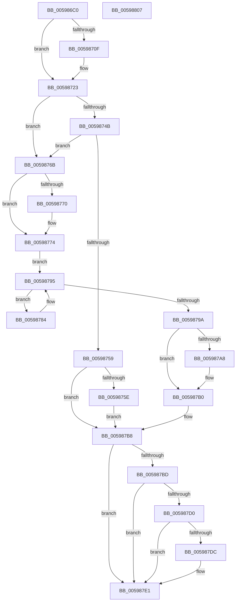

# IopProcessIoTracking

- RVA: `0x005986C0`–`0x00598808` (길이 `328` bytes)
- VA: `0x00000001405986C0`
- 실행 섹션: `.text`
- PDB 이름 있음: `예`; PDB Function 태그: `아니요`
- unwind 정보 RVA: `0x000C7718`
- 디코드: `92`개 명령, `328/328` bytes 표시
- 미해석 바이트: `0` (있으면 어셈블리에 `.byte`로 보존)

> 이 문서는 커널 이미지의 기계어와 PDB 기호를 분석해 생성했습니다. 4번과 5번은 함수 원형과 자료형을 바이너리 사용 방식에서 추정한 C 해석이며 원본 소스 복구 결과는 아닙니다.

## 1. Dependencies

- 직접 호출 지점: **8**; 고유 호출 대상: **8**
- 직접 호출자로 확인된 함수: **1**
- RIP 상대 이미지 참조: **3**

### Outgoing calls
- `0x00598732` → [KeAbPreAcquire](../21/KeAbPreAcquire_function_00210230.md) (function, `0x00210230`)
- `0x00598750` → [ExfTryAcquirePushLockSharedEx](../3F/ExfTryAcquirePushLockSharedEx_function_003FC210.md) (function, `0x003FC210`)
- `0x00598764` → [KeAbPostReleaseEx](../26/KeAbPostReleaseEx_function_00262210.md) (function, `0x00262210`)
- `0x0059878D` → [guard_dispatch_icall](../6B/guard_dispatch_icall_function_006BAAD0.md) (function, `0x006BAAD0`)
- `0x005987AB` → [ExfReleasePushLockShared](../26/ExfReleasePushLockShared_function_00263440.md) (function, `0x00263440`)
- `0x005987B3` → [KeAbPostRelease](../2E/KeAbPostRelease_function_002E1600.md) (function, `0x002E1600`)
- `0x005987DC` → [KiCheckForKernelApcDelivery](../2E/KiCheckForKernelApcDelivery_function_002E2C80.md) (function, `0x002E2C80`)
- `0x005987E9` → [_security_check_cookie](../6A/_security_check_cookie_function_006AC640.md) (function, `0x006AC640`)

### Direct callers
- [sub_006F997E](../6F/Unknown_function_006F997E.md) at `0x006F99C5`

### Static image references
- `0x005986D6` → RVA `0x00E0A740` (`.data`; read)
- `0x00598723` → RVA `0x00F8D438` (`.data`; read)
- `0x00598774` → RVA `0x00F8D440` (`.data`; read)

## 2. Other-region calls and transfers

- 다른 실행 섹션으로 향하는 call: **0**
- 별도 외부 분기/꼬리 이동을 확인하지 못했습니다.

## 3. Assembly (complete function range)

```asm
005986C0  48 89 5C 24 18                  mov qword ptr [rsp + 0x18], rbx
005986C5  48 89 6C 24 20                  mov qword ptr [rsp + 0x20], rbp
005986CA  56                              push rsi
005986CB  57                              push rdi
005986CC  41 54                           push r12
005986CE  41 56                           push r14
005986D0  41 57                           push r15
005986D2  48 83 EC 50                     sub rsp, 0x50
005986D6  48 8B 05 63 20 87 00            mov rax, qword ptr [rip + 0x872063]
005986DD  48 33 C4                        xor rax, rsp
005986E0  48 89 44 24 40                  mov qword ptr [rsp + 0x40], rax
005986E5  33 ED                           xor ebp, ebp
005986E7  48 89 4C 24 30                  mov qword ptr [rsp + 0x30], rcx
005986EC  89 6C 24 2A                     mov dword ptr [rsp + 0x2a], ebp
005986F0  40 8A FD                        mov dil, bpl
005986F3  66 89 6C 24 2E                  mov word ptr [rsp + 0x2e], bp
005986F8  89 54 24 38                     mov dword ptr [rsp + 0x38], edx
005986FC  8D 45 18                        lea eax, [rbp + 0x18]
005986FF  66 89 44 24 28                  mov word ptr [rsp + 0x28], ax
00598704  44 0F 20 C0                     mov rax, cr8
00598708  8D 75 01                        lea esi, [rbp + 1]
0059870B  3C 02                           cmp al, 2
0059870D  73 14                           jae 0x140598723
0059870F  65 48 8B 04 25 88 01 00 00      mov rax, qword ptr gs:[0x188]
00598718  40 8A FE                        mov dil, sil
0059871B  66 FF 88 E6 01 00 00            dec word ptr [rax + 0x1e6]
00598722  90                              nop
00598723  4C 8D 35 0E 4D 9F 00            lea r14, [rip + 0x9f4d0e]
0059872A  44 8B C6                        mov r8d, esi
0059872D  49 8B CE                        mov rcx, r14
00598730  33 D2                           xor edx, edx
00598732  E8 F9 7A C7 FF                  call 0x140210230
00598737  48 8B D8                        mov rbx, rax
0059873A  33 C0                           xor eax, eax
0059873C  44 8D 60 11                     lea r12d, [rax + 0x11]
00598740  F0 4C 0F B1 25 EF 4C 9F 00      lock cmpxchg qword ptr [rip + 0x9f4cef], r12
00598749  74 20                           je 0x14059876b
0059874B  33 D2                           xor edx, edx
0059874D  49 8B CE                        mov rcx, r14
00598750  E8 BB 3A E6 FF                  call 0x1403fc210
00598755  84 C0                           test al, al
00598757  75 12                           jne 0x14059876b
00598759  48 85 DB                        test rbx, rbx
0059875C  74 5A                           je 0x1405987b8
0059875E  48 8B D3                        mov rdx, rbx
00598761  49 8B CE                        mov rcx, r14
00598764  E8 A7 9A CC FF                  call 0x140262210
00598769  EB 4D                           jmp 0x1405987b8
0059876B  48 85 DB                        test rbx, rbx
0059876E  74 04                           je 0x140598774
00598770  40 88 73 0A                     mov byte ptr [rbx + 0xa], sil
00598774  48 8B 1D C5 4C 9F 00            mov rbx, qword ptr [rip + 0x9f4cc5]
0059877B  4C 8D 3D BE 4C 9F 00            lea r15, [rip + 0x9f4cbe]
00598782  EB 11                           jmp 0x140598795
00598784  48 8B 43 10                     mov rax, qword ptr [rbx + 0x10]
00598788  48 8D 4C 24 28                  lea rcx, [rsp + 0x28]
0059878D  E8 3E 23 12 00                  call 0x1406baad0
00598792  48 8B 1B                        mov rbx, qword ptr [rbx]
00598795  49 3B DF                        cmp rbx, r15
00598798  75 EA                           jne 0x140598784
0059879A  49 8B C4                        mov rax, r12
0059879D  F0 48 0F B1 2D 92 4C 9F 00      lock cmpxchg qword ptr [rip + 0x9f4c92], rbp
005987A6  74 08                           je 0x1405987b0
005987A8  49 8B CE                        mov rcx, r14
005987AB  E8 90 AC CC FF                  call 0x140263440
005987B0  49 8B CE                        mov rcx, r14
005987B3  E8 48 8E D4 FF                  call 0x1402e1600
005987B8  40 3A FE                        cmp dil, sil
005987BB  75 24                           jne 0x1405987e1
005987BD  65 48 8B 04 25 88 01 00 00      mov rax, qword ptr gs:[0x188]
005987C6  90                              nop
005987C7  66 01 B0 E6 01 00 00            add word ptr [rax + 0x1e6], si
005987CE  75 11                           jne 0x1405987e1
005987D0  48 05 98 00 00 00               add rax, 0x98
005987D6  90                              nop
005987D7  48 39 00                        cmp qword ptr [rax], rax
005987DA  74 05                           je 0x1405987e1
005987DC  E8 9F A4 D4 FF                  call 0x1402e2c80
005987E1  48 8B 4C 24 40                  mov rcx, qword ptr [rsp + 0x40]
005987E6  48 33 CC                        xor rcx, rsp
005987E9  E8 52 3E 11 00                  call 0x1406ac640
005987EE  4C 8D 5C 24 50                  lea r11, [rsp + 0x50]
005987F3  49 8B 5B 40                     mov rbx, qword ptr [r11 + 0x40]
005987F7  49 8B 6B 48                     mov rbp, qword ptr [r11 + 0x48]
005987FB  49 8B E3                        mov rsp, r11
005987FE  41 5F                           pop r15
00598800  41 5E                           pop r14
00598802  41 5C                           pop r12
00598804  5F                              pop rdi
00598805  5E                              pop rsi
00598806  C3                              ret
00598807  CC                              int3
```

## 4. C-style interpretation (structured pseudocode)

```c
__int64 __fastcall IopProcessIoTracking(__int64 a1, int a2)
{
    __int64 result;
    __int64 v_rbp;
    __int64 v_rdi;
    __int64 v_rsp;
    unsigned __int64 v_stack_m28;
    unsigned __int64 v_stack_m38;
    unsigned int v_stack_m40;
    unsigned __int64 v_stack_m48;
    unsigned __int16 v_stack_m4A;
    unsigned int v_stack_m4E;
    unsigned __int16 v_stack_m50;
    unsigned __int64 v_stack_p18;
    unsigned __int64 v_stack_p20;

    v_stack_p18 = v_rbx;
    v_stack_p20 = v_rbp;
    v_rsp = (v_rsp) - (80);
    result = (*(unsigned __int64 *)(v_rip + 8855651)) ^ (v_rsp);
    v_stack_m38 = result;
    v_rbp = 0;
    v_stack_m48 = a1;
    v_stack_m4E = 0;
    v_stack_m4A = 0;
    v_stack_m40 = a2;
    v_stack_m50 = (unsigned __int16)(v_rbp + 24);
    result = v_cr8;
    v_rdi = 0;
    if (((unsigned __int8)(v_cr8)) < 2) {
        result = *(unsigned __int64 *)(gs_base + (0 + 392));
        v_rdi = (unsigned __int8)(v_rbp + 1);
    }
    a2 = 0;
    result = KeAbPreAcquire(v_rip + 10439950, a2, (unsigned int)((unsigned int)(v_rbp + 1)), a4);
    result = 0;
    if (condition_is_equal) goto loc_0059876B;
    a2 = 0;
    result = ExfTryAcquirePushLockSharedEx(v_rip + 10439950, a2, (unsigned int)((unsigned int)(v_rbp + 1)), a4);
    if ((unsigned __int8)(result) != 0) goto loc_0059876B;
    if (result == 0) goto loc_005987B8;
    result = KeAbPostReleaseEx(v_rip + 10439950, result, (unsigned int)((unsigned int)(v_rbp + 1)), a4);
    goto loc_005987B8;
loc_0059876B:
    if (result != 0) {
        *(unsigned __int8 *)(result + 10) = (unsigned __int8)(v_rbp + 1);
    }
    goto loc_00598795;
loc_00598784:
    result = guard_dispatch_icall(v_stack_m50, result, (unsigned int)((unsigned int)(v_rbp + 1)), a4);
loc_00598795:
    if ((*(unsigned __int64 *)(*(unsigned __int64 *)(v_rip + 10439877))) != (v_rip + 10439870)) goto loc_00598784;
    result = result + 17;
    if ((*(unsigned __int64 *)(*(unsigned __int64 *)(v_rip + 10439877))) != (v_rip + 10439870)) {
        a1 = v_rip + 10439950;
        result = ExfReleasePushLockShared(a1, result, (unsigned int)((unsigned int)(v_rbp + 1)), a4);
    }
    result = KeAbPostRelease(v_rip + 10439950, result, (unsigned int)((unsigned int)(v_rbp + 1)), a4);
loc_005987B8:
    if (((unsigned __int8)(v_rdi)) != ((unsigned __int8)(v_rbp + 1))) goto loc_005987E1;
    if (((unsigned __int8)(v_rdi)) != ((unsigned __int8)(v_rbp + 1))) goto loc_005987E1;
    result = (*(unsigned __int64 *)(gs_base + (0 + 392))) + (152);
    if ((*(unsigned __int64 *)(result)) != result) {
        result = KiCheckForKernelApcDelivery(v_rip + 10439950, result, (unsigned int)((unsigned int)(v_rbp + 1)), a4);
    }
    a1 = (v_stack_m38) ^ (v_rsp);
    result = _security_check_cookie(a1, result, (unsigned int)((unsigned int)(v_rbp + 1)), a4);
    return result;
}
```

## 5. (Beta) C Style

```c
int64_t IopProcessIoTracking(int64_t Arg1, int32_t Arg2)
{
    int64_t result;
    int64_t local_rbp;
    int64_t local_rdi;
    int64_t local_rsp;
    uint64_t v_stack_m28;
    uint64_t v_stack_m38;
    uint32_t v_stack_m40;
    uint64_t v_stack_m48;
    uint16_t v_stack_m4A;
    uint32_t v_stack_m4E;
    uint16_t v_stack_m50;
    uint64_t v_stack_p18;
    uint64_t v_stack_p20;

    v_stack_p18 = local_rbx;
    v_stack_p20 = local_rbp;
    local_rsp = (local_rsp) - (80);
    result = (*(uint64_t *)(v_rip + 0x872063)) ^ (local_rsp);
    v_stack_m38 = result;
    local_rbp = 0;
    v_stack_m48 = Arg1;
    v_stack_m4E = 0;
    v_stack_m4A = 0;
    v_stack_m40 = Arg2;
    v_stack_m50 = (uint16_t)(local_rbp + 24);
    result = v_cr8;
    local_rdi = 0;
    if (((uint8_t)(v_cr8)) < 2) {
        result = *(uint64_t *)(gs_base + (0 + 0x188));
        local_rdi = (uint8_t)(local_rbp + 1);
    }
    Arg2 = 0;
    result = KeAbPreAcquire(v_rip + 10439950, Arg2, (uint32_t)((uint32_t)(local_rbp + 1)), a4);
    result = 0;
    if (condition_is_equal) goto loc_0059876B;
    Arg2 = 0;
    result = ExfTryAcquirePushLockSharedEx(v_rip + 10439950, Arg2, (uint32_t)((uint32_t)(local_rbp + 1)), a4);
    if ((uint8_t)(result) != 0) goto loc_0059876B;
    if (result == 0) goto loc_005987B8;
    result = KeAbPostReleaseEx(v_rip + 10439950, result, (uint32_t)((uint32_t)(local_rbp + 1)), a4);
    goto loc_005987B8;
loc_0059876B:
    if (result != 0) {
        *(uint8_t *)(result + 0xA) = (uint8_t)(local_rbp + 1);
    }
    goto loc_00598795;
loc_00598784:
    result = guard_dispatch_icall(v_stack_m50, result, (uint32_t)((uint32_t)(local_rbp + 1)), a4);
loc_00598795:
    if ((*(uint64_t *)(*(uint64_t *)(v_rip + 0x9F4CC5))) != (v_rip + 10439870)) goto loc_00598784;
    result = result + 17;
    if ((*(uint64_t *)(*(uint64_t *)(v_rip + 0x9F4CC5))) != (v_rip + 10439870)) {
        Arg1 = v_rip + 10439950;
        result = ExfReleasePushLockShared(Arg1, result, (uint32_t)((uint32_t)(local_rbp + 1)), a4);
    }
    result = KeAbPostRelease(v_rip + 10439950, result, (uint32_t)((uint32_t)(local_rbp + 1)), a4);
loc_005987B8:
    if (((uint8_t)(local_rdi)) != ((uint8_t)(local_rbp + 1))) goto loc_005987E1;
    if (((uint8_t)(local_rdi)) != ((uint8_t)(local_rbp + 1))) goto loc_005987E1;
    result = (*(uint64_t *)(gs_base + (0 + 0x188))) + (152);
    if ((*(uint64_t *)(result)) != result) {
        result = KiCheckForKernelApcDelivery(v_rip + 10439950, result, (uint32_t)((uint32_t)(local_rbp + 1)), a4);
    }
    Arg1 = (v_stack_m38) ^ (local_rsp);
    result = _security_check_cookie(Arg1, result, (uint32_t)((uint32_t)(local_rbp + 1)), a4);
    return result;
}
```

## 6. Execution-region graph

[열기: 2D/3D 그래프와 함수 탐색 컨트롤 패널](../../../control-panel.html?section=text&rva=0x005986C0&view=graph)

- 2D 그래프는 위에서 아래로 흐르고, 3D 그래프는 빈 공간을 드래그해 회전합니다. Shift+드래그는 이동, 휠은 확대·축소, 함수 노드 선택은 대상 보고서 이동입니다.

### Static fallback


