# IopReadDumpRegistry

- RVA: `0x00595CE0`–`0x00595E64` (길이 `388` bytes)
- VA: `0x0000000140595CE0`
- 실행 섹션: `.text`
- PDB 이름 있음: `예`; PDB Function 태그: `아니요`
- unwind 정보 RVA: `0x000C7014`
- 디코드: `104`개 명령, `388/388` bytes 표시
- 미해석 바이트: `0` (있으면 어셈블리에 `.byte`로 보존)

> 이 문서는 커널 이미지의 기계어와 PDB 기호를 분석해 생성했습니다. 4번과 5번은 함수 원형과 자료형을 바이너리 사용 방식에서 추정한 C 해석이며 원본 소스 복구 결과는 아닙니다.

## 1. Dependencies

- 직접 호출 지점: **12**; 고유 호출 대상: **4**
- 직접 호출자로 확인된 함수: **2**
- RIP 상대 이미지 참조: **10**

### Outgoing calls
- `0x00595D27` → [IopOpenRegistryKey](../../page/A8/IopOpenRegistryKey_function_00A8F200.md) (function, `0x00A8F200`)
- `0x00595D46` → [IopGetRegistryValue](../../page/99/IopGetRegistryValue_function_009990EC.md) (function, `0x009990EC`)
- `0x00595D67` → [ExFreePoolWithTag](../../poolcode/B8/ExFreePoolWithTag_function_00B82870.md) (function, `0x00B82870`)
- `0x00595D83` → [IopGetRegistryValue](../../page/99/IopGetRegistryValue_function_009990EC.md) (function, `0x009990EC`)
- `0x00595DA0` → [ExFreePoolWithTag](../../poolcode/B8/ExFreePoolWithTag_function_00B82870.md) (function, `0x00B82870`)
- `0x00595DB7` → [IopGetRegistryValue](../../page/99/IopGetRegistryValue_function_009990EC.md) (function, `0x009990EC`)
- `0x00595DD8` → [ExFreePoolWithTag](../../poolcode/B8/ExFreePoolWithTag_function_00B82870.md) (function, `0x00B82870`)
- `0x00595DEF` → [IopGetRegistryValue](../../page/99/IopGetRegistryValue_function_009990EC.md) (function, `0x009990EC`)
- `0x00595E10` → [ExFreePoolWithTag](../../poolcode/B8/ExFreePoolWithTag_function_00B82870.md) (function, `0x00B82870`)
- `0x00595E27` → [IopGetRegistryValue](../../page/99/IopGetRegistryValue_function_009990EC.md) (function, `0x009990EC`)
- `0x00595E48` → [ExFreePoolWithTag](../../poolcode/B8/ExFreePoolWithTag_function_00B82870.md) (function, `0x00B82870`)
- `0x00595E53` → [ObCloseHandle](../../page/8A/ObCloseHandle_function_008A1870.md) (function, `0x008A1870`)

### Direct callers
- [IoConfigureCrashDump](IoConfigureCrashDump_function_00591CB4.md) at `0x00591D0C`
- [IopInitializeCrashDump](../../page/71/IopInitializeCrashDump_function_0071A270.md) at `0x0071A2B1`

### Static image references
- `0x00595CF7` → RVA `0x006C9970` (` ?? ::FNODOBFM::`string'`; read)
- `0x00595D3F` → RVA `0x006C9C10` (` ?? ::FNODOBFM::`string'`; read)
- `0x00595D5F` → RVA `0x00E660B8` (`.data`; write)
- `0x00595D7C` → RVA `0x006C9BE0` (` ?? ::FNODOBFM::`string'`; read)
- `0x00595DB0` → RVA `0x006C9D00` (` ?? ::FNODOBFM::`string'`; read)
- `0x00595DD0` → RVA `0x00E66190` (`.data`; write)
- `0x00595DE8` → RVA `0x006C9CD0` (` ?? ::FNODOBFM::`string'`; read)
- `0x00595E08` → RVA `0x00E0A9D8` (`.data`; write)
- `0x00595E20` → RVA `0x006C9CA0` (` ?? ::FNODOBFM::`string'`; read)
- `0x00595E40` → RVA `0x00E0A9B4` (`.data`; write)

## 2. Other-region calls and transfers

- 다른 실행 섹션으로 향하는 call: **12**
  - `0x00595D27` → [IopOpenRegistryKey](../../page/A8/IopOpenRegistryKey_function_00A8F200.md) (`.text` → `PAGE`)
  - `0x00595D46` → [IopGetRegistryValue](../../page/99/IopGetRegistryValue_function_009990EC.md) (`.text` → `PAGE`)
  - `0x00595D67` → [ExFreePoolWithTag](../../poolcode/B8/ExFreePoolWithTag_function_00B82870.md) (`.text` → `POOLCODE`)
  - `0x00595D83` → [IopGetRegistryValue](../../page/99/IopGetRegistryValue_function_009990EC.md) (`.text` → `PAGE`)
  - `0x00595DA0` → [ExFreePoolWithTag](../../poolcode/B8/ExFreePoolWithTag_function_00B82870.md) (`.text` → `POOLCODE`)
  - `0x00595DB7` → [IopGetRegistryValue](../../page/99/IopGetRegistryValue_function_009990EC.md) (`.text` → `PAGE`)
  - `0x00595DD8` → [ExFreePoolWithTag](../../poolcode/B8/ExFreePoolWithTag_function_00B82870.md) (`.text` → `POOLCODE`)
  - `0x00595DEF` → [IopGetRegistryValue](../../page/99/IopGetRegistryValue_function_009990EC.md) (`.text` → `PAGE`)
  - `0x00595E10` → [ExFreePoolWithTag](../../poolcode/B8/ExFreePoolWithTag_function_00B82870.md) (`.text` → `POOLCODE`)
  - `0x00595E27` → [IopGetRegistryValue](../../page/99/IopGetRegistryValue_function_009990EC.md) (`.text` → `PAGE`)
  - `0x00595E48` → [ExFreePoolWithTag](../../poolcode/B8/ExFreePoolWithTag_function_00B82870.md) (`.text` → `POOLCODE`)
  - `0x00595E53` → [ObCloseHandle](../../page/8A/ObCloseHandle_function_008A1870.md) (`.text` → `PAGE`)
- 별도 외부 분기/꼬리 이동을 확인하지 못했습니다.

## 3. Assembly (complete function range)

```asm
00595CE0  48 89 5C 24 10                  mov qword ptr [rsp + 0x10], rbx
00595CE5  48 89 4C 24 08                  mov qword ptr [rsp + 8], rcx
00595CEA  55                              push rbp
00595CEB  48 8B EC                        mov rbp, rsp
00595CEE  48 83 EC 40                     sub rsp, 0x40
00595CF2  48 83 65 20 00                  and qword ptr [rbp + 0x20], 0
00595CF7  48 8D 05 72 3C 13 00            lea rax, [rip + 0x133c72]
00595CFE  48 83 65 10 00                  and qword ptr [rbp + 0x10], 0
00595D03  4C 8D 45 F0                     lea r8, [rbp - 0x10]
00595D07  48 8B DA                        mov rbx, rdx
00595D0A  48 89 45 F8                     mov qword ptr [rbp - 8], rax
00595D0E  33 D2                           xor edx, edx
00595D10  48 C7 45 F0 7E 00 80 00         mov qword ptr [rbp - 0x10], 0x80007e
00595D18  41 B9 19 00 02 00               mov r9d, 0x20019
00595D1E  C6 44 24 20 00                  mov byte ptr [rsp + 0x20], 0
00595D23  48 8D 4D 20                     lea rcx, [rbp + 0x20]
00595D27  E8 D4 94 4F 00                  call 0x140a8f200
00595D2C  85 C0                           test eax, eax
00595D2E  0F 88 24 01 00 00               js 0x140595e58
00595D34  48 8B 4D 20                     mov rcx, qword ptr [rbp + 0x20]
00595D38  4C 8D 4D 10                     lea r9, [rbp + 0x10]
00595D3C  45 33 C0                        xor r8d, r8d
00595D3F  48 8D 15 CA 3E 13 00            lea rdx, [rip + 0x133eca]
00595D46  E8 A1 33 40 00                  call 0x1409990ec
00595D4B  85 C0                           test eax, eax
00595D4D  78 1D                           js 0x140595d6c
00595D4F  48 8B 4D 10                     mov rcx, qword ptr [rbp + 0x10]
00595D53  83 79 0C 00                     cmp dword ptr [rcx + 0xc], 0
00595D57  74 0C                           je 0x140595d65
00595D59  8B 41 08                        mov eax, dword ptr [rcx + 8]
00595D5C  8B 14 08                        mov edx, dword ptr [rax + rcx]
00595D5F  89 15 53 03 8D 00               mov dword ptr [rip + 0x8d0353], edx
00595D65  33 D2                           xor edx, edx
00595D67  E8 04 CB 5E 00                  call 0x140b82870
00595D6C  48 85 DB                        test rbx, rbx
00595D6F  74 34                           je 0x140595da5
00595D71  48 8B 4D 20                     mov rcx, qword ptr [rbp + 0x20]
00595D75  4C 8D 4D 10                     lea r9, [rbp + 0x10]
00595D79  45 33 C0                        xor r8d, r8d
00595D7C  48 8D 15 5D 3E 13 00            lea rdx, [rip + 0x133e5d]
00595D83  E8 64 33 40 00                  call 0x1409990ec
00595D88  85 C0                           test eax, eax
00595D8A  78 19                           js 0x140595da5
00595D8C  48 8B 4D 10                     mov rcx, qword ptr [rbp + 0x10]
00595D90  83 79 0C 00                     cmp dword ptr [rcx + 0xc], 0
00595D94  74 08                           je 0x140595d9e
00595D96  8B 41 08                        mov eax, dword ptr [rcx + 8]
00595D99  8B 14 08                        mov edx, dword ptr [rax + rcx]
00595D9C  89 13                           mov dword ptr [rbx], edx
00595D9E  33 D2                           xor edx, edx
00595DA0  E8 CB CA 5E 00                  call 0x140b82870
00595DA5  48 8B 4D 20                     mov rcx, qword ptr [rbp + 0x20]
00595DA9  4C 8D 4D 10                     lea r9, [rbp + 0x10]
00595DAD  45 33 C0                        xor r8d, r8d
00595DB0  48 8D 15 49 3F 13 00            lea rdx, [rip + 0x133f49]
00595DB7  E8 30 33 40 00                  call 0x1409990ec
00595DBC  85 C0                           test eax, eax
00595DBE  78 1D                           js 0x140595ddd
00595DC0  48 8B 4D 10                     mov rcx, qword ptr [rbp + 0x10]
00595DC4  83 79 0C 00                     cmp dword ptr [rcx + 0xc], 0
00595DC8  74 0C                           je 0x140595dd6
00595DCA  8B 41 08                        mov eax, dword ptr [rcx + 8]
00595DCD  8B 14 08                        mov edx, dword ptr [rax + rcx]
00595DD0  89 15 BA 03 8D 00               mov dword ptr [rip + 0x8d03ba], edx
00595DD6  33 D2                           xor edx, edx
00595DD8  E8 93 CA 5E 00                  call 0x140b82870
00595DDD  48 8B 4D 20                     mov rcx, qword ptr [rbp + 0x20]
00595DE1  4C 8D 4D 10                     lea r9, [rbp + 0x10]
00595DE5  45 33 C0                        xor r8d, r8d
00595DE8  48 8D 15 E1 3E 13 00            lea rdx, [rip + 0x133ee1]
00595DEF  E8 F8 32 40 00                  call 0x1409990ec
00595DF4  85 C0                           test eax, eax
00595DF6  78 1D                           js 0x140595e15
00595DF8  48 8B 4D 10                     mov rcx, qword ptr [rbp + 0x10]
00595DFC  83 79 0C 00                     cmp dword ptr [rcx + 0xc], 0
00595E00  74 0C                           je 0x140595e0e
00595E02  8B 41 08                        mov eax, dword ptr [rcx + 8]
00595E05  8B 14 08                        mov edx, dword ptr [rax + rcx]
00595E08  89 15 CA 4B 87 00               mov dword ptr [rip + 0x874bca], edx
00595E0E  33 D2                           xor edx, edx
00595E10  E8 5B CA 5E 00                  call 0x140b82870
00595E15  48 8B 4D 20                     mov rcx, qword ptr [rbp + 0x20]
00595E19  4C 8D 4D 10                     lea r9, [rbp + 0x10]
00595E1D  45 33 C0                        xor r8d, r8d
00595E20  48 8D 15 79 3E 13 00            lea rdx, [rip + 0x133e79]
00595E27  E8 C0 32 40 00                  call 0x1409990ec
00595E2C  85 C0                           test eax, eax
00595E2E  78 1D                           js 0x140595e4d
00595E30  48 8B 4D 10                     mov rcx, qword ptr [rbp + 0x10]
00595E34  83 79 0C 00                     cmp dword ptr [rcx + 0xc], 0
00595E38  74 0C                           je 0x140595e46
00595E3A  8B 41 08                        mov eax, dword ptr [rcx + 8]
00595E3D  8B 14 08                        mov edx, dword ptr [rax + rcx]
00595E40  89 15 6E 4B 87 00               mov dword ptr [rip + 0x874b6e], edx
00595E46  33 D2                           xor edx, edx
00595E48  E8 23 CA 5E 00                  call 0x140b82870
00595E4D  48 8B 4D 20                     mov rcx, qword ptr [rbp + 0x20]
00595E51  33 D2                           xor edx, edx
00595E53  E8 18 BA 30 00                  call 0x1408a1870
00595E58  48 8B 5C 24 58                  mov rbx, qword ptr [rsp + 0x58]
00595E5D  48 83 C4 40                     add rsp, 0x40
00595E61  5D                              pop rbp
00595E62  C3                              ret
00595E63  CC                              int3
```

## 4. C-style interpretation (structured pseudocode)

```c
__int64 __fastcall IopReadDumpRegistry(__int64 a1, __int64 a2)
{
    __int64 result;
    __int64 v_rsp;
    unsigned __int64 v_stack_m10;
    unsigned __int64 v_stack_m18;
    unsigned __int8 v_stack_m28;
    unsigned __int64 v_stack_p10;
    unsigned __int64 v_stack_p18;
    unsigned __int64 v_stack_p8;

    v_stack_p10 = v_rbx;
    v_stack_p8 = a1;
    v_rsp = (v_rsp) - (64);
    v_stack_m10 = v_rip + 1260658;
    a2 = 0;
    v_stack_m18 = 0x80007EULL;
    v_stack_m28 = 0;
    result = IopOpenRegistryKey(v_stack_p18, a2, v_stack_m18, (unsigned int)(0x20019ULL));
    if (sign_flag) goto loc_00595E58;
    a3 = 0;
    result = IopGetRegistryValue(v_stack_p18, v_rip + 1261258, a3, v_stack_p8);
    if (sign_flag) goto loc_00595D6C;
    if ((*(unsigned int *)(v_stack_p8 + 12)) != 0) {
        result = *(unsigned int *)(v_stack_p8 + 8);
        a2 = *(unsigned int *)(result + v_stack_p8 * 1);
        *(unsigned int *)(v_rip + 9241427) = (unsigned int)(a2);
    }
    a2 = 0;
    result = ExFreePoolWithTag(v_stack_p8, a2, a3, v_stack_p8);
loc_00595D6C:
    if (0 == 0) goto loc_00595DA5;
    a3 = 0;
    result = IopGetRegistryValue(v_stack_p18, v_rip + 1261149, a3, v_stack_p8);
    if (sign_flag) goto loc_00595DA5;
    if ((*(unsigned int *)(v_stack_p8 + 12)) != 0) {
        result = *(unsigned int *)(v_stack_p8 + 8);
        a2 = *(unsigned int *)(result + v_stack_p8 * 1);
        *(unsigned int *)(a2) = (unsigned int)(a2);
    }
    a2 = 0;
    result = ExFreePoolWithTag(v_stack_p8, a2, a3, v_stack_p8);
loc_00595DA5:
    a3 = 0;
    result = IopGetRegistryValue(v_stack_p18, v_rip + 1261385, a3, v_stack_p8);
    if (sign_flag) goto loc_00595DDD;
    if ((*(unsigned int *)(v_stack_p8 + 12)) != 0) {
        result = *(unsigned int *)(v_stack_p8 + 8);
        a2 = *(unsigned int *)(result + v_stack_p8 * 1);
        *(unsigned int *)(v_rip + 9241530) = (unsigned int)(a2);
    }
    a2 = 0;
    result = ExFreePoolWithTag(v_stack_p8, a2, a3, v_stack_p8);
loc_00595DDD:
    a3 = 0;
    result = IopGetRegistryValue(v_stack_p18, v_rip + 1261281, a3, v_stack_p8);
    if (sign_flag) goto loc_00595E15;
    if ((*(unsigned int *)(v_stack_p8 + 12)) != 0) {
        result = *(unsigned int *)(v_stack_p8 + 8);
        a2 = *(unsigned int *)(result + v_stack_p8 * 1);
        *(unsigned int *)(v_rip + 8866762) = (unsigned int)(a2);
    }
    a2 = 0;
    result = ExFreePoolWithTag(v_stack_p8, a2, a3, v_stack_p8);
loc_00595E15:
    a3 = 0;
    result = IopGetRegistryValue(v_stack_p18, v_rip + 1261177, a3, v_stack_p8);
    if (sign_flag) goto loc_00595E4D;
    if ((*(unsigned int *)(v_stack_p8 + 12)) != 0) {
        result = *(unsigned int *)(v_stack_p8 + 8);
        a2 = *(unsigned int *)(result + v_stack_p8 * 1);
        *(unsigned int *)(v_rip + 8866670) = (unsigned int)(a2);
    }
    a2 = 0;
    result = ExFreePoolWithTag(v_stack_p8, a2, a3, v_stack_p8);
loc_00595E4D:
    a2 = 0;
    result = ObCloseHandle(v_stack_p18, a2, a3, v_stack_p8);
loc_00595E58:
    v_rsp = (v_rsp) + (64);
    return result;
}
```

## 5. (Beta) C Style

```c
int64_t IopReadDumpRegistry(int64_t Arg1, int64_t Arg2)
{
    int64_t result;
    int64_t local_rsp;
    uint64_t v_stack_m10;
    uint64_t v_stack_m18;
    uint8_t v_stack_m28;
    uint64_t v_stack_p10;
    uint64_t v_stack_p18;
    uint64_t v_stack_p8;

    v_stack_p10 = local_rbx;
    v_stack_p8 = Arg1;
    local_rsp = (local_rsp) - (64);
    v_stack_m10 = v_rip + 1260658;
    Arg2 = 0;
    v_stack_m18 = 0x80007EULL;
    v_stack_m28 = 0;
    result = IopOpenRegistryKey(v_stack_p18, Arg2, v_stack_m18, (uint32_t)(0x20019ULL));
    if (sign_flag) goto loc_00595E58;
    a3 = 0;
    result = IopGetRegistryValue(v_stack_p18, v_rip + 1261258, a3, v_stack_p8);
    if (sign_flag) goto loc_00595D6C;
    if ((*(uint32_t *)(v_stack_p8 + 0xC)) != 0) {
        result = *(uint32_t *)(v_stack_p8 + 0x8);
        Arg2 = *(uint32_t *)(result + v_stack_p8 * 1);
        *(uint32_t *)(v_rip + 0x8D0353) = (uint32_t)(Arg2);
    }
    Arg2 = 0;
    result = ExFreePoolWithTag(v_stack_p8, Arg2, a3, v_stack_p8);
loc_00595D6C:
    if (0 == 0) goto loc_00595DA5;
    a3 = 0;
    result = IopGetRegistryValue(v_stack_p18, v_rip + 1261149, a3, v_stack_p8);
    if (sign_flag) goto loc_00595DA5;
    if ((*(uint32_t *)(v_stack_p8 + 0xC)) != 0) {
        result = *(uint32_t *)(v_stack_p8 + 0x8);
        Arg2 = *(uint32_t *)(result + v_stack_p8 * 1);
        *(uint32_t *)(Arg2) = (uint32_t)(Arg2);
    }
    Arg2 = 0;
    result = ExFreePoolWithTag(v_stack_p8, Arg2, a3, v_stack_p8);
loc_00595DA5:
    a3 = 0;
    result = IopGetRegistryValue(v_stack_p18, v_rip + 1261385, a3, v_stack_p8);
    if (sign_flag) goto loc_00595DDD;
    if ((*(uint32_t *)(v_stack_p8 + 0xC)) != 0) {
        result = *(uint32_t *)(v_stack_p8 + 0x8);
        Arg2 = *(uint32_t *)(result + v_stack_p8 * 1);
        *(uint32_t *)(v_rip + 0x8D03BA) = (uint32_t)(Arg2);
    }
    Arg2 = 0;
    result = ExFreePoolWithTag(v_stack_p8, Arg2, a3, v_stack_p8);
loc_00595DDD:
    a3 = 0;
    result = IopGetRegistryValue(v_stack_p18, v_rip + 1261281, a3, v_stack_p8);
    if (sign_flag) goto loc_00595E15;
    if ((*(uint32_t *)(v_stack_p8 + 0xC)) != 0) {
        result = *(uint32_t *)(v_stack_p8 + 0x8);
        Arg2 = *(uint32_t *)(result + v_stack_p8 * 1);
        *(uint32_t *)(v_rip + 0x874BCA) = (uint32_t)(Arg2);
    }
    Arg2 = 0;
    result = ExFreePoolWithTag(v_stack_p8, Arg2, a3, v_stack_p8);
loc_00595E15:
    a3 = 0;
    result = IopGetRegistryValue(v_stack_p18, v_rip + 1261177, a3, v_stack_p8);
    if (sign_flag) goto loc_00595E4D;
    if ((*(uint32_t *)(v_stack_p8 + 0xC)) != 0) {
        result = *(uint32_t *)(v_stack_p8 + 0x8);
        Arg2 = *(uint32_t *)(result + v_stack_p8 * 1);
        *(uint32_t *)(v_rip + 0x874B6E) = (uint32_t)(Arg2);
    }
    Arg2 = 0;
    result = ExFreePoolWithTag(v_stack_p8, Arg2, a3, v_stack_p8);
loc_00595E4D:
    Arg2 = 0;
    result = ObCloseHandle(v_stack_p18, Arg2, a3, v_stack_p8);
loc_00595E58:
    local_rsp = (local_rsp) + (64);
    return result;
}
```

## 6. Execution-region graph

[열기: 2D/3D 그래프와 함수 탐색 컨트롤 패널](../../../control-panel.html?section=text&rva=0x00595CE0&view=graph)

- 2D 그래프는 위에서 아래로 흐르고, 3D 그래프는 빈 공간을 드래그해 회전합니다. Shift+드래그는 이동, 휠은 확대·축소, 함수 노드 선택은 대상 보고서 이동입니다.

### Static fallback

```mermaid
flowchart TD
  bb_00595CE0[BB_00595CE0]
  bb_00595D34[BB_00595D34]
  bb_00595D4F[BB_00595D4F]
  bb_00595D59[BB_00595D59]
  bb_00595D65[BB_00595D65]
  bb_00595D6C[BB_00595D6C]
  bb_00595D71[BB_00595D71]
  bb_00595D8C[BB_00595D8C]
  bb_00595D96[BB_00595D96]
  bb_00595D9E[BB_00595D9E]
  bb_00595DA5[BB_00595DA5]
  bb_00595DC0[BB_00595DC0]
  bb_00595DCA[BB_00595DCA]
  bb_00595DD6[BB_00595DD6]
  bb_00595DDD[BB_00595DDD]
  bb_00595DF8[BB_00595DF8]
  bb_00595E02[BB_00595E02]
  bb_00595E0E[BB_00595E0E]
  bb_00595E15[BB_00595E15]
  bb_00595E30[BB_00595E30]
  bb_00595E3A[BB_00595E3A]
  bb_00595E46[BB_00595E46]
  bb_00595E4D[BB_00595E4D]
  bb_00595E58[BB_00595E58]
  bb_00595E63[BB_00595E63]
  bb_00595CE0 -->|branch| bb_00595E58
  bb_00595CE0 -->|fallthrough| bb_00595D34
  bb_00595D34 -->|branch| bb_00595D6C
  bb_00595D34 -->|fallthrough| bb_00595D4F
  bb_00595D4F -->|branch| bb_00595D65
  bb_00595D4F -->|fallthrough| bb_00595D59
  bb_00595D59 -->|flow| bb_00595D65
  bb_00595D65 -->|flow| bb_00595D6C
  bb_00595D6C -->|branch| bb_00595DA5
  bb_00595D6C -->|fallthrough| bb_00595D71
  bb_00595D71 -->|branch| bb_00595DA5
  bb_00595D71 -->|fallthrough| bb_00595D8C
  bb_00595D8C -->|branch| bb_00595D9E
  bb_00595D8C -->|fallthrough| bb_00595D96
  bb_00595D96 -->|flow| bb_00595D9E
  bb_00595D9E -->|flow| bb_00595DA5
  bb_00595DA5 -->|branch| bb_00595DDD
  bb_00595DA5 -->|fallthrough| bb_00595DC0
  bb_00595DC0 -->|branch| bb_00595DD6
  bb_00595DC0 -->|fallthrough| bb_00595DCA
  bb_00595DCA -->|flow| bb_00595DD6
  bb_00595DD6 -->|flow| bb_00595DDD
  bb_00595DDD -->|branch| bb_00595E15
  bb_00595DDD -->|fallthrough| bb_00595DF8
  bb_00595DF8 -->|branch| bb_00595E0E
  bb_00595DF8 -->|fallthrough| bb_00595E02
  bb_00595E02 -->|flow| bb_00595E0E
  bb_00595E0E -->|flow| bb_00595E15
  bb_00595E15 -->|branch| bb_00595E4D
  bb_00595E15 -->|fallthrough| bb_00595E30
  bb_00595E30 -->|branch| bb_00595E46
  bb_00595E30 -->|fallthrough| bb_00595E3A
  bb_00595E3A -->|flow| bb_00595E46
  bb_00595E46 -->|flow| bb_00595E4D
  bb_00595E4D -->|flow| bb_00595E58
```


