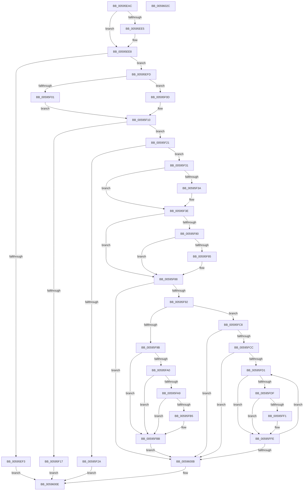

# IopRemovePageDumpRange

- RVA: `0x00595EAC`–`0x0059602D` (길이 `385` bytes)
- VA: `0x0000000140595EAC`
- 실행 섹션: `.text`
- PDB 이름 있음: `예`; PDB Function 태그: `아니요`
- unwind 정보 RVA: `0x00092598`
- 디코드: `118`개 명령, `385/385` bytes 표시
- 미해석 바이트: `0` (있으면 어셈블리에 `.byte`로 보존)

> 이 문서는 커널 이미지의 기계어와 PDB 기호를 분석해 생성했습니다. 4번과 5번은 함수 원형과 자료형을 바이너리 사용 방식에서 추정한 C 해석이며 원본 소스 복구 결과는 아닙니다.

## 1. Dependencies

- 직접 호출 지점: **5**; 고유 호출 대상: **4**
- 직접 호출자로 확인된 함수: **2**
- RIP 상대 이미지 참조: **2**

### Outgoing calls
- `0x00595F74` → [IoFreeDumpRange](IoFreeDumpRange_function_005927B0.md) (function, `0x005927B0`)
- `0x00595FC1` → [IopAddAddressRangeToRemovePagesArray](../5A/IopAddAddressRangeToRemovePagesArray_function_005A1260.md) (function, `0x005A1260`)
- `0x00595FD6` → [MmIsAddressValidEx](../27/MmIsAddressValidEx_function_0027FDD0.md) (function, `0x0027FDD0`)
- `0x00595FE2` → [MmGetPhysicalAddress](../23/MmGetPhysicalAddress_function_0023A500.md) (function, `0x0023A500`)
- `0x00595FF9` → [IopAddAddressRangeToRemovePagesArray](../5A/IopAddAddressRangeToRemovePagesArray_function_005A1260.md) (function, `0x005A1260`)

### Direct callers
- [IopDumpCallRemovePagesCallbacks](IopDumpCallRemovePagesCallbacks_function_00594B44.md) at `0x00594C38`
- [IopRemoveLargeAllocsFromPartialDump](../5A/IopRemoveLargeAllocsFromPartialDump_function_005A2480.md) at `0x005A24C0`

### Static image references
- `0x00595F3E` → RVA `0x00E66050` (`.data`; read)
- `0x00595F88` → RVA `0x00E661A0` (`.data`; read)

## 2. Other-region calls and transfers

- 다른 실행 섹션으로 향하는 call: **0**
- 별도 외부 분기/꼬리 이동을 확인하지 못했습니다.

## 3. Assembly (complete function range)

```asm
00595EAC  48 8B C4                        mov rax, rsp
00595EAF  48 89 58 08                     mov qword ptr [rax + 8], rbx
00595EB3  48 89 70 10                     mov qword ptr [rax + 0x10], rsi
00595EB7  48 89 78 18                     mov qword ptr [rax + 0x18], rdi
00595EBB  4C 89 60 20                     mov qword ptr [rax + 0x20], r12
00595EBF  55                              push rbp
00595EC0  41 56                           push r14
00595EC2  41 57                           push r15
00595EC4  48 8B EC                        mov rbp, rsp
00595EC7  48 83 EC 60                     sub rsp, 0x60
00595ECB  0F 57 C0                        xorps xmm0, xmm0
00595ECE  4C 8B F2                        mov r14, rdx
00595ED1  48 8B F1                        mov rsi, rcx
00595ED4  0F 11 45 D0                     movups xmmword ptr [rbp - 0x30], xmm0
00595ED8  0F 11 45 E0                     movups xmmword ptr [rbp - 0x20], xmm0
00595EDC  0F 11 45 F0                     movups xmmword ptr [rbp - 0x10], xmm0
00595EE0  48 85 D2                        test rdx, rdx
00595EE3  74 03                           je 0x140595ee8
00595EE5  C6 02 00                        mov byte ptr [rdx], 0
00595EE8  8B 59 08                        mov ebx, dword ptr [rcx + 8]
00595EEB  F7 C3 FC FF FF 7F               test ebx, 0x7ffffffc
00595EF1  74 0A                           je 0x140595efd
00595EF3  B8 F2 00 00 C0                  mov eax, 0xc00000f2
00595EF8  E9 11 01 00 00                  jmp 0x14059600e
00595EFD  85 DB                           test ebx, ebx
00595EFF  79 0C                           jns 0x140595f0d
00595F01  0F BA F3 1F                     btr ebx, 0x1f
00595F05  41 B7 01                        mov r15b, 1
00595F08  89 59 08                        mov dword ptr [rcx + 8], ebx
00595F0B  EB 03                           jmp 0x140595f10
00595F0D  45 32 FF                        xor r15b, r15b
00595F10  8D 43 FF                        lea eax, [rbx - 1]
00595F13  85 C3                           test ebx, eax
00595F15  74 0A                           je 0x140595f21
00595F17  B8 0D 00 00 C0                  mov eax, 0xc000000d
00595F1C  E9 ED 00 00 00                  jmp 0x14059600e
00595F21  4C 8B 41 18                     mov r8, qword ptr [rcx + 0x18]
00595F25  4D 85 C0                        test r8, r8
00595F28  75 07                           jne 0x140595f31
00595F2A  33 C0                           xor eax, eax
00595F2C  E9 DD 00 00 00                  jmp 0x14059600e
00595F31  48 8B 79 10                     mov rdi, qword ptr [rcx + 0x10]
00595F35  83 E3 01                        and ebx, 1
00595F38  75 04                           jne 0x140595f3e
00595F3A  48 C1 EF 0C                     shr rdi, 0xc
00595F3E  48 8B 05 0B 01 8D 00            mov rax, qword ptr [rip + 0x8d010b]
00595F45  83 F3 01                        xor ebx, 1
00595F48  83 4D F8 01                     or dword ptr [rbp - 8], 1
00595F4C  03 DB                           add ebx, ebx
00595F4E  44 8B CB                        mov r9d, ebx
00595F51  48 8B D7                        mov rdx, rdi
00595F54  48 8B 48 08                     mov rcx, qword ptr [rax + 8]
00595F58  48 8B 41 30                     mov rax, qword ptr [rcx + 0x30]
00595F5C  48 89 45 C0                     mov qword ptr [rbp - 0x40], rax
00595F60  48 8D 41 38                     lea rax, [rcx + 0x38]
00595F64  48 89 45 C8                     mov qword ptr [rbp - 0x38], rax
00595F68  48 8D 4D D0                     lea rcx, [rbp - 0x30]
00595F6C  48 8D 45 C0                     lea rax, [rbp - 0x40]
00595F70  48 89 45 E0                     mov qword ptr [rbp - 0x20], rax
00595F74  E8 37 C8 FF FF                  call 0x1405927b0
00595F79  44 8B E0                        mov r12d, eax
00595F7C  85 C0                           test eax, eax
00595F7E  78 08                           js 0x140595f88
00595F80  4D 85 F6                        test r14, r14
00595F83  74 03                           je 0x140595f88
00595F85  45 88 3E                        mov byte ptr [r14], r15b
00595F88  48 83 3D 10 02 8D 00 00         cmp qword ptr [rip + 0x8d0210], 0
00595F90  74 79                           je 0x14059600b
00595F92  48 8B 76 18                     mov rsi, qword ptr [rsi + 0x18]
00595F96  83 FB 02                        cmp ebx, 2
00595F99  75 2D                           jne 0x140595fc8
00595F9B  48 85 F6                        test rsi, rsi
00595F9E  74 1B                           je 0x140595fbb
00595FA0  48 8B 4D C0                     mov rcx, qword ptr [rbp - 0x40]
00595FA4  48 3B F9                        cmp rdi, rcx
00595FA7  73 12                           jae 0x140595fbb
00595FA9  48 8D 46 FF                     lea rax, [rsi - 1]
00595FAD  48 03 C7                        add rax, rdi
00595FB0  48 3B C1                        cmp rax, rcx
00595FB3  72 06                           jb 0x140595fbb
00595FB5  48 8B F1                        mov rsi, rcx
00595FB8  48 2B F7                        sub rsi, rdi
00595FBB  48 8B D6                        mov rdx, rsi
00595FBE  48 8B CF                        mov rcx, rdi
00595FC1  E8 9A B2 00 00                  call 0x1405a1260
00595FC6  EB 43                           jmp 0x14059600b
00595FC8  85 DB                           test ebx, ebx
00595FCA  75 3F                           jne 0x14059600b
00595FCC  48 85 F6                        test rsi, rsi
00595FCF  74 3A                           je 0x14059600b
00595FD1  33 D2                           xor edx, edx
00595FD3  48 8B CF                        mov rcx, rdi
00595FD6  E8 F5 9D CE FF                  call 0x14027fdd0
00595FDB  84 C0                           test al, al
00595FDD  74 1F                           je 0x140595ffe
00595FDF  48 8B CF                        mov rcx, rdi
00595FE2  E8 19 45 CA FF                  call 0x14023a500
00595FE7  48 C1 E8 0C                     shr rax, 0xc
00595FEB  48 3B 45 C0                     cmp rax, qword ptr [rbp - 0x40]
00595FEF  73 0D                           jae 0x140595ffe
00595FF1  BA 01 00 00 00                  mov edx, 1
00595FF6  48 8B C8                        mov rcx, rax
00595FF9  E8 62 B2 00 00                  call 0x1405a1260
00595FFE  48 81 C7 00 10 00 00            add rdi, 0x1000
00596005  48 83 EE 01                     sub rsi, 1
00596009  75 C6                           jne 0x140595fd1
0059600B  41 8B C4                        mov eax, r12d
0059600E  4C 8D 5C 24 60                  lea r11, [rsp + 0x60]
00596013  49 8B 5B 20                     mov rbx, qword ptr [r11 + 0x20]
00596017  49 8B 73 28                     mov rsi, qword ptr [r11 + 0x28]
0059601B  49 8B 7B 30                     mov rdi, qword ptr [r11 + 0x30]
0059601F  4D 8B 63 38                     mov r12, qword ptr [r11 + 0x38]
00596023  49 8B E3                        mov rsp, r11
00596026  41 5F                           pop r15
00596028  41 5E                           pop r14
0059602A  5D                              pop rbp
0059602B  C3                              ret
0059602C  CC                              int3
```

## 4. C-style interpretation (structured pseudocode)

```c
__int64 __fastcall IopRemovePageDumpRange(__int64 a1, __int64 a2)
{
    __int64 result;
    __int64 v_r15;
    __int64 v_rbx;
    __int64 v_rdi;
    __int64 v_rsi;
    __int64 v_rsp;
    unsigned __int64 v_stack_m18;
    unsigned int v_stack_m20;
    unsigned __int64 v_stack_m28;
    unsigned __int64 v_stack_m38;
    unsigned __int64 v_stack_m48;
    unsigned __int64 v_stack_m50;
    unsigned __int64 v_stack_m58;

    *(unsigned __int64 *)(v_rsp + 8) = v_rbx;
    *(unsigned __int64 *)(v_rsp + 16) = v_rsi;
    *(unsigned __int64 *)(v_rsp + 24) = v_rdi;
    *(unsigned __int64 *)(v_rsp + 32) = v_r12;
    v_rsp = (v_rsp) - (96);
    v_stack_m48 = v_xmm0;
    v_stack_m38 = v_xmm0;
    v_stack_m28 = v_xmm0;
    if (a2 != 0) {
        *(unsigned __int8 *)(a2) = 0;
    }
    if ((((unsigned int)((unsigned int)(*(unsigned int *)(a1 + 8)))) & (0x7FFFFFFCULL)) == 0) goto loc_00595EFD;
    goto loc_0059600E;
loc_00595EFD:
    if (!sign_flag) goto loc_00595F0D;
    *(unsigned int *)(a1 + 8) = (unsigned int)((unsigned int)(*(unsigned int *)(a1 + 8)));
    goto loc_00595F10;
loc_00595F0D:
    v_r15 = 0;
loc_00595F10:
    if ((((unsigned int)((unsigned int)(*(unsigned int *)(a1 + 8)))) & ((unsigned int)((unsigned int)(*(unsigned int *)(a1 + 8)) - 1))) == 0) goto loc_00595F21;
    goto loc_0059600E;
loc_00595F21:
    if (*(unsigned __int64 *)(a1 + 24) != 0) goto loc_00595F31;
    result = 0;
    goto loc_0059600E;
loc_00595F31:
    v_rbx = (unsigned int)(((unsigned int)(*(unsigned int *)(a1 + 8))) & (1));
    v_rdi = *(unsigned __int64 *)(a1 + 16);
    if (!(condition_is_not_equal)) {
        v_rdi = (*(unsigned __int64 *)(a1 + 16)) >> (12);
    }
    v_rbx = (unsigned int)((v_rbx) ^ (1));
    v_rbx = (unsigned int)((v_rbx) + ((unsigned int)(v_rbx)));
    v_stack_m58 = *(unsigned __int64 *)(*(unsigned __int64 *)(*(unsigned __int64 *)(v_rip + 9240843) + 8) + 48);
    v_stack_m50 = *(unsigned __int64 *)(*(unsigned __int64 *)(v_rip + 9240843) + 8) + 56;
    v_stack_m38 = v_stack_m58;
    result = IoFreeDumpRange(v_stack_m48, v_rdi, *(unsigned __int64 *)(a1 + 24), (unsigned int)((unsigned int)(v_rbx)));
    if (sign_flag) goto loc_00595F88;
    if (a2 != 0) {
        *(unsigned __int8 *)(a2) = 0;
    }
    if ((*(unsigned __int64 *)(v_rip + 9241104)) == 0) goto loc_0059600B;
    if (((unsigned int)(v_rbx)) != 2) goto loc_00595FC8;
    if (*(unsigned __int64 *)(a1 + 24) == 0) goto loc_00595FBB;
    if (v_rdi >= v_stack_m58) goto loc_00595FBB;
    result = (*(unsigned __int64 *)(a1 + 24) - 1) + (v_rdi);
    v_rsi = *(unsigned __int64 *)(a1 + 24);
    if (result >= v_stack_m58) {
        v_rsi = v_stack_m58;
        v_rsi = (v_rsi) - (v_rdi);
    }
    result = IopAddAddressRangeToRemovePagesArray(v_rdi, v_rsi, *(unsigned __int64 *)(a1 + 24), (unsigned int)((unsigned int)(v_rbx)));
    goto loc_0059600B;
loc_00595FC8:
    if ((unsigned int)(v_rbx) != 0) goto loc_0059600B;
    if (v_rsi == 0) goto loc_0059600B;
loc_00595FD1:
    a2 = 0;
    result = MmIsAddressValidEx(v_rdi, a2, *(unsigned __int64 *)(a1 + 24), (unsigned int)((unsigned int)(v_rbx)));
    if ((unsigned __int8)(result) == 0) goto loc_00595FFE;
    result = MmGetPhysicalAddress(v_rdi, a2, *(unsigned __int64 *)(a1 + 24), (unsigned int)((unsigned int)(v_rbx)));
    result = (result) >> (12);
    if (result < v_stack_m58) {
        a2 = 1;
        a1 = result;
        result = IopAddAddressRangeToRemovePagesArray(a1, a2, *(unsigned __int64 *)(a1 + 24), (unsigned int)((unsigned int)(v_rbx)));
    }
    v_rdi = (v_rdi) + (0x1000ULL);
    v_rsi = (v_rsi) - (1);
    if (condition_is_not_equal) goto loc_00595FD1;
loc_0059600B:
loc_0059600E:
    return (unsigned int)((unsigned int)((unsigned int)((unsigned int)(result))));
}
```

## 5. (Beta) C Style

```c
int64_t IopRemovePageDumpRange(void *Arg1, int64_t Arg2)
{
    uint8_t *arg1 = (uint8_t *)Arg1;

    int64_t result;
    int64_t local_r15;
    int64_t local_rbx;
    int64_t local_rdi;
    int64_t local_rsi;
    int64_t local_rsp;
    uint64_t v_stack_m18;
    uint32_t v_stack_m20;
    uint64_t v_stack_m28;
    uint64_t v_stack_m38;
    uint64_t v_stack_m48;
    uint64_t v_stack_m50;
    uint64_t v_stack_m58;

    *(uint64_t *)(local_rsp + 0x8) = local_rbx;
    *(uint64_t *)(local_rsp + 0x10) = local_rsi;
    *(uint64_t *)(local_rsp + 0x18) = local_rdi;
    *(uint64_t *)(local_rsp + 0x20) = local_r12;
    local_rsp = (local_rsp) - (96);
    v_stack_m48 = v_xmm0;
    v_stack_m38 = v_xmm0;
    v_stack_m28 = v_xmm0;
    if (Arg2 != 0) {
        *(uint8_t *)(Arg2) = 0;
    }
    if ((((uint32_t)((uint32_t)(*(uint32_t *)(arg1 + 0x8)))) & (0x7FFFFFFCULL)) == 0) goto loc_00595EFD;
    goto loc_0059600E;
loc_00595EFD:
    if (!sign_flag) goto loc_00595F0D;
    *(uint32_t *)(arg1 + 0x8) = (uint32_t)((uint32_t)(*(uint32_t *)(arg1 + 0x8)));
    goto loc_00595F10;
loc_00595F0D:
    local_r15 = 0;
loc_00595F10:
    if ((((uint32_t)((uint32_t)(*(uint32_t *)(arg1 + 0x8)))) & ((uint32_t)((uint32_t)(*(uint32_t *)(arg1 + 0x8)) - 1))) == 0) goto loc_00595F21;
    goto loc_0059600E;
loc_00595F21:
    if (*(uint64_t *)(arg1 + 0x18) != 0) goto loc_00595F31;
    result = 0;
    goto loc_0059600E;
loc_00595F31:
    local_rbx = (uint32_t)(((uint32_t)(*(uint32_t *)(arg1 + 0x8))) & (1));
    local_rdi = *(uint64_t *)(arg1 + 0x10);
    if (!(condition_is_not_equal)) {
        local_rdi = (*(uint64_t *)(arg1 + 0x10)) >> (12);
    }
    local_rbx = (uint32_t)((local_rbx) ^ (1));
    local_rbx = (uint32_t)((local_rbx) + ((uint32_t)(local_rbx)));
    v_stack_m58 = *(uint64_t *)(*(uint64_t *)(*(uint64_t *)(v_rip + 0x8D010B) + 0x8) + 0x30);
    v_stack_m50 = *(uint64_t *)(*(uint64_t *)(v_rip + 0x8D010B) + 0x8) + 56;
    v_stack_m38 = v_stack_m58;
    result = IoFreeDumpRange(v_stack_m48, local_rdi, *(uint64_t *)(arg1 + 0x18), (uint32_t)((uint32_t)(local_rbx)));
    if (sign_flag) goto loc_00595F88;
    if (Arg2 != 0) {
        *(uint8_t *)(Arg2) = 0;
    }
    if ((*(uint64_t *)(v_rip + 0x8D0210)) == 0) goto loc_0059600B;
    if (((uint32_t)(local_rbx)) != 2) goto loc_00595FC8;
    if (*(uint64_t *)(arg1 + 0x18) == 0) goto loc_00595FBB;
    if (local_rdi >= v_stack_m58) goto loc_00595FBB;
    result = (*(uint64_t *)(arg1 + 0x18) - 1) + (local_rdi);
    local_rsi = *(uint64_t *)(arg1 + 0x18);
    if (result >= v_stack_m58) {
        local_rsi = v_stack_m58;
        local_rsi = (local_rsi) - (local_rdi);
    }
    result = IopAddAddressRangeToRemovePagesArray(local_rdi, local_rsi, *(uint64_t *)(arg1 + 0x18), (uint32_t)((uint32_t)(local_rbx)));
    goto loc_0059600B;
loc_00595FC8:
    if ((uint32_t)(local_rbx) != 0) goto loc_0059600B;
    if (local_rsi == 0) goto loc_0059600B;
loc_00595FD1:
    Arg2 = 0;
    result = MmIsAddressValidEx(local_rdi, Arg2, *(uint64_t *)(arg1 + 0x18), (uint32_t)((uint32_t)(local_rbx)));
    if ((uint8_t)(result) == 0) goto loc_00595FFE;
    result = MmGetPhysicalAddress(local_rdi, Arg2, *(uint64_t *)(arg1 + 0x18), (uint32_t)((uint32_t)(local_rbx)));
    result = (result) >> (12);
    if (result < v_stack_m58) {
        Arg2 = 1;
        Arg1 = result;
        result = IopAddAddressRangeToRemovePagesArray(Arg1, Arg2, *(uint64_t *)(arg1 + 0x18), (uint32_t)((uint32_t)(local_rbx)));
    }
    local_rdi = (local_rdi) + (0x1000ULL);
    local_rsi = (local_rsi) - (1);
    if (condition_is_not_equal) goto loc_00595FD1;
loc_0059600B:
loc_0059600E:
    return (uint32_t)((uint32_t)((uint32_t)((uint32_t)(result))));
}
```

### 관측된 메모리 오프셋

구조체 형식이 확인되지 않은 접근은 인자 기준의 오프셋으로만 기록했습니다.

| 기준 인자 | 오프셋 표현 | 폭 (bit) | 접근 |
|---|---:|---:|---|
| `Arg1` | `+ 0x8` | `32` | `R` |
| `Arg1` | `+ 0x8` | `32` | `W` |
| `Arg1` | `+ 0x10` | `64` | `R` |
| `Arg1` | `+ 0x18` | `64` | `R` |

## 6. Execution-region graph

[열기: 2D/3D 그래프와 함수 탐색 컨트롤 패널](../../../control-panel.html?section=text&rva=0x00595EAC&view=graph)

- 2D 그래프는 위에서 아래로 흐르고, 3D 그래프는 빈 공간을 드래그해 회전합니다. Shift+드래그는 이동, 휠은 확대·축소, 함수 노드 선택은 대상 보고서 이동입니다.

### Static fallback


