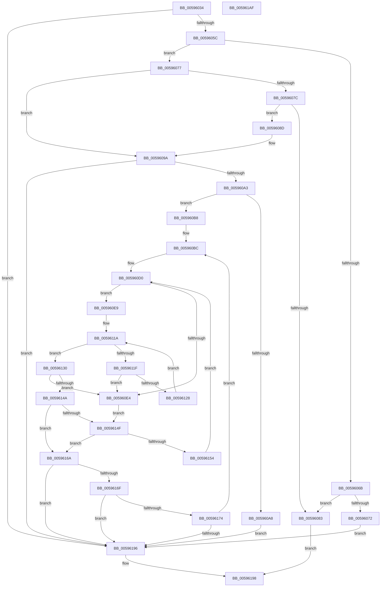

# IopRemovePageFromPageMap

- RVA: `0x00596034`–`0x005961B0` (길이 `380` bytes)
- VA: `0x0000000140596034`
- 실행 섹션: `.text`
- PDB 이름 있음: `예`; PDB Function 태그: `아니요`
- unwind 정보 RVA: `0x000C4178`
- 디코드: `117`개 명령, `380/380` bytes 표시
- 미해석 바이트: `0` (있으면 어셈블리에 `.byte`로 보존)

> 이 문서는 커널 이미지의 기계어와 PDB 기호를 분석해 생성했습니다. 4번과 5번은 함수 원형과 자료형을 바이너리 사용 방식에서 추정한 C 해석이며 원본 소스 복구 결과는 아닙니다.

## 1. Dependencies

- 직접 호출 지점: **2**; 고유 호출 대상: **1**
- 직접 호출자로 확인된 함수: **1**
- RIP 상대 이미지 참조: **0**

### Outgoing calls
- `0x005960AE` → [RtlClearBitsEx](../29/RtlClearBitsEx_function_00297740.md) (function, `0x00297740`)
- `0x00596180` → [RtlClearBitsEx](../29/RtlClearBitsEx_function_00297740.md) (function, `0x00297740`)

### Direct callers
- [IoFreeDumpRange](IoFreeDumpRange_function_005927B0.md) at `0x0059281B`
- [IoFreeDumpRange](IoFreeDumpRange_function_005927B0.md) at `0x00592861`

### Static image references
- 디코드된 RIP-relative 메모리 참조가 없습니다.

## 2. Other-region calls and transfers

- 다른 실행 섹션으로 향하는 call: **0**
- 별도 외부 분기/꼬리 이동을 확인하지 못했습니다.

## 3. Assembly (complete function range)

```asm
00596034  48 89 5C 24 08                  mov qword ptr [rsp + 8], rbx
00596039  48 89 6C 24 10                  mov qword ptr [rsp + 0x10], rbp
0059603E  56                              push rsi
0059603F  57                              push rdi
00596040  41 55                           push r13
00596042  41 56                           push r14
00596044  41 57                           push r15
00596046  48 83 EC 20                     sub rsp, 0x20
0059604A  4D 8B D0                        mov r10, r8
0059604D  48 8B EA                        mov rbp, rdx
00596050  48 8B F9                        mov rdi, rcx
00596053  4D 85 C9                        test r9, r9
00596056  0F 84 3A 01 00 00               je 0x140596196
0059605C  48 8B 01                        mov rax, qword ptr [rcx]
0059605F  49 8D 71 FF                     lea rsi, [r9 - 1]
00596063  49 03 F0                        add rsi, r8
00596066  4C 3B C0                        cmp r8, rax
00596069  72 0C                           jb 0x140596077
0059606B  80 7C 24 70 00                  cmp byte ptr [rsp + 0x70], 0
00596070  74 11                           je 0x140596083
00596072  E9 1F 01 00 00                  jmp 0x140596196
00596077  48 3B F0                        cmp rsi, rax
0059607A  72 1E                           jb 0x14059609a
0059607C  80 7C 24 70 00                  cmp byte ptr [rsp + 0x70], 0
00596081  75 0A                           jne 0x14059608d
00596083  B8 41 01 00 C0                  mov eax, 0xc0000141
00596088  E9 0B 01 00 00                  jmp 0x140596198
0059608D  48 8D 70 FF                     lea rsi, [rax - 1]
00596091  4C 8B CE                        mov r9, rsi
00596094  4D 2B CA                        sub r9, r10
00596097  49 FF C1                        inc r9
0059609A  4D 85 C9                        test r9, r9
0059609D  0F 84 F3 00 00 00               je 0x140596196
005960A3  48 85 ED                        test rbp, rbp
005960A6  75 10                           jne 0x1405960b8
005960A8  4D 8B C1                        mov r8, r9
005960AB  49 8B D2                        mov rdx, r10
005960AE  E8 8D 16 D0 FF                  call 0x140297740
005960B3  E9 DE 00 00 00                  jmp 0x140596196
005960B8  49 83 CD FF                     or r13, 0xffffffffffffffff
005960BC  4C 8B 1F                        mov r11, qword ptr [rdi]
005960BF  4C 8B 7F 08                     mov r15, qword ptr [rdi + 8]
005960C3  4D 3B D3                        cmp r10, r11
005960C6  4D 1B C9                        sbb r9, r9
005960C9  4D 23 CA                        and r9, r10
005960CC  49 8D 53 FF                     lea rdx, [r11 - 1]
005960D0  83 64 24 68 00                  and dword ptr [rsp + 0x68], 0
005960D5  48 8B C2                        mov rax, rdx
005960D8  49 2B C1                        sub rax, r9
005960DB  48 FF C0                        inc rax
005960DE  48 83 F8 01                     cmp rax, 1
005960E2  73 05                           jae 0x1405960e9
005960E4  49 8B DD                        mov rbx, r13
005960E7  EB 66                           jmp 0x14059614f
005960E9  48 8B C2                        mov rax, rdx
005960EC  41 8A C9                        mov cl, r9b
005960EF  48 C1 E8 06                     shr rax, 6
005960F3  80 E1 3F                        and cl, 0x3f
005960F6  41 B8 01 00 00 00               mov r8d, 1
005960FC  49 D3 E0                        shl r8, cl
005960FF  49 FF C8                        dec r8
00596102  4D 8D 34 C7                     lea r14, [r15 + rax*8]
00596106  49 8B C1                        mov rax, r9
00596109  48 C1 E8 06                     shr rax, 6
0059610D  49 8D 1C C7                     lea rbx, [r15 + rax*8]
00596111  48 8B 03                        mov rax, qword ptr [rbx]
00596114  48 F7 D0                        not rax
00596117  4C 0B C0                        or r8, rax
0059611A  4D 3B C5                        cmp r8, r13
0059611D  75 11                           jne 0x140596130
0059611F  48 83 C3 08                     add rbx, 8
00596123  49 3B DE                        cmp rbx, r14
00596126  77 BC                           ja 0x1405960e4
00596128  4C 8B 03                        mov r8, qword ptr [rbx]
0059612B  49 F7 D0                        not r8
0059612E  EB EA                           jmp 0x14059611a
00596130  49 2B DF                        sub rbx, r15
00596133  49 F7 D0                        not r8
00596136  48 C1 FB 03                     sar rbx, 3
0059613A  49 0F BC C0                     bsf rax, r8
0059613E  48 C1 E3 06                     shl rbx, 6
00596142  48 03 D8                        add rbx, rax
00596145  48 3B DA                        cmp rbx, rdx
00596148  77 9A                           ja 0x1405960e4
0059614A  49 3B DD                        cmp rbx, r13
0059614D  75 1B                           jne 0x14059616a
0059614F  4D 85 C9                        test r9, r9
00596152  74 16                           je 0x14059616a
00596154  49 8D 52 01                     lea rdx, [r10 + 1]
00596158  49 3B D3                        cmp rdx, r11
0059615B  49 0F 47 D3                     cmova rdx, r11
0059615F  48 FF CA                        dec rdx
00596162  45 33 C9                        xor r9d, r9d
00596165  E9 66 FF FF FF                  jmp 0x1405960d0
0059616A  49 3B DA                        cmp rbx, r10
0059616D  72 27                           jb 0x140596196
0059616F  49 3B DD                        cmp rbx, r13
00596172  74 22                           je 0x140596196
00596174  41 B8 01 00 00 00               mov r8d, 1
0059617A  48 8B D3                        mov rdx, rbx
0059617D  48 8B CF                        mov rcx, rdi
00596180  E8 BB 15 D0 FF                  call 0x140297740
00596185  48 FF 45 00                     inc qword ptr [rbp]
00596189  4C 8D 53 01                     lea r10, [rbx + 1]
0059618D  4C 3B D6                        cmp r10, rsi
00596190  0F 86 26 FF FF FF               jbe 0x1405960bc
00596196  33 C0                           xor eax, eax
00596198  48 8B 5C 24 50                  mov rbx, qword ptr [rsp + 0x50]
0059619D  48 8B 6C 24 58                  mov rbp, qword ptr [rsp + 0x58]
005961A2  48 83 C4 20                     add rsp, 0x20
005961A6  41 5F                           pop r15
005961A8  41 5E                           pop r14
005961AA  41 5D                           pop r13
005961AC  5F                              pop rdi
005961AD  5E                              pop rsi
005961AE  C3                              ret
005961AF  CC                              int3
```

## 4. C-style interpretation (structured pseudocode)

```c
__int64 __fastcall IopRemovePageFromPageMap(__int64 a1, __int64 a2, __int64 a3, __int64 a4, unsigned __int8 a5)
{
    __int64 result;
    __int64 v_r13;
    __int64 v_rbx;
    __int64 v_rsi;
    __int64 v_rsp;
    unsigned __int64 v_stack_p10;
    unsigned int v_stack_p20;
    unsigned __int64 v_stack_p8;

    v_stack_p8 = v_rbx;
    v_stack_p10 = v_rbp;
    v_rsp = (v_rsp) - (32);
    if (a4 == 0) goto loc_00596196;
    v_rsi = (a4 - 1) + (a3);
    if (a3 < (*(unsigned __int64 *)(a1))) goto loc_00596077;
    if (a5 == 0) goto loc_00596083;
    goto loc_00596196;
loc_00596077:
    if (v_rsi < (*(unsigned __int64 *)(a1))) goto loc_0059609A;
    if (a5 != 0) goto loc_0059608D;
loc_00596083:
    goto loc_00596198;
loc_0059608D:
    a4 = ((unsigned int)(0xC0000141ULL) - 1) - (a3);
    a4 = (a4) + 1;
loc_0059609A:
    if (a4 == 0) goto loc_00596196;
    if (a2 != 0) goto loc_005960B8;
    result = RtlClearBitsEx(a1, a3, a4, a4);
    goto loc_00596196;
loc_005960B8:
    v_r13 = (v_r13) | (-1);
loc_005960BC:
    a4 = (a4) & (a3);
loc_005960D0:
    result = (*(unsigned __int64 *)(a1) - 1) - (a4);
    result = (result) + 1;
    if (result >= 1) goto loc_005960E9;
loc_005960E4:
    goto loc_0059614F;
loc_005960E9:
    result = (*(unsigned __int64 *)(a1) - 1) >> (6);
    a1 = (unsigned __int8)(((unsigned __int8)(a4)) & (63));
    a3 = (1) << ((unsigned __int8)(a1));
    a3 = (a3) - 1;
    result = (a4) >> (6);
    result = ~(*(unsigned __int64 *)(*(unsigned __int64 *)(a1 + 8) + result * 8));
    a3 = (a3) | (result);
loc_0059611A:
    if (a3 != v_r13) goto loc_00596130;
    v_rbx = (*(unsigned __int64 *)(a1 + 8) + result * 8) + (8);
    if (v_rbx > (*(unsigned __int64 *)(a1 + 8) + result * 8)) goto loc_005960E4;
    a3 = ~(*(unsigned __int64 *)(v_rbx));
    goto loc_0059611A;
loc_00596130:
    v_rbx = (v_rbx) - (*(unsigned __int64 *)(a1 + 8));
    a3 = ~(a3);
    v_rbx = (v_rbx) >> (3);
    v_rbx = (v_rbx) << (6);
    v_rbx = (v_rbx) + (result);
    if (v_rbx > (*(unsigned __int64 *)(a1) - 1)) goto loc_005960E4;
    if (v_rbx != v_r13) goto loc_0059616A;
loc_0059614F:
    if (a4 == 0) goto loc_0059616A;
    a2 = a3 + 1;
    if ((a3 + 1) > (*(unsigned __int64 *)(a1))) { a2 = *(unsigned __int64 *)(a1); }
    a2 = (a2) - 1;
    a4 = 0;
    goto loc_005960D0;
loc_0059616A:
    if (v_rbx < a3) goto loc_00596196;
    if (v_rbx == v_r13) goto loc_00596196;
    result = RtlClearBitsEx(a1, v_rbx, 1, a4);
    if ((v_rbx + 1) <= ((unsigned int)(0xC0000141ULL) - 1)) goto loc_005960BC;
loc_00596196:
    result = 0;
loc_00596198:
    v_rsp = (v_rsp) + (32);
    return result;
}
```

## 5. (Beta) C Style

```c
int64_t IopRemovePageFromPageMap(void *Arg1, int64_t Arg2, int64_t Arg3, int64_t Arg4, uint8_t Arg5)
{
    uint8_t *arg1 = (uint8_t *)Arg1;

    int64_t result;
    int64_t local_r13;
    int64_t local_rbx;
    int64_t local_rsi;
    int64_t local_rsp;
    uint64_t v_stack_p10;
    uint32_t v_stack_p20;
    uint64_t v_stack_p8;

    v_stack_p8 = local_rbx;
    v_stack_p10 = local_rbp;
    local_rsp = (local_rsp) - (32);
    if (Arg4 == 0) goto loc_00596196;
    local_rsi = (Arg4 - 1) + (Arg3);
    if (Arg3 < (*(uint64_t *)(arg1))) goto loc_00596077;
    if (Arg5 == 0) goto loc_00596083;
    goto loc_00596196;
loc_00596077:
    if (local_rsi < (*(uint64_t *)(arg1))) goto loc_0059609A;
    if (Arg5 != 0) goto loc_0059608D;
loc_00596083:
    goto loc_00596198;
loc_0059608D:
    Arg4 = ((uint32_t)(0xC0000141ULL) - 1) - (Arg3);
    Arg4 = (Arg4) + 1;
loc_0059609A:
    if (Arg4 == 0) goto loc_00596196;
    if (Arg2 != 0) goto loc_005960B8;
    result = RtlClearBitsEx(Arg1, Arg3, Arg4, Arg4);
    goto loc_00596196;
loc_005960B8:
    local_r13 = (local_r13) | (-1);
loc_005960BC:
    Arg4 = (Arg4) & (Arg3);
loc_005960D0:
    result = (*(uint64_t *)(arg1) - 1) - (Arg4);
    result = (result) + 1;
    if (result >= 1) goto loc_005960E9;
loc_005960E4:
    goto loc_0059614F;
loc_005960E9:
    result = (*(uint64_t *)(arg1) - 1) >> (6);
    Arg1 = (uint8_t)(((uint8_t)(Arg4)) & (63));
    Arg3 = (1) << ((uint8_t)(Arg1));
    Arg3 = (Arg3) - 1;
    result = (Arg4) >> (6);
    result = ~(*(uint64_t *)(*(uint64_t *)(arg1 + 0x8) + result * 8));
    Arg3 = (Arg3) | (result);
loc_0059611A:
    if (Arg3 != local_r13) goto loc_00596130;
    local_rbx = (*(uint64_t *)(arg1 + 0x8) + result * 8) + (8);
    if (local_rbx > (*(uint64_t *)(arg1 + 0x8) + result * 8)) goto loc_005960E4;
    Arg3 = ~(*(uint64_t *)(local_rbx));
    goto loc_0059611A;
loc_00596130:
    local_rbx = (local_rbx) - (*(uint64_t *)(arg1 + 0x8));
    Arg3 = ~(Arg3);
    local_rbx = (local_rbx) >> (3);
    local_rbx = (local_rbx) << (6);
    local_rbx = (local_rbx) + (result);
    if (local_rbx > (*(uint64_t *)(arg1) - 1)) goto loc_005960E4;
    if (local_rbx != local_r13) goto loc_0059616A;
loc_0059614F:
    if (Arg4 == 0) goto loc_0059616A;
    Arg2 = Arg3 + 1;
    if ((Arg3 + 1) > (*(uint64_t *)(arg1))) { Arg2 = *(uint64_t *)(arg1); }
    Arg2 = (Arg2) - 1;
    Arg4 = 0;
    goto loc_005960D0;
loc_0059616A:
    if (local_rbx < Arg3) goto loc_00596196;
    if (local_rbx == local_r13) goto loc_00596196;
    result = RtlClearBitsEx(Arg1, local_rbx, 1, Arg4);
    if ((local_rbx + 1) <= ((uint32_t)(0xC0000141ULL) - 1)) goto loc_005960BC;
loc_00596196:
    result = 0;
loc_00596198:
    local_rsp = (local_rsp) + (32);
    return result;
}
```

### 관측된 메모리 오프셋

구조체 형식이 확인되지 않은 접근은 인자 기준의 오프셋으로만 기록했습니다.

| 기준 인자 | 오프셋 표현 | 폭 (bit) | 접근 |
|---|---:|---:|---|
| `Arg1` | `+ 0x0` | `64` | `R` |
| `Arg1` | `+ 0x8` | `64` | `R` |

## 6. Execution-region graph

[열기: 2D/3D 그래프와 함수 탐색 컨트롤 패널](../../../control-panel.html?section=text&rva=0x00596034&view=graph)

- 2D 그래프는 위에서 아래로 흐르고, 3D 그래프는 빈 공간을 드래그해 회전합니다. Shift+드래그는 이동, 휠은 확대·축소, 함수 노드 선택은 대상 보고서 이동입니다.

### Static fallback


