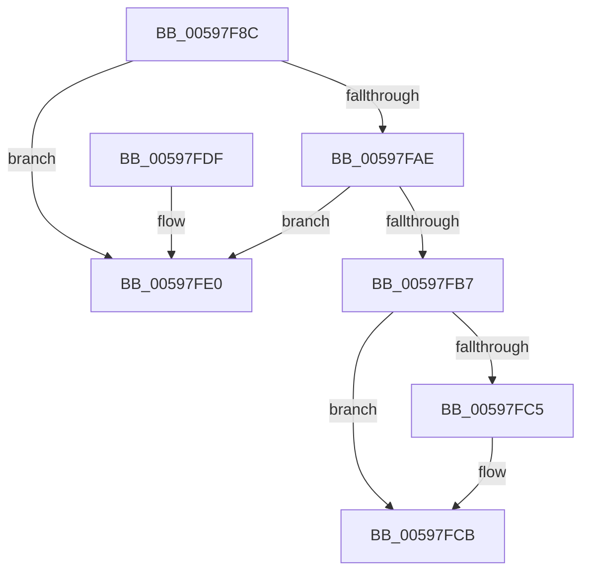

# IopRemoveTimerFromTimerList

- RVA: `0x00597F8C`–`0x00597FE7` (길이 `91` bytes)
- VA: `0x0000000140597F8C`
- 실행 섹션: `.text`
- PDB 이름 있음: `예`; PDB Function 태그: `아니요`
- unwind 정보 RVA: `0x0005DAC8`
- 디코드: `26`개 명령, `91/91` bytes 표시
- 미해석 바이트: `0` (있으면 어셈블리에 `.byte`로 보존)

> 이 문서는 커널 이미지의 기계어와 PDB 기호를 분석해 생성했습니다. 4번과 5번은 함수 원형과 자료형을 바이너리 사용 방식에서 추정한 C 해석이며 원본 소스 복구 결과는 아닙니다.

## 1. Dependencies

- 직접 호출 지점: **2**; 고유 호출 대상: **2**
- 직접 호출자로 확인된 함수: **1**
- RIP 상대 이미지 참조: **2**

### Outgoing calls
- `0x00597F9C` → [KeAcquireSpinLockRaiseToDpc](../20/KeAcquireSpinLockRaiseToDpc_function_00208470.md) (function, `0x00208470`)
- `0x00597FD4` → [KeReleaseSpinLock](../39/KeReleaseSpinLock_function_00392BA0.md) (function, `0x00392BA0`)

### Direct callers
- [IoDeleteDevice](../26/IoDeleteDevice_function_0026FE90.md) at `0x0026FFE0`

### Static image references
- `0x00597F95` → RVA `0x00FCF140` (`CACHEALI`; read)
- `0x00597FC5` → RVA `0x00F8D500` (`.data`; read/write)

## 2. Other-region calls and transfers

- 다른 실행 섹션으로 향하는 call: **0**
- 별도 외부 분기/꼬리 이동을 확인하지 못했습니다.

## 3. Assembly (complete function range)

```asm
00597F8C  40 53                           push rbx
00597F8E  48 83 EC 20                     sub rsp, 0x20
00597F92  48 8B D9                        mov rbx, rcx
00597F95  48 8D 0D A4 71 A3 00            lea rcx, [rip + 0xa371a4]
00597F9C  E8 CF 04 C7 FF                  call 0x140208470
00597FA1  4C 8D 43 08                     lea r8, [rbx + 8]
00597FA5  4D 8B 08                        mov r9, qword ptr [r8]
00597FA8  4D 39 41 08                     cmp qword ptr [r9 + 8], r8
00597FAC  75 32                           jne 0x140597fe0
00597FAE  49 8B 50 08                     mov rdx, qword ptr [r8 + 8]
00597FB2  4C 39 02                        cmp qword ptr [rdx], r8
00597FB5  75 29                           jne 0x140597fe0
00597FB7  4C 89 0A                        mov qword ptr [rdx], r9
00597FBA  49 89 51 08                     mov qword ptr [r9 + 8], rdx
00597FBE  66 83 7B 02 00                  cmp word ptr [rbx + 2], 0
00597FC3  74 06                           je 0x140597fcb
00597FC5  FF 0D 35 55 9F 00               dec dword ptr [rip + 0x9f5535]
00597FCB  8A D0                           mov dl, al
00597FCD  48 8D 0D 6C 71 A3 00            lea rcx, [rip + 0xa3716c]
00597FD4  E8 C7 AB DF FF                  call 0x140392ba0
00597FD9  48 83 C4 20                     add rsp, 0x20
00597FDD  5B                              pop rbx
00597FDE  C3                              ret
00597FDF  CC                              int3
00597FE0  B9 03 00 00 00                  mov ecx, 3
00597FE5  CD 29                           int 0x29
```

## 4. C-style interpretation (structured pseudocode)

```c
__int64 __fastcall IopRemoveTimerFromTimerList(__int64 a1)
{
    __int64 result;
    __int64 v_rsp;

    v_rsp = (v_rsp) - (32);
    result = KeAcquireSpinLockRaiseToDpc(v_rip + 10711460, a2, a3, a4);
    if ((*(unsigned __int64 *)(*(unsigned __int64 *)(a1 + 8) + 8)) != (a1 + 8)) goto loc_00597FE0;
    if ((*(unsigned __int64 *)(*(unsigned __int64 *)(a1 + 8 + 8))) != (a1 + 8)) goto loc_00597FE0;
    *(unsigned __int64 *)(*(unsigned __int64 *)(a1 + 8 + 8)) = *(unsigned __int64 *)(a1 + 8);
    *(unsigned __int64 *)(*(unsigned __int64 *)(a1 + 8) + 8) = *(unsigned __int64 *)(a1 + 8 + 8);
    if ((*(unsigned __int16 *)(a1 + 2)) != 0) {
    }
    result = KeReleaseSpinLock(v_rip + 10711404, (unsigned __int8)(result), a1 + 8, *(unsigned __int64 *)(a1 + 8));
    v_rsp = (v_rsp) + (32);
    return result;
loc_00597FE0:
    return result;
}
```

## 5. (Beta) C Style

```c
int64_t IopRemoveTimerFromTimerList(void *Arg1)
{
    uint8_t *arg1 = (uint8_t *)Arg1;

    int64_t result;
    int64_t local_rsp;

    local_rsp = (local_rsp) - (32);
    result = KeAcquireSpinLockRaiseToDpc(v_rip + 10711460, a2, a3, a4);
    if ((*(uint64_t *)(*(uint64_t *)(arg1 + 0x8) + 0x8)) != (Arg1 + 8)) goto loc_00597FE0;
    if ((*(uint64_t *)(*(uint64_t *)(arg1 + 0x8 + 0x8))) != (Arg1 + 8)) goto loc_00597FE0;
    *(uint64_t *)(*(uint64_t *)(arg1 + 0x8 + 0x8)) = *(uint64_t *)(arg1 + 0x8);
    *(uint64_t *)(*(uint64_t *)(arg1 + 0x8) + 0x8) = *(uint64_t *)(arg1 + 0x8 + 0x8);
    if ((*(uint16_t *)(arg1 + 0x2)) != 0) {
    }
    result = KeReleaseSpinLock(v_rip + 10711404, (uint8_t)(result), Arg1 + 8, *(uint64_t *)(arg1 + 0x8));
    local_rsp = (local_rsp) + (32);
    return result;
loc_00597FE0:
    return result;
}
```

### 관측된 메모리 오프셋

구조체 형식이 확인되지 않은 접근은 인자 기준의 오프셋으로만 기록했습니다.

| 기준 인자 | 오프셋 표현 | 폭 (bit) | 접근 |
|---|---:|---:|---|
| `Arg1` | `+ 0x0` | `64` | `R` |
| `Arg1` | `+ 0x2` | `16` | `R` |
| `Arg1` | `+ 0x8` | `64` | `R` |

## 6. Execution-region graph

[열기: 2D/3D 그래프와 함수 탐색 컨트롤 패널](../../../control-panel.html?section=text&rva=0x00597F8C&view=graph)

- 2D 그래프는 위에서 아래로 흐르고, 3D 그래프는 빈 공간을 드래그해 회전합니다. Shift+드래그는 이동, 휠은 확대·축소, 함수 노드 선택은 대상 보고서 이동입니다.

### Static fallback


