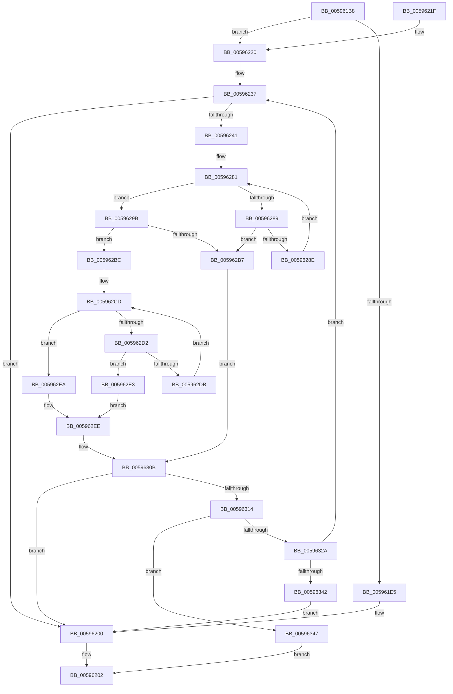

# IopSearchAndAddPageRangeToPageMaps

- RVA: `0x005961B8`–`0x0059635A` (길이 `418` bytes)
- VA: `0x00000001405961B8`
- 실행 섹션: `.text`
- PDB 이름 있음: `예`; PDB Function 태그: `아니요`
- unwind 정보 RVA: `0x000C7030`
- 디코드: `121`개 명령, `418/418` bytes 표시
- 미해석 바이트: `0` (있으면 어셈블리에 `.byte`로 보존)

> 이 문서는 커널 이미지의 기계어와 PDB 기호를 분석해 생성했습니다. 4번과 5번은 함수 원형과 자료형을 바이너리 사용 방식에서 추정한 C 해석이며 원본 소스 복구 결과는 아닙니다.

## 1. Dependencies

- 직접 호출 지점: **3**; 고유 호출 대상: **1**
- 직접 호출자로 확인된 함수: **2**
- RIP 상대 이미지 참조: **0**

### Outgoing calls
- `0x005961FB` → [IopAddPageRangeToPageMaps](IopAddPageRangeToPageMaps_function_005944B0.md) (function, `0x005944B0`)
- `0x0059632D` → [IopAddPageRangeToPageMaps](IopAddPageRangeToPageMaps_function_005944B0.md) (function, `0x005944B0`)
- `0x00596347` → [IopAddPageRangeToPageMaps](IopAddPageRangeToPageMaps_function_005944B0.md) (function, `0x005944B0`)

### Direct callers
- [IopAddPageToPageMap](IopAddPageToPageMap_function_00594594.md) at `0x0059461E`
- [IopFilterAndAddPageRangeToPageMaps](../5A/IopFilterAndAddPageRangeToPageMaps_function_005A1B3C.md) at `0x005A1BDB`
- [IopFilterAndAddPageRangeToPageMaps](../5A/IopFilterAndAddPageRangeToPageMaps_function_005A1B3C.md) at `0x005A1C21`

### Static image references
- 디코드된 RIP-relative 메모리 참조가 없습니다.

## 2. Other-region calls and transfers

- 다른 실행 섹션으로 향하는 call: **0**
- 별도 외부 분기/꼬리 이동을 확인하지 못했습니다.

## 3. Assembly (complete function range)

```asm
005961B8  48 89 5C 24 08                  mov qword ptr [rsp + 8], rbx
005961BD  48 89 6C 24 10                  mov qword ptr [rsp + 0x10], rbp
005961C2  48 89 74 24 20                  mov qword ptr [rsp + 0x20], rsi
005961C7  57                              push rdi
005961C8  41 54                           push r12
005961CA  41 55                           push r13
005961CC  41 56                           push r14
005961CE  41 57                           push r15
005961D0  48 83 EC 30                     sub rsp, 0x30
005961D4  4D 8B D1                        mov r10, r9
005961D7  4D 8B F0                        mov r14, r8
005961DA  48 8B EA                        mov rbp, rdx
005961DD  4C 8B F9                        mov r15, rcx
005961E0  4D 85 C0                        test r8, r8
005961E3  75 3B                           jne 0x140596220
005961E5  8B 84 24 88 00 00 00            mov eax, dword ptr [rsp + 0x88]
005961EC  4D 8B C2                        mov r8, r10
005961EF  4C 8B 8C 24 80 00 00 00         mov r9, qword ptr [rsp + 0x80]
005961F7  89 44 24 20                     mov dword ptr [rsp + 0x20], eax
005961FB  E8 B0 E2 FF FF                  call 0x1405944b0
00596200  33 C0                           xor eax, eax
00596202  48 8B 5C 24 60                  mov rbx, qword ptr [rsp + 0x60]
00596207  48 8B 6C 24 68                  mov rbp, qword ptr [rsp + 0x68]
0059620C  48 8B 74 24 78                  mov rsi, qword ptr [rsp + 0x78]
00596211  48 83 C4 30                     add rsp, 0x30
00596215  41 5F                           pop r15
00596217  41 5E                           pop r14
00596219  41 5D                           pop r13
0059621B  41 5C                           pop r12
0059621D  5F                              pop rdi
0059621E  C3                              ret
0059621F  CC                              int3
00596220  48 8B B4 24 80 00 00 00         mov rsi, qword ptr [rsp + 0x80]
00596228  4C 8B 6A 08                     mov r13, qword ptr [rdx + 8]
0059622C  49 03 F2                        add rsi, r10
0059622F  44 8B A4 24 88 00 00 00         mov r12d, dword ptr [rsp + 0x88]
00596237  83 64 24 70 00                  and dword ptr [rsp + 0x70], 0
0059623C  49 3B F2                        cmp rsi, r10
0059623F  76 BF                           jbe 0x140596200
00596241  33 FF                           xor edi, edi
00596243  48 8D 46 FF                     lea rax, [rsi - 1]
00596247  48 C1 E8 06                     shr rax, 6
0059624B  41 8A CA                        mov cl, r10b
0059624E  80 E1 3F                        and cl, 0x3f
00596251  4C 8D 0C C5 00 00 00 00         lea r9, [rax*8]
00596259  49 8B C2                        mov rax, r10
0059625C  48 C1 E8 06                     shr rax, 6
00596260  4D 03 CD                        add r9, r13
00596263  48 8D 14 C5 00 00 00 00         lea rdx, [rax*8]
0059626B  49 03 D5                        add rdx, r13
0059626E  8D 47 01                        lea eax, [rdi + 1]
00596271  48 D3 E0                        shl rax, cl
00596274  48 FF C8                        dec rax
00596277  4C 8B 02                        mov r8, qword ptr [rdx]
0059627A  4C 0B C0                        or r8, rax
0059627D  48 8D 42 08                     lea rax, [rdx + 8]
00596281  49 F7 D0                        not r8
00596284  4D 85 C0                        test r8, r8
00596287  75 12                           jne 0x14059629b
00596289  49 3B C1                        cmp rax, r9
0059628C  77 29                           ja 0x1405962b7
0059628E  48 83 C2 08                     add rdx, 8
00596292  48 83 C0 08                     add rax, 8
00596296  4C 8B 02                        mov r8, qword ptr [rdx]
00596299  EB E6                           jmp 0x140596281
0059629B  49 0F BC C8                     bsf rcx, r8
0059629F  48 8B DA                        mov rbx, rdx
005962A2  49 2B DD                        sub rbx, r13
005962A5  8B C1                           mov eax, ecx
005962A7  48 C1 FB 03                     sar rbx, 3
005962AB  48 C1 E3 06                     shl rbx, 6
005962AF  48 03 D8                        add rbx, rax
005962B2  48 3B DE                        cmp rbx, rsi
005962B5  76 05                           jbe 0x1405962bc
005962B7  48 8B DE                        mov rbx, rsi
005962BA  EB 4F                           jmp 0x14059630b
005962BC  B8 01 00 00 00                  mov eax, 1
005962C1  48 D3 E0                        shl rax, cl
005962C4  48 FF C8                        dec rax
005962C7  49 0B C0                        or rax, r8
005962CA  48 F7 D0                        not rax
005962CD  48 85 C0                        test rax, rax
005962D0  75 18                           jne 0x1405962ea
005962D2  48 8D 42 08                     lea rax, [rdx + 8]
005962D6  49 3B C1                        cmp rax, r9
005962D9  77 08                           ja 0x1405962e3
005962DB  48 8B D0                        mov rdx, rax
005962DE  48 8B 00                        mov rax, qword ptr [rax]
005962E1  EB EA                           jmp 0x1405962cd
005962E3  B8 40 00 00 00                  mov eax, 0x40
005962E8  EB 04                           jmp 0x1405962ee
005962EA  48 0F BC C0                     bsf rax, rax
005962EE  49 2B D5                        sub rdx, r13
005962F1  8B C8                           mov ecx, eax
005962F3  48 C1 FA 03                     sar rdx, 3
005962F7  48 8B FE                        mov rdi, rsi
005962FA  48 C1 E2 06                     shl rdx, 6
005962FE  48 03 CA                        add rcx, rdx
00596301  48 3B CE                        cmp rcx, rsi
00596304  48 0F 46 F9                     cmovbe rdi, rcx
00596308  48 2B FB                        sub rdi, rbx
0059630B  48 85 FF                        test rdi, rdi
0059630E  0F 84 EC FE FF FF               je 0x140596200
00596314  4D 8B 0E                        mov r9, qword ptr [r14]
00596317  4C 8B C3                        mov r8, rbx
0059631A  44 89 64 24 20                  mov dword ptr [rsp + 0x20], r12d
0059631F  48 8B D5                        mov rdx, rbp
00596322  49 8B CF                        mov rcx, r15
00596325  49 3B F9                        cmp rdi, r9
00596328  77 1D                           ja 0x140596347
0059632A  4C 8B CF                        mov r9, rdi
0059632D  E8 7E E1 FF FF                  call 0x1405944b0
00596332  49 29 3E                        sub qword ptr [r14], rdi
00596335  4C 8D 14 1F                     lea r10, [rdi + rbx]
00596339  4C 3B D6                        cmp r10, rsi
0059633C  0F 82 F5 FE FF FF               jb 0x140596237
00596342  E9 B9 FE FF FF                  jmp 0x140596200
00596347  E8 64 E1 FF FF                  call 0x1405944b0
0059634C  49 83 26 00                     and qword ptr [r14], 0
00596350  B8 23 00 00 C0                  mov eax, 0xc0000023
00596355  E9 A8 FE FF FF                  jmp 0x140596202
```

## 4. C-style interpretation (structured pseudocode)

```c
__int64 __fastcall IopSearchAndAddPageRangeToPageMaps(__int64 a1, __int64 a2, __int64 a3, __int64 a4, __int64 a5, unsigned int a6)
{
    __int64 result;
    __int64 v_rbx;
    __int64 v_rdi;
    __int64 v_rsi;
    __int64 v_rsp;
    unsigned int v_stack_m38;
    unsigned __int64 v_stack_p10;
    unsigned __int64 v_stack_p20;
    unsigned int v_stack_p70;
    unsigned __int64 v_stack_p8;

    v_stack_p8 = v_rbx;
    v_stack_p10 = v_rbp;
    v_stack_p20 = v_rsi;
    v_rsp = (v_rsp) - (48);
    if (a3 != 0) goto loc_00596220;
    v_stack_m38 = (unsigned int)((unsigned int)(a6));
    result = IopAddPageRangeToPageMaps(a1, a2, a4, a5);
loc_00596200:
    result = 0;
loc_00596202:
    v_rsp = (v_rsp) + (48);
    return result;
loc_00596220:
    v_rsi = (a5) + (a4);
loc_00596237:
    if (v_rsi <= a4) goto loc_00596200;
    v_rdi = 0;
    result = (v_rsi - 1) >> (6);
    a1 = (unsigned __int8)(((unsigned __int8)(a4)) & (63));
    result = (a4) >> (6);
    a4 = (result * 8) + (*(unsigned __int64 *)(a2 + 8));
    a2 = (result * 8) + (*(unsigned __int64 *)(a2 + 8));
    result = (v_rdi + 1) << ((unsigned __int8)(a1));
    result = (result) - 1;
    a3 = (*(unsigned __int64 *)(a2)) | (result);
loc_00596281:
    a3 = ~(a3);
    if (a3 != 0) goto loc_0059629B;
    if ((a2 + 8) > a4) goto loc_005962B7;
    a2 = (a2) + (8);
    result = (a2 + 8) + (8);
    goto loc_00596281;
loc_0059629B:
    v_rbx = (a2) - (*(unsigned __int64 *)(a2 + 8));
    v_rbx = (v_rbx) >> (3);
    v_rbx = (v_rbx) << (6);
    v_rbx = (v_rbx) + ((unsigned int)((unsigned int)(a1)));
    if (v_rbx <= v_rsi) goto loc_005962BC;
loc_005962B7:
    goto loc_0059630B;
loc_005962BC:
    result = (1) << ((unsigned __int8)(a1));
    result = (result) - 1;
    result = (result) | (*(unsigned __int64 *)(a2));
    result = ~(result);
loc_005962CD:
    if (result != 0) goto loc_005962EA;
    if ((a2 + 8) > a4) goto loc_005962E3;
    goto loc_005962CD;
loc_005962E3:
    goto loc_005962EE;
loc_005962EA:
loc_005962EE:
    a2 = (a2 + 8) - (*(unsigned __int64 *)(a2 + 8));
    a2 = (a2) >> (3);
    a2 = (a2) << (6);
    a1 = (64) + (a2);
    v_rdi = v_rsi;
    if (a1 <= v_rsi) { v_rdi = a1; }
    v_rdi = (v_rdi) - (v_rsi);
loc_0059630B:
    if (v_rdi == 0) goto loc_00596200;
    v_stack_p20 = (unsigned int)((unsigned int)(a6));
    if (v_rdi > (*(unsigned __int64 *)(a3))) goto loc_00596347;
    result = IopAddPageRangeToPageMaps(a1, v_stack_p10, v_rsi, v_rdi);
    if ((v_rdi + v_rsi * 1) < v_rsi) goto loc_00596237;
    goto loc_00596200;
loc_00596347:
    result = IopAddPageRangeToPageMaps(a1, v_stack_p10, v_rsi, v_rdi);
    goto loc_00596202;
}
```

## 5. (Beta) C Style

```c
int64_t IopSearchAndAddPageRangeToPageMaps(int64_t Arg1, void *Arg2, void *Arg3, int64_t Arg4, int64_t Arg5, uint32_t Arg6)
{
    uint8_t *arg2 = (uint8_t *)Arg2;
    uint8_t *arg3 = (uint8_t *)Arg3;

    int64_t result;
    int64_t local_rbx;
    int64_t local_rdi;
    int64_t local_rsi;
    int64_t local_rsp;
    uint32_t v_stack_m38;
    uint64_t v_stack_p10;
    uint64_t v_stack_p20;
    uint32_t v_stack_p70;
    uint64_t v_stack_p8;

    v_stack_p8 = local_rbx;
    v_stack_p10 = local_rbp;
    v_stack_p20 = local_rsi;
    local_rsp = (local_rsp) - (48);
    if (Arg3 != NULL) goto loc_00596220;
    v_stack_m38 = (uint32_t)((uint32_t)(Arg6));
    result = IopAddPageRangeToPageMaps(Arg1, Arg2, Arg4, Arg5);
loc_00596200:
    result = 0;
loc_00596202:
    local_rsp = (local_rsp) + (48);
    return result;
loc_00596220:
    local_rsi = (Arg5) + (Arg4);
loc_00596237:
    if (local_rsi <= Arg4) goto loc_00596200;
    local_rdi = 0;
    result = (local_rsi - 1) >> (6);
    Arg1 = (uint8_t)(((uint8_t)(Arg4)) & (63));
    result = (Arg4) >> (6);
    Arg4 = (result * 8) + (*(uint64_t *)(arg2 + 0x8));
    Arg2 = (result * 8) + (*(uint64_t *)(arg2 + 0x8));
    result = (local_rdi + 1) << ((uint8_t)(Arg1));
    result = (result) - 1;
    Arg3 = (*(uint64_t *)(arg2)) | (result);
loc_00596281:
    Arg3 = ~(Arg3);
    if (Arg3 != NULL) goto loc_0059629B;
    if ((Arg2 + 8) > Arg4) goto loc_005962B7;
    Arg2 = (Arg2) + (8);
    result = (Arg2 + 8) + (8);
    goto loc_00596281;
loc_0059629B:
    local_rbx = (Arg2) - (*(uint64_t *)(arg2 + 0x8));
    local_rbx = (local_rbx) >> (3);
    local_rbx = (local_rbx) << (6);
    local_rbx = (local_rbx) + ((uint32_t)((uint32_t)(Arg1)));
    if (local_rbx <= local_rsi) goto loc_005962BC;
loc_005962B7:
    goto loc_0059630B;
loc_005962BC:
    result = (1) << ((uint8_t)(Arg1));
    result = (result) - 1;
    result = (result) | (*(uint64_t *)(arg2));
    result = ~(result);
loc_005962CD:
    if (result != 0) goto loc_005962EA;
    if ((Arg2 + 8) > Arg4) goto loc_005962E3;
    goto loc_005962CD;
loc_005962E3:
    goto loc_005962EE;
loc_005962EA:
loc_005962EE:
    Arg2 = (Arg2 + 8) - (*(uint64_t *)(arg2 + 0x8));
    Arg2 = (Arg2) >> (3);
    Arg2 = (Arg2) << (6);
    Arg1 = (64) + (Arg2);
    local_rdi = local_rsi;
    if (Arg1 <= local_rsi) { local_rdi = Arg1; }
    local_rdi = (local_rdi) - (local_rsi);
loc_0059630B:
    if (local_rdi == 0) goto loc_00596200;
    v_stack_p20 = (uint32_t)((uint32_t)(Arg6));
    if (local_rdi > (*(uint64_t *)(arg3))) goto loc_00596347;
    result = IopAddPageRangeToPageMaps(Arg1, v_stack_p10, local_rsi, local_rdi);
    if ((local_rdi + local_rsi * 1) < local_rsi) goto loc_00596237;
    goto loc_00596200;
loc_00596347:
    result = IopAddPageRangeToPageMaps(Arg1, v_stack_p10, local_rsi, local_rdi);
    goto loc_00596202;
}
```

### 관측된 메모리 오프셋

구조체 형식이 확인되지 않은 접근은 인자 기준의 오프셋으로만 기록했습니다.

| 기준 인자 | 오프셋 표현 | 폭 (bit) | 접근 |
|---|---:|---:|---|
| `Arg2` | `+ 0x8` | `64` | `R` |
| `Arg3` | `+ 0x0` | `64` | `R` |
| `Arg3` | `+ 0x0` | `64` | `R/W` |

## 6. Execution-region graph

[열기: 2D/3D 그래프와 함수 탐색 컨트롤 패널](../../../control-panel.html?section=text&rva=0x005961B8&view=graph)

- 2D 그래프는 위에서 아래로 흐르고, 3D 그래프는 빈 공간을 드래그해 회전합니다. Shift+드래그는 이동, 휠은 확대·축소, 함수 노드 선택은 대상 보고서 이동입니다.

### Static fallback


