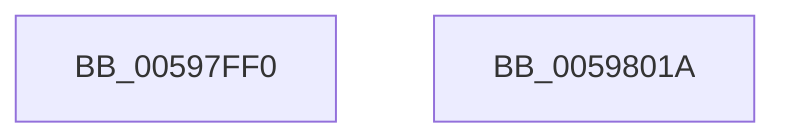

# IopSetFsRegistrationInProgress

- RVA: `0x00597FF0`–`0x0059801B` (길이 `43` bytes)
- VA: `0x0000000140597FF0`
- 실행 섹션: `.text`
- PDB 이름 있음: `예`; PDB Function 태그: `아니요`
- unwind 정보 RVA: `0x0005CF00`
- 디코드: `13`개 명령, `43/43` bytes 표시
- 미해석 바이트: `0` (있으면 어셈블리에 `.byte`로 보존)

> 이 문서는 커널 이미지의 기계어와 PDB 기호를 분석해 생성했습니다. 4번과 5번은 함수 원형과 자료형을 바이너리 사용 방식에서 추정한 C 해석이며 원본 소스 복구 결과는 아닙니다.

## 1. Dependencies

- 직접 호출 지점: **2**; 고유 호출 대상: **2**
- 직접 호출자로 확인된 함수: **1**
- RIP 상대 이미지 참조: **1**

### Outgoing calls
- `0x00597FFD` → [KeAcquireQueuedSpinLock](../27/KeAcquireQueuedSpinLock_function_00273D80.md) (function, `0x00273D80`)
- `0x0059800F` → [KeReleaseQueuedSpinLock](../27/KeReleaseQueuedSpinLock_function_00272540.md) (function, `0x00272540`)

### Direct callers
- [IoRegisterFileSystem](../../page/71/IoRegisterFileSystem_function_0071D6C0.md) at `0x0071D6F3`
- [IoRegisterFileSystem](../../page/71/IoRegisterFileSystem_function_0071D6C0.md) at `0x0071D830`
- [IoRegisterFileSystem](../../page/71/IoRegisterFileSystem_function_0071D6C0.md) at `0x0071D843`

### Static image references
- `0x00598004` → RVA `0x00E66128` (`.data`; write)

## 2. Other-region calls and transfers

- 다른 실행 섹션으로 향하는 call: **0**
- 별도 외부 분기/꼬리 이동을 확인하지 못했습니다.

## 3. Assembly (complete function range)

```asm
00597FF0  40 53                           push rbx
00597FF2  48 83 EC 20                     sub rsp, 0x20
00597FF6  8A D9                           mov bl, cl
00597FF8  B9 0A 00 00 00                  mov ecx, 0xa
00597FFD  E8 7E BD CD FF                  call 0x140273d80
00598002  8A D0                           mov dl, al
00598004  88 1D 1E E1 8C 00               mov byte ptr [rip + 0x8ce11e], bl
0059800A  B9 0A 00 00 00                  mov ecx, 0xa
0059800F  E8 2C A5 CD FF                  call 0x140272540
00598014  48 83 C4 20                     add rsp, 0x20
00598018  5B                              pop rbx
00598019  C3                              ret
0059801A  CC                              int3
```

## 4. C-style interpretation (structured pseudocode)

```c
__int64 __fastcall IopSetFsRegistrationInProgress(unsigned __int8 a1)
{
    __int64 result;
    __int64 v_rsp;

    v_rsp = (v_rsp) - (32);
    result = KeAcquireQueuedSpinLock(10, a2, a3, a4);
    *(unsigned __int8 *)(v_rip + 9232670) = a1;
    result = KeReleaseQueuedSpinLock(10, (unsigned __int8)(result), a3, a4);
    v_rsp = (v_rsp) + (32);
    return result;
}
```

## 5. (Beta) C Style

```c
int64_t IopSetFsRegistrationInProgress(uint8_t Arg1)
{
    int64_t result;
    int64_t local_rsp;

    local_rsp = (local_rsp) - (32);
    result = KeAcquireQueuedSpinLock(10, a2, a3, a4);
    *(uint8_t *)(v_rip + 0x8CE11E) = Arg1;
    result = KeReleaseQueuedSpinLock(10, (uint8_t)(result), a3, a4);
    local_rsp = (local_rsp) + (32);
    return result;
}
```

## 6. Execution-region graph

[열기: 2D/3D 그래프와 함수 탐색 컨트롤 패널](../../../control-panel.html?section=text&rva=0x00597FF0&view=graph)

- 2D 그래프는 위에서 아래로 흐르고, 3D 그래프는 빈 공간을 드래그해 회전합니다. Shift+드래그는 이동, 휠은 확대·축소, 함수 노드 선택은 대상 보고서 이동입니다.

### Static fallback


