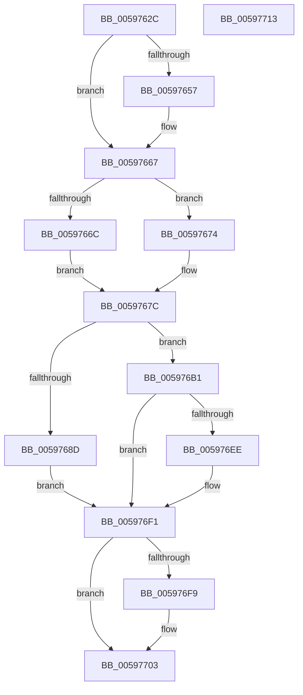

# IopUpdateFunctionPointers

- RVA: `0x0059762C`–`0x00597714` (길이 `232` bytes)
- VA: `0x000000014059762C`
- 실행 섹션: `.text`
- PDB 이름 있음: `예`; PDB Function 태그: `아니요`
- unwind 정보 RVA: `0x000718AC`
- 디코드: `62`개 명령, `232/232` bytes 표시
- 미해석 바이트: `0` (있으면 어셈블리에 `.byte`로 보존)

> 이 문서는 커널 이미지의 기계어와 PDB 기호를 분석해 생성했습니다. 4번과 5번은 함수 원형과 자료형을 바이너리 사용 방식에서 추정한 C 해석이며 원본 소스 복구 결과는 아닙니다.

## 1. Dependencies

- 직접 호출 지점: **2**; 고유 호출 대상: **2**
- 직접 호출자로 확인된 함수: **5**
- RIP 상대 이미지 참조: **9**

### Outgoing calls
- `0x00597662` → [KeAcquireInStackQueuedSpinLock](../27/KeAcquireInStackQueuedSpinLock_function_002757A0.md) (function, `0x002757A0`)
- `0x005976FE` → [KeReleaseInStackQueuedSpinLock](../34/KeReleaseInStackQueuedSpinLock_function_00342CE0.md) (function, `0x00342CE0`)

### Direct callers
- [IoPerfInit](../4D/IoPerfInit_function_004DC338.md) at `0x004DC3A2`
- [IopIrpExtensionControl](IopIrpExtensionControl_function_00597558.md) at `0x0059760A`
- [IoPerfReset](IoPerfReset_function_0059863C.md) at `0x005986A1`
- [ViIovPluginUnload](../6A/ViIovPluginUnload_function_006AADB0.md) at `0x006AADC7`
- [IoVerifierInit](../../pagevrfy/B9/IoVerifierInit_function_00B92314.md) at `0x00B9232F`

### Static image references
- `0x0059765B` → RVA `0x00F8D430` (`.data`; read)
- `0x0059766C` → RVA `0x00E66114` (`.data`; read)
- `0x00597682` → RVA `0x00E66114` (`.data`; write)
- `0x00597693` → RVA `0x00FC6D24` (`ALMOSTRO`; read/write)
- `0x00597699` → RVA `0x00FC6D64` (`ALMOSTRO`; read/write)
- `0x005976A2` → RVA `0x00FC6E98` (`ALMOSTRO`; read)
- `0x005976A9` → RVA `0x00FC6DD4` (`ALMOSTRO`; read/write)
- `0x005976B9` → RVA `0x00FC6E98` (`ALMOSTRO`; read/write)
- `0x005976CA` → RVA `0x00FC6D24` (`ALMOSTRO`; read)

## 2. Other-region calls and transfers

- 다른 실행 섹션으로 향하는 call: **0**
- 별도 외부 분기/꼬리 이동을 확인하지 못했습니다.

## 3. Assembly (complete function range)

```asm
0059762C  4C 8B DC                        mov r11, rsp
0059762F  49 89 5B 08                     mov qword ptr [r11 + 8], rbx
00597633  49 89 73 10                     mov qword ptr [r11 + 0x10], rsi
00597637  57                              push rdi
00597638  48 83 EC 40                     sub rsp, 0x40
0059763C  33 C0                           xor eax, eax
0059763E  0F 57 C0                        xorps xmm0, xmm0
00597641  41 8A F0                        mov sil, r8b
00597644  40 8A FA                        mov dil, dl
00597647  8B D9                           mov ebx, ecx
00597649  0F 11 44 24 20                  movups xmmword ptr [rsp + 0x20], xmm0
0059764E  49 89 43 E8                     mov qword ptr [r11 - 0x18], rax
00597652  45 84 C0                        test r8b, r8b
00597655  75 10                           jne 0x140597667
00597657  49 8D 53 D8                     lea rdx, [r11 - 0x28]
0059765B  48 8D 0D CE 5D 9F 00            lea rcx, [rip + 0x9f5dce]
00597662  E8 39 E1 CD FF                  call 0x1402757a0
00597667  40 84 FF                        test dil, dil
0059766A  74 08                           je 0x140597674
0059766C  0B 1D A2 EA 8C 00               or ebx, dword ptr [rip + 0x8ceaa2]
00597672  EB 08                           jmp 0x14059767c
00597674  F7 D3                           not ebx
00597676  23 1D 98 EA 8C 00               and ebx, dword ptr [rip + 0x8cea98]
0059767C  41 B8 01 00 00 00               mov r8d, 1
00597682  89 1D 8C EA 8C 00               mov dword ptr [rip + 0x8cea8c], ebx
00597688  41 84 D8                        test r8b, bl
0059768B  74 24                           je 0x1405976b1
0059768D  41 8B C8                        mov ecx, r8d
00597690  41 8B C0                        mov eax, r8d
00597693  87 05 8B F6 A2 00               xchg dword ptr [rip + 0xa2f68b], eax
00597699  87 0D C5 F6 A2 00               xchg dword ptr [rip + 0xa2f6c5], ecx
0059769F  41 8B C0                        mov eax, r8d
005976A2  48 8D 0D EF F7 A2 00            lea rcx, [rip + 0xa2f7ef]
005976A9  87 05 25 F7 A2 00               xchg dword ptr [rip + 0xa2f725], eax
005976AF  EB 40                           jmp 0x1405976f1
005976B1  33 C0                           xor eax, eax
005976B3  41 B8 02 00 00 00               mov r8d, 2
005976B9  87 05 D9 F7 A2 00               xchg dword ptr [rip + 0xa2f7d9], eax
005976BF  8B 0D 4F EA 8C 00               mov ecx, dword ptr [rip + 0x8cea4f]
005976C5  41 22 C8                        and cl, r8b
005976C8  F6 D9                           neg cl
005976CA  48 8D 0D 53 F6 A2 00            lea rcx, [rip + 0xa2f653]
005976D1  1B D2                           sbb edx, edx
005976D3  83 E2 03                        and edx, 3
005976D6  8B C2                           mov eax, edx
005976D8  87 05 86 F6 A2 00               xchg dword ptr [rip + 0xa2f686], eax
005976DE  87 15 F0 F6 A2 00               xchg dword ptr [rip + 0xa2f6f0], edx
005976E4  8B 05 2A EA 8C 00               mov eax, dword ptr [rip + 0x8cea2a]
005976EA  A8 04                           test al, 4
005976EC  75 03                           jne 0x1405976f1
005976EE  45 33 C0                        xor r8d, r8d
005976F1  44 87 01                        xchg dword ptr [rcx], r8d
005976F4  40 84 F6                        test sil, sil
005976F7  75 0A                           jne 0x140597703
005976F9  48 8D 4C 24 20                  lea rcx, [rsp + 0x20]
005976FE  E8 DD B5 DA FF                  call 0x140342ce0
00597703  48 8B 5C 24 50                  mov rbx, qword ptr [rsp + 0x50]
00597708  48 8B 74 24 58                  mov rsi, qword ptr [rsp + 0x58]
0059770D  48 83 C4 40                     add rsp, 0x40
00597711  5F                              pop rdi
00597712  C3                              ret
00597713  CC                              int3
```

## 4. C-style interpretation (structured pseudocode)

```c
__int64 __fastcall IopUpdateFunctionPointers(int a1, unsigned __int8 a2, unsigned __int8 a3)
{
    __int64 result;
    __int64 v_rbx;
    __int64 v_rsp;
    unsigned __int64 v_stack_m28;
    unsigned __int64 v_stack_p10;
    unsigned __int64 v_stack_p8;

    *(unsigned __int64 *)(v_rsp + 8) = v_rbx;
    *(unsigned __int64 *)(v_rsp + 16) = v_rsi;
    v_rsp = (v_rsp) - (64);
    result = 0;
    v_stack_m28 = v_xmm0;
    *(unsigned __int64 *)(v_rsp - 24) = 0;
    if (a3 == 0) {
        a2 = v_rsp - 40;
        a1 = v_rip + 10444238;
        result = KeAcquireInStackQueuedSpinLock(a1, a2, a3, a4);
    }
    if (a2 == 0) goto loc_00597674;
    v_rbx = (unsigned int)(((unsigned int)(a1)) | (*(unsigned int *)(v_rip + 9235106)));
    goto loc_0059767C;
loc_00597674:
    v_rbx = (unsigned int)(~(v_rbx));
    v_rbx = (unsigned int)((v_rbx) & (*(unsigned int *)(v_rip + 9235096)));
loc_0059767C:
    *(unsigned int *)(v_rip + 9235084) = (unsigned int)(v_rbx);
    if (((1) & ((unsigned __int8)(v_rbx))) == 0) goto loc_005976B1;
    goto loc_005976F1;
loc_005976B1:
    result = 0;
    a1 = (unsigned __int8)(((unsigned int)(*(unsigned int *)(v_rip + 9235023))) & (2));
    a1 = (unsigned __int8)(-(a1));
    a2 = (unsigned int)((a2) & (3));
    if ((((unsigned __int8)((unsigned int)(*(unsigned int *)(v_rip + 9234986)))) & (4)) == 0) {
        a3 = 0;
    }
    result = (unsigned int)(*(unsigned int *)(v_rip + 9234986));
    if (0 == 0) {
        a1 = v_stack_m28;
        result = KeReleaseInStackQueuedSpinLock(a1, a2, a3, a4);
    }
    v_rsp = (v_rsp) + (64);
    return result;
}
```

## 5. (Beta) C Style

```c
int64_t IopUpdateFunctionPointers(int32_t Arg1, uint8_t Arg2, uint8_t Arg3)
{
    int64_t result;
    int64_t local_rbx;
    int64_t local_rsp;
    uint64_t v_stack_m28;
    uint64_t v_stack_p10;
    uint64_t v_stack_p8;

    *(uint64_t *)(local_rsp + 0x8) = local_rbx;
    *(uint64_t *)(local_rsp + 0x10) = local_rsi;
    local_rsp = (local_rsp) - (64);
    result = 0;
    v_stack_m28 = v_xmm0;
    *(uint64_t *)(local_rsp - 0x18) = 0;
    if (Arg3 == 0) {
        Arg2 = local_rsp - 40;
        Arg1 = v_rip + 10444238;
        result = KeAcquireInStackQueuedSpinLock(Arg1, Arg2, Arg3, a4);
    }
    if (Arg2 == 0) goto loc_00597674;
    local_rbx = (uint32_t)(((uint32_t)(Arg1)) | (*(uint32_t *)(v_rip + 0x8CEAA2)));
    goto loc_0059767C;
loc_00597674:
    local_rbx = (uint32_t)(~(local_rbx));
    local_rbx = (uint32_t)((local_rbx) & (*(uint32_t *)(v_rip + 0x8CEA98)));
loc_0059767C:
    *(uint32_t *)(v_rip + 0x8CEA8C) = (uint32_t)(local_rbx);
    if (((1) & ((uint8_t)(local_rbx))) == 0) goto loc_005976B1;
    goto loc_005976F1;
loc_005976B1:
    result = 0;
    Arg1 = (uint8_t)(((uint32_t)(*(uint32_t *)(v_rip + 0x8CEA4F))) & (2));
    Arg1 = (uint8_t)(-(Arg1));
    Arg2 = (uint32_t)((Arg2) & (3));
    if ((((uint8_t)((uint32_t)(*(uint32_t *)(v_rip + 0x8CEA2A)))) & (4)) == 0) {
        Arg3 = 0;
    }
    result = (uint32_t)(*(uint32_t *)(v_rip + 0x8CEA2A));
    if (0 == 0) {
        Arg1 = v_stack_m28;
        result = KeReleaseInStackQueuedSpinLock(Arg1, Arg2, Arg3, a4);
    }
    local_rsp = (local_rsp) + (64);
    return result;
}
```

## 6. Execution-region graph

[열기: 2D/3D 그래프와 함수 탐색 컨트롤 패널](../../../control-panel.html?section=text&rva=0x0059762C&view=graph)

- 2D 그래프는 위에서 아래로 흐르고, 3D 그래프는 빈 공간을 드래그해 회전합니다. Shift+드래그는 이동, 휠은 확대·축소, 함수 노드 선택은 대상 보고서 이동입니다.

### Static fallback


