# IopUpdateMinidumpContext

- RVA: `0x00596360`–`0x0059670C` (길이 `940` bytes)
- VA: `0x0000000140596360`
- 실행 섹션: `.text`
- PDB 이름 있음: `예`; PDB Function 태그: `아니요`
- unwind 정보 RVA: `0x000C715C`
- 디코드: `238`개 명령, `940/940` bytes 표시
- 미해석 바이트: `0` (있으면 어셈블리에 `.byte`로 보존)

> 이 문서는 커널 이미지의 기계어와 PDB 기호를 분석해 생성했습니다. 4번과 5번은 함수 원형과 자료형을 바이너리 사용 방식에서 추정한 C 해석이며 원본 소스 복구 결과는 아닙니다.

## 1. Dependencies

- 직접 호출 지점: **15**; 고유 호출 대상: **5**
- 직접 호출자로 확인된 함수: **3**
- RIP 상대 이미지 참조: **4**

### Outgoing calls
- `0x0059644A` → [IopGetMaxValidMemorySize](IopGetMaxValidMemorySize_function_0059559C.md) (function, `0x0059559C`)
- `0x00596454` → [IoAddTriageDumpDataBlock](../42/IoAddTriageDumpDataBlock_function_00428374.md) (function, `0x00428374`)
- `0x005964A2` → [IopGetMaxValidMemorySize](IopGetMaxValidMemorySize_function_0059559C.md) (function, `0x0059559C`)
- `0x005964AC` → [IoAddTriageDumpDataBlock](../42/IoAddTriageDumpDataBlock_function_00428374.md) (function, `0x00428374`)
- `0x0059650D` → [IopIsAddressRangeValid](../4B/IopIsAddressRangeValid_function_004B6CBC.md) (function, `0x004B6CBC`)
- `0x00596522` → [IopIsAddressRangeValid](../4B/IopIsAddressRangeValid_function_004B6CBC.md) (function, `0x004B6CBC`)
- `0x00596552` → [IopGetMaxValidMemorySize](IopGetMaxValidMemorySize_function_0059559C.md) (function, `0x0059559C`)
- `0x0059655C` → [IoAddTriageDumpDataBlock](../42/IoAddTriageDumpDataBlock_function_00428374.md) (function, `0x00428374`)
- `0x00596568` → [KeGetPrcb](../2D/KeGetPrcb_function_002D85D0.md) (function, `0x002D85D0`)
- `0x00596585` → [IoAddTriageDumpDataBlock](../42/IoAddTriageDumpDataBlock_function_00428374.md) (function, `0x00428374`)
- `0x00596599` → [IoAddTriageDumpDataBlock](../42/IoAddTriageDumpDataBlock_function_00428374.md) (function, `0x00428374`)
- `0x005965CB` → [IoAddTriageDumpDataBlock](../42/IoAddTriageDumpDataBlock_function_00428374.md) (function, `0x00428374`)
- `0x005965F8` → [IoAddTriageDumpDataBlock](../42/IoAddTriageDumpDataBlock_function_00428374.md) (function, `0x00428374`)
- `0x00596615` → [IoAddTriageDumpDataBlock](../42/IoAddTriageDumpDataBlock_function_00428374.md) (function, `0x00428374`)
- `0x0059663A` → [IopAddBugcheckTriageDataFromParameters](IopAddBugcheckTriageDataFromParameters_function_00593E54.md) (function, `0x00593E54`)

### Direct callers
- [IopCollectTriageDumpData](IopCollectTriageDumpData_function_00594754.md) at `0x005947C6`
- [IopWriteCapsuleTriageDumpToFirmware](IopWriteCapsuleTriageDumpToFirmware_function_005967AC.md) at `0x0059683B`
- [IopAddMiniDumpPagesToPartialKernelDump](../5A/IopAddMiniDumpPagesToPartialKernelDump_function_005A16F8.md) at `0x005A17A4`

### Static image references
- `0x00596414` → RVA `0x00FC5020` (`ALMOSTRO`; read)
- `0x00596477` → RVA `0x00FC505C` (`ALMOSTRO`; read)
- `0x005965FD` → RVA `0x00F0CE80` (`.data`; read)
- `0x0059664D` → RVA `0x00E66050` (`.data`; read)

## 2. Other-region calls and transfers

- 다른 실행 섹션으로 향하는 call: **0**
- 별도 외부 분기/꼬리 이동을 확인하지 못했습니다.

## 3. Assembly (complete function range)

```asm
00596360  48 8B C4                        mov rax, rsp
00596363  48 89 58 18                     mov qword ptr [rax + 0x18], rbx
00596367  4C 89 48 20                     mov qword ptr [rax + 0x20], r9
0059636B  48 89 50 10                     mov qword ptr [rax + 0x10], rdx
0059636F  89 48 08                        mov dword ptr [rax + 8], ecx
00596372  55                              push rbp
00596373  56                              push rsi
00596374  57                              push rdi
00596375  41 54                           push r12
00596377  41 55                           push r13
00596379  41 56                           push r14
0059637B  41 57                           push r15
0059637D  48 83 EC 30                     sub rsp, 0x30
00596381  65 4C 8B 2C 25 20 00 00 00      mov r13, qword ptr gs:[0x20]
0059638A  8B C1                           mov eax, ecx
0059638C  C6 84 24 A8 00 00 00 00         mov byte ptr [rsp + 0xa8], 0
00596394  4D 8B F1                        mov r14, r9
00596397  4D 8B E0                        mov r12, r8
0059639A  48 8B EA                        mov rbp, rdx
0059639D  8B F1                           mov esi, ecx
0059639F  83 E8 7E                        sub eax, 0x7e
005963A2  74 47                           je 0x1405963eb
005963A4  83 F8 01                        cmp eax, 1
005963A7  75 54                           jne 0x1405963fd
005963A9  48 8B BC 24 98 00 00 00         mov rdi, qword ptr [rsp + 0x98]
005963B1  48 83 FA 08                     cmp rdx, 8
005963B5  75 2A                           jne 0x1405963e1
005963B7  49 8B 80 58 01 00 00            mov rax, qword ptr [r8 + 0x158]
005963BE  48 89 87 A0 00 00 00            mov qword ptr [rdi + 0xa0], rax
005963C5  49 8B 80 68 01 00 00            mov rax, qword ptr [r8 + 0x168]
005963CC  48 89 87 F8 00 00 00            mov qword ptr [rdi + 0xf8], rax
005963D3  49 8B 80 80 01 00 00            mov rax, qword ptr [r8 + 0x180]
005963DA  48 89 87 98 00 00 00            mov qword ptr [rdi + 0x98], rax
005963E1  C6 84 24 A8 00 00 00 01         mov byte ptr [rsp + 0xa8], 1
005963E9  EB 1A                           jmp 0x140596405
005963EB  48 8B 84 24 90 00 00 00         mov rax, qword ptr [rsp + 0x90]
005963F3  48 85 C0                        test rax, rax
005963F6  74 05                           je 0x1405963fd
005963F8  48 8B F8                        mov rdi, rax
005963FB  EB E4                           jmp 0x1405963e1
005963FD  48 8B BC 24 98 00 00 00         mov rdi, qword ptr [rsp + 0x98]
00596405  65 48 8B 14 25 20 3A 00 00      mov rdx, qword ptr gs:[0x3a20]
0059640E  41 B8 FF 7F 00 00               mov r8d, 0x7fff
00596414  8B 05 06 EC A2 00               mov eax, dword ptr [rip + 0xa2ec06]
0059641A  48 83 C2 50                     add rdx, 0x50
0059641E  48 8B 9F 98 00 00 00            mov rbx, qword ptr [rdi + 0x98]
00596425  48 8B CA                        mov rcx, rdx
00596428  48 2B C8                        sub rcx, rax
0059642B  48 3B CB                        cmp rcx, rbx
0059642E  77 2F                           ja 0x14059645f
00596430  48 3B DA                        cmp rbx, rdx
00596433  73 2A                           jae 0x14059645f
00596435  48 8B C2                        mov rax, rdx
00596438  48 2B C3                        sub rax, rbx
0059643B  49 3B C0                        cmp rax, r8
0059643E  73 04                           jae 0x140596444
00596440  2B D3                           sub edx, ebx
00596442  EB 03                           jmp 0x140596447
00596444  41 8B D0                        mov edx, r8d
00596447  48 8B CB                        mov rcx, rbx
0059644A  E8 4D F1 FF FF                  call 0x14059559c
0059644F  8B D0                           mov edx, eax
00596451  48 8B CB                        mov rcx, rbx
00596454  E8 1B 1F E9 FF                  call 0x140428374
00596459  41 B8 FF 7F 00 00               mov r8d, 0x7fff
0059645F  41 BF 02 00 00 00               mov r15d, 2
00596465  45 38 BD 58 86 00 00            cmp byte ptr [r13 + 0x8658], r15b
0059646C  76 43                           jbe 0x1405964b1
0059646E  65 48 8B 14 25 58 91 00 00      mov rdx, qword ptr gs:[0x9158]
00596477  8B 05 DF EB A2 00               mov eax, dword ptr [rip + 0xa2ebdf]
0059647D  48 8B CA                        mov rcx, rdx
00596480  48 2B C8                        sub rcx, rax
00596483  48 3B CB                        cmp rcx, rbx
00596486  77 29                           ja 0x1405964b1
00596488  48 3B DA                        cmp rbx, rdx
0059648B  73 24                           jae 0x1405964b1
0059648D  48 8B C2                        mov rax, rdx
00596490  48 2B C3                        sub rax, rbx
00596493  49 3B C0                        cmp rax, r8
00596496  73 04                           jae 0x14059649c
00596498  2B D3                           sub edx, ebx
0059649A  EB 03                           jmp 0x14059649f
0059649C  41 8B D0                        mov edx, r8d
0059649F  48 8B CB                        mov rcx, rbx
005964A2  E8 F5 F0 FF FF                  call 0x14059559c
005964A7  8B D0                           mov edx, eax
005964A9  48 8B CB                        mov rcx, rbx
005964AC  E8 C3 1E E9 FF                  call 0x140428374
005964B1  81 FE 33 01 00 00               cmp esi, 0x133
005964B7  0F 85 24 01 00 00               jne 0x1405965e1
005964BD  65 8A 04 25 3C 3A 00 00         mov al, byte ptr gs:[0x3a3c]
005964C5  4C 8B B4 24 A0 00 00 00         mov r14, qword ptr [rsp + 0xa0]
005964CD  A8 01                           test al, 1
005964CF  0F 84 8C 00 00 00               je 0x140596561
005964D5  4D 3B 75 18                     cmp r14, qword ptr [r13 + 0x18]
005964D9  0F 84 82 00 00 00               je 0x140596561
005964DF  65 48 8B 0C 25 58 91 00 00      mov rcx, qword ptr gs:[0x9158]
005964E8  BA 08 00 00 00                  mov edx, 8
005964ED  65 48 8B 34 25 20 3A 00 00      mov rsi, qword ptr gs:[0x3a20]
005964F6  8B 05 24 EB A2 00               mov eax, dword ptr [rip + 0xa2eb24]
005964FC  48 83 C6 50                     add rsi, 0x50
00596500  48 8B DE                        mov rbx, rsi
00596503  48 8D 69 F8                     lea rbp, [rcx - 8]
00596507  48 2B D8                        sub rbx, rax
0059650A  48 8B CD                        mov rcx, rbp
0059650D  E8 AA 07 F2 FF                  call 0x1404b6cbc
00596512  84 C0                           test al, al
00596514  74 21                           je 0x140596537
00596516  48 8B 6D 00                     mov rbp, qword ptr [rbp]
0059651A  BA 08 00 00 00                  mov edx, 8
0059651F  48 8B CD                        mov rcx, rbp
00596522  E8 95 07 F2 FF                  call 0x1404b6cbc
00596527  84 C0                           test al, al
00596529  74 0C                           je 0x140596537
0059652B  48 3B DD                        cmp rbx, rbp
0059652E  77 07                           ja 0x140596537
00596530  48 3B EE                        cmp rbp, rsi
00596533  48 0F 42 DD                     cmovb rbx, rbp
00596537  48 8B C6                        mov rax, rsi
0059653A  B9 FF 7F 00 00                  mov ecx, 0x7fff
0059653F  48 2B C3                        sub rax, rbx
00596542  48 3B C1                        cmp rax, rcx
00596545  73 04                           jae 0x14059654b
00596547  2B F3                           sub esi, ebx
00596549  EB 02                           jmp 0x14059654d
0059654B  8B F1                           mov esi, ecx
0059654D  8B D6                           mov edx, esi
0059654F  48 8B CB                        mov rcx, rbx
00596552  E8 45 F0 FF FF                  call 0x14059559c
00596557  8B D0                           mov edx, eax
00596559  48 8B CB                        mov rcx, rbx
0059655C  E8 13 1E E9 FF                  call 0x140428374
00596561  41 8B 8E 18 02 00 00            mov ecx, dword ptr [r14 + 0x218]
00596568  E8 63 20 D4 FF                  call 0x1402d85d0
0059656D  48 8B E8                        mov rbp, rax
00596570  4C 8D B0 40 38 00 00            lea r14, [rax + 0x3840]
00596577  49 8B 36                        mov rsi, qword ptr [r14]
0059657A  EB 25                           jmp 0x1405965a1
0059657C  BA 40 00 00 00                  mov edx, 0x40
00596581  48 8D 4E F8                     lea rcx, [rsi - 8]
00596585  E8 EA 1D E9 FF                  call 0x140428374
0059658A  48 8B 4E 30                     mov rcx, qword ptr [rsi + 0x30]
0059658E  48 83 F9 01                     cmp rcx, 1
00596592  74 0A                           je 0x14059659e
00596594  BA 60 00 00 00                  mov edx, 0x60
00596599  E8 D6 1D E9 FF                  call 0x140428374
0059659E  48 8B 36                        mov rsi, qword ptr [rsi]
005965A1  48 85 F6                        test rsi, rsi
005965A4  75 D6                           jne 0x14059657c
005965A6  49 83 C6 30                     add r14, 0x30
005965AA  49 83 EF 01                     sub r15, 1
005965AE  75 C7                           jne 0x140596577
005965B0  48 8B 8D A8 8E 00 00            mov rcx, qword ptr [rbp + 0x8ea8]
005965B7  48 85 C9                        test rcx, rcx
005965BA  74 14                           je 0x1405965d0
005965BC  48 3B 8D B0 8E 00 00            cmp rcx, qword ptr [rbp + 0x8eb0]
005965C3  74 0B                           je 0x1405965d0
005965C5  8B 95 DC 38 00 00               mov edx, dword ptr [rbp + 0x38dc]
005965CB  E8 A4 1D E9 FF                  call 0x140428374
005965D0  8B 74 24 70                     mov esi, dword ptr [rsp + 0x70]
005965D4  48 8B 6C 24 78                  mov rbp, qword ptr [rsp + 0x78]
005965D9  4C 8B B4 24 88 00 00 00         mov r14, qword ptr [rsp + 0x88]
005965E1  49 8B 8D 18 83 00 00            mov rcx, qword ptr [r13 + 0x8318]
005965E8  48 85 C9                        test rcx, rcx
005965EB  74 10                           je 0x1405965fd
005965ED  41 8B 95 24 83 00 00            mov edx, dword ptr [r13 + 0x8324]
005965F4  85 D2                           test edx, edx
005965F6  74 05                           je 0x1405965fd
005965F8  E8 77 1D E9 FF                  call 0x140428374
005965FD  48 8B 1D 7C 68 97 00            mov rbx, qword ptr [rip + 0x97687c]
00596604  4C 8D 3D 75 68 97 00            lea r15, [rip + 0x976875]
0059660B  EB 10                           jmp 0x14059661d
0059660D  BA 20 04 00 00                  mov edx, 0x420
00596612  48 8B CB                        mov rcx, rbx
00596615  E8 5A 1D E9 FF                  call 0x140428374
0059661A  48 8B 1B                        mov rbx, qword ptr [rbx]
0059661D  49 3B DF                        cmp rbx, r15
00596620  75 EB                           jne 0x14059660d
00596622  48 8B 84 24 90 00 00 00         mov rax, qword ptr [rsp + 0x90]
0059662A  4D 8B CE                        mov r9, r14
0059662D  4D 8B C4                        mov r8, r12
00596630  48 89 44 24 20                  mov qword ptr [rsp + 0x20], rax
00596635  48 8B D5                        mov rdx, rbp
00596638  8B CE                           mov ecx, esi
0059663A  E8 15 D8 FF FF                  call 0x140593e54
0059663F  80 BC 24 A8 00 00 00 00         cmp byte ptr [rsp + 0xa8], 0
00596647  0F 84 A6 00 00 00               je 0x1405966f3
0059664D  48 8B 05 FC F9 8C 00            mov rax, qword ptr [rip + 0x8cf9fc]
00596654  48 85 C0                        test rax, rax
00596657  0F 84 96 00 00 00               je 0x1405966f3
0059665D  80 BC 24 B0 00 00 00 00         cmp byte ptr [rsp + 0xb0], 0
00596665  0F 84 88 00 00 00               je 0x1405966f3
0059666B  0F BA 68 18 1C                  bts dword ptr [rax + 0x18], 0x1c
00596670  B9 09 00 00 00                  mov ecx, 9
00596675  48 8B 05 D4 F9 8C 00            mov rax, qword ptr [rip + 0x8cf9d4]
0059667C  48 83 C0 40                     add rax, 0x40
00596680  8D 51 77                        lea edx, [rcx + 0x77]
00596683  0F 10 07                        movups xmm0, xmmword ptr [rdi]
00596686  0F 11 00                        movups xmmword ptr [rax], xmm0
00596689  0F 10 4F 10                     movups xmm1, xmmword ptr [rdi + 0x10]
0059668D  0F 11 48 10                     movups xmmword ptr [rax + 0x10], xmm1
00596691  0F 10 47 20                     movups xmm0, xmmword ptr [rdi + 0x20]
00596695  0F 11 40 20                     movups xmmword ptr [rax + 0x20], xmm0
00596699  0F 10 4F 30                     movups xmm1, xmmword ptr [rdi + 0x30]
0059669D  0F 11 48 30                     movups xmmword ptr [rax + 0x30], xmm1
005966A1  0F 10 47 40                     movups xmm0, xmmword ptr [rdi + 0x40]
005966A5  0F 11 40 40                     movups xmmword ptr [rax + 0x40], xmm0
005966A9  0F 10 4F 50                     movups xmm1, xmmword ptr [rdi + 0x50]
005966AD  0F 11 48 50                     movups xmmword ptr [rax + 0x50], xmm1
005966B1  0F 10 47 60                     movups xmm0, xmmword ptr [rdi + 0x60]
005966B5  0F 11 40 60                     movups xmmword ptr [rax + 0x60], xmm0
005966B9  48 03 C2                        add rax, rdx
005966BC  0F 10 4F 70                     movups xmm1, xmmword ptr [rdi + 0x70]
005966C0  48 03 FA                        add rdi, rdx
005966C3  0F 11 48 F0                     movups xmmword ptr [rax - 0x10], xmm1
005966C7  48 83 E9 01                     sub rcx, 1
005966CB  75 B6                           jne 0x140596683
005966CD  0F 10 07                        movups xmm0, xmmword ptr [rdi]
005966D0  0F 11 00                        movups xmmword ptr [rax], xmm0
005966D3  0F 10 4F 10                     movups xmm1, xmmword ptr [rdi + 0x10]
005966D7  0F 11 48 10                     movups xmmword ptr [rax + 0x10], xmm1
005966DB  0F 10 47 20                     movups xmm0, xmmword ptr [rdi + 0x20]
005966DF  0F 11 40 20                     movups xmmword ptr [rax + 0x20], xmm0
005966E3  0F 10 4F 30                     movups xmm1, xmmword ptr [rdi + 0x30]
005966E7  0F 11 48 30                     movups xmmword ptr [rax + 0x30], xmm1
005966EB  0F 10 47 40                     movups xmm0, xmmword ptr [rdi + 0x40]
005966EF  0F 11 40 40                     movups xmmword ptr [rax + 0x40], xmm0
005966F3  48 8B 9C 24 80 00 00 00         mov rbx, qword ptr [rsp + 0x80]
005966FB  48 83 C4 30                     add rsp, 0x30
005966FF  41 5F                           pop r15
00596701  41 5E                           pop r14
00596703  41 5D                           pop r13
00596705  41 5C                           pop r12
00596707  5F                              pop rdi
00596708  5E                              pop rsi
00596709  5D                              pop rbp
0059670A  C3                              ret
0059670B  CC                              int3
```

## 4. C-style interpretation (structured pseudocode)

```c
__int64 __fastcall IopUpdateMinidumpContext(int a1, __int64 a2, __int64 a3, __int64 a4, __int64 a5, __int64 a6, __int64 a7, unsigned __int8 a8, unsigned __int8 a9)
{
    __int64 result;
    __int64 v_r14;
    __int64 v_r15;
    __int64 v_rbx;
    __int64 v_rdi;
    __int64 v_rsi;
    __int64 v_rsp;
    unsigned __int64 v_stack_m48;
    unsigned __int64 v_stack_p10;
    unsigned __int64 v_stack_p18;
    unsigned __int64 v_stack_p20;
    unsigned __int8 v_stack_p40;
    unsigned int v_stack_p8;

    *(unsigned __int64 *)(v_rsp + 24) = v_rbx;
    *(unsigned __int64 *)(v_rsp + 32) = a4;
    *(unsigned __int64 *)(v_rsp + 16) = a2;
    *(unsigned int *)(v_rsp + 8) = a1;
    v_rsp = (v_rsp) - (48);
    v_stack_p40 = 0;
    result = (unsigned int)(((unsigned int)(a1)) - (126));
    if (condition_is_equal) goto loc_005963EB;
    if (((unsigned int)(result)) != 1) goto loc_005963FD;
    if (a2 == 8) {
        result = *(unsigned __int64 *)(a3 + 344);
        *(unsigned __int64 *)(a6 + 160) = result;
        result = *(unsigned __int64 *)(a3 + 360);
        *(unsigned __int64 *)(a6 + 248) = result;
        result = *(unsigned __int64 *)(a3 + 384);
        *(unsigned __int64 *)(a6 + 152) = result;
    }
    v_stack_p40 = 1;
    goto loc_00596405;
loc_005963EB:
    if (a5 == 0) goto loc_005963FD;
    goto loc_005963E1;
loc_005963FD:
loc_00596405:
    a2 = (*(unsigned __int64 *)(gs_base + (0 + 14880))) + (80);
    a1 = (a2) - ((unsigned int)(*(unsigned int *)(v_rip + 10677254)));
    if (a1 > (*(unsigned __int64 *)(a6 + 152))) goto loc_0059645F;
    if ((*(unsigned __int64 *)(a6 + 152)) >= a2) goto loc_0059645F;
    result = (a2) - (*(unsigned __int64 *)(a6 + 152));
    if (result >= ((unsigned int)(0x7FFFULL))) goto loc_00596444;
    a2 = (unsigned int)((a2) - ((unsigned int)(*(unsigned __int64 *)(a6 + 152))));
    goto loc_00596447;
loc_00596444:
loc_00596447:
    result = IopGetMaxValidMemorySize(*(unsigned __int64 *)(a6 + 152), (unsigned int)((unsigned int)((unsigned int)(0x7FFFULL))), (unsigned int)(0x7FFFULL), a4);
    result = IoAddTriageDumpDataBlock(*(unsigned __int64 *)(a6 + 152), (unsigned int)((unsigned int)(result)), (unsigned int)(0x7FFFULL), a4);
loc_0059645F:
    if ((*(unsigned __int8 *)(*(unsigned __int64 *)(gs_base + (0 + 32)) + 34392)) <= 2) goto loc_005964B1;
    a1 = (*(unsigned __int64 *)(gs_base + (0 + 37208))) - ((unsigned int)(*(unsigned int *)(v_rip + 10677215)));
    if (a1 > (*(unsigned __int64 *)(a6 + 152))) goto loc_005964B1;
    if ((*(unsigned __int64 *)(a6 + 152)) >= (*(unsigned __int64 *)(gs_base + (0 + 37208)))) goto loc_005964B1;
    result = (*(unsigned __int64 *)(gs_base + (0 + 37208))) - (*(unsigned __int64 *)(a6 + 152));
    if (result >= ((unsigned int)(0x7FFFULL))) goto loc_0059649C;
    a2 = (unsigned int)((*(unsigned __int64 *)(gs_base + (0 + 37208))) - ((unsigned int)(*(unsigned __int64 *)(a6 + 152))));
    goto loc_0059649F;
loc_0059649C:
loc_0059649F:
    result = IopGetMaxValidMemorySize(*(unsigned __int64 *)(a6 + 152), (unsigned int)((unsigned int)((unsigned int)(0x7FFFULL))), (unsigned int)(0x7FFFULL), a4);
    result = IoAddTriageDumpDataBlock(*(unsigned __int64 *)(a6 + 152), (unsigned int)((unsigned int)(result)), (unsigned int)(0x7FFFULL), a4);
loc_005964B1:
    if (((unsigned int)((unsigned int)(a1))) != 307) goto loc_005965E1;
    if ((((unsigned __int8)(*(unsigned __int8 *)(gs_base + (0 + 14908)))) & (1)) == 0) goto loc_00596561;
    if (a7 == (*(unsigned __int64 *)(*(unsigned __int64 *)(gs_base + (0 + 32)) + 24))) goto loc_00596561;
    v_rsi = (*(unsigned __int64 *)(gs_base + (0 + 14880))) + (80);
    v_rbx = (v_rsi) - ((unsigned int)(*(unsigned int *)(v_rip + 10677028)));
    result = IopIsAddressRangeValid(*(unsigned __int64 *)(gs_base + (0 + 37208)) - 8, 8, (unsigned int)(0x7FFFULL), a4);
    if ((unsigned __int8)(result) == 0) goto loc_00596537;
    result = IopIsAddressRangeValid(*(unsigned __int64 *)(*(unsigned __int64 *)(gs_base + (0 + 37208)) - 8), 8, (unsigned int)(0x7FFFULL), a4);
    if ((unsigned __int8)(result) == 0) goto loc_00596537;
    if (v_rbx <= (*(unsigned __int64 *)(*(unsigned __int64 *)(gs_base + (0 + 37208)) - 8))) {
        if ((*(unsigned __int64 *)(*(unsigned __int64 *)(gs_base + (0 + 37208)) - 8)) < v_rsi) { v_rbx = *(unsigned __int64 *)(*(unsigned __int64 *)(gs_base + (0 + 37208)) - 8); }
    }
    result = (v_rsi) - (v_rbx);
    if (result >= ((unsigned int)(0x7FFFULL))) goto loc_0059654B;
    v_rsi = (unsigned int)((v_rsi) - ((unsigned int)(v_rbx)));
    goto loc_0059654D;
loc_0059654B:
loc_0059654D:
    result = IopGetMaxValidMemorySize(v_rbx, (unsigned int)((unsigned int)((unsigned int)((unsigned int)((unsigned int)(0x7FFFULL))))), (unsigned int)(0x7FFFULL), a4);
    result = IoAddTriageDumpDataBlock(v_rbx, (unsigned int)((unsigned int)(result)), (unsigned int)(0x7FFFULL), a4);
loc_00596561:
    result = KeGetPrcb((unsigned int)(*(unsigned int *)(a7 + 536)), (unsigned int)((unsigned int)(result)), (unsigned int)(0x7FFFULL), a4);
loc_00596577:
    goto loc_005965A1;
loc_0059657C:
    result = IoAddTriageDumpDataBlock(*(unsigned __int64 *)(result + 14400) - 8, 64, (unsigned int)(0x7FFFULL), a4);
    if ((*(unsigned __int64 *)(*(unsigned __int64 *)(result + 14400) + 48)) != 1) {
        a2 = 96;
        result = IoAddTriageDumpDataBlock(*(unsigned __int64 *)(*(unsigned __int64 *)(result + 14400) + 48), a2, (unsigned int)(0x7FFFULL), a4);
    }
loc_005965A1:
    if (*(unsigned __int64 *)(*(unsigned __int64 *)(result + 14400)) != 0) goto loc_0059657C;
    v_r14 = (result + 14400) + (48);
    v_r15 = (2) - (1);
    if (condition_is_not_equal) goto loc_00596577;
    if (*(unsigned __int64 *)(result + 36520) == 0) goto loc_005965D0;
    if ((*(unsigned __int64 *)(result + 36520)) != (*(unsigned __int64 *)(result + 36528))) {
        a2 = *(unsigned int *)(result + 14556);
        result = IoAddTriageDumpDataBlock(*(unsigned __int64 *)(result + 36520), a2, (unsigned int)(0x7FFFULL), a4);
    }
loc_005965E1:
    if (*(unsigned __int64 *)(*(unsigned __int64 *)(gs_base + (0 + 32)) + 33560) == 0) goto loc_005965FD;
    if ((unsigned int)((unsigned int)(*(unsigned int *)(*(unsigned __int64 *)(gs_base + (0 + 32)) + 33572))) != 0) {
        result = IoAddTriageDumpDataBlock(*(unsigned __int64 *)(*(unsigned __int64 *)(gs_base + (0 + 32)) + 33560), (unsigned int)(*(unsigned int *)(*(unsigned __int64 *)(gs_base + (0 + 32)) + 33572)), (unsigned int)(0x7FFFULL), a4);
    }
    goto loc_0059661D;
loc_0059660D:
    result = IoAddTriageDumpDataBlock(*(unsigned __int64 *)(v_rip + 9922684), (unsigned int)(0x420ULL), (unsigned int)(0x7FFFULL), a4);
loc_0059661D:
    if ((*(unsigned __int64 *)(*(unsigned __int64 *)(v_rip + 9922684))) != (v_rip + 9922677)) goto loc_0059660D;
    v_stack_m48 = a5;
    result = IopAddBugcheckTriageDataFromParameters((unsigned int)((unsigned int)((unsigned int)(v_stack_p8))), v_stack_p10, a3, v_stack_p20);
    if (a8 == 0) goto loc_005966F3;
    if (*(unsigned __int64 *)(v_rip + 9239036) == 0) goto loc_005966F3;
    if (a9 == 0) goto loc_005966F3;
    result = (*(unsigned __int64 *)(v_rip + 9238996)) + (64);
loc_00596683:
    *(unsigned __int64 *)(result) = v_xmm0;
    *(unsigned __int64 *)(result + 16) = v_xmm1;
    *(unsigned __int64 *)(result + 32) = v_xmm0;
    *(unsigned __int64 *)(result + 48) = v_xmm1;
    *(unsigned __int64 *)(result + 64) = v_xmm0;
    *(unsigned __int64 *)(result + 80) = v_xmm1;
    *(unsigned __int64 *)(result + 96) = v_xmm0;
    result = (result) + (9 + 119);
    v_rdi = (a6) + (9 + 119);
    *(unsigned __int64 *)(result - 16) = v_xmm1;
    a1 = (9) - (1);
    if (condition_is_not_equal) goto loc_00596683;
    *(unsigned __int64 *)(result) = v_xmm0;
    *(unsigned __int64 *)(result + 16) = v_xmm1;
    *(unsigned __int64 *)(result + 32) = v_xmm0;
    *(unsigned __int64 *)(result + 48) = v_xmm1;
    *(unsigned __int64 *)(result + 64) = v_xmm0;
loc_005966F3:
    v_rsp = (v_rsp) + (48);
    return result;
}
```

## 5. (Beta) C Style

```c
int64_t IopUpdateMinidumpContext(int32_t Arg1, int64_t Arg2, void *Arg3, int64_t Arg4, int64_t Arg5, void *Arg6, int64_t Arg7, uint8_t Arg8, uint8_t Arg9)
{
    uint8_t *arg3 = (uint8_t *)Arg3;
    uint8_t *arg6 = (uint8_t *)Arg6;

    int64_t result;
    int64_t local_r14;
    int64_t local_r15;
    int64_t local_rbx;
    int64_t local_rdi;
    int64_t local_rsi;
    int64_t local_rsp;
    uint64_t v_stack_m48;
    uint64_t v_stack_p10;
    uint64_t v_stack_p18;
    uint64_t v_stack_p20;
    uint8_t v_stack_p40;
    uint32_t v_stack_p8;

    *(uint64_t *)(local_rsp + 0x18) = local_rbx;
    *(uint64_t *)(local_rsp + 0x20) = Arg4;
    *(uint64_t *)(local_rsp + 0x10) = Arg2;
    *(uint32_t *)(local_rsp + 0x8) = Arg1;
    local_rsp = (local_rsp) - (48);
    v_stack_p40 = 0;
    result = (uint32_t)(((uint32_t)(Arg1)) - (126));
    if (condition_is_equal) goto loc_005963EB;
    if (((uint32_t)(result)) != 1) goto loc_005963FD;
    if (Arg2 == 8) {
        result = *(uint64_t *)(arg3 + 0x158);
        *(uint64_t *)(arg6 + 0xA0) = result;
        result = *(uint64_t *)(arg3 + 0x168);
        *(uint64_t *)(arg6 + 0xF8) = result;
        result = *(uint64_t *)(arg3 + 0x180);
        *(uint64_t *)(arg6 + 0x98) = result;
    }
    v_stack_p40 = 1;
    goto loc_00596405;
loc_005963EB:
    if (Arg5 == 0) goto loc_005963FD;
    goto loc_005963E1;
loc_005963FD:
loc_00596405:
    Arg2 = (*(uint64_t *)(gs_base + (0 + 0x3A20))) + (80);
    Arg1 = (Arg2) - ((uint32_t)(*(uint32_t *)(v_rip + 0xA2EC06)));
    if (Arg1 > (*(uint64_t *)(arg6 + 0x98))) goto loc_0059645F;
    if ((*(uint64_t *)(arg6 + 0x98)) >= Arg2) goto loc_0059645F;
    result = (Arg2) - (*(uint64_t *)(arg6 + 0x98));
    if (result >= ((uint32_t)(0x7FFFULL))) goto loc_00596444;
    Arg2 = (uint32_t)((Arg2) - ((uint32_t)(*(uint64_t *)(arg6 + 0x98))));
    goto loc_00596447;
loc_00596444:
loc_00596447:
    result = IopGetMaxValidMemorySize(*(uint64_t *)(arg6 + 0x98), (uint32_t)((uint32_t)((uint32_t)(0x7FFFULL))), (uint32_t)(0x7FFFULL), Arg4);
    result = IoAddTriageDumpDataBlock(*(uint64_t *)(arg6 + 0x98), (uint32_t)((uint32_t)(result)), (uint32_t)(0x7FFFULL), Arg4);
loc_0059645F:
    if ((*(uint8_t *)(*(uint64_t *)(gs_base + (0 + 0x20)) + 0x8658)) <= 2) goto loc_005964B1;
    Arg1 = (*(uint64_t *)(gs_base + (0 + 0x9158))) - ((uint32_t)(*(uint32_t *)(v_rip + 0xA2EBDF)));
    if (Arg1 > (*(uint64_t *)(arg6 + 0x98))) goto loc_005964B1;
    if ((*(uint64_t *)(arg6 + 0x98)) >= (*(uint64_t *)(gs_base + (0 + 0x9158)))) goto loc_005964B1;
    result = (*(uint64_t *)(gs_base + (0 + 0x9158))) - (*(uint64_t *)(arg6 + 0x98));
    if (result >= ((uint32_t)(0x7FFFULL))) goto loc_0059649C;
    Arg2 = (uint32_t)((*(uint64_t *)(gs_base + (0 + 0x9158))) - ((uint32_t)(*(uint64_t *)(arg6 + 0x98))));
    goto loc_0059649F;
loc_0059649C:
loc_0059649F:
    result = IopGetMaxValidMemorySize(*(uint64_t *)(arg6 + 0x98), (uint32_t)((uint32_t)((uint32_t)(0x7FFFULL))), (uint32_t)(0x7FFFULL), Arg4);
    result = IoAddTriageDumpDataBlock(*(uint64_t *)(arg6 + 0x98), (uint32_t)((uint32_t)(result)), (uint32_t)(0x7FFFULL), Arg4);
loc_005964B1:
    if (((uint32_t)((uint32_t)(Arg1))) != 307) goto loc_005965E1;
    if ((((uint8_t)(*(uint8_t *)(gs_base + (0 + 0x3A3C)))) & (1)) == 0) goto loc_00596561;
    if (Arg7 == (*(uint64_t *)(*(uint64_t *)(gs_base + (0 + 0x20)) + 0x18))) goto loc_00596561;
    local_rsi = (*(uint64_t *)(gs_base + (0 + 0x3A20))) + (80);
    local_rbx = (local_rsi) - ((uint32_t)(*(uint32_t *)(v_rip + 0xA2EB24)));
    result = IopIsAddressRangeValid(*(uint64_t *)(gs_base + (0 + 0x9158)) - 8, 8, (uint32_t)(0x7FFFULL), Arg4);
    if ((uint8_t)(result) == 0) goto loc_00596537;
    result = IopIsAddressRangeValid(*(uint64_t *)(*(uint64_t *)(gs_base + (0 + 0x9158)) - 0x8), 8, (uint32_t)(0x7FFFULL), Arg4);
    if ((uint8_t)(result) == 0) goto loc_00596537;
    if (local_rbx <= (*(uint64_t *)(*(uint64_t *)(gs_base + (0 + 0x9158)) - 0x8))) {
        if ((*(uint64_t *)(*(uint64_t *)(gs_base + (0 + 0x9158)) - 0x8)) < local_rsi) { local_rbx = *(uint64_t *)(*(uint64_t *)(gs_base + (0 + 0x9158)) - 0x8); }
    }
    result = (local_rsi) - (local_rbx);
    if (result >= ((uint32_t)(0x7FFFULL))) goto loc_0059654B;
    local_rsi = (uint32_t)((local_rsi) - ((uint32_t)(local_rbx)));
    goto loc_0059654D;
loc_0059654B:
loc_0059654D:
    result = IopGetMaxValidMemorySize(local_rbx, (uint32_t)((uint32_t)((uint32_t)((uint32_t)((uint32_t)(0x7FFFULL))))), (uint32_t)(0x7FFFULL), Arg4);
    result = IoAddTriageDumpDataBlock(local_rbx, (uint32_t)((uint32_t)(result)), (uint32_t)(0x7FFFULL), Arg4);
loc_00596561:
    result = KeGetPrcb((uint32_t)(*(uint32_t *)(Arg7 + 0x218)), (uint32_t)((uint32_t)(result)), (uint32_t)(0x7FFFULL), Arg4);
loc_00596577:
    goto loc_005965A1;
loc_0059657C:
    result = IoAddTriageDumpDataBlock(*(uint64_t *)(result + 0x3840) - 8, 64, (uint32_t)(0x7FFFULL), Arg4);
    if ((*(uint64_t *)(*(uint64_t *)(result + 0x3840) + 0x30)) != 1) {
        Arg2 = 96;
        result = IoAddTriageDumpDataBlock(*(uint64_t *)(*(uint64_t *)(result + 0x3840) + 0x30), Arg2, (uint32_t)(0x7FFFULL), Arg4);
    }
loc_005965A1:
    if (*(uint64_t *)(*(uint64_t *)(result + 0x3840)) != 0) goto loc_0059657C;
    local_r14 = (result + 14400) + (48);
    local_r15 = (2) - (1);
    if (condition_is_not_equal) goto loc_00596577;
    if (*(uint64_t *)(result + 0x8EA8) == 0) goto loc_005965D0;
    if ((*(uint64_t *)(result + 0x8EA8)) != (*(uint64_t *)(result + 0x8EB0))) {
        Arg2 = *(uint32_t *)(result + 0x38DC);
        result = IoAddTriageDumpDataBlock(*(uint64_t *)(result + 0x8EA8), Arg2, (uint32_t)(0x7FFFULL), Arg4);
    }
loc_005965E1:
    if (*(uint64_t *)(*(uint64_t *)(gs_base + (0 + 0x20)) + 0x8318) == 0) goto loc_005965FD;
    if ((uint32_t)((uint32_t)(*(uint32_t *)(*(uint64_t *)(gs_base + (0 + 0x20)) + 0x8324))) != 0) {
        result = IoAddTriageDumpDataBlock(*(uint64_t *)(*(uint64_t *)(gs_base + (0 + 0x20)) + 0x8318), (uint32_t)(*(uint32_t *)(*(uint64_t *)(gs_base + (0 + 0x20)) + 0x8324)), (uint32_t)(0x7FFFULL), Arg4);
    }
    goto loc_0059661D;
loc_0059660D:
    result = IoAddTriageDumpDataBlock(*(uint64_t *)(v_rip + 0x97687C), (uint32_t)(0x420ULL), (uint32_t)(0x7FFFULL), Arg4);
loc_0059661D:
    if ((*(uint64_t *)(*(uint64_t *)(v_rip + 0x97687C))) != (v_rip + 9922677)) goto loc_0059660D;
    v_stack_m48 = Arg5;
    result = IopAddBugcheckTriageDataFromParameters((uint32_t)((uint32_t)((uint32_t)(v_stack_p8))), v_stack_p10, Arg3, v_stack_p20);
    if (Arg8 == 0) goto loc_005966F3;
    if (*(uint64_t *)(v_rip + 0x8CF9FC) == 0) goto loc_005966F3;
    if (Arg9 == 0) goto loc_005966F3;
    result = (*(uint64_t *)(v_rip + 0x8CF9D4)) + (64);
loc_00596683:
    *(uint64_t *)(result) = v_xmm0;
    *(uint64_t *)(result + 0x10) = v_xmm1;
    *(uint64_t *)(result + 0x20) = v_xmm0;
    *(uint64_t *)(result + 0x30) = v_xmm1;
    *(uint64_t *)(result + 0x40) = v_xmm0;
    *(uint64_t *)(result + 0x50) = v_xmm1;
    *(uint64_t *)(result + 0x60) = v_xmm0;
    result = (result) + (9 + 119);
    local_rdi = (Arg6) + (9 + 119);
    *(uint64_t *)(result - 0x10) = v_xmm1;
    Arg1 = (9) - (1);
    if (condition_is_not_equal) goto loc_00596683;
    *(uint64_t *)(result) = v_xmm0;
    *(uint64_t *)(result + 0x10) = v_xmm1;
    *(uint64_t *)(result + 0x20) = v_xmm0;
    *(uint64_t *)(result + 0x30) = v_xmm1;
    *(uint64_t *)(result + 0x40) = v_xmm0;
loc_005966F3:
    local_rsp = (local_rsp) + (48);
    return result;
}
```

### 관측된 메모리 오프셋

구조체 형식이 확인되지 않은 접근은 인자 기준의 오프셋으로만 기록했습니다.

| 기준 인자 | 오프셋 표현 | 폭 (bit) | 접근 |
|---|---:|---:|---|
| `Arg3` | `+ 0x158` | `64` | `R` |
| `Arg3` | `+ 0x168` | `64` | `R` |
| `Arg3` | `+ 0x180` | `64` | `R` |
| `Arg6` | `+ 0x98` | `64` | `W` |
| `Arg6` | `+ 0xA0` | `64` | `W` |
| `Arg6` | `+ 0xF8` | `64` | `W` |

## 6. Execution-region graph

[열기: 2D/3D 그래프와 함수 탐색 컨트롤 패널](../../../control-panel.html?section=text&rva=0x00596360&view=graph)

- 2D 그래프는 위에서 아래로 흐르고, 3D 그래프는 빈 공간을 드래그해 회전합니다. Shift+드래그는 이동, 휠은 확대·축소, 함수 노드 선택은 대상 보고서 이동입니다.

### Static fallback

```mermaid
flowchart TD
  bb_00596360[BB_00596360]
  bb_005963A4[BB_005963A4]
  bb_005963A9[BB_005963A9]
  bb_005963B7[BB_005963B7]
  bb_005963E1[BB_005963E1]
  bb_005963EB[BB_005963EB]
  bb_005963F8[BB_005963F8]
  bb_005963FD[BB_005963FD]
  bb_00596405[BB_00596405]
  bb_00596430[BB_00596430]
  bb_00596435[BB_00596435]
  bb_00596440[BB_00596440]
  bb_00596444[BB_00596444]
  bb_00596447[BB_00596447]
  bb_0059645F[BB_0059645F]
  bb_0059646E[BB_0059646E]
  bb_00596488[BB_00596488]
  bb_0059648D[BB_0059648D]
  bb_00596498[BB_00596498]
  bb_0059649C[BB_0059649C]
  bb_0059649F[BB_0059649F]
  bb_005964B1[BB_005964B1]
  bb_005964BD[BB_005964BD]
  bb_005964D5[BB_005964D5]
  bb_005964DF[BB_005964DF]
  bb_00596516[BB_00596516]
  bb_0059652B[BB_0059652B]
  bb_00596530[BB_00596530]
  bb_00596537[BB_00596537]
  bb_00596547[BB_00596547]
  bb_0059654B[BB_0059654B]
  bb_0059654D[BB_0059654D]
  bb_00596561[BB_00596561]
  bb_00596577[BB_00596577]
  bb_0059657C[BB_0059657C]
  bb_00596594[BB_00596594]
  bb_0059659E[BB_0059659E]
  bb_005965A1[BB_005965A1]
  bb_005965A6[BB_005965A6]
  bb_005965B0[BB_005965B0]
  bb_005965BC[BB_005965BC]
  bb_005965C5[BB_005965C5]
  bb_005965D0[BB_005965D0]
  bb_005965E1[BB_005965E1]
  bb_005965ED[BB_005965ED]
  bb_005965F8[BB_005965F8]
  bb_005965FD[BB_005965FD]
  bb_0059660D[BB_0059660D]
  bb_0059661D[BB_0059661D]
  bb_00596622[BB_00596622]
  bb_0059664D[BB_0059664D]
  bb_0059665D[BB_0059665D]
  bb_0059666B[BB_0059666B]
  bb_00596683[BB_00596683]
  bb_005966CD[BB_005966CD]
  bb_005966F3[BB_005966F3]
  bb_0059670B[BB_0059670B]
  bb_00596360 -->|branch| bb_005963EB
  bb_00596360 -->|fallthrough| bb_005963A4
  bb_005963A4 -->|branch| bb_005963FD
  bb_005963A4 -->|fallthrough| bb_005963A9
  bb_005963A9 -->|branch| bb_005963E1
  bb_005963A9 -->|fallthrough| bb_005963B7
  bb_005963B7 -->|flow| bb_005963E1
  bb_005963E1 -->|branch| bb_00596405
  bb_005963EB -->|branch| bb_005963FD
  bb_005963EB -->|fallthrough| bb_005963F8
  bb_005963F8 -->|branch| bb_005963E1
  bb_005963FD -->|flow| bb_00596405
  bb_00596405 -->|branch| bb_0059645F
  bb_00596405 -->|fallthrough| bb_00596430
  bb_00596430 -->|branch| bb_0059645F
  bb_00596430 -->|fallthrough| bb_00596435
  bb_00596435 -->|branch| bb_00596444
  bb_00596435 -->|fallthrough| bb_00596440
  bb_00596440 -->|branch| bb_00596447
  bb_00596444 -->|flow| bb_00596447
  bb_00596447 -->|flow| bb_0059645F
  bb_0059645F -->|branch| bb_005964B1
  bb_0059645F -->|fallthrough| bb_0059646E
  bb_0059646E -->|branch| bb_005964B1
  bb_0059646E -->|fallthrough| bb_00596488
  bb_00596488 -->|branch| bb_005964B1
  bb_00596488 -->|fallthrough| bb_0059648D
  bb_0059648D -->|branch| bb_0059649C
  bb_0059648D -->|fallthrough| bb_00596498
  bb_00596498 -->|branch| bb_0059649F
  bb_0059649C -->|flow| bb_0059649F
  bb_0059649F -->|flow| bb_005964B1
  bb_005964B1 -->|branch| bb_005965E1
  bb_005964B1 -->|fallthrough| bb_005964BD
  bb_005964BD -->|branch| bb_00596561
  bb_005964BD -->|fallthrough| bb_005964D5
  bb_005964D5 -->|branch| bb_00596561
  bb_005964D5 -->|fallthrough| bb_005964DF
  bb_005964DF -->|branch| bb_00596537
  bb_005964DF -->|fallthrough| bb_00596516
  bb_00596516 -->|branch| bb_00596537
  bb_00596516 -->|fallthrough| bb_0059652B
  bb_0059652B -->|branch| bb_00596537
  bb_0059652B -->|fallthrough| bb_00596530
  bb_00596530 -->|flow| bb_00596537
  bb_00596537 -->|branch| bb_0059654B
  bb_00596537 -->|fallthrough| bb_00596547
  bb_00596547 -->|branch| bb_0059654D
  bb_0059654B -->|flow| bb_0059654D
  bb_0059654D -->|flow| bb_00596561
  bb_00596561 -->|flow| bb_00596577
  bb_00596577 -->|branch| bb_005965A1
  bb_0059657C -->|branch| bb_0059659E
  bb_0059657C -->|fallthrough| bb_00596594
  bb_00596594 -->|flow| bb_0059659E
  bb_0059659E -->|flow| bb_005965A1
  bb_005965A1 -->|branch| bb_0059657C
  bb_005965A1 -->|fallthrough| bb_005965A6
  bb_005965A6 -->|branch| bb_00596577
  bb_005965A6 -->|fallthrough| bb_005965B0
  bb_005965B0 -->|branch| bb_005965D0
  bb_005965B0 -->|fallthrough| bb_005965BC
  bb_005965BC -->|branch| bb_005965D0
  bb_005965BC -->|fallthrough| bb_005965C5
  bb_005965C5 -->|flow| bb_005965D0
  bb_005965D0 -->|flow| bb_005965E1
  bb_005965E1 -->|branch| bb_005965FD
  bb_005965E1 -->|fallthrough| bb_005965ED
  bb_005965ED -->|branch| bb_005965FD
  bb_005965ED -->|fallthrough| bb_005965F8
  bb_005965F8 -->|flow| bb_005965FD
  bb_005965FD -->|branch| bb_0059661D
  bb_0059660D -->|flow| bb_0059661D
  bb_0059661D -->|branch| bb_0059660D
  bb_0059661D -->|fallthrough| bb_00596622
  bb_00596622 -->|branch| bb_005966F3
  bb_00596622 -->|fallthrough| bb_0059664D
  bb_0059664D -->|branch| bb_005966F3
  bb_0059664D -->|fallthrough| bb_0059665D
  bb_0059665D -->|branch| bb_005966F3
  bb_0059665D -->|fallthrough| bb_0059666B
  bb_0059666B -->|flow| bb_00596683
  bb_00596683 -->|branch| bb_00596683
  bb_00596683 -->|fallthrough| bb_005966CD
  bb_005966CD -->|flow| bb_005966F3
```


