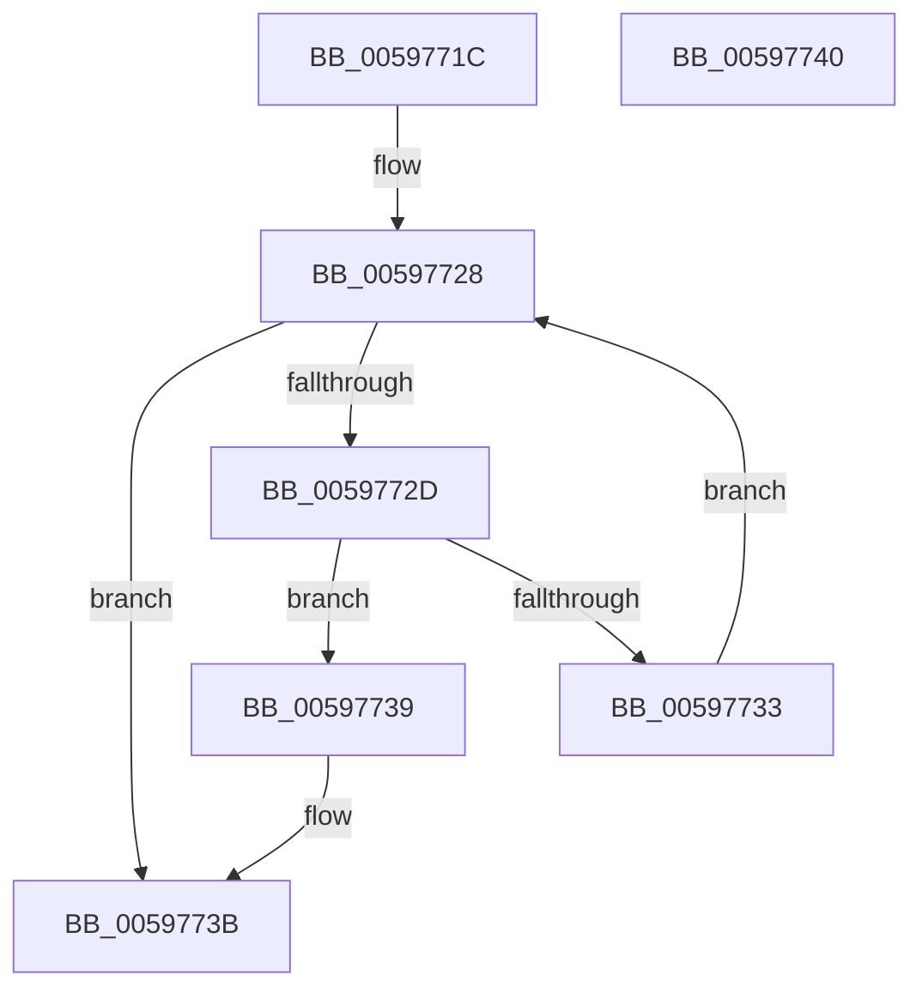

# IopVerifyDriverObjectOnStack

- RVA: `0x0059771C`–`0x00597741` (길이 `37` bytes)
- VA: `0x000000014059771C`
- 실행 섹션: `.text`
- PDB 이름 있음: `예`; PDB Function 태그: `아니요`
- unwind 정보 RVA: `0x0005C788`
- 디코드: `13`개 명령, `37/37` bytes 표시
- 미해석 바이트: `0` (있으면 어셈블리에 `.byte`로 보존)

> 이 문서는 커널 이미지의 기계어와 PDB 기호를 분석해 생성했습니다. 4번과 5번은 함수 원형과 자료형을 바이너리 사용 방식에서 추정한 C 해석이며 원본 소스 복구 결과는 아닙니다.

## 1. Dependencies

- 직접 호출 지점: **1**; 고유 호출 대상: **1**
- 직접 호출자로 확인된 함수: **1**
- RIP 상대 이미지 참조: **0**

### Outgoing calls
- `0x00597723` → [IopGetDeviceAttachmentBase](../27/IopGetDeviceAttachmentBase_function_002726E0.md) (function, `0x002726E0`)

### Direct callers
- [IopGetDriverPathInformation](IopGetDriverPathInformation_function_005973A8.md) at `0x00597453`
- [IopGetDriverPathInformation](IopGetDriverPathInformation_function_005973A8.md) at `0x0059746A`

### Static image references
- 디코드된 RIP-relative 메모리 참조가 없습니다.

## 2. Other-region calls and transfers

- 다른 실행 섹션으로 향하는 call: **0**
- 별도 외부 분기/꼬리 이동을 확인하지 못했습니다.

## 3. Assembly (complete function range)

```asm
0059771C  48 83 EC 28                     sub rsp, 0x28
00597720  4C 8B C2                        mov r8, rdx
00597723  E8 B8 AF CD FF                  call 0x1402726e0
00597728  48 85 C0                        test rax, rax
0059772B  74 0E                           je 0x14059773b
0059772D  4C 39 40 08                     cmp qword ptr [rax + 8], r8
00597731  74 06                           je 0x140597739
00597733  48 8B 40 18                     mov rax, qword ptr [rax + 0x18]
00597737  EB EF                           jmp 0x140597728
00597739  B0 01                           mov al, 1
0059773B  48 83 C4 28                     add rsp, 0x28
0059773F  C3                              ret
00597740  CC                              int3
```

## 4. C-style interpretation (structured pseudocode)

```c
__int64 __fastcall IopVerifyDriverObjectOnStack(__int64 a1, __int64 a2)
{
    __int64 result;
    __int64 v_rsp;

    v_rsp = (v_rsp) - (40);
    result = IopGetDeviceAttachmentBase(a1, a2, a2, a4);
loc_00597728:
    if (result == 0) goto loc_0059773B;
    if ((*(unsigned __int64 *)(result + 8)) == a2) goto loc_00597739;
    goto loc_00597728;
loc_00597739:
loc_0059773B:
    v_rsp = (v_rsp) + (40);
    return 1;
}
```

## 5. (Beta) C Style

```c
int64_t IopVerifyDriverObjectOnStack(int64_t Arg1, int64_t Arg2)
{
    int64_t result;
    int64_t local_rsp;

    local_rsp = (local_rsp) - (40);
    result = IopGetDeviceAttachmentBase(Arg1, Arg2, Arg2, a4);
loc_00597728:
    if (result == 0) goto loc_0059773B;
    if ((*(uint64_t *)(result + 0x8)) == Arg2) goto loc_00597739;
    goto loc_00597728;
loc_00597739:
loc_0059773B:
    local_rsp = (local_rsp) + (40);
    return 1;
}
```

## 6. Execution-region graph

[열기: 2D/3D 그래프와 함수 탐색 컨트롤 패널](../../../control-panel.html?section=text&rva=0x0059771C&view=graph)

- 2D 그래프는 위에서 아래로 흐르고, 3D 그래프는 빈 공간을 드래그해 회전합니다. Shift+드래그는 이동, 휠은 확대·축소, 함수 노드 선택은 대상 보고서 이동입니다.

### Static fallback


