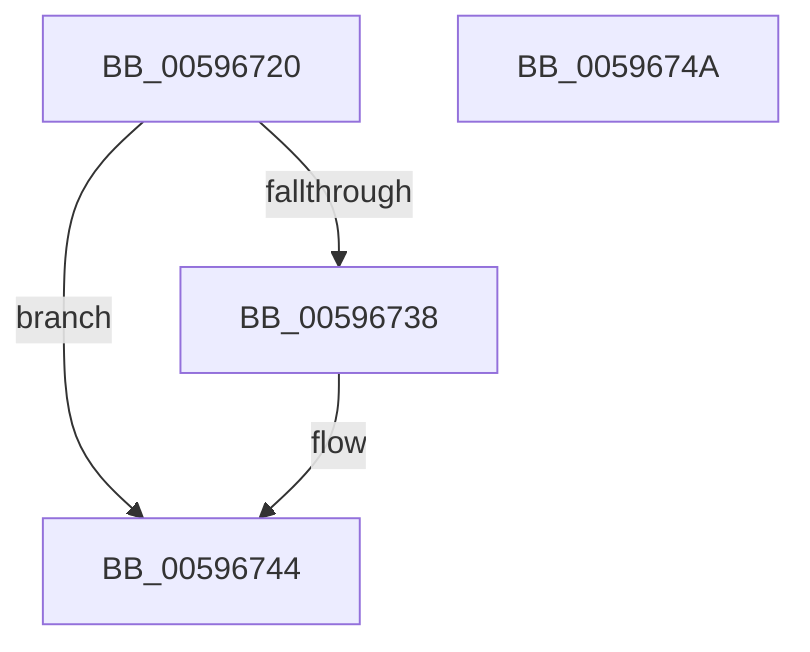

# IopWheaSelLogCheckPoint

- RVA: `0x00596720`–`0x0059674B` (길이 `43` bytes)
- VA: `0x0000000140596720`
- 실행 섹션: `.text`
- PDB 이름 있음: `예`; PDB Function 태그: `아니요`
- unwind 정보 RVA: `0x0005CF00`
- 디코드: `15`개 명령, `43/43` bytes 표시
- 미해석 바이트: `0` (있으면 어셈블리에 `.byte`로 보존)

> 이 문서는 커널 이미지의 기계어와 PDB 기호를 분석해 생성했습니다. 4번과 5번은 함수 원형과 자료형을 바이너리 사용 방식에서 추정한 C 해석이며 원본 소스 복구 결과는 아닙니다.

## 1. Dependencies

- 직접 호출 지점: **2**; 고유 호출 대상: **1**
- 직접 호출자로 확인된 함수: **0**
- RIP 상대 이미지 참조: **0**

### Outgoing calls
- `0x0059672F` → [WheaSelLogCheckPoint](../../page/7D/WheaSelLogCheckPoint_function_007D6800.md) (function, `0x007D6800`)
- `0x0059673F` → [WheaSelLogCheckPoint](../../page/7D/WheaSelLogCheckPoint_function_007D6800.md) (function, `0x007D6800`)

### Direct callers
- 이 함수 시작 RVA로 연결되는 직접 call은 확인되지 않았습니다. 간접 호출은 완전히 역산할 수 없습니다.

### Static image references
- 디코드된 RIP-relative 메모리 참조가 없습니다.

## 2. Other-region calls and transfers

- 다른 실행 섹션으로 향하는 call: **2**
  - `0x0059672F` → [WheaSelLogCheckPoint](../../page/7D/WheaSelLogCheckPoint_function_007D6800.md) (`.text` → `PAGE`)
  - `0x0059673F` → [WheaSelLogCheckPoint](../../page/7D/WheaSelLogCheckPoint_function_007D6800.md) (`.text` → `PAGE`)
- 별도 외부 분기/꼬리 이동을 확인하지 못했습니다.

## 3. Assembly (complete function range)

```asm
00596720  40 53                           push rbx
00596722  48 83 EC 20                     sub rsp, 0x20
00596726  8B DA                           mov ebx, edx
00596728  8B D1                           mov edx, ecx
0059672A  B9 51 00 00 00                  mov ecx, 0x51
0059672F  E8 CC 00 24 00                  call 0x1407d6800
00596734  85 C0                           test eax, eax
00596736  78 0C                           js 0x140596744
00596738  B9 52 00 00 00                  mov ecx, 0x52
0059673D  8B D3                           mov edx, ebx
0059673F  E8 BC 00 24 00                  call 0x1407d6800
00596744  48 83 C4 20                     add rsp, 0x20
00596748  5B                              pop rbx
00596749  C3                              ret
0059674A  CC                              int3
```

## 4. C-style interpretation (structured pseudocode)

```c
__int64 __fastcall IopWheaSelLogCheckPoint(int a1, int a2)
{
    __int64 result;
    __int64 v_rsp;

    v_rsp = (v_rsp) - (32);
    result = WheaSelLogCheckPoint(81, (unsigned int)(a1), a3, a4);
    if (!(sign_flag)) {
        a1 = 82;
        a2 = (unsigned int)((unsigned int)(a2));
        result = WheaSelLogCheckPoint(a1, a2, a3, a4);
    }
    v_rsp = (v_rsp) + (32);
    return result;
}
```

## 5. (Beta) C Style

```c
int64_t IopWheaSelLogCheckPoint(int32_t Arg1, int32_t Arg2)
{
    int64_t result;
    int64_t local_rsp;

    local_rsp = (local_rsp) - (32);
    result = WheaSelLogCheckPoint(81, (uint32_t)(Arg1), a3, a4);
    if (!(sign_flag)) {
        Arg1 = 82;
        Arg2 = (uint32_t)((uint32_t)(Arg2));
        result = WheaSelLogCheckPoint(Arg1, Arg2, a3, a4);
    }
    local_rsp = (local_rsp) + (32);
    return result;
}
```

## 6. Execution-region graph

[열기: 2D/3D 그래프와 함수 탐색 컨트롤 패널](../../../control-panel.html?section=text&rva=0x00596720&view=graph)

- 2D 그래프는 위에서 아래로 흐르고, 3D 그래프는 빈 공간을 드래그해 회전합니다. Shift+드래그는 이동, 휠은 확대·축소, 함수 노드 선택은 대상 보고서 이동입니다.

### Static fallback


