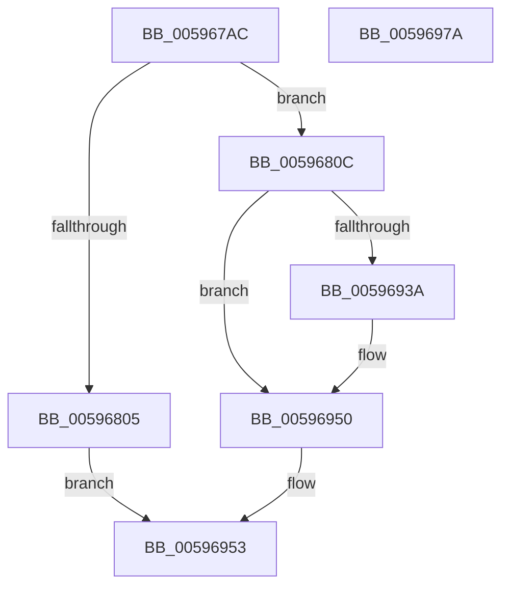

# IopWriteCapsuleTriageDumpToFirmware

- RVA: `0x005967AC`–`0x0059697B` (길이 `463` bytes)
- VA: `0x00000001405967AC`
- 실행 섹션: `.text`
- PDB 이름 있음: `예`; PDB Function 태그: `아니요`
- unwind 정보 RVA: `0x000C6F94`
- 디코드: `111`개 명령, `463/463` bytes 표시
- 미해석 바이트: `0` (있으면 어셈블리에 `.byte`로 보존)

> 이 문서는 커널 이미지의 기계어와 PDB 기호를 분석해 생성했습니다. 4번과 5번은 함수 원형과 자료형을 바이너리 사용 방식에서 추정한 C 해석이며 원본 소스 복구 결과는 아닙니다.

## 1. Dependencies

- 직접 호출 지점: **6**; 고유 호출 대상: **6**
- 직접 호출자로 확인된 함수: **1**
- RIP 상대 이미지 참조: **6**

### Outgoing calls
- `0x0059683B` → [IopUpdateMinidumpContext](IopUpdateMinidumpContext_function_00596360.md) (function, `0x00596360`)
- `0x00596847` → [MmSnapTriageDumpInformation](../67/MmSnapTriageDumpInformation_function_0067DE28.md) (function, `0x0067DE28`)
- `0x0059687A` → [IoFillDumpHeader](IoFillDumpHeader_function_00591ECC.md) (function, `0x00591ECC`)
- `0x00596900` → [IoFillTriageDumpBuffer](IoFillTriageDumpBuffer_function_005921CC.md) (function, `0x005921CC`)
- `0x00596941` → [IopWriteTriageDumpToFirmware](IopWriteTriageDumpToFirmware_function_00596984.md) (function, `0x00596984`)
- `0x0059695A` → [_security_check_cookie](../6A/_security_check_cookie_function_006AC640.md) (function, `0x006AC640`)

### Direct callers
- [IoWriteCrashDump](IoWriteCrashDump_function_005936D8.md) at `0x00593777`

### Static image references
- `0x005967C8` → RVA `0x00E0A740` (`.data`; read)
- `0x005967D6` → RVA `0x00E65F58` (`.data`; read)
- `0x00596824` → RVA `0x00F03FA4` (`.data`; write)
- `0x0059687F` → RVA `0x00F8E8E0` (`.data`; read)
- `0x00596895` → RVA `0x00F8D8E0` (`.data`; read)
- `0x005968D2` → RVA `0x00FC41C0` (`.data`; read)

## 2. Other-region calls and transfers

- 다른 실행 섹션으로 향하는 call: **0**
- 별도 외부 분기/꼬리 이동을 확인하지 못했습니다.

## 3. Assembly (complete function range)

```asm
005967AC  48 89 5C 24 08                  mov qword ptr [rsp + 8], rbx
005967B1  55                              push rbp
005967B2  56                              push rsi
005967B3  57                              push rdi
005967B4  41 54                           push r12
005967B6  41 55                           push r13
005967B8  41 56                           push r14
005967BA  41 57                           push r15
005967BC  48 8D 6C 24 F9                  lea rbp, [rsp - 7]
005967C1  48 81 EC C0 00 00 00            sub rsp, 0xc0
005967C8  48 8B 05 71 3F 87 00            mov rax, qword ptr [rip + 0x873f71]
005967CF  48 33 C4                        xor rax, rsp
005967D2  48 89 45 FF                     mov qword ptr [rbp - 1], rax
005967D6  48 8B 35 7B F7 8C 00            mov rsi, qword ptr [rip + 0x8cf77b]
005967DD  45 33 F6                        xor r14d, r14d
005967E0  48 8B 7D 6F                     mov rdi, qword ptr [rbp + 0x6f]
005967E4  4D 8B E9                        mov r13, r9
005967E7  48 8B 45 77                     mov rax, qword ptr [rbp + 0x77]
005967EB  4D 8B E0                        mov r12, r8
005967EE  89 4D B7                        mov dword ptr [rbp - 0x49], ecx
005967F1  4C 8B FA                        mov r15, rdx
005967F4  48 89 7D D7                     mov qword ptr [rbp - 0x29], rdi
005967F8  48 89 45 BF                     mov qword ptr [rbp - 0x41], rax
005967FC  44 89 75 BB                     mov dword ptr [rbp - 0x45], r14d
00596800  48 85 F6                        test rsi, rsi
00596803  75 07                           jne 0x14059680c
00596805  32 C0                           xor al, al
00596807  E9 47 01 00 00                  jmp 0x140596953
0059680C  48 8B 5D 67                     mov rbx, qword ptr [rbp + 0x67]
00596810  C6 44 24 40 01                  mov byte ptr [rsp + 0x40], 1
00596815  48 89 44 24 30                  mov qword ptr [rsp + 0x30], rax
0059681A  48 89 7C 24 28                  mov qword ptr [rsp + 0x28], rdi
0059681F  48 89 5C 24 20                  mov qword ptr [rsp + 0x20], rbx
00596824  44 89 35 79 D7 96 00            mov dword ptr [rip + 0x96d779], r14d
0059682B  4C 89 7D DF                     mov qword ptr [rbp - 0x21], r15
0059682F  4C 89 65 E7                     mov qword ptr [rbp - 0x19], r12
00596833  4C 89 6D EF                     mov qword ptr [rbp - 0x11], r13
00596837  48 89 5D F7                     mov qword ptr [rbp - 9], rbx
0059683B  E8 20 FB FF FF                  call 0x140596360
00596840  48 8D 55 DF                     lea rdx, [rbp - 0x21]
00596844  48 8B CF                        mov rcx, rdi
00596847  E8 DC 75 0E 00                  call 0x14067de28
0059684C  48 8B 45 BF                     mov rax, qword ptr [rbp - 0x41]
00596850  48 8D BE 1C 10 00 00            lea rdi, [rsi + 0x101c]
00596857  44 8B 45 B7                     mov r8d, dword ptr [rbp - 0x49]
0059685B  4D 8B CF                        mov r9, r15
0059685E  48 89 44 24 38                  mov qword ptr [rsp + 0x38], rax
00596863  BA 04 00 00 00                  mov edx, 4
00596868  48 89 5C 24 30                  mov qword ptr [rsp + 0x30], rbx
0059686D  48 8B CF                        mov rcx, rdi
00596870  4C 89 6C 24 28                  mov qword ptr [rsp + 0x28], r13
00596875  4C 89 64 24 20                  mov qword ptr [rsp + 0x20], r12
0059687A  E8 4D B6 FF FF                  call 0x140591ecc
0059687F  8B 05 5B 80 9F 00               mov eax, dword ptr [rip + 0x9f805b]
00596885  48 8D 96 1C 30 00 00            lea rdx, [rsi + 0x301c]
0059688C  89 45 C7                        mov dword ptr [rbp - 0x39], eax
0059688F  41 BF 01 00 00 00               mov r15d, 1
00596895  48 8D 05 44 70 9F 00            lea rax, [rip + 0x9f7044]
0059689C  C7 45 CB 00 01 00 00            mov dword ptr [rbp - 0x35], 0x100
005968A3  48 89 45 CF                     mov qword ptr [rbp - 0x31], rax
005968A7  BB FF 0D 00 00                  mov ebx, 0xdff
005968AC  48 8D 45 BB                     lea rax, [rbp - 0x45]
005968B0  44 8B CB                        mov r9d, ebx
005968B3  48 89 44 24 60                  mov qword ptr [rsp + 0x60], rax
005968B8  45 8A C7                        mov r8b, r15b
005968BB  48 8D 45 C7                     lea rax, [rbp - 0x39]
005968BF  B9 00 E0 03 00                  mov ecx, 0x3e000
005968C4  48 89 44 24 58                  mov qword ptr [rsp + 0x58], rax
005968C9  48 8D 45 C7                     lea rax, [rbp - 0x39]
005968CD  48 89 44 24 50                  mov qword ptr [rsp + 0x50], rax
005968D2  8B 05 E8 D8 A2 00               mov eax, dword ptr [rip + 0xa2d8e8]
005968D8  44 89 7C 24 48                  mov dword ptr [rsp + 0x48], r15d
005968DD  C7 44 24 40 41 00 00 00         mov dword ptr [rsp + 0x40], 0x41
005968E5  89 44 24 38                     mov dword ptr [rsp + 0x38], eax
005968E9  48 8B 45 BF                     mov rax, qword ptr [rbp - 0x41]
005968ED  48 89 44 24 30                  mov qword ptr [rsp + 0x30], rax
005968F2  48 8B 45 D7                     mov rax, qword ptr [rbp - 0x29]
005968F6  48 89 44 24 28                  mov qword ptr [rsp + 0x28], rax
005968FB  4C 89 74 24 20                  mov qword ptr [rsp + 0x20], r14
00596900  E8 C7 B8 FF FF                  call 0x1405921cc
00596905  0F 57 C0                        xorps xmm0, xmm0
00596908  8B C8                           mov ecx, eax
0059690A  0F 11 47 60                     movups xmmword ptr [rdi + 0x60], xmm0
0059690E  0F 11 47 70                     movups xmmword ptr [rdi + 0x70], xmm0
00596912  44 89 B7 3C 10 00 00            mov dword ptr [rdi + 0x103c], r14d
00596919  8B 86 20 30 00 00               mov eax, dword ptr [rsi + 0x3020]
0059691F  81 8F 50 10 00 00 88 00 00 00   or dword ptr [rdi + 0x1050], 0x88
00596929  48 89 87 A0 0F 00 00            mov qword ptr [rdi + 0xfa0], rax
00596930  89 9F 38 10 00 00               mov dword ptr [rdi + 0x1038], ebx
00596936  85 C9                           test ecx, ecx
00596938  78 16                           js 0x140596950
0059693A  48 8B 0D 17 F6 8C 00            mov rcx, qword ptr [rip + 0x8cf617]
00596941  E8 3E 00 00 00                  call 0x140596984
00596946  85 C0                           test eax, eax
00596948  45 0F B6 F6                     movzx r14d, r14b
0059694C  45 0F 49 F7                     cmovns r14d, r15d
00596950  41 8A C6                        mov al, r14b
00596953  48 8B 4D FF                     mov rcx, qword ptr [rbp - 1]
00596957  48 33 CC                        xor rcx, rsp
0059695A  E8 E1 5C 11 00                  call 0x1406ac640
0059695F  48 8B 9C 24 00 01 00 00         mov rbx, qword ptr [rsp + 0x100]
00596967  48 81 C4 C0 00 00 00            add rsp, 0xc0
0059696E  41 5F                           pop r15
00596970  41 5E                           pop r14
00596972  41 5D                           pop r13
00596974  41 5C                           pop r12
00596976  5F                              pop rdi
00596977  5E                              pop rsi
00596978  5D                              pop rbp
00596979  C3                              ret
0059697A  CC                              int3
```

## 4. C-style interpretation (structured pseudocode)

```c
__int64 __fastcall IopWriteCapsuleTriageDumpToFirmware(int a1, __int64 a2, __int64 a3, __int64 a4, __int64 a5, __int64 a6, __int64 a7)
{
    __int64 result;
    __int64 v_r14;
    __int64 v_rsp;
    unsigned __int64 v_stack_m3F;
    unsigned __int64 v_stack_m40;
    unsigned __int64 v_stack_m48;
    unsigned __int64 v_stack_m50;
    unsigned __int64 v_stack_m58;
    unsigned __int64 v_stack_m60;
    unsigned __int64 v_stack_m68;
    unsigned __int64 v_stack_m70;
    unsigned int v_stack_m74;
    unsigned int v_stack_m78;
    unsigned __int64 v_stack_m80;
    unsigned int v_stack_m84;
    unsigned int v_stack_m88;
    unsigned __int64 v_stack_m98;
    unsigned __int64 v_stack_mA0;
    unsigned __int64 v_stack_mA8;
    unsigned int v_stack_mB0;
    unsigned __int8 v_stack_mB8;
    unsigned __int64 v_stack_mC0;
    unsigned __int64 v_stack_mC8;
    unsigned __int64 v_stack_mD0;
    unsigned __int64 v_stack_mD8;
    unsigned __int64 v_stack_p8;

    v_stack_p8 = v_rbx;
    v_rsp = (v_rsp) - (192);
    result = (*(unsigned __int64 *)(v_rip + 8863601)) ^ (v_rsp);
    v_stack_m40 = result;
    v_r14 = 0;
    v_stack_m88 = a1;
    v_stack_m68 = a6;
    v_stack_m80 = a7;
    v_stack_m84 = 0;
    if (*(unsigned __int64 *)(v_rip + 9238395) != 0) goto loc_0059680C;
    result = 0;
    goto loc_00596953;
loc_0059680C:
    v_stack_mB8 = 1;
    v_stack_mC8 = 0;
    v_stack_mD0 = a6;
    v_stack_mD8 = a5;
    *(unsigned int *)(v_rip + 9885561) = 0;
    v_stack_m60 = a2;
    v_stack_m58 = a3;
    v_stack_m50 = a4;
    v_stack_m48 = a5;
    result = IopUpdateMinidumpContext(a1, a2, a3, a4);
    result = MmSnapTriageDumpInformation(a6, v_stack_m60, a3, a4);
    v_stack_mC0 = v_stack_m80;
    v_stack_mC8 = a5;
    v_stack_mD0 = a4;
    v_stack_mD8 = a3;
    result = IoFillDumpHeader(*(unsigned __int64 *)(v_rip + 9238395) + 4124, 4, (unsigned int)(v_stack_m88), a2);
    v_stack_m78 = (unsigned int)((unsigned int)(*(unsigned int *)(v_rip + 10453083)));
    v_stack_m74 = 256;
    v_stack_m70 = v_rip + 10448964;
    v_stack_m98 = v_stack_m84;
    v_stack_mA0 = v_stack_m78;
    v_stack_mA8 = v_stack_m78;
    v_stack_mB0 = 1;
    v_stack_mB8 = 65;
    v_stack_mC0 = (unsigned int)((unsigned int)(*(unsigned int *)(v_rip + 10672360)));
    v_stack_mC8 = v_stack_m80;
    v_stack_mD0 = v_stack_m68;
    v_stack_mD8 = 0;
    result = IoFillTriageDumpBuffer((unsigned int)(0x3E000ULL), *(unsigned __int64 *)(v_rip + 9238395) + 12316, 1, (unsigned int)((unsigned int)((unsigned int)(0xDFFULL))));
    *(unsigned __int64 *)(*(unsigned __int64 *)(v_rip + 9238395) + 4124 + 96) = v_xmm0;
    *(unsigned __int64 *)(*(unsigned __int64 *)(v_rip + 9238395) + 4124 + 112) = v_xmm0;
    *(unsigned int *)(*(unsigned __int64 *)(v_rip + 9238395) + 4124 + 4156) = 0;
    *(unsigned __int64 *)(*(unsigned __int64 *)(v_rip + 9238395) + 4124 + 4000) = (unsigned int)(*(unsigned int *)(*(unsigned __int64 *)(v_rip + 9238395) + 12320));
    *(unsigned int *)(*(unsigned __int64 *)(v_rip + 9238395) + 4124 + 4152) = (unsigned int)((unsigned int)(0xDFFULL));
    result = (unsigned int)(*(unsigned int *)(*(unsigned __int64 *)(v_rip + 9238395) + 12320));
    if (!(sign_flag)) {
        a1 = *(unsigned __int64 *)(v_rip + 9238039);
        result = IopWriteTriageDumpToFirmware(a1, *(unsigned __int64 *)(v_rip + 9238395) + 12316, 1, (unsigned int)((unsigned int)((unsigned int)(0xDFFULL))));
        v_r14 = 0;
        if (!sign_flag) { v_r14 = 1; }
    }
loc_00596953:
    a1 = (v_stack_m40) ^ (v_rsp);
    result = _security_check_cookie(a1, *(unsigned __int64 *)(v_rip + 9238395) + 12316, 1, (unsigned int)((unsigned int)((unsigned int)(0xDFFULL))));
    v_rsp = (v_rsp) + (192);
    return result;
}
```

## 5. (Beta) C Style

```c
int64_t IopWriteCapsuleTriageDumpToFirmware(int32_t Arg1, int64_t Arg2, int64_t Arg3, int64_t Arg4, int64_t Arg5, int64_t Arg6, int64_t Arg7)
{
    int64_t result;
    int64_t local_r14;
    int64_t local_rsp;
    uint64_t v_stack_m3F;
    uint64_t v_stack_m40;
    uint64_t v_stack_m48;
    uint64_t v_stack_m50;
    uint64_t v_stack_m58;
    uint64_t v_stack_m60;
    uint64_t v_stack_m68;
    uint64_t v_stack_m70;
    uint32_t v_stack_m74;
    uint32_t v_stack_m78;
    uint64_t v_stack_m80;
    uint32_t v_stack_m84;
    uint32_t v_stack_m88;
    uint64_t v_stack_m98;
    uint64_t v_stack_mA0;
    uint64_t v_stack_mA8;
    uint32_t v_stack_mB0;
    uint8_t v_stack_mB8;
    uint64_t v_stack_mC0;
    uint64_t v_stack_mC8;
    uint64_t v_stack_mD0;
    uint64_t v_stack_mD8;
    uint64_t v_stack_p8;

    v_stack_p8 = local_rbx;
    local_rsp = (local_rsp) - (192);
    result = (*(uint64_t *)(v_rip + 0x873F71)) ^ (local_rsp);
    v_stack_m40 = result;
    local_r14 = 0;
    v_stack_m88 = Arg1;
    v_stack_m68 = Arg6;
    v_stack_m80 = Arg7;
    v_stack_m84 = 0;
    if (*(uint64_t *)(v_rip + 0x8CF77B) != 0) goto loc_0059680C;
    result = 0;
    goto loc_00596953;
loc_0059680C:
    v_stack_mB8 = 1;
    v_stack_mC8 = 0;
    v_stack_mD0 = Arg6;
    v_stack_mD8 = Arg5;
    *(uint32_t *)(v_rip + 0x96D779) = 0;
    v_stack_m60 = Arg2;
    v_stack_m58 = Arg3;
    v_stack_m50 = Arg4;
    v_stack_m48 = Arg5;
    result = IopUpdateMinidumpContext(Arg1, Arg2, Arg3, Arg4);
    result = MmSnapTriageDumpInformation(Arg6, v_stack_m60, Arg3, Arg4);
    v_stack_mC0 = v_stack_m80;
    v_stack_mC8 = Arg5;
    v_stack_mD0 = Arg4;
    v_stack_mD8 = Arg3;
    result = IoFillDumpHeader(*(uint64_t *)(v_rip + 0x8CF77B) + 4124, 4, (uint32_t)(v_stack_m88), Arg2);
    v_stack_m78 = (uint32_t)((uint32_t)(*(uint32_t *)(v_rip + 0x9F805B)));
    v_stack_m74 = 256;
    v_stack_m70 = v_rip + 10448964;
    v_stack_m98 = v_stack_m84;
    v_stack_mA0 = v_stack_m78;
    v_stack_mA8 = v_stack_m78;
    v_stack_mB0 = 1;
    v_stack_mB8 = 65;
    v_stack_mC0 = (uint32_t)((uint32_t)(*(uint32_t *)(v_rip + 0xA2D8E8)));
    v_stack_mC8 = v_stack_m80;
    v_stack_mD0 = v_stack_m68;
    v_stack_mD8 = 0;
    result = IoFillTriageDumpBuffer((uint32_t)(0x3E000ULL), *(uint64_t *)(v_rip + 0x8CF77B) + 12316, 1, (uint32_t)((uint32_t)((uint32_t)(0xDFFULL))));
    *(uint64_t *)(*(uint64_t *)(v_rip + 0x8CF77B) + 0x101C + 0x60) = v_xmm0;
    *(uint64_t *)(*(uint64_t *)(v_rip + 0x8CF77B) + 0x101C + 0x70) = v_xmm0;
    *(uint32_t *)(*(uint64_t *)(v_rip + 0x8CF77B) + 0x101C + 0x103C) = 0;
    *(uint64_t *)(*(uint64_t *)(v_rip + 0x8CF77B) + 0x101C + 0xFA0) = (uint32_t)(*(uint32_t *)(*(uint64_t *)(v_rip + 0x8CF77B) + 0x3020));
    *(uint32_t *)(*(uint64_t *)(v_rip + 0x8CF77B) + 0x101C + 0x1038) = (uint32_t)((uint32_t)(0xDFFULL));
    result = (uint32_t)(*(uint32_t *)(*(uint64_t *)(v_rip + 0x8CF77B) + 0x3020));
    if (!(sign_flag)) {
        Arg1 = *(uint64_t *)(v_rip + 0x8CF617);
        result = IopWriteTriageDumpToFirmware(Arg1, *(uint64_t *)(v_rip + 0x8CF77B) + 12316, 1, (uint32_t)((uint32_t)((uint32_t)(0xDFFULL))));
        local_r14 = 0;
        if (!sign_flag) { local_r14 = 1; }
    }
loc_00596953:
    Arg1 = (v_stack_m40) ^ (local_rsp);
    result = _security_check_cookie(Arg1, *(uint64_t *)(v_rip + 0x8CF77B) + 12316, 1, (uint32_t)((uint32_t)((uint32_t)(0xDFFULL))));
    local_rsp = (local_rsp) + (192);
    return result;
}
```

## 6. Execution-region graph

[열기: 2D/3D 그래프와 함수 탐색 컨트롤 패널](../../../control-panel.html?section=text&rva=0x005967AC&view=graph)

- 2D 그래프는 위에서 아래로 흐르고, 3D 그래프는 빈 공간을 드래그해 회전합니다. Shift+드래그는 이동, 휠은 확대·축소, 함수 노드 선택은 대상 보고서 이동입니다.

### Static fallback


