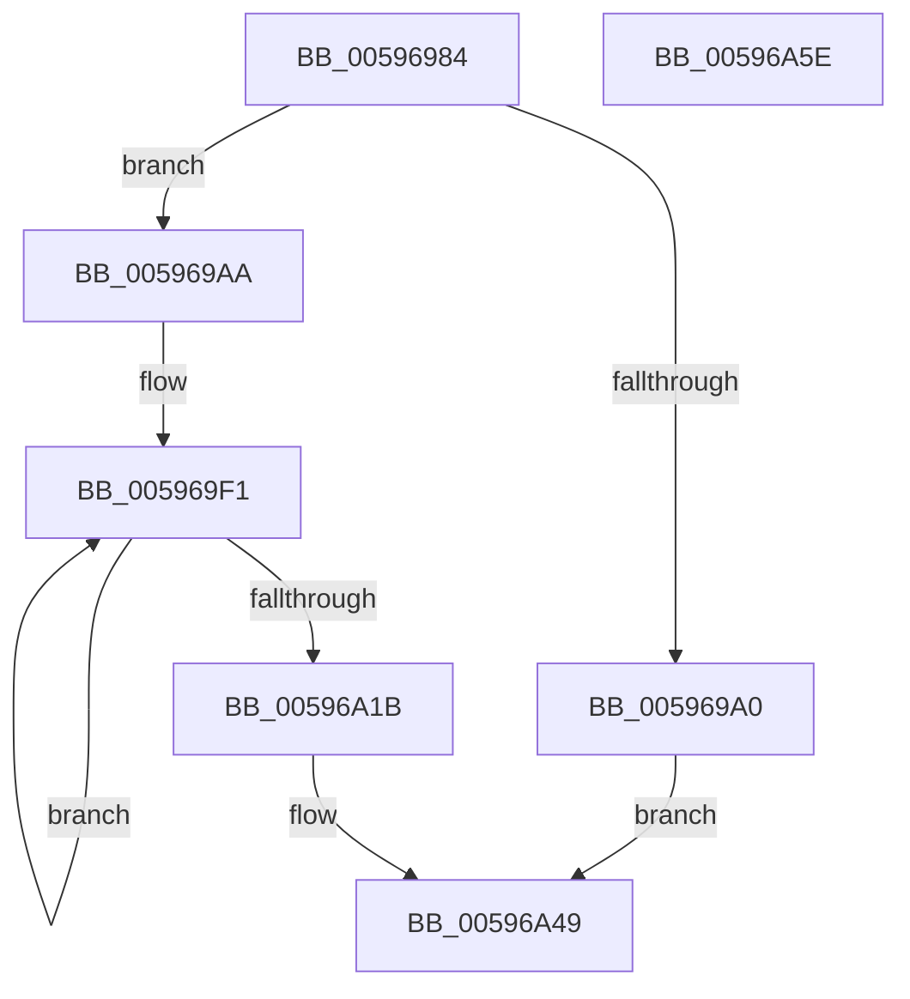

# IopWriteTriageDumpToFirmware

- RVA: `0x00596984`–`0x00596A5F` (길이 `219` bytes)
- VA: `0x0000000140596984`
- 실행 섹션: `.text`
- PDB 이름 있음: `예`; PDB Function 태그: `아니요`
- unwind 정보 RVA: `0x0006C8E8`
- 디코드: `53`개 명령, `219/219` bytes 표시
- 미해석 바이트: `0` (있으면 어셈블리에 `.byte`로 보존)

> 이 문서는 커널 이미지의 기계어와 PDB 기호를 분석해 생성했습니다. 4번과 5번은 함수 원형과 자료형을 바이너리 사용 방식에서 추정한 C 해석이며 원본 소스 복구 결과는 아닙니다.

## 1. Dependencies

- 직접 호출 지점: **4**; 고유 호출 대상: **3**
- 직접 호출자로 확인된 함수: **2**
- RIP 상대 이미지 참조: **2**

### Outgoing calls
- `0x00596A03` → [MmGetPhysicalAddress](../23/MmGetPhysicalAddress_function_0023A500.md) (function, `0x0023A500`)
- `0x00596A25` → [MmGetPhysicalAddress](../23/MmGetPhysicalAddress_function_0023A500.md) (function, `0x0023A500`)
- `0x00596A2D` → [KiScanBugCheckCallbackList](../5B/KiScanBugCheckCallbackList_function_005B5464.md) (function, `0x005B5464`)
- `0x00596A44` → [guard_dispatch_icall](../6B/guard_dispatch_icall_function_006BAAD0.md) (function, `0x006BAAD0`)

### Direct callers
- [IoWriteCrashDump](IoWriteCrashDump_function_005936D8.md) at `0x00593E12`
- [IopWriteCapsuleTriageDumpToFirmware](IopWriteCapsuleTriageDumpToFirmware_function_005967AC.md) at `0x00596941`

### Static image references
- `0x005969AA` → RVA `0x000277C8` (`.rdata`; read)
- `0x00596A32` → RVA `0x00E00AA8` (`.data`; read)

## 2. Other-region calls and transfers

- 다른 실행 섹션으로 향하는 call: **0**
- 별도 외부 분기/꼬리 이동을 확인하지 못했습니다.

## 3. Assembly (complete function range)

```asm
00596984  48 89 5C 24 10                  mov qword ptr [rsp + 0x10], rbx
00596989  48 89 6C 24 18                  mov qword ptr [rsp + 0x18], rbp
0059698E  48 89 74 24 20                  mov qword ptr [rsp + 0x20], rsi
00596993  57                              push rdi
00596994  48 83 EC 20                     sub rsp, 0x20
00596998  48 8B D9                        mov rbx, rcx
0059699B  48 85 C9                        test rcx, rcx
0059699E  75 0A                           jne 0x1405969aa
005969A0  B8 A3 00 00 C0                  mov eax, 0xc00000a3
005969A5  E9 9F 00 00 00                  jmp 0x140596a49
005969AA  0F 10 05 17 0E A9 FF            movups xmm0, xmmword ptr [rip - 0x56f1e9]
005969B1  48 8D 81 00 10 00 00            lea rax, [rcx + 0x1000]
005969B8  BE 1C 00 04 00                  mov esi, 0x4001c
005969BD  48 89 44 24 30                  mov qword ptr [rsp + 0x30], rax
005969C2  48 8B FB                        mov rdi, rbx
005969C5  C7 81 10 10 00 00 1C 00 00 00   mov dword ptr [rcx + 0x1010], 0x1c
005969CF  48 8B 44 24 30                  mov rax, qword ptr [rsp + 0x30]
005969D4  F3 0F 7F 00                     movdqu xmmword ptr [rax], xmm0
005969D8  48 8B 44 24 30                  mov rax, qword ptr [rsp + 0x30]
005969DD  C7 40 14 00 00 07 00            mov dword ptr [rax + 0x14], 0x70000
005969E4  48 8B 44 24 30                  mov rax, qword ptr [rsp + 0x30]
005969E9  89 70 18                        mov dword ptr [rax + 0x18], esi
005969EC  48 8B 6C 24 30                  mov rbp, qword ptr [rsp + 0x30]
005969F1  B8 00 10 00 00                  mov eax, 0x1000
005969F6  48 8B CD                        mov rcx, rbp
005969F9  48 3B F0                        cmp rsi, rax
005969FC  48 0F 42 C6                     cmovb rax, rsi
00596A00  48 89 07                        mov qword ptr [rdi], rax
00596A03  E8 F8 3A CA FF                  call 0x14023a500
00596A08  48 89 47 08                     mov qword ptr [rdi + 8], rax
00596A0C  48 8B 07                        mov rax, qword ptr [rdi]
00596A0F  48 8D 7F 10                     lea rdi, [rdi + 0x10]
00596A13  48 03 E8                        add rbp, rax
00596A16  48 2B F0                        sub rsi, rax
00596A19  75 D6                           jne 0x1405969f1
00596A1B  48 21 37                        and qword ptr [rdi], rsi
00596A1E  48 8B CB                        mov rcx, rbx
00596A21  48 21 77 08                     and qword ptr [rdi + 8], rsi
00596A25  E8 D6 3A CA FF                  call 0x14023a500
00596A2A  48 8B D8                        mov rbx, rax
00596A2D  E8 32 EA 01 00                  call 0x1405b5464
00596A32  48 8B 05 6F A0 86 00            mov rax, qword ptr [rip + 0x86a06f]
00596A39  8D 56 01                        lea edx, [rsi + 1]
00596A3C  4C 8B C3                        mov r8, rbx
00596A3F  48 8D 4C 24 30                  lea rcx, [rsp + 0x30]
00596A44  E8 87 40 12 00                  call 0x1406baad0
00596A49  48 8B 5C 24 38                  mov rbx, qword ptr [rsp + 0x38]
00596A4E  48 8B 6C 24 40                  mov rbp, qword ptr [rsp + 0x40]
00596A53  48 8B 74 24 48                  mov rsi, qword ptr [rsp + 0x48]
00596A58  48 83 C4 20                     add rsp, 0x20
00596A5C  5F                              pop rdi
00596A5D  C3                              ret
00596A5E  CC                              int3
```

## 4. C-style interpretation (structured pseudocode)

```c
__int64 __fastcall IopWriteTriageDumpToFirmware(__int64 a1)
{
    __int64 result;
    __int64 v_rbp;
    __int64 v_rsi;
    __int64 v_rsp;
    unsigned __int64 v_stack_p10;
    unsigned __int64 v_stack_p18;
    unsigned __int64 v_stack_p20;
    unsigned __int64 v_stack_p8;

    v_stack_p10 = v_rbx;
    v_stack_p18 = v_rbp;
    v_stack_p20 = v_rsi;
    v_rsp = (v_rsp) - (32);
    if (a1 != 0) goto loc_005969AA;
    goto loc_00596A49;
loc_005969AA:
    v_stack_p8 = a1 + 4096;
    *(unsigned int *)(a1 + 4112) = 28;
    *(unsigned __int64 *)(v_stack_p8) = v_xmm0;
    *(unsigned int *)(v_stack_p8 + 20) = 0x70000ULL;
    *(unsigned int *)(v_stack_p8 + 24) = (unsigned int)((unsigned int)(0x4001CULL));
loc_005969F1:
    result = (unsigned int)(0x1000ULL);
    if (((unsigned int)(0x4001CULL)) < ((unsigned int)(0x1000ULL))) { result = (unsigned int)(0x4001CULL); }
    *(unsigned __int64 *)(a1) = result;
    result = MmGetPhysicalAddress(v_stack_p8, a2, a3, a4);
    *(unsigned __int64 *)(a1 + 8) = result;
    v_rbp = (v_stack_p8) + (*(unsigned __int64 *)(a1));
    v_rsi = ((unsigned int)(0x4001CULL)) - (*(unsigned __int64 *)(a1));
    if (condition_is_not_equal) goto loc_005969F1;
    result = MmGetPhysicalAddress(a1, a2, a3, a4);
    result = KiScanBugCheckCallbackList(a1, a2, a3, a4);
    result = guard_dispatch_icall(v_stack_p8, v_rsi + 1, result, a4);
loc_00596A49:
    v_rsp = (v_rsp) + (32);
    return result;
}
```

## 5. (Beta) C Style

```c
int64_t IopWriteTriageDumpToFirmware(void *Arg1)
{
    uint8_t *arg1 = (uint8_t *)Arg1;

    int64_t result;
    int64_t local_rbp;
    int64_t local_rsi;
    int64_t local_rsp;
    uint64_t v_stack_p10;
    uint64_t v_stack_p18;
    uint64_t v_stack_p20;
    uint64_t v_stack_p8;

    v_stack_p10 = local_rbx;
    v_stack_p18 = local_rbp;
    v_stack_p20 = local_rsi;
    local_rsp = (local_rsp) - (32);
    if (Arg1 != NULL) goto loc_005969AA;
    goto loc_00596A49;
loc_005969AA:
    v_stack_p8 = Arg1 + 4096;
    *(uint32_t *)(arg1 + 0x1010) = 28;
    *(uint64_t *)(v_stack_p8) = v_xmm0;
    *(uint32_t *)(v_stack_p8 + 0x14) = 0x70000ULL;
    *(uint32_t *)(v_stack_p8 + 0x18) = (uint32_t)((uint32_t)(0x4001CULL));
loc_005969F1:
    result = (uint32_t)(0x1000ULL);
    if (((uint32_t)(0x4001CULL)) < ((uint32_t)(0x1000ULL))) { result = (uint32_t)(0x4001CULL); }
    *(uint64_t *)(arg1) = result;
    result = MmGetPhysicalAddress(v_stack_p8, a2, a3, a4);
    *(uint64_t *)(arg1 + 0x8) = result;
    local_rbp = (v_stack_p8) + (*(uint64_t *)(arg1));
    local_rsi = ((uint32_t)(0x4001CULL)) - (*(uint64_t *)(arg1));
    if (condition_is_not_equal) goto loc_005969F1;
    result = MmGetPhysicalAddress(Arg1, a2, a3, a4);
    result = KiScanBugCheckCallbackList(Arg1, a2, a3, a4);
    result = guard_dispatch_icall(v_stack_p8, local_rsi + 1, result, a4);
loc_00596A49:
    local_rsp = (local_rsp) + (32);
    return result;
}
```

### 관측된 메모리 오프셋

구조체 형식이 확인되지 않은 접근은 인자 기준의 오프셋으로만 기록했습니다.

| 기준 인자 | 오프셋 표현 | 폭 (bit) | 접근 |
|---|---:|---:|---|
| `Arg1` | `+ 0x0` | `64` | `R` |
| `Arg1` | `+ 0x0` | `64` | `R/W` |
| `Arg1` | `+ 0x0` | `64` | `W` |
| `Arg1` | `+ 0x8` | `64` | `R/W` |
| `Arg1` | `+ 0x8` | `64` | `W` |
| `Arg1` | `+ 0x10` | `64` | `R` |

## 6. Execution-region graph

[열기: 2D/3D 그래프와 함수 탐색 컨트롤 패널](../../../control-panel.html?section=text&rva=0x00596984&view=graph)

- 2D 그래프는 위에서 아래로 흐르고, 3D 그래프는 빈 공간을 드래그해 회전합니다. Shift+드래그는 이동, 휠은 확대·축소, 함수 노드 선택은 대상 보고서 이동입니다.

### Static fallback


