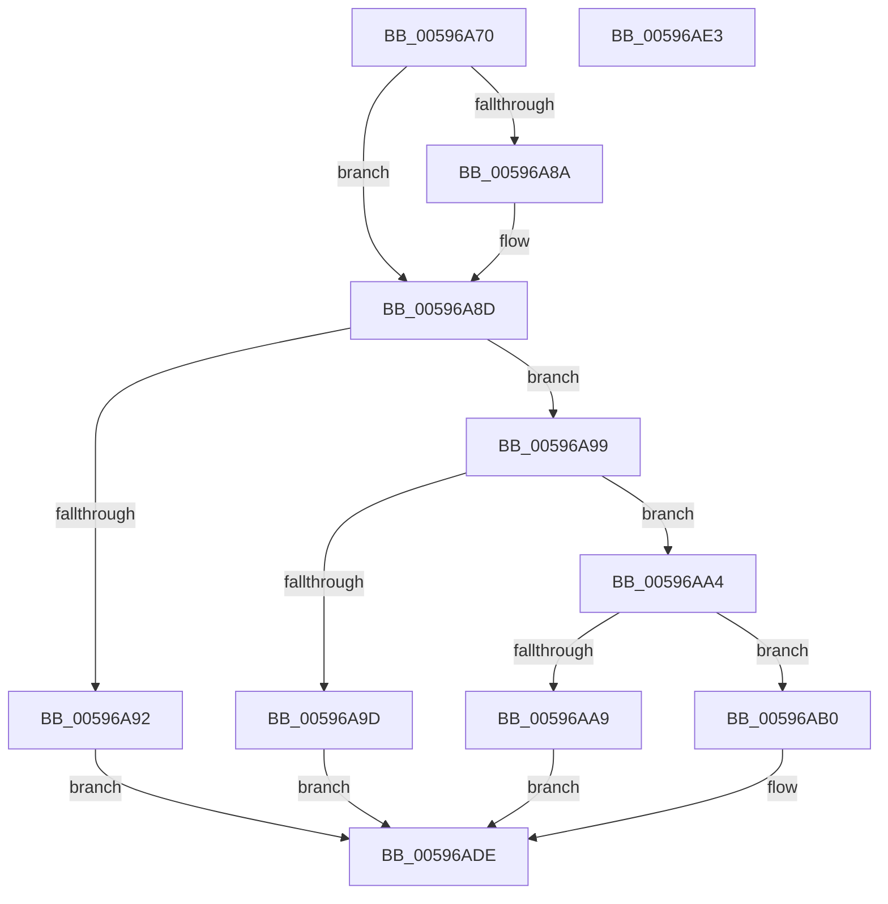

# KeInitializeCrashDumpHeader

- RVA: `0x00596A70`–`0x00596AE4` (길이 `116` bytes)
- VA: `0x0000000140596A70`
- 실행 섹션: `.text`
- PDB 이름 있음: `예`; PDB Function 태그: `아니요`
- unwind 정보 RVA: `0x00063458`
- 디코드: `33`개 명령, `116/116` bytes 표시
- 미해석 바이트: `0` (있으면 어셈블리에 `.byte`로 보존)

> 이 문서는 커널 이미지의 기계어와 PDB 기호를 분석해 생성했습니다. 4번과 5번은 함수 원형과 자료형을 바이너리 사용 방식에서 추정한 C 해석이며 원본 소스 복구 결과는 아닙니다.

## 1. Dependencies

- 직접 호출 지점: **1**; 고유 호출 대상: **1**
- 직접 호출자로 확인된 함수: **0**
- RIP 상대 이미지 참조: **0**

### Outgoing calls
- `0x00596AD7` → [IoFillDumpHeader](IoFillDumpHeader_function_00591ECC.md) (function, `0x00591ECC`)

### Direct callers
- 이 함수 시작 RVA로 연결되는 직접 call은 확인되지 않았습니다. 간접 호출은 완전히 역산할 수 없습니다.

### Static image references
- 디코드된 RIP-relative 메모리 참조가 없습니다.

## 2. Other-region calls and transfers

- 다른 실행 섹션으로 향하는 call: **0**
- 별도 외부 분기/꼬리 이동을 확인하지 못했습니다.

## 3. Assembly (complete function range)

```asm
00596A70  48 83 EC 48                     sub rsp, 0x48
00596A74  48 8B 44 24 70                  mov rax, qword ptr [rsp + 0x70]
00596A79  4D 8B D0                        mov r10, r8
00596A7C  45 33 C0                        xor r8d, r8d
00596A7F  41 BB 00 20 00 00               mov r11d, 0x2000
00596A85  48 85 C0                        test rax, rax
00596A88  74 03                           je 0x140596a8d
00596A8A  44 89 18                        mov dword ptr [rax], r11d
00596A8D  83 F9 01                        cmp ecx, 1
00596A90  74 07                           je 0x140596a99
00596A92  B8 EF 00 00 C0                  mov eax, 0xc00000ef
00596A97  EB 45                           jmp 0x140596ade
00596A99  85 D2                           test edx, edx
00596A9B  74 07                           je 0x140596aa4
00596A9D  B8 F0 00 00 C0                  mov eax, 0xc00000f0
00596AA2  EB 3A                           jmp 0x140596ade
00596AA4  45 3B CB                        cmp r9d, r11d
00596AA7  73 07                           jae 0x140596ab0
00596AA9  B8 F2 00 00 C0                  mov eax, 0xc00000f2
00596AAE  EB 2E                           jmp 0x140596ade
00596AB0  65 48 8B 04 25 88 01 00 00      mov rax, qword ptr gs:[0x188]
00596AB9  45 33 C9                        xor r9d, r9d
00596ABC  48 89 44 24 38                  mov qword ptr [rsp + 0x38], rax
00596AC1  49 8B CA                        mov rcx, r10
00596AC4  4C 89 44 24 30                  mov qword ptr [rsp + 0x30], r8
00596AC9  4C 89 44 24 28                  mov qword ptr [rsp + 0x28], r8
00596ACE  41 8D 51 01                     lea edx, [r9 + 1]
00596AD2  4C 89 44 24 20                  mov qword ptr [rsp + 0x20], r8
00596AD7  E8 F0 B3 FF FF                  call 0x140591ecc
00596ADC  33 C0                           xor eax, eax
00596ADE  48 83 C4 48                     add rsp, 0x48
00596AE2  C3                              ret
00596AE3  CC                              int3
```

## 4. C-style interpretation (structured pseudocode)

```c
__int64 __fastcall KeInitializeCrashDumpHeader(int a1, int a2, __int64 a3, int a4, __int64 a5)
{
    __int64 result;
    __int64 v_rsp;
    unsigned __int64 v_stack_m10;
    unsigned __int64 v_stack_m18;
    unsigned __int64 v_stack_m20;
    unsigned __int64 v_stack_m28;

    v_rsp = (v_rsp) - (72);
    a3 = 0;
    if (a5 != 0) {
        *(unsigned int *)(a5) = (unsigned int)((unsigned int)(0x2000ULL));
    }
    if (a1 == 1) goto loc_00596A99;
    goto loc_00596ADE;
loc_00596A99:
    if (a2 == 0) goto loc_00596AA4;
    goto loc_00596ADE;
loc_00596AA4:
    if (a4 >= ((unsigned int)((unsigned int)(0x2000ULL)))) goto loc_00596AB0;
    goto loc_00596ADE;
loc_00596AB0:
    a4 = 0;
    v_stack_m10 = *(unsigned __int64 *)(gs_base + (0 + 392));
    v_stack_m18 = 0;
    v_stack_m20 = 0;
    v_stack_m28 = 0;
    result = IoFillDumpHeader(0, a4 + 1, a3, a4);
    result = 0;
loc_00596ADE:
    v_rsp = (v_rsp) + (72);
    return result;
}
```

## 5. (Beta) C Style

```c
int64_t KeInitializeCrashDumpHeader(int32_t Arg1, int32_t Arg2, int64_t Arg3, int32_t Arg4, int64_t Arg5)
{
    int64_t result;
    int64_t local_rsp;
    uint64_t v_stack_m10;
    uint64_t v_stack_m18;
    uint64_t v_stack_m20;
    uint64_t v_stack_m28;

    local_rsp = (local_rsp) - (72);
    Arg3 = 0;
    if (Arg5 != 0) {
        *(uint32_t *)(Arg5) = (uint32_t)((uint32_t)(0x2000ULL));
    }
    if (Arg1 == 1) goto loc_00596A99;
    goto loc_00596ADE;
loc_00596A99:
    if (Arg2 == 0) goto loc_00596AA4;
    goto loc_00596ADE;
loc_00596AA4:
    if (Arg4 >= ((uint32_t)((uint32_t)(0x2000ULL)))) goto loc_00596AB0;
    goto loc_00596ADE;
loc_00596AB0:
    Arg4 = 0;
    v_stack_m10 = *(uint64_t *)(gs_base + (0 + 0x188));
    v_stack_m18 = 0;
    v_stack_m20 = 0;
    v_stack_m28 = 0;
    result = IoFillDumpHeader(0, Arg4 + 1, Arg3, Arg4);
    result = 0;
loc_00596ADE:
    local_rsp = (local_rsp) + (72);
    return result;
}
```

## 6. Execution-region graph

[열기: 2D/3D 그래프와 함수 탐색 컨트롤 패널](../../../control-panel.html?section=text&rva=0x00596A70&view=graph)

- 2D 그래프는 위에서 아래로 흐르고, 3D 그래프는 빈 공간을 드래그해 회전합니다. Shift+드래그는 이동, 휠은 확대·축소, 함수 노드 선택은 대상 보고서 이동입니다.

### Static fallback


