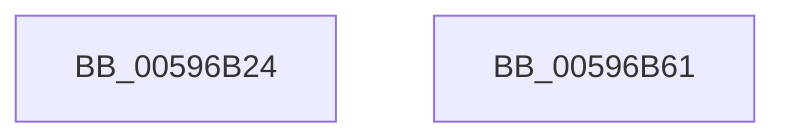

# McTemplateK0_EtwWriteTransfer

- RVA: `0x00596B24`–`0x00596B62` (길이 `62` bytes)
- VA: `0x0000000140596B24`
- 실행 섹션: `.text`
- PDB 이름 있음: `예`; PDB Function 태그: `아니요`
- unwind 정보 RVA: `0x00060904`
- 디코드: `15`개 명령, `62/62` bytes 표시
- 미해석 바이트: `0` (있으면 어셈블리에 `.byte`로 보존)

> 이 문서는 커널 이미지의 기계어와 PDB 기호를 분석해 생성했습니다. 4번과 5번은 함수 원형과 자료형을 바이너리 사용 방식에서 추정한 C 해석이며 원본 소스 복구 결과는 아닙니다.

## 1. Dependencies

- 직접 호출 지점: **2**; 고유 호출 대상: **2**
- 직접 호출자로 확인된 함수: **3**
- RIP 상대 이미지 참조: **1**

### Outgoing calls
- `0x00596B4A` → [McGenEventWrite_EtwWriteTransfer](../42/McGenEventWrite_EtwWriteTransfer_function_00424FC8.md) (function, `0x00424FC8`)
- `0x00596B57` → [_security_check_cookie](../6A/_security_check_cookie_function_006AC640.md) (function, `0x006AC640`)

### Direct callers
- [PnpSerializeBoot](../5A/PnpSerializeBoot_function_005A4F1C.md) at `0x005A4F3E`
- [PnpSerializeBoot](../5A/PnpSerializeBoot_function_005A4F1C.md) at `0x005A4F7F`
- [PiSwIrpStartCreate](../../page/8D/PiSwIrpStartCreate_function_008DA834.md) at `0x008DA949`
- [IoInitSystemPreDrivers](../../init/C2/IoInitSystemPreDrivers_function_00C2AC3C.md) at `0x00C2B7DE`
- [IoInitSystemPreDrivers](../../init/C2/IoInitSystemPreDrivers_function_00C2AC3C.md) at `0x00C2BB41`
- [IoInitSystemPreDrivers](../../init/C2/IoInitSystemPreDrivers_function_00C2AC3C.md) at `0x00C2BBD1`
- [IoInitSystemPreDrivers](../../init/C2/IoInitSystemPreDrivers_function_00C2AC3C.md) at `0x00C2BBF7`
- [IoInitSystemPreDrivers](../../init/C2/IoInitSystemPreDrivers_function_00C2AC3C.md) at `0x00C2BCAB`
- [IoInitSystemPreDrivers](../../init/C2/IoInitSystemPreDrivers_function_00C2AC3C.md) at `0x00C2BECC`

### Static image references
- `0x00596B28` → RVA `0x00E0A740` (`.data`; read)

## 2. Other-region calls and transfers

- 다른 실행 섹션으로 향하는 call: **0**
- 별도 외부 분기/꼬리 이동을 확인하지 못했습니다.

## 3. Assembly (complete function range)

```asm
00596B24  48 83 EC 58                     sub rsp, 0x58
00596B28  48 8B 05 11 3C 87 00            mov rax, qword ptr [rip + 0x873c11]
00596B2F  48 33 C4                        xor rax, rsp
00596B32  48 89 44 24 40                  mov qword ptr [rsp + 0x40], rax
00596B37  48 8D 44 24 30                  lea rax, [rsp + 0x30]
00596B3C  41 B9 01 00 00 00               mov r9d, 1
00596B42  45 33 C0                        xor r8d, r8d
00596B45  48 89 44 24 20                  mov qword ptr [rsp + 0x20], rax
00596B4A  E8 79 E4 E8 FF                  call 0x140424fc8
00596B4F  48 8B 4C 24 40                  mov rcx, qword ptr [rsp + 0x40]
00596B54  48 33 CC                        xor rcx, rsp
00596B57  E8 E4 5A 11 00                  call 0x1406ac640
00596B5C  48 83 C4 58                     add rsp, 0x58
00596B60  C3                              ret
00596B61  CC                              int3
```

## 4. C-style interpretation (structured pseudocode)

```c
__int64 __fastcall McTemplateK0_EtwWriteTransfer(__int64 a1, __int64 a2, int a3)
{
    __int64 result;
    __int64 v_rsp;
    unsigned __int64 v_stack_m18;
    unsigned __int64 v_stack_m28;
    unsigned __int64 v_stack_m38;

    v_rsp = (v_rsp) - (88);
    result = (*(unsigned __int64 *)(v_rip + 8862737)) ^ (v_rsp);
    v_stack_m18 = result;
    a3 = 0;
    v_stack_m38 = v_stack_m28;
    result = McGenEventWrite_EtwWriteTransfer(a1, a2, a3, 1);
    a1 = (v_stack_m18) ^ (v_rsp);
    result = _security_check_cookie(a1, a2, a3, 1);
    v_rsp = (v_rsp) + (88);
    return result;
}
```

## 5. (Beta) C Style

```c
int64_t McTemplateK0_EtwWriteTransfer(int64_t Arg1, int64_t Arg2, int32_t Arg3)
{
    int64_t result;
    int64_t local_rsp;
    uint64_t v_stack_m18;
    uint64_t v_stack_m28;
    uint64_t v_stack_m38;

    local_rsp = (local_rsp) - (88);
    result = (*(uint64_t *)(v_rip + 0x873C11)) ^ (local_rsp);
    v_stack_m18 = result;
    Arg3 = 0;
    v_stack_m38 = v_stack_m28;
    result = McGenEventWrite_EtwWriteTransfer(Arg1, Arg2, Arg3, 1);
    Arg1 = (v_stack_m18) ^ (local_rsp);
    result = _security_check_cookie(Arg1, Arg2, Arg3, 1);
    local_rsp = (local_rsp) + (88);
    return result;
}
```

## 6. Execution-region graph

[열기: 2D/3D 그래프와 함수 탐색 컨트롤 패널](../../../control-panel.html?section=text&rva=0x00596B24&view=graph)

- 2D 그래프는 위에서 아래로 흐르고, 3D 그래프는 빈 공간을 드래그해 회전합니다. Shift+드래그는 이동, 휠은 확대·축소, 함수 노드 선택은 대상 보고서 이동입니다.

### Static fallback


