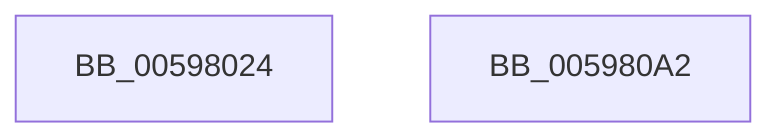

# McTemplateK0hzr0_EtwWriteTransfer

- RVA: `0x00598024`–`0x005980A3` (길이 `127` bytes)
- VA: `0x0000000140598024`
- 실행 섹션: `.text`
- PDB 이름 있음: `예`; PDB Function 태그: `아니요`
- unwind 정보 RVA: `0x000AD3B0`
- 디코드: `28`개 명령, `127/127` bytes 표시
- 미해석 바이트: `0` (있으면 어셈블리에 `.byte`로 보존)

> 이 문서는 커널 이미지의 기계어와 PDB 기호를 분석해 생성했습니다. 4번과 5번은 함수 원형과 자료형을 바이너리 사용 방식에서 추정한 C 해석이며 원본 소스 복구 결과는 아닙니다.

## 1. Dependencies

- 직접 호출 지점: **2**; 고유 호출 대상: **2**
- 직접 호출자로 확인된 함수: **2**
- RIP 상대 이미지 참조: **3**

### Outgoing calls
- `0x0059808B` → [McGenEventWrite_EtwWriteTransfer](../42/McGenEventWrite_EtwWriteTransfer_function_00424FC8.md) (function, `0x00424FC8`)
- `0x00598098` → [_security_check_cookie](../6A/_security_check_cookie_function_006AC640.md) (function, `0x006AC640`)

### Direct callers
- [IopAttachDeviceToDeviceStackSafe](../41/IopAttachDeviceToDeviceStackSafe_function_00410574.md) at `0x004107FF`
- [IoRegisterFsRegistrationChangeMountAware](../../page/71/IoRegisterFsRegistrationChangeMountAware_function_0071D890.md) at `0x0071D8ED`

### Static image references
- `0x00598030` → RVA `0x00E0A740` (`.data`; read)
- `0x00598047` → RVA `0x00022888` (`.rdata`; read)
- `0x00598056` → RVA `0x00E06E20` (`.data`; read)

## 2. Other-region calls and transfers

- 다른 실행 섹션으로 향하는 call: **0**
- 별도 외부 분기/꼬리 이동을 확인하지 못했습니다.

## 3. Assembly (complete function range)

```asm
00598024  4C 8B DC                        mov r11, rsp
00598027  66 45 89 4B 20                  mov word ptr [r11 + 0x20], r9w
0059802C  48 83 EC 78                     sub rsp, 0x78
00598030  48 8B 05 09 27 87 00            mov rax, qword ptr [rip + 0x872709]
00598037  48 33 C4                        xor rax, rsp
0059803A  48 89 44 24 60                  mov qword ptr [rsp + 0x60], rax
0059803F  49 8D 43 20                     lea rax, [r11 + 0x20]
00598043  49 89 43 C8                     mov qword ptr [r11 - 0x38], rax
00598047  48 8D 15 3A A8 A8 FF            lea rdx, [rip - 0x5757c6]
0059804E  48 8B 84 24 A0 00 00 00         mov rax, qword ptr [rsp + 0xa0]
00598056  48 8D 0D C3 ED 86 00            lea rcx, [rip + 0x86edc3]
0059805D  83 64 24 4C 00                  and dword ptr [rsp + 0x4c], 0
00598062  C7 44 24 48 02 00 00 00         mov dword ptr [rsp + 0x48], 2
0059806A  49 89 43 D8                     mov qword ptr [r11 - 0x28], rax
0059806E  83 64 24 5C 00                  and dword ptr [rsp + 0x5c], 0
00598073  41 0F B7 C1                     movzx eax, r9w
00598077  41 B9 03 00 00 00               mov r9d, 3
0059807D  03 C0                           add eax, eax
0059807F  89 44 24 58                     mov dword ptr [rsp + 0x58], eax
00598083  49 8D 43 B8                     lea rax, [r11 - 0x48]
00598087  49 89 43 A8                     mov qword ptr [r11 - 0x58], rax
0059808B  E8 38 CF E8 FF                  call 0x140424fc8
00598090  48 8B 4C 24 60                  mov rcx, qword ptr [rsp + 0x60]
00598095  48 33 CC                        xor rcx, rsp
00598098  E8 A3 45 11 00                  call 0x1406ac640
0059809D  48 83 C4 78                     add rsp, 0x78
005980A1  C3                              ret
005980A2  CC                              int3
```

## 4. C-style interpretation (structured pseudocode)

```c
__int64 __fastcall McTemplateK0hzr0_EtwWriteTransfer(__int64 a1, __int64 a2, __int64 a3, unsigned __int16 a4, __int64 a5)
{
    __int64 result;
    __int64 v_rsp;
    unsigned __int64 v_stack_m18;
    unsigned int v_stack_m1C;
    unsigned int v_stack_m20;
    unsigned int v_stack_m2C;
    unsigned int v_stack_m30;

    *(unsigned __int16 *)(v_rsp + 32) = a4;
    v_rsp = (v_rsp) - (120);
    result = (*(unsigned __int64 *)(v_rip + 8857353)) ^ (v_rsp);
    v_stack_m18 = result;
    *(unsigned __int64 *)(v_rsp - 56) = v_rsp + 32;
    v_stack_m30 = 2;
    *(unsigned __int64 *)(v_rsp - 40) = a5;
    result = (unsigned int)((a4) + (a4));
    v_stack_m20 = (unsigned int)(result);
    *(unsigned __int64 *)(v_rsp - 88) = v_rsp - 72;
    result = McGenEventWrite_EtwWriteTransfer(v_rip + 8842691, v_rip - 5724102, a3, 3);
    a1 = (v_stack_m18) ^ (v_rsp);
    result = _security_check_cookie(a1, v_rip - 5724102, a3, 3);
    v_rsp = (v_rsp) + (120);
    return result;
}
```

## 5. (Beta) C Style

```c
int64_t McTemplateK0hzr0_EtwWriteTransfer(int64_t Arg1, int64_t Arg2, int64_t Arg3, uint16_t Arg4, int64_t Arg5)
{
    int64_t result;
    int64_t local_rsp;
    uint64_t v_stack_m18;
    uint32_t v_stack_m1C;
    uint32_t v_stack_m20;
    uint32_t v_stack_m2C;
    uint32_t v_stack_m30;

    *(uint16_t *)(local_rsp + 0x20) = Arg4;
    local_rsp = (local_rsp) - (120);
    result = (*(uint64_t *)(v_rip + 0x872709)) ^ (local_rsp);
    v_stack_m18 = result;
    *(uint64_t *)(local_rsp - 0x38) = local_rsp + 32;
    v_stack_m30 = 2;
    *(uint64_t *)(local_rsp - 0x28) = Arg5;
    result = (uint32_t)((Arg4) + (Arg4));
    v_stack_m20 = (uint32_t)(result);
    *(uint64_t *)(local_rsp - 0x58) = local_rsp - 72;
    result = McGenEventWrite_EtwWriteTransfer(v_rip + 8842691, v_rip - 5724102, Arg3, 3);
    Arg1 = (v_stack_m18) ^ (local_rsp);
    result = _security_check_cookie(Arg1, v_rip - 5724102, Arg3, 3);
    local_rsp = (local_rsp) + (120);
    return result;
}
```

## 6. Execution-region graph

[열기: 2D/3D 그래프와 함수 탐색 컨트롤 패널](../../../control-panel.html?section=text&rva=0x00598024&view=graph)

- 2D 그래프는 위에서 아래로 흐르고, 3D 그래프는 빈 공간을 드래그해 회전합니다. Shift+드래그는 이동, 휠은 확대·축소, 함수 노드 선택은 대상 보고서 이동입니다.

### Static fallback


