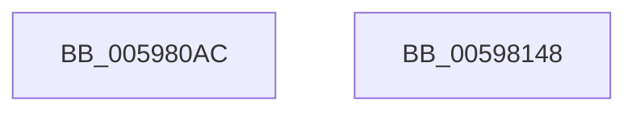

# McTemplateK0hzr0hzr2_EtwWriteTransfer

- RVA: `0x005980AC`–`0x00598149` (길이 `157` bytes)
- VA: `0x00000001405980AC`
- 실행 섹션: `.text`
- PDB 이름 있음: `예`; PDB Function 태그: `아니요`
- unwind 정보 RVA: `0x000C7540`
- 디코드: `38`개 명령, `157/157` bytes 표시
- 미해석 바이트: `0` (있으면 어셈블리에 `.byte`로 보존)

> 이 문서는 커널 이미지의 기계어와 PDB 기호를 분석해 생성했습니다. 4번과 5번은 함수 원형과 자료형을 바이너리 사용 방식에서 추정한 C 해석이며 원본 소스 복구 결과는 아닙니다.

## 1. Dependencies

- 직접 호출 지점: **2**; 고유 호출 대상: **2**
- 직접 호출자로 확인된 함수: **1**
- RIP 상대 이미지 참조: **2**

### Outgoing calls
- `0x0059812E` → [McGenEventWrite_EtwWriteTransfer](../42/McGenEventWrite_EtwWriteTransfer_function_00424FC8.md) (function, `0x00424FC8`)
- `0x0059813A` → [_security_check_cookie](../6A/_security_check_cookie_function_006AC640.md) (function, `0x006AC640`)

### Direct callers
- [sub_006ECEEA](../6E/Unknown_function_006ECEEA.md) at `0x006ED065`

### Static image references
- `0x005980BF` → RVA `0x00E0A740` (`.data`; read)
- `0x005980E4` → RVA `0x00E06E20` (`.data`; read)

## 2. Other-region calls and transfers

- 다른 실행 섹션으로 향하는 call: **0**
- 별도 외부 분기/꼬리 이동을 확인하지 못했습니다.

## 3. Assembly (complete function range)

```asm
005980AC  66 44 89 4C 24 20               mov word ptr [rsp + 0x20], r9w
005980B2  55                              push rbp
005980B3  48 8D 6C 24 C1                  lea rbp, [rsp - 0x3f]
005980B8  48 81 EC 90 00 00 00            sub rsp, 0x90
005980BF  48 8B 05 7A 26 87 00            mov rax, qword ptr [rip + 0x87267a]
005980C6  48 33 C4                        xor rax, rsp
005980C9  48 89 45 2F                     mov qword ptr [rbp + 0x2f], rax
005980CD  45 33 D2                        xor r10d, r10d
005980D0  48 C7 45 F7 02 00 00 00         mov qword ptr [rbp - 9], 2
005980D8  48 8D 45 67                     lea rax, [rbp + 0x67]
005980DC  44 89 55 0B                     mov dword ptr [rbp + 0xb], r10d
005980E0  48 89 45 EF                     mov qword ptr [rbp - 0x11], rax
005980E4  48 8D 0D 35 ED 86 00            lea rcx, [rip + 0x86ed35]
005980EB  48 8B 45 6F                     mov rax, qword ptr [rbp + 0x6f]
005980EF  48 89 45 FF                     mov qword ptr [rbp - 1], rax
005980F3  41 0F B7 C1                     movzx eax, r9w
005980F7  45 8D 4A 05                     lea r9d, [r10 + 5]
005980FB  03 C0                           add eax, eax
005980FD  48 C7 45 17 02 00 00 00         mov qword ptr [rbp + 0x17], 2
00598105  89 45 07                        mov dword ptr [rbp + 7], eax
00598108  48 8D 45 77                     lea rax, [rbp + 0x77]
0059810C  48 89 45 0F                     mov qword ptr [rbp + 0xf], rax
00598110  48 8B 45 7F                     mov rax, qword ptr [rbp + 0x7f]
00598114  48 89 45 1F                     mov qword ptr [rbp + 0x1f], rax
00598118  0F B7 45 77                     movzx eax, word ptr [rbp + 0x77]
0059811C  03 C0                           add eax, eax
0059811E  44 89 55 2B                     mov dword ptr [rbp + 0x2b], r10d
00598122  89 45 27                        mov dword ptr [rbp + 0x27], eax
00598125  48 8D 45 DF                     lea rax, [rbp - 0x21]
00598129  48 89 44 24 20                  mov qword ptr [rsp + 0x20], rax
0059812E  E8 95 CE E8 FF                  call 0x140424fc8
00598133  48 8B 4D 2F                     mov rcx, qword ptr [rbp + 0x2f]
00598137  48 33 CC                        xor rcx, rsp
0059813A  E8 01 45 11 00                  call 0x1406ac640
0059813F  48 81 C4 90 00 00 00            add rsp, 0x90
00598146  5D                              pop rbp
00598147  C3                              ret
00598148  CC                              int3
```

## 4. C-style interpretation (structured pseudocode)

```c
__int64 __fastcall McTemplateK0hzr0hzr2_EtwWriteTransfer(__int64 a1, __int64 a2, __int64 a3, unsigned __int16 a4, __int64 a5, unsigned __int16 a6, __int64 a7)
{
    __int64 result;
    __int64 v_r10;
    __int64 v_rsp;
    unsigned __int64 v_stack_m18;
    unsigned int v_stack_m1C;
    unsigned int v_stack_m20;
    unsigned __int64 v_stack_m28;
    unsigned __int64 v_stack_m30;
    unsigned __int64 v_stack_m38;
    unsigned int v_stack_m3C;
    unsigned int v_stack_m40;
    unsigned __int64 v_stack_m47;
    unsigned __int64 v_stack_m48;
    unsigned __int64 v_stack_m50;
    unsigned __int64 v_stack_m58;
    unsigned __int64 v_stack_m68;
    unsigned __int64 v_stack_m78;
    unsigned __int16 v_stack_p20;

    v_stack_p20 = a4;
    v_rsp = (v_rsp) - (144);
    result = (*(unsigned __int64 *)(v_rip + 8857210)) ^ (v_rsp);
    v_stack_m18 = result;
    v_r10 = 0;
    v_stack_m50 = 2;
    v_stack_m3C = 0;
    v_stack_m58 = v_stack_p20;
    v_stack_m48 = a5;
    result = (unsigned int)((a4) + (a4));
    v_stack_m30 = 2;
    v_stack_m40 = (unsigned int)(result);
    v_stack_m38 = a6;
    v_stack_m28 = a7;
    result = (unsigned int)((a6) + (a6));
    v_stack_m1C = 0;
    v_stack_m20 = (unsigned int)(result);
    v_stack_m78 = v_stack_m68;
    result = McGenEventWrite_EtwWriteTransfer(v_rip + 8842549, a2, a3, v_r10 + 5);
    a1 = (v_stack_m18) ^ (v_rsp);
    result = _security_check_cookie(a1, a2, a3, v_r10 + 5);
    v_rsp = (v_rsp) + (144);
    return result;
}
```

## 5. (Beta) C Style

```c
int64_t McTemplateK0hzr0hzr2_EtwWriteTransfer(int64_t Arg1, int64_t Arg2, int64_t Arg3, uint16_t Arg4, int64_t Arg5, uint16_t Arg6, int64_t Arg7)
{
    int64_t result;
    int64_t local_r10;
    int64_t local_rsp;
    uint64_t v_stack_m18;
    uint32_t v_stack_m1C;
    uint32_t v_stack_m20;
    uint64_t v_stack_m28;
    uint64_t v_stack_m30;
    uint64_t v_stack_m38;
    uint32_t v_stack_m3C;
    uint32_t v_stack_m40;
    uint64_t v_stack_m47;
    uint64_t v_stack_m48;
    uint64_t v_stack_m50;
    uint64_t v_stack_m58;
    uint64_t v_stack_m68;
    uint64_t v_stack_m78;
    uint16_t v_stack_p20;

    v_stack_p20 = Arg4;
    local_rsp = (local_rsp) - (144);
    result = (*(uint64_t *)(v_rip + 0x87267A)) ^ (local_rsp);
    v_stack_m18 = result;
    local_r10 = 0;
    v_stack_m50 = 2;
    v_stack_m3C = 0;
    v_stack_m58 = v_stack_p20;
    v_stack_m48 = Arg5;
    result = (uint32_t)((Arg4) + (Arg4));
    v_stack_m30 = 2;
    v_stack_m40 = (uint32_t)(result);
    v_stack_m38 = Arg6;
    v_stack_m28 = Arg7;
    result = (uint32_t)((Arg6) + (Arg6));
    v_stack_m1C = 0;
    v_stack_m20 = (uint32_t)(result);
    v_stack_m78 = v_stack_m68;
    result = McGenEventWrite_EtwWriteTransfer(v_rip + 8842549, Arg2, Arg3, local_r10 + 5);
    Arg1 = (v_stack_m18) ^ (local_rsp);
    result = _security_check_cookie(Arg1, Arg2, Arg3, local_r10 + 5);
    local_rsp = (local_rsp) + (144);
    return result;
}
```

## 6. Execution-region graph

[열기: 2D/3D 그래프와 함수 탐색 컨트롤 패널](../../../control-panel.html?section=text&rva=0x005980AC&view=graph)

- 2D 그래프는 위에서 아래로 흐르고, 3D 그래프는 빈 공간을 드래그해 회전합니다. Shift+드래그는 이동, 휠은 확대·축소, 함수 노드 선택은 대상 보고서 이동입니다.

### Static fallback


