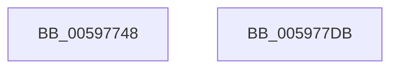

# McTemplateK0jhzr1d_EtwWriteTransfer

- RVA: `0x00597748`–`0x005977DC` (길이 `148` bytes)
- VA: `0x0000000140597748`
- 실행 섹션: `.text`
- PDB 이름 있음: `예`; PDB Function 태그: `아니요`
- unwind 정보 RVA: `0x000BD7A0`
- 디코드: `34`개 명령, `148/148` bytes 표시
- 미해석 바이트: `0` (있으면 어셈블리에 `.byte`로 보존)

> 이 문서는 커널 이미지의 기계어와 PDB 기호를 분석해 생성했습니다. 4번과 5번은 함수 원형과 자료형을 바이너리 사용 방식에서 추정한 C 해석이며 원본 소스 복구 결과는 아닙니다.

## 1. Dependencies

- 직접 호출 지점: **2**; 고유 호출 대상: **2**
- 직접 호출자로 확인된 함수: **1**
- RIP 상대 이미지 참조: **3**

### Outgoing calls
- `0x005977C1` → [McGenEventWrite_EtwWriteTransfer](../42/McGenEventWrite_EtwWriteTransfer_function_00424FC8.md) (function, `0x00424FC8`)
- `0x005977CD` → [_security_check_cookie](../6A/_security_check_cookie_function_006AC640.md) (function, `0x006AC640`)

### Direct callers
- [IopMountVolume](../../page/A3/IopMountVolume_function_00A329D0.md) at `0x00A330A1`

### Static image references
- `0x00597756` → RVA `0x00E0A740` (`.data`; read)
- `0x00597775` → RVA `0x00021D18` (`.rdata`; read)
- `0x0059778C` → RVA `0x00E06E20` (`.data`; read)

## 2. Other-region calls and transfers

- 다른 실행 섹션으로 향하는 call: **0**
- 별도 외부 분기/꼬리 이동을 확인하지 못했습니다.

## 3. Assembly (complete function range)

```asm
00597748  40 55                           push rbp
0059774A  48 8D 6C 24 C1                  lea rbp, [rsp - 0x3f]
0059774F  48 81 EC 90 00 00 00            sub rsp, 0x90
00597756  48 8B 05 E3 2F 87 00            mov rax, qword ptr [rip + 0x872fe3]
0059775D  48 33 C4                        xor rax, rsp
00597760  48 89 45 2F                     mov qword ptr [rbp + 0x2f], rax
00597764  33 C9                           xor ecx, ecx
00597766  4C 89 4D EF                     mov qword ptr [rbp - 0x11], r9
0059776A  48 8D 45 6F                     lea rax, [rbp + 0x6f]
0059776E  89 4D 1B                        mov dword ptr [rbp + 0x1b], ecx
00597771  48 89 45 FF                     mov qword ptr [rbp - 1], rax
00597775  48 8D 15 9C A5 A8 FF            lea rdx, [rip - 0x575a64]
0059777C  48 8B 45 77                     mov rax, qword ptr [rbp + 0x77]
00597780  48 89 45 0F                     mov qword ptr [rbp + 0xf], rax
00597784  44 8D 49 05                     lea r9d, [rcx + 5]
00597788  0F B7 45 6F                     movzx eax, word ptr [rbp + 0x6f]
0059778C  48 8D 0D 8D F6 86 00            lea rcx, [rip + 0x86f68d]
00597793  03 C0                           add eax, eax
00597795  48 C7 45 F7 10 00 00 00         mov qword ptr [rbp - 9], 0x10
0059779D  89 45 17                        mov dword ptr [rbp + 0x17], eax
005977A0  48 8D 45 7F                     lea rax, [rbp + 0x7f]
005977A4  48 89 45 1F                     mov qword ptr [rbp + 0x1f], rax
005977A8  48 8D 45 DF                     lea rax, [rbp - 0x21]
005977AC  48 89 44 24 20                  mov qword ptr [rsp + 0x20], rax
005977B1  48 C7 45 07 02 00 00 00         mov qword ptr [rbp + 7], 2
005977B9  48 C7 45 27 04 00 00 00         mov qword ptr [rbp + 0x27], 4
005977C1  E8 02 D8 E8 FF                  call 0x140424fc8
005977C6  48 8B 4D 2F                     mov rcx, qword ptr [rbp + 0x2f]
005977CA  48 33 CC                        xor rcx, rsp
005977CD  E8 6E 4E 11 00                  call 0x1406ac640
005977D2  48 81 C4 90 00 00 00            add rsp, 0x90
005977D9  5D                              pop rbp
005977DA  C3                              ret
005977DB  CC                              int3
```

## 4. C-style interpretation (structured pseudocode)

```c
__int64 __fastcall McTemplateK0jhzr1d_EtwWriteTransfer(int a1, __int64 a2, __int64 a3, __int64 a4, unsigned __int16 a5, __int64 a6, __int64 a7)
{
    __int64 result;
    __int64 v_rsp;
    unsigned __int64 v_stack_m18;
    unsigned __int64 v_stack_m20;
    unsigned __int64 v_stack_m28;
    unsigned int v_stack_m2C;
    unsigned int v_stack_m30;
    unsigned __int64 v_stack_m38;
    unsigned __int64 v_stack_m40;
    unsigned __int64 v_stack_m47;
    unsigned __int64 v_stack_m48;
    unsigned __int64 v_stack_m50;
    unsigned __int64 v_stack_m58;
    unsigned __int64 v_stack_m68;
    unsigned __int64 v_stack_m78;

    v_rsp = (v_rsp) - (144);
    result = (*(unsigned __int64 *)(v_rip + 8859619)) ^ (v_rsp);
    v_stack_m18 = result;
    a1 = 0;
    v_stack_m58 = a4;
    v_stack_m2C = 0;
    v_stack_m48 = a5;
    v_stack_m38 = a6;
    result = (unsigned int)((a5) + (a5));
    v_stack_m50 = 16;
    v_stack_m30 = (unsigned int)(result);
    v_stack_m28 = a7;
    v_stack_m78 = v_stack_m68;
    v_stack_m40 = 2;
    v_stack_m20 = 4;
    result = McGenEventWrite_EtwWriteTransfer(v_rip + 8844941, v_rip - 5724772, a3, a1 + 5);
    a1 = (v_stack_m18) ^ (v_rsp);
    result = _security_check_cookie(a1, v_rip - 5724772, a3, a1 + 5);
    v_rsp = (v_rsp) + (144);
    return result;
}
```

## 5. (Beta) C Style

```c
int64_t McTemplateK0jhzr1d_EtwWriteTransfer(int32_t Arg1, int64_t Arg2, int64_t Arg3, int64_t Arg4, uint16_t Arg5, int64_t Arg6, int64_t Arg7)
{
    int64_t result;
    int64_t local_rsp;
    uint64_t v_stack_m18;
    uint64_t v_stack_m20;
    uint64_t v_stack_m28;
    uint32_t v_stack_m2C;
    uint32_t v_stack_m30;
    uint64_t v_stack_m38;
    uint64_t v_stack_m40;
    uint64_t v_stack_m47;
    uint64_t v_stack_m48;
    uint64_t v_stack_m50;
    uint64_t v_stack_m58;
    uint64_t v_stack_m68;
    uint64_t v_stack_m78;

    local_rsp = (local_rsp) - (144);
    result = (*(uint64_t *)(v_rip + 0x872FE3)) ^ (local_rsp);
    v_stack_m18 = result;
    Arg1 = 0;
    v_stack_m58 = Arg4;
    v_stack_m2C = 0;
    v_stack_m48 = Arg5;
    v_stack_m38 = Arg6;
    result = (uint32_t)((Arg5) + (Arg5));
    v_stack_m50 = 16;
    v_stack_m30 = (uint32_t)(result);
    v_stack_m28 = Arg7;
    v_stack_m78 = v_stack_m68;
    v_stack_m40 = 2;
    v_stack_m20 = 4;
    result = McGenEventWrite_EtwWriteTransfer(v_rip + 8844941, v_rip - 5724772, Arg3, Arg1 + 5);
    Arg1 = (v_stack_m18) ^ (local_rsp);
    result = _security_check_cookie(Arg1, v_rip - 5724772, Arg3, Arg1 + 5);
    local_rsp = (local_rsp) + (144);
    return result;
}
```

## 6. Execution-region graph

[열기: 2D/3D 그래프와 함수 탐색 컨트롤 패널](../../../control-panel.html?section=text&rva=0x00597748&view=graph)

- 2D 그래프는 위에서 아래로 흐르고, 3D 그래프는 빈 공간을 드래그해 회전합니다. Shift+드래그는 이동, 휠은 확대·축소, 함수 노드 선택은 대상 보고서 이동입니다.

### Static fallback


