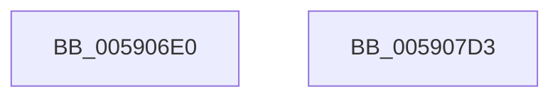

# RotBarInit

- RVA: `0x005906E0`–`0x005907D4` (길이 `244` bytes)
- VA: `0x00000001405906E0`
- 실행 섹션: `.text`
- PDB 이름 있음: `예`; PDB Function 태그: `아니요`
- unwind 정보 RVA: `0x000C6ED0`
- 디코드: `54`개 명령, `244/244` bytes 표시
- 미해석 바이트: `0` (있으면 어셈블리에 `.byte`로 보존)

> 이 문서는 커널 이미지의 기계어와 PDB 기호를 분석해 생성했습니다. 4번과 5번은 함수 원형과 자료형을 바이너리 사용 방식에서 추정한 C 해석이며 원본 소스 복구 결과는 아닙니다.

## 1. Dependencies

- 직접 호출 지점: **4**; 고유 호출 대상: **2**
- 직접 호출자로 확인된 함수: **1**
- RIP 상대 이미지 참조: **9**

### Outgoing calls
- `0x00590752` → `BOOTVID.dll!VidScreenToBufferBlt` (import, 간접 대상; import `BOOTVID.dll!VidScreenToBufferBlt`)
- `0x0059077B` → `BOOTVID.dll!VidScreenToBufferBlt` (import, 간접 대상; import `BOOTVID.dll!VidScreenToBufferBlt`)
- `0x005907A4` → `BOOTVID.dll!VidScreenToBufferBlt` (import, 간접 대상; import `BOOTVID.dll!VidScreenToBufferBlt`)
- `0x005907C1` → `BOOTVID.dll!VidSolidColorFill` (import, 간접 대상; import `BOOTVID.dll!VidSolidColorFill`)

### Direct callers
- [DisplayBootBitmap](../53/DisplayBootBitmap_function_0053B87C.md) at `0x0053BA19`

### Static image references
- `0x005906E6` → RVA `0x00E06D90` (`.data`; read)
- `0x005906F2` → RVA `0x00F8EB20` (`.data`; read/write)
- `0x005906FE` → RVA `0x00E65E64` (`.data`; read/write)
- `0x00590708` → RVA `0x00E65E60` (`.data`; write)
- `0x0059072F` → RVA `0x00F8EA60` (`.data`; read)
- `0x00590752` → RVA `0x00151000` (`BOOTVID.dll!VidScreenToBufferBlt (IAT)`; read)
- `0x00590774` → RVA `0x00F8EB40` (`.data`; read)
- `0x0059079D` → RVA `0x00F8EA20` (`.data`; read)
- `0x005907C1` → RVA `0x00151048` (`BOOTVID.dll!VidSolidColorFill (IAT)`; read)

## 2. Other-region calls and transfers

- 다른 실행 섹션으로 향하는 call: **0**
- 별도 외부 분기/꼬리 이동을 확인하지 못했습니다.

## 3. Assembly (complete function range)

```asm
005906E0  40 56                           push rsi
005906E2  48 83 EC 30                     sub rsp, 0x30
005906E6  48 8B 05 A3 66 87 00            mov rax, qword ptr [rip + 0x8766a3]
005906ED  BA 01 00 00 00                  mov edx, 1
005906F2  83 25 27 E4 9F 00 00            and dword ptr [rip + 0x9fe427], 0
005906F9  B9 12 0B 00 00                  mov ecx, 0xb12
005906FE  83 25 5F 57 8D 00 00            and dword ptr [rip + 0x8d575f], 0
00590705  45 33 C0                        xor r8d, r8d
00590708  89 15 52 57 8D 00               mov dword ptr [rip + 0x8d5752], edx
0059070E  83 60 10 00                     and dword ptr [rax + 0x10], 0
00590712  8D 72 03                        lea esi, [rdx + 3]
00590715  83 60 20 00                     and dword ptr [rax + 0x20], 0
00590719  44 8D 4A 05                     lea r9d, [rdx + 5]
0059071D  83 60 24 00                     and dword ptr [rax + 0x24], 0
00590721  89 50 04                        mov dword ptr [rax + 4], edx
00590724  89 50 08                        mov dword ptr [rax + 8], edx
00590727  33 D2                           xor edx, edx
00590729  89 48 18                        mov dword ptr [rax + 0x18], ecx
0059072C  89 48 1C                        mov dword ptr [rax + 0x1c], ecx
0059072F  48 8D 0D 2A E3 9F 00            lea rcx, [rip + 0x9fe32a]
00590736  89 74 24 28                     mov dword ptr [rsp + 0x28], esi
0059073A  C7 44 24 20 09 00 00 00         mov dword ptr [rsp + 0x20], 9
00590742  C7 00 28 00 00 00               mov dword ptr [rax], 0x28
00590748  C7 40 0C 01 00 04 00            mov dword ptr [rax + 0xc], 0x40001
0059074F  89 70 14                        mov dword ptr [rax + 0x14], esi
00590752  48 FF 15 A7 08 BC FF            call qword ptr [rip - 0x43f759]
00590759  0F 1F 44 00 00                  nop dword ptr [rax + rax]
0059075E  44 8D 4E 02                     lea r9d, [rsi + 2]
00590762  89 74 24 28                     mov dword ptr [rsp + 0x28], esi
00590766  45 33 C0                        xor r8d, r8d
00590769  C7 44 24 20 09 00 00 00         mov dword ptr [rsp + 0x20], 9
00590771  8D 56 04                        lea edx, [rsi + 4]
00590774  48 8D 0D C5 E3 9F 00            lea rcx, [rip + 0x9fe3c5]
0059077B  48 FF 15 7E 08 BC FF            call qword ptr [rip - 0x43f782]
00590782  0F 1F 44 00 00                  nop dword ptr [rax + rax]
00590787  44 8D 4E 02                     lea r9d, [rsi + 2]
0059078B  89 74 24 28                     mov dword ptr [rsp + 0x28], esi
0059078F  45 33 C0                        xor r8d, r8d
00590792  C7 44 24 20 09 00 00 00         mov dword ptr [rsp + 0x20], 9
0059079A  8D 56 0C                        lea edx, [rsi + 0xc]
0059079D  48 8D 0D 7C E2 9F 00            lea rcx, [rip + 0x9fe27c]
005907A4  48 FF 15 55 08 BC FF            call qword ptr [rip - 0x43f7ab]
005907AB  0F 1F 44 00 00                  nop dword ptr [rax + rax]
005907B0  83 64 24 20 00                  and dword ptr [rsp + 0x20], 0
005907B5  44 8D 4E 05                     lea r9d, [rsi + 5]
005907B9  33 D2                           xor edx, edx
005907BB  44 8D 46 12                     lea r8d, [rsi + 0x12]
005907BF  33 C9                           xor ecx, ecx
005907C1  48 FF 15 80 08 BC FF            call qword ptr [rip - 0x43f780]
005907C8  0F 1F 44 00 00                  nop dword ptr [rax + rax]
005907CD  48 83 C4 30                     add rsp, 0x30
005907D1  5E                              pop rsi
005907D2  C3                              ret
005907D3  CC                              int3
```

## 4. C-style interpretation (structured pseudocode)

```c
__int64 __fastcall RotBarInit(__int64 a1, __int64 a2, int a3)
{
    __int64 result;
    __int64 v_rsp;
    unsigned int v_stack_m10;
    unsigned int v_stack_m18;

    v_rsp = (v_rsp) - (48);
    a3 = 0;
    *(unsigned int *)(v_rip + 9262930) = 1;
    *(unsigned int *)(*(unsigned __int64 *)(v_rip + 8873635) + 4) = 1;
    *(unsigned int *)(*(unsigned __int64 *)(v_rip + 8873635) + 8) = 1;
    a2 = 0;
    *(unsigned int *)(*(unsigned __int64 *)(v_rip + 8873635) + 24) = (unsigned int)((unsigned int)(0xB12ULL));
    *(unsigned int *)(*(unsigned __int64 *)(v_rip + 8873635) + 28) = (unsigned int)((unsigned int)(0xB12ULL));
    v_stack_m10 = (unsigned int)(1 + 3);
    v_stack_m18 = 9;
    *(unsigned int *)(*(unsigned __int64 *)(v_rip + 8873635)) = 40;
    *(unsigned int *)(*(unsigned __int64 *)(v_rip + 8873635) + 12) = 0x40001ULL;
    *(unsigned int *)(*(unsigned __int64 *)(v_rip + 8873635) + 20) = (unsigned int)(1 + 3);
    result = BOOTVID_dll_VidScreenToBufferBlt(v_rip + 10478378, a2, a3, 1 + 5);
    v_stack_m10 = (unsigned int)(1 + 3);
    a3 = 0;
    v_stack_m18 = 9;
    result = BOOTVID_dll_VidScreenToBufferBlt(v_rip + 10478533, 1 + 3 + 4, a3, 1 + 3 + 2);
    v_stack_m10 = (unsigned int)(1 + 3);
    a3 = 0;
    v_stack_m18 = 9;
    result = BOOTVID_dll_VidScreenToBufferBlt(v_rip + 10478204, 1 + 3 + 12, a3, 1 + 3 + 2);
    a2 = 0;
    a1 = 0;
    result = BOOTVID_dll_VidSolidColorFill(a1, a2, 1 + 3 + 18, 1 + 3 + 5);
    v_rsp = (v_rsp) + (48);
    return result;
}
```

## 5. (Beta) C Style

```c
int64_t RotBarInit(int64_t Arg1, int64_t Arg2, int32_t Arg3)
{
    int64_t result;
    int64_t local_rsp;
    uint32_t v_stack_m10;
    uint32_t v_stack_m18;

    local_rsp = (local_rsp) - (48);
    Arg3 = 0;
    *(uint32_t *)(v_rip + 0x8D5752) = 1;
    *(uint32_t *)(*(uint64_t *)(v_rip + 0x8766A3) + 0x4) = 1;
    *(uint32_t *)(*(uint64_t *)(v_rip + 0x8766A3) + 0x8) = 1;
    Arg2 = 0;
    *(uint32_t *)(*(uint64_t *)(v_rip + 0x8766A3) + 0x18) = (uint32_t)((uint32_t)(0xB12ULL));
    *(uint32_t *)(*(uint64_t *)(v_rip + 0x8766A3) + 0x1C) = (uint32_t)((uint32_t)(0xB12ULL));
    v_stack_m10 = (uint32_t)(1 + 3);
    v_stack_m18 = 9;
    *(uint32_t *)(*(uint64_t *)(v_rip + 0x8766A3)) = 40;
    *(uint32_t *)(*(uint64_t *)(v_rip + 0x8766A3) + 0xC) = 0x40001ULL;
    *(uint32_t *)(*(uint64_t *)(v_rip + 0x8766A3) + 0x14) = (uint32_t)(1 + 3);
    result = kernel_indirect_call(v_rip + 10478378, Arg2, Arg3, 1 + 5);
    v_stack_m10 = (uint32_t)(1 + 3);
    Arg3 = 0;
    v_stack_m18 = 9;
    result = kernel_indirect_call(v_rip + 10478533, 1 + 3 + 4, Arg3, 1 + 3 + 2);
    v_stack_m10 = (uint32_t)(1 + 3);
    Arg3 = 0;
    v_stack_m18 = 9;
    result = kernel_indirect_call(v_rip + 10478204, 1 + 3 + 12, Arg3, 1 + 3 + 2);
    Arg2 = 0;
    Arg1 = 0;
    result = kernel_indirect_call(Arg1, Arg2, 1 + 3 + 18, 1 + 3 + 5);
    local_rsp = (local_rsp) + (48);
    return result;
}
```

## 6. Execution-region graph

[열기: 2D/3D 그래프와 함수 탐색 컨트롤 패널](../../../control-panel.html?section=text&rva=0x005906E0&view=graph)

- 2D 그래프는 위에서 아래로 흐르고, 3D 그래프는 빈 공간을 드래그해 회전합니다. Shift+드래그는 이동, 휠은 확대·축소, 함수 노드 선택은 대상 보고서 이동입니다.

### Static fallback


