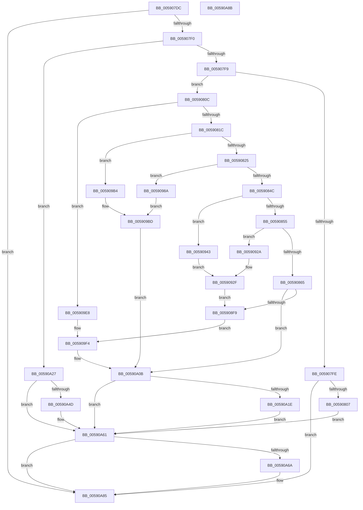

# RotBarUpdate

- RVA: `0x005907DC`–`0x00590A8C` (길이 `688` bytes)
- VA: `0x00000001405907DC`
- 실행 섹션: `.text`
- PDB 이름 있음: `예`; PDB Function 태그: `아니요`
- unwind 정보 RVA: `0x00064C80`
- 디코드: `139`개 명령, `688/688` bytes 표시
- 미해석 바이트: `0` (있으면 어셈블리에 `.byte`로 보존)

> 이 문서는 커널 이미지의 기계어와 PDB 기호를 분석해 생성했습니다. 4번과 5번은 함수 원형과 자료형을 바이너리 사용 방식에서 추정한 C 해석이며 원본 소스 복구 결과는 아닙니다.

## 1. Dependencies

- 직접 호출 지점: **11**; 고유 호출 대상: **5**
- 직접 호출자로 확인된 함수: **1**
- RIP 상대 이미지 참조: **15**

### Outgoing calls
- `0x0059086C` → `BOOTVID.dll!VidBufferToScreenBlt` (import, 간접 대상; import `BOOTVID.dll!VidBufferToScreenBlt`)
- `0x005908A5` → `BOOTVID.dll!VidBufferToScreenBlt` (import, 간접 대상; import `BOOTVID.dll!VidBufferToScreenBlt`)
- `0x005908DE` → `BOOTVID.dll!VidBufferToScreenBlt` (import, 간접 대상; import `BOOTVID.dll!VidBufferToScreenBlt`)
- `0x0059092F` → `BOOTVID.dll!VidBufferToScreenBlt` (import, 간접 대상; import `BOOTVID.dll!VidBufferToScreenBlt`)
- `0x0059094F` → `BOOTVID.dll!VidBufferToScreenBlt` (import, 간접 대상; import `BOOTVID.dll!VidBufferToScreenBlt`)
- `0x00590996` → `BOOTVID.dll!VidBufferToScreenBlt` (import, 간접 대상; import `BOOTVID.dll!VidBufferToScreenBlt`)
- `0x005909DA` → `BOOTVID.dll!VidBufferToScreenBlt` (import, 간접 대상; import `BOOTVID.dll!VidBufferToScreenBlt`)
- `0x005909FF` → `BOOTVID.dll!VidSolidColorFill` (import, 간접 대상; import `BOOTVID.dll!VidSolidColorFill`)
- `0x00590A2F` → [FadePalette](FadePalette_function_0059059C.md) (function, `0x0059059C`)
- `0x00590A61` → [InbvGetDisplayState](InbvGetDisplayState_function_0059030C.md) (function, `0x0059030C`)
- `0x00590A79` → `BOOTVID.dll!VidBitBlt` (import, 간접 대상; import `BOOTVID.dll!VidBitBlt`)

### Direct callers
- [InbvRotateGuiBootDisplay](InbvRotateGuiBootDisplay_function_00590680.md) at `0x005906B2`

### Static image references
- `0x005907E2` → RVA `0x00E65E60` (`.data`; read)
- `0x0059080C` → RVA `0x00E65E64` (`.data`; read)
- `0x00590858` → RVA `0x00F8EA60` (`.data`; read)
- `0x0059086C` → RVA `0x00151040` (`BOOTVID.dll!VidBufferToScreenBlt (IAT)`; read)
- `0x0059087E` → RVA `0x00F8EB40` (`.data`; read)
- `0x005908B7` → RVA `0x00F8EA20` (`.data`; read)
- `0x005909FF` → RVA `0x00151048` (`BOOTVID.dll!VidSolidColorFill (IAT)`; read)
- `0x00590A13` → RVA `0x00E65E64` (`.data`; write)
- `0x00590A1E` → RVA `0x00E65E64` (`.data`; read/write)
- `0x00590A27` → RVA `0x00F8EB20` (`.data`; read)
- `0x00590A34` → RVA `0x00E06D88` (`.data`; read)
- `0x00590A42` → RVA `0x00F8EB20` (`.data`; write)
- `0x00590A4D` → RVA `0x00E65E60` (`.data`; write)
- `0x00590A6C` → RVA `0x00F8EAA0` (`.data`; read)
- `0x00590A79` → RVA `0x00151050` (`BOOTVID.dll!VidBitBlt (IAT)`; read)

## 2. Other-region calls and transfers

- 다른 실행 섹션으로 향하는 call: **0**
- 별도 외부 분기/꼬리 이동을 확인하지 못했습니다.

## 3. Assembly (complete function range)

```asm
005907DC  40 53                           push rbx
005907DE  48 83 EC 30                     sub rsp, 0x30
005907E2  8B 0D 78 56 8D 00               mov ecx, dword ptr [rip + 0x8d5678]
005907E8  85 C9                           test ecx, ecx
005907EA  0F 84 95 02 00 00               je 0x140590a85
005907F0  83 E9 01                        sub ecx, 1
005907F3  0F 84 2E 02 00 00               je 0x140590a27
005907F9  83 E9 01                        sub ecx, 1
005907FC  74 0E                           je 0x14059080c
005907FE  83 F9 01                        cmp ecx, 1
00590801  0F 84 7E 02 00 00               je 0x140590a85
00590807  E9 55 02 00 00                  jmp 0x140590a61
0059080C  8B 15 52 56 8D 00               mov edx, dword ptr [rip + 0x8d5652]
00590812  8B CA                           mov ecx, edx
00590814  85 D2                           test edx, edx
00590816  0F 84 CC 01 00 00               je 0x1405909e8
0059081C  83 E9 01                        sub ecx, 1
0059081F  0F 84 8F 01 00 00               je 0x1405909b4
00590825  C7 44 24 28 04 00 00 00         mov dword ptr [rsp + 0x28], 4
0059082D  BB 62 01 00 00                  mov ebx, 0x162
00590832  C7 44 24 20 09 00 00 00         mov dword ptr [rsp + 0x20], 9
0059083A  44 8B C3                        mov r8d, ebx
0059083D  41 B9 06 00 00 00               mov r9d, 6
00590843  83 E9 01                        sub ecx, 1
00590846  0F 84 3E 01 00 00               je 0x14059098a
0059084C  83 E9 0E                        sub ecx, 0xe
0059084F  0F 84 EE 00 00 00               je 0x140590943
00590855  83 F9 01                        cmp ecx, 1
00590858  48 8D 0D 01 E2 9F 00            lea rcx, [rip + 0x9fe201]
0059085F  0F 84 C5 00 00 00               je 0x14059092a
00590865  8D 14 D5 EB 00 00 00            lea edx, [rdx*8 + 0xeb]
0059086C  48 FF 15 CD 07 BC FF            call qword ptr [rip - 0x43f833]
00590873  0F 1F 44 00 00                  nop dword ptr [rax + rax]
00590878  8B 15 E6 55 8D 00               mov edx, dword ptr [rip + 0x8d55e6]
0059087E  48 8D 0D BB E2 9F 00            lea rcx, [rip + 0x9fe2bb]
00590885  C7 44 24 28 04 00 00 00         mov dword ptr [rsp + 0x28], 4
0059088D  41 B9 06 00 00 00               mov r9d, 6
00590893  44 8B C3                        mov r8d, ebx
00590896  C7 44 24 20 09 00 00 00         mov dword ptr [rsp + 0x20], 9
0059089E  8D 14 D5 F3 00 00 00            lea edx, [rdx*8 + 0xf3]
005908A5  48 FF 15 94 07 BC FF            call qword ptr [rip - 0x43f86c]
005908AC  0F 1F 44 00 00                  nop dword ptr [rax + rax]
005908B1  8B 15 AD 55 8D 00               mov edx, dword ptr [rip + 0x8d55ad]
005908B7  48 8D 0D 62 E1 9F 00            lea rcx, [rip + 0x9fe162]
005908BE  C7 44 24 28 04 00 00 00         mov dword ptr [rsp + 0x28], 4
005908C6  41 B9 06 00 00 00               mov r9d, 6
005908CC  44 8B C3                        mov r8d, ebx
005908CF  C7 44 24 20 09 00 00 00         mov dword ptr [rsp + 0x20], 9
005908D7  8D 14 D5 FB 00 00 00            lea edx, [rdx*8 + 0xfb]
005908DE  48 FF 15 5B 07 BC FF            call qword ptr [rip - 0x43f8a5]
005908E5  0F 1F 44 00 00                  nop dword ptr [rax + rax]
005908EA  8B 0D 74 55 8D 00               mov ecx, dword ptr [rip + 0x8d5574]
005908F0  83 F9 03                        cmp ecx, 3
005908F3  0F 8E 12 01 00 00               jle 0x140590a0b
005908F9  83 C1 10                        add ecx, 0x10
005908FC  B8 39 8E E3 38                  mov eax, 0x38e38e39
00590901  F7 E9                           imul ecx
00590903  C1 FA 02                        sar edx, 2
00590906  8B C2                           mov eax, edx
00590908  C1 E8 1F                        shr eax, 0x1f
0059090B  03 D0                           add edx, eax
0059090D  8D 04 D2                        lea eax, [rdx + rdx*8]
00590910  8B D3                           mov edx, ebx
00590912  03 C0                           add eax, eax
00590914  2B C8                           sub ecx, eax
00590916  44 8D 04 CD F8 00 00 00         lea r8d, [rcx*8 + 0xf8]
0059091E  8D 0C CD F3 00 00 00            lea ecx, [rcx*8 + 0xf3]
00590925  E9 CA 00 00 00                  jmp 0x1405909f4
0059092A  BA 73 01 00 00                  mov edx, 0x173
0059092F  48 FF 15 0A 07 BC FF            call qword ptr [rip - 0x43f8f6]
00590936  0F 1F 44 00 00                  nop dword ptr [rax + rax]
0059093B  8B 0D 23 55 8D 00               mov ecx, dword ptr [rip + 0x8d5523]
00590941  EB B6                           jmp 0x1405908f9
00590943  BA 6B 01 00 00                  mov edx, 0x16b
00590948  48 8D 0D 11 E1 9F 00            lea rcx, [rip + 0x9fe111]
0059094F  48 FF 15 EA 06 BC FF            call qword ptr [rip - 0x43f916]
00590956  0F 1F 44 00 00                  nop dword ptr [rax + rax]
0059095B  8B 15 03 55 8D 00               mov edx, dword ptr [rip + 0x8d5503]
00590961  48 8D 0D D8 E1 9F 00            lea rcx, [rip + 0x9fe1d8]
00590968  C7 44 24 28 04 00 00 00         mov dword ptr [rsp + 0x28], 4
00590970  41 B9 06 00 00 00               mov r9d, 6
00590976  C7 44 24 20 09 00 00 00         mov dword ptr [rsp + 0x20], 9
0059097E  44 8B C3                        mov r8d, ebx
00590981  8D 14 D5 F3 00 00 00            lea edx, [rdx*8 + 0xf3]
00590988  EB A5                           jmp 0x14059092f
0059098A  BA 03 01 00 00                  mov edx, 0x103
0059098F  48 8D 0D AA E1 9F 00            lea rcx, [rip + 0x9fe1aa]
00590996  48 FF 15 A3 06 BC FF            call qword ptr [rip - 0x43f95d]
0059099D  0F 1F 44 00 00                  nop dword ptr [rax + rax]
005909A2  8B 15 BC 54 8D 00               mov edx, dword ptr [rip + 0x8d54bc]
005909A8  44 8B C3                        mov r8d, ebx
005909AB  8D 14 D5 FB 00 00 00            lea edx, [rdx*8 + 0xfb]
005909B2  EB 09                           jmp 0x1405909bd
005909B4  BA 03 01 00 00                  mov edx, 0x103
005909B9  44 8D 42 5F                     lea r8d, [rdx + 0x5f]
005909BD  C7 44 24 28 04 00 00 00         mov dword ptr [rsp + 0x28], 4
005909C5  48 8D 0D 54 E0 9F 00            lea rcx, [rip + 0x9fe054]
005909CC  41 B9 06 00 00 00               mov r9d, 6
005909D2  C7 44 24 20 09 00 00 00         mov dword ptr [rsp + 0x20], 9
005909DA  48 FF 15 5F 06 BC FF            call qword ptr [rip - 0x43f9a1]
005909E1  0F 1F 44 00 00                  nop dword ptr [rax + rax]
005909E6  EB 23                           jmp 0x140590a0b
005909E8  BA 62 01 00 00                  mov edx, 0x162
005909ED  8D 4A 11                        lea ecx, [rdx + 0x11]
005909F0  44 8D 42 16                     lea r8d, [rdx + 0x16]
005909F4  83 64 24 20 00                  and dword ptr [rsp + 0x20], 0
005909F9  41 B9 6A 01 00 00               mov r9d, 0x16a
005909FF  48 FF 15 42 06 BC FF            call qword ptr [rip - 0x43f9be]
00590A06  0F 1F 44 00 00                  nop dword ptr [rax + rax]
00590A0B  8B 05 53 54 8D 00               mov eax, dword ptr [rip + 0x8d5453]
00590A11  FF C0                           inc eax
00590A13  89 05 4B 54 8D 00               mov dword ptr [rip + 0x8d544b], eax
00590A19  83 F8 11                        cmp eax, 0x11
00590A1C  7E 43                           jle 0x140590a61
00590A1E  83 25 3F 54 8D 00 00            and dword ptr [rip + 0x8d543f], 0
00590A25  EB 3A                           jmp 0x140590a61
00590A27  8B 1D F3 E0 9F 00               mov ebx, dword ptr [rip + 0x9fe0f3]
00590A2D  8A CB                           mov cl, bl
00590A2F  E8 68 FB FF FF                  call 0x14059059c
00590A34  48 8B 05 4D 63 87 00            mov rax, qword ptr [rip + 0x87634d]
00590A3B  83 60 04 00                     and dword ptr [rax + 4], 0
00590A3F  8D 43 01                        lea eax, [rbx + 1]
00590A42  89 05 D8 E0 9F 00               mov dword ptr [rip + 0x9fe0d8], eax
00590A48  83 F8 14                        cmp eax, 0x14
00590A4B  7C 14                           jl 0x140590a61
00590A4D  C7 05 09 54 8D 00 02 00 00 00   mov dword ptr [rip + 0x8d5409], 2
00590A57  C7 05 BF E0 9F 00 01 00 00 00   mov dword ptr [rip + 0x9fe0bf], 1
00590A61  E8 A6 F8 FF FF                  call 0x14059030c
00590A66  85 C0                           test eax, eax
00590A68  75 1B                           jne 0x140590a85
00590A6A  33 D2                           xor edx, edx
00590A6C  48 8D 0D 2D E0 9F 00            lea rcx, [rip + 0x9fe02d]
00590A73  41 B8 E0 01 00 00               mov r8d, 0x1e0
00590A79  48 FF 15 D0 05 BC FF            call qword ptr [rip - 0x43fa30]
00590A80  0F 1F 44 00 00                  nop dword ptr [rax + rax]
00590A85  48 83 C4 30                     add rsp, 0x30
00590A89  5B                              pop rbx
00590A8A  C3                              ret
00590A8B  CC                              int3
```

## 4. C-style interpretation (structured pseudocode)

```c
__int64 __fastcall RotBarUpdate(void)
{
    __int64 result;
    __int64 v_rsp;
    unsigned int v_stack_m10;
    unsigned int v_stack_m18;

    v_rsp = (v_rsp) - (48);
    if ((unsigned int)((unsigned int)(*(unsigned int *)(v_rip + 9262712))) == 0) goto loc_00590A85;
    a1 = (unsigned int)(((unsigned int)(*(unsigned int *)(v_rip + 9262712))) - (1));
    if (condition_is_equal) goto loc_00590A27;
    a1 = (unsigned int)((a1) - (1));
    if (condition_is_equal) goto loc_0059080C;
    if (((unsigned int)(a1)) == 1) goto loc_00590A85;
    goto loc_00590A61;
loc_0059080C:
    if ((unsigned int)((unsigned int)(*(unsigned int *)(v_rip + 9262674))) == 0) goto loc_005909E8;
    a1 = (unsigned int)(((unsigned int)((unsigned int)((unsigned int)(*(unsigned int *)(v_rip + 9262674))))) - (1));
    if (condition_is_equal) goto loc_005909B4;
    v_stack_m10 = 4;
    v_stack_m18 = 9;
    a1 = (unsigned int)((a1) - (1));
    if (condition_is_equal) goto loc_0059098A;
    a1 = (unsigned int)((a1) - (14));
    if (condition_is_equal) goto loc_00590943;
    if (((unsigned int)(a1)) == 1) goto loc_0059092A;
    result = BOOTVID_dll_VidBufferToScreenBlt(v_rip + 10478081, (unsigned int)(*(unsigned int *)(v_rip + 9262674)) * 8 + 235, 354, 6);
    v_stack_m10 = 4;
    v_stack_m18 = 9;
    result = BOOTVID_dll_VidBufferToScreenBlt(v_rip + 10478267, (unsigned int)(*(unsigned int *)(v_rip + 9262566)) * 8 + 243, 354, 6);
    v_stack_m10 = 4;
    v_stack_m18 = 9;
    result = BOOTVID_dll_VidBufferToScreenBlt(v_rip + 10477922, (unsigned int)(*(unsigned int *)(v_rip + 9262509)) * 8 + 251, 354, 6);
    if (((unsigned int)((unsigned int)(*(unsigned int *)(v_rip + 9262452)))) <= 3) goto loc_00590A0B;
loc_005908F9:
    a1 = (unsigned int)(((unsigned int)(*(unsigned int *)(v_rip + 9262452))) + (16));
    a2 = (unsigned int)(((unsigned int)(*(unsigned int *)(v_rip + 9262509)) * 8 + 251) >> (2));
    result = (unsigned int)(((unsigned int)((unsigned int)(a2))) >> (31));
    a2 = (unsigned int)((a2) + ((unsigned int)(result)));
    result = (unsigned int)((a2 + a2 * 8) + ((unsigned int)(a2 + a2 * 8)));
    a1 = (unsigned int)((a1) - ((unsigned int)(result)));
    goto loc_005909F4;
loc_0059092A:
loc_0059092F:
    result = BOOTVID_dll_VidBufferToScreenBlt(a1 * 8 + 243, 371, a1 * 8 + 248, 6);
    goto loc_005908F9;
loc_00590943:
    result = BOOTVID_dll_VidBufferToScreenBlt(v_rip + 10477841, 363, a1 * 8 + 248, 6);
    v_stack_m10 = 4;
    v_stack_m18 = 9;
    goto loc_0059092F;
loc_0059098A:
    result = BOOTVID_dll_VidBufferToScreenBlt(v_rip + 10477994, 259, 354, 6);
    goto loc_005909BD;
loc_005909B4:
loc_005909BD:
    v_stack_m10 = 4;
    v_stack_m18 = 9;
    result = BOOTVID_dll_VidBufferToScreenBlt(v_rip + 10477652, 259, 259 + 95, 6);
    goto loc_00590A0B;
loc_005909E8:
loc_005909F4:
    result = BOOTVID_dll_VidSolidColorFill(354 + 17, 354, 354 + 22, 362);
loc_00590A0B:
    result = (unsigned int)(((unsigned int)(*(unsigned int *)(v_rip + 9262163))) + 1);
    *(unsigned int *)(v_rip + 9262155) = (unsigned int)(result);
    if (((unsigned int)(result)) <= 17) goto loc_00590A61;
    goto loc_00590A61;
loc_00590A27:
    result = FadePalette((unsigned __int8)((unsigned int)(*(unsigned int *)(v_rip + 10477811))), 354, 354 + 22, 362);
    *(unsigned int *)(v_rip + 10477784) = (unsigned int)((unsigned int)(*(unsigned int *)(v_rip + 10477811)) + 1);
    if (((unsigned int)((unsigned int)(*(unsigned int *)(v_rip + 10477811)) + 1)) >= 20) {
        *(unsigned int *)(v_rip + 9262089) = 2;
        *(unsigned int *)(v_rip + 10477759) = 1;
    }
    result = InbvGetDisplayState((unsigned __int8)((unsigned int)(*(unsigned int *)(v_rip + 10477811))), 354, 354 + 22, 362);
    if ((unsigned int)(result) == 0) {
        a2 = 0;
        a1 = v_rip + 10477613;
        a3 = 480;
        result = BOOTVID_dll_VidBitBlt(a1, a2, a3, 362);
    }
    v_rsp = (v_rsp) + (48);
    return result;
}
```

## 5. (Beta) C Style

```c
void RotBarUpdate(void)
{
    int64_t result;
    int64_t local_rsp;
    uint32_t v_stack_m10;
    uint32_t v_stack_m18;

    local_rsp = (local_rsp) - (48);
    if ((uint32_t)((uint32_t)(*(uint32_t *)(v_rip + 0x8D5678))) == 0) goto loc_00590A85;
    a1 = (uint32_t)(((uint32_t)(*(uint32_t *)(v_rip + 0x8D5678))) - (1));
    if (condition_is_equal) goto loc_00590A27;
    a1 = (uint32_t)((a1) - (1));
    if (condition_is_equal) goto loc_0059080C;
    if (((uint32_t)(a1)) == 1) goto loc_00590A85;
    goto loc_00590A61;
loc_0059080C:
    if ((uint32_t)((uint32_t)(*(uint32_t *)(v_rip + 0x8D5652))) == 0) goto loc_005909E8;
    a1 = (uint32_t)(((uint32_t)((uint32_t)((uint32_t)(*(uint32_t *)(v_rip + 0x8D5652))))) - (1));
    if (condition_is_equal) goto loc_005909B4;
    v_stack_m10 = 4;
    v_stack_m18 = 9;
    a1 = (uint32_t)((a1) - (1));
    if (condition_is_equal) goto loc_0059098A;
    a1 = (uint32_t)((a1) - (14));
    if (condition_is_equal) goto loc_00590943;
    if (((uint32_t)(a1)) == 1) goto loc_0059092A;
    result = kernel_indirect_call(v_rip + 10478081, (uint32_t)(*(uint32_t *)(v_rip + 0x8D5652)) * 8 + 235, 354, 6);
    v_stack_m10 = 4;
    v_stack_m18 = 9;
    result = kernel_indirect_call(v_rip + 10478267, (uint32_t)(*(uint32_t *)(v_rip + 0x8D55E6)) * 8 + 243, 354, 6);
    v_stack_m10 = 4;
    v_stack_m18 = 9;
    result = kernel_indirect_call(v_rip + 10477922, (uint32_t)(*(uint32_t *)(v_rip + 0x8D55AD)) * 8 + 251, 354, 6);
    if (((uint32_t)((uint32_t)(*(uint32_t *)(v_rip + 0x8D5574)))) <= 3) goto loc_00590A0B;
loc_005908F9:
    a1 = (uint32_t)(((uint32_t)(*(uint32_t *)(v_rip + 0x8D5574))) + (16));
    a2 = (uint32_t)(((uint32_t)(*(uint32_t *)(v_rip + 0x8D55AD)) * 8 + 251) >> (2));
    result = (uint32_t)(((uint32_t)((uint32_t)(a2))) >> (31));
    a2 = (uint32_t)((a2) + ((uint32_t)(result)));
    result = (uint32_t)((a2 + a2 * 8) + ((uint32_t)(a2 + a2 * 8)));
    a1 = (uint32_t)((a1) - ((uint32_t)(result)));
    goto loc_005909F4;
loc_0059092A:
loc_0059092F:
    result = kernel_indirect_call(a1 * 8 + 243, 371, a1 * 8 + 248, 6);
    goto loc_005908F9;
loc_00590943:
    result = kernel_indirect_call(v_rip + 10477841, 363, a1 * 8 + 248, 6);
    v_stack_m10 = 4;
    v_stack_m18 = 9;
    goto loc_0059092F;
loc_0059098A:
    result = kernel_indirect_call(v_rip + 10477994, 259, 354, 6);
    goto loc_005909BD;
loc_005909B4:
loc_005909BD:
    v_stack_m10 = 4;
    v_stack_m18 = 9;
    result = kernel_indirect_call(v_rip + 10477652, 259, 259 + 95, 6);
    goto loc_00590A0B;
loc_005909E8:
loc_005909F4:
    result = kernel_indirect_call(354 + 17, 354, 354 + 22, 362);
loc_00590A0B:
    result = (uint32_t)(((uint32_t)(*(uint32_t *)(v_rip + 0x8D5453))) + 1);
    *(uint32_t *)(v_rip + 0x8D544B) = (uint32_t)(result);
    if (((uint32_t)(result)) <= 17) goto loc_00590A61;
    goto loc_00590A61;
loc_00590A27:
    result = FadePalette((uint8_t)((uint32_t)(*(uint32_t *)(v_rip + 0x9FE0F3))), 354, 354 + 22, 362);
    *(uint32_t *)(v_rip + 0x9FE0D8) = (uint32_t)((uint32_t)(*(uint32_t *)(v_rip + 0x9FE0F3)) + 1);
    if (((uint32_t)((uint32_t)(*(uint32_t *)(v_rip + 0x9FE0F3)) + 1)) >= 20) {
        *(uint32_t *)(v_rip + 0x8D5409) = 2;
        *(uint32_t *)(v_rip + 0x9FE0BF) = 1;
    }
    result = InbvGetDisplayState((uint8_t)((uint32_t)(*(uint32_t *)(v_rip + 0x9FE0F3))), 354, 354 + 22, 362);
    if ((uint32_t)(result) == 0) {
        a2 = 0;
        a1 = v_rip + 10477613;
        a3 = 480;
        result = kernel_indirect_call(a1, a2, a3, 362);
    }
    local_rsp = (local_rsp) + (48);
    return result;
}
```

## 6. Execution-region graph

[열기: 2D/3D 그래프와 함수 탐색 컨트롤 패널](../../../control-panel.html?section=text&rva=0x005907DC&view=graph)

- 2D 그래프는 위에서 아래로 흐르고, 3D 그래프는 빈 공간을 드래그해 회전합니다. Shift+드래그는 이동, 휠은 확대·축소, 함수 노드 선택은 대상 보고서 이동입니다.

### Static fallback


