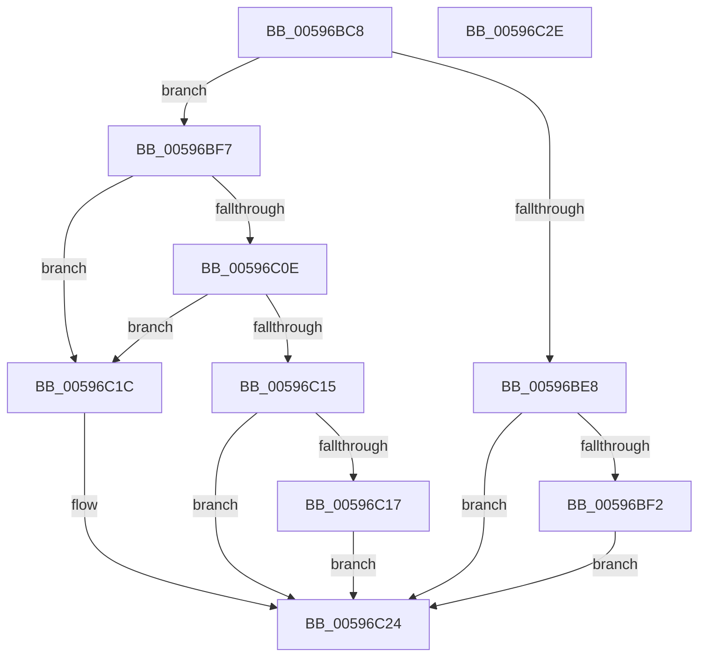

# RtlStringCchPrintfA

- RVA: `0x00596BC8`–`0x00596C2F` (길이 `103` bytes)
- VA: `0x0000000140596BC8`
- 실행 섹션: `.text`
- PDB 이름 있음: `예`; PDB Function 태그: `아니요`
- unwind 정보 RVA: `0x000C71B8`
- 디코드: `37`개 명령, `103/103` bytes 표시
- 미해석 바이트: `0` (있으면 어셈블리에 `.byte`로 보존)

> 이 문서는 커널 이미지의 기계어와 PDB 기호를 분석해 생성했습니다. 4번과 5번은 함수 원형과 자료형을 바이너리 사용 방식에서 추정한 C 해석이며 원본 소스 복구 결과는 아닙니다.

## 1. Dependencies

- 직접 호출 지점: **1**; 고유 호출 대상: **1**
- 직접 호출자로 확인된 함수: **8**
- RIP 상대 이미지 참조: **0**

### Outgoing calls
- `0x00596C05` → [vsnprintf](../4F/vsnprintf_function_004FF050.md) (function, `0x004FF050`)

### Direct callers
- [IopCopyBootLogRegistryToFile](../../page/71/IopCopyBootLogRegistryToFile_function_0071B19C.md) at `0x0071B2AC`
- [sub_00B46364](../../page/B4/Unknown_function_00B46364.md) at `0x00B463D5`
- [sub_00B46364](../../page/B4/Unknown_function_00B46364.md) at `0x00B464D4`
- [IopCreateArcNames](../../init/C2/IopCreateArcNames_function_00C2BF1C.md) at `0x00C2BF68`
- [IopCreateArcNames](../../init/C2/IopCreateArcNames_function_00C2BF1C.md) at `0x00C2BFA5`
- [IopCreateArcNamesCd](../../init/C2/IopCreateArcNamesCd_function_00C2C060.md) at `0x00C2C2D5`
- [IopCreateArcNamesCd](../../init/C2/IopCreateArcNamesCd_function_00C2C060.md) at `0x00C2C319`
- [IopCreateArcNamesCd](../../init/C2/IopCreateArcNamesCd_function_00C2C060.md) at `0x00C2C4B2`
- [IopMarkBootPartition](../../init/C2/IopMarkBootPartition_function_00C2CFA0.md) at `0x00C2D01B`
- [IopGetBootDiskInformation](../../init/C2/IopGetBootDiskInformation_function_00C2DAAC.md) at `0x00C2DBCE`
- [IopGetBootDiskInformation](../../init/C2/IopGetBootDiskInformation_function_00C2DAAC.md) at `0x00C2DE50`
- [IopApplySystemPartitionProt](../../init/C2/IopApplySystemPartitionProt_function_00C2E398.md) at `0x00C2E509`
- [PipCriticalDeviceWaitCallback](../../init/C3/PipCriticalDeviceWaitCallback_function_00C30890.md) at `0x00C3090A`

### Static image references
- 디코드된 RIP-relative 메모리 참조가 없습니다.

## 2. Other-region calls and transfers

- 다른 실행 섹션으로 향하는 call: **0**
- 별도 외부 분기/꼬리 이동을 확인하지 못했습니다.

## 3. Assembly (complete function range)

```asm
00596BC8  4C 89 44 24 18                  mov qword ptr [rsp + 0x18], r8
00596BCD  4C 89 4C 24 20                  mov qword ptr [rsp + 0x20], r9
00596BD2  53                              push rbx
00596BD3  56                              push rsi
00596BD4  57                              push rdi
00596BD5  48 83 EC 30                     sub rsp, 0x30
00596BD9  48 8D 42 FF                     lea rax, [rdx - 1]
00596BDD  48 8B F1                        mov rsi, rcx
00596BE0  48 3D FE FF FF 7F               cmp rax, 0x7ffffffe
00596BE6  76 0F                           jbe 0x140596bf7
00596BE8  BB 0D 00 00 C0                  mov ebx, 0xc000000d
00596BED  48 85 D2                        test rdx, rdx
00596BF0  74 32                           je 0x140596c24
00596BF2  C6 01 00                        mov byte ptr [rcx], 0
00596BF5  EB 2D                           jmp 0x140596c24
00596BF7  48 8D 7A FF                     lea rdi, [rdx - 1]
00596BFB  33 DB                           xor ebx, ebx
00596BFD  48 8B D7                        mov rdx, rdi
00596C00  4C 8D 4C 24 68                  lea r9, [rsp + 0x68]
00596C05  E8 46 84 F6 FF                  call 0x1404ff050
00596C0A  85 C0                           test eax, eax
00596C0C  78 0E                           js 0x140596c1c
00596C0E  48 98                           cdqe
00596C10  48 3B C7                        cmp rax, rdi
00596C13  77 07                           ja 0x140596c1c
00596C15  75 0D                           jne 0x140596c24
00596C17  88 1C 37                        mov byte ptr [rdi + rsi], bl
00596C1A  EB 08                           jmp 0x140596c24
00596C1C  88 1C 37                        mov byte ptr [rdi + rsi], bl
00596C1F  BB 05 00 00 80                  mov ebx, 0x80000005
00596C24  8B C3                           mov eax, ebx
00596C26  48 83 C4 30                     add rsp, 0x30
00596C2A  5F                              pop rdi
00596C2B  5E                              pop rsi
00596C2C  5B                              pop rbx
00596C2D  C3                              ret
00596C2E  CC                              int3
```

## 4. C-style interpretation (structured pseudocode)

```c
__int64 __fastcall RtlStringCchPrintfA(__int64 a1, __int64 a2, __int64 a3, __int64 a4)
{
    __int64 result;
    __int64 v_rbx;
    __int64 v_rsp;
    unsigned __int64 v_stack_p18;
    unsigned __int64 v_stack_p20;

    v_stack_p18 = a3;
    v_stack_p20 = a4;
    v_rsp = (v_rsp) - (48);
    if ((a2 - 1) <= 0x7FFFFFFEULL) goto loc_00596BF7;
    if (a2 == 0) goto loc_00596C24;
    *(unsigned __int8 *)(a1) = 0;
    goto loc_00596C24;
loc_00596BF7:
    v_rbx = 0;
    result = vsnprintf(a1, a2 - 1, a3, v_stack_p20);
    if (sign_flag) goto loc_00596C1C;
    if (result > (a2 - 1)) goto loc_00596C1C;
    if (result != (a2 - 1)) goto loc_00596C24;
    *(unsigned __int8 *)(a2 - 1 + a1 * 1) = 0;
    goto loc_00596C24;
loc_00596C1C:
    *(unsigned __int8 *)(a2 - 1 + a1 * 1) = 0;
loc_00596C24:
    v_rsp = (v_rsp) + (48);
    return (unsigned int)((unsigned int)((unsigned int)(0x80000005ULL)));
}
```

## 5. (Beta) C Style

```c
int64_t RtlStringCchPrintfA(void *Arg1, void *Arg2, int64_t Arg3, int64_t Arg4)
{
    uint8_t *arg1 = (uint8_t *)Arg1;
    uint8_t *arg2 = (uint8_t *)Arg2;

    int64_t result;
    int64_t local_rbx;
    int64_t local_rsp;
    uint64_t v_stack_p18;
    uint64_t v_stack_p20;

    v_stack_p18 = Arg3;
    v_stack_p20 = Arg4;
    local_rsp = (local_rsp) - (48);
    if ((Arg2 - 1) <= 0x7FFFFFFEULL) goto loc_00596BF7;
    if (Arg2 == NULL) goto loc_00596C24;
    *(uint8_t *)(arg1) = 0;
    goto loc_00596C24;
loc_00596BF7:
    local_rbx = 0;
    result = vsnprintf(Arg1, Arg2 - 1, Arg3, v_stack_p20);
    if (sign_flag) goto loc_00596C1C;
    if (result > (Arg2 - 1)) goto loc_00596C1C;
    if (result != (Arg2 - 1)) goto loc_00596C24;
    *(uint8_t *)(arg2 - 0x1 + arg1 * 1) = 0;
    goto loc_00596C24;
loc_00596C1C:
    *(uint8_t *)(arg2 - 0x1 + arg1 * 1) = 0;
loc_00596C24:
    local_rsp = (local_rsp) + (48);
    return (uint32_t)((uint32_t)((uint32_t)(0x80000005ULL)));
}
```

### 관측된 메모리 오프셋

구조체 형식이 확인되지 않은 접근은 인자 기준의 오프셋으로만 기록했습니다.

| 기준 인자 | 오프셋 표현 | 폭 (bit) | 접근 |
|---|---:|---:|---|
| `Arg1` | `+ 0x0` | `8` | `W` |
| `Arg2` | `- 0x1` | `64` | `R` |
| `Arg2` | `+ 0x0 + rsi*1` | `8` | `W` |

## 6. Execution-region graph

[열기: 2D/3D 그래프와 함수 탐색 컨트롤 패널](../../../control-panel.html?section=text&rva=0x00596BC8&view=graph)

- 2D 그래프는 위에서 아래로 흐르고, 3D 그래프는 빈 공간을 드래그해 회전합니다. Shift+드래그는 이동, 휠은 확대·축소, 함수 노드 선택은 대상 보고서 이동입니다.

### Static fallback


