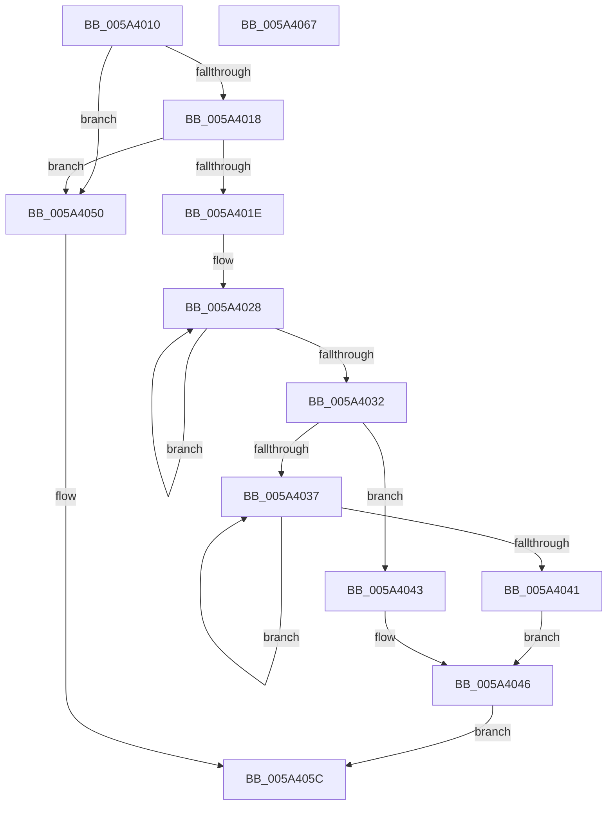

# EventDataDescCreateString

- RVA: `0x005A4010`–`0x005A4068` (길이 `88` bytes)
- VA: `0x00000001405A4010`
- 실행 섹션: `.text`
- PDB 이름 있음: `예`; PDB Function 태그: `아니요`
- unwind 정보 RVA: `0x000DB714`
- 디코드: `27`개 명령, `88/88` bytes 표시
- 미해석 바이트: `0` (있으면 어셈블리에 `.byte`로 보존)

> 이 문서는 커널 이미지의 기계어와 PDB 기호를 분석해 생성했습니다. 4번과 5번은 함수 원형과 자료형을 바이너리 사용 방식에서 추정한 C 해석이며 원본 소스 복구 결과는 아닙니다.

## 1. Dependencies

- 직접 호출 지점: **0**; 고유 호출 대상: **0**
- 직접 호출자로 확인된 함수: **1**
- RIP 상대 이미지 참조: **1**

### Outgoing calls
- 직접 디코드된 call 명령이 없습니다.

### Direct callers
- [IopLiveDumpTraceEventGeneric](IopLiveDumpTraceEventGeneric_function_005A41E4.md) at `0x005A424A`
- [IopLiveDumpTraceEventGeneric](IopLiveDumpTraceEventGeneric_function_005A41E4.md) at `0x005A427B`
- [IopLiveDumpTraceEventGeneric](IopLiveDumpTraceEventGeneric_function_005A41E4.md) at `0x005A428C`

### Static image references
- `0x005A4050` → RVA `0x006CB080` (` ?? ::FNODOBFM::`string'`; read)

## 2. Other-region calls and transfers

- 다른 실행 섹션으로 향하는 call: **0**
- 별도 외부 분기/꼬리 이동을 확인하지 못했습니다.

## 3. Assembly (complete function range)

```asm
005A4010  45 33 D2                        xor r10d, r10d
005A4013  48 85 D2                        test rdx, rdx
005A4016  74 38                           je 0x1405a4050
005A4018  66 44 39 12                     cmp word ptr [rdx], r10w
005A401C  74 32                           je 0x1405a4050
005A401E  48 83 C8 FF                     or rax, 0xffffffffffffffff
005A4022  45 8B C8                        mov r9d, r8d
005A4025  4C 8B C0                        mov r8, rax
005A4028  49 FF C0                        inc r8
005A402B  66 46 39 14 42                  cmp word ptr [rdx + r8*2], r10w
005A4030  75 F6                           jne 0x1405a4028
005A4032  4D 3B C1                        cmp r8, r9
005A4035  73 0C                           jae 0x1405a4043
005A4037  48 FF C0                        inc rax
005A403A  66 44 39 14 42                  cmp word ptr [rdx + rax*2], r10w
005A403F  75 F6                           jne 0x1405a4037
005A4041  EB 03                           jmp 0x1405a4046
005A4043  49 8B C1                        mov rax, r9
005A4046  48 8D 04 45 02 00 00 00         lea rax, [rax*2 + 2]
005A404E  EB 0C                           jmp 0x1405a405c
005A4050  48 8D 15 29 70 12 00            lea rdx, [rip + 0x127029]
005A4057  B8 0A 00 00 00                  mov eax, 0xa
005A405C  48 89 11                        mov qword ptr [rcx], rdx
005A405F  89 41 08                        mov dword ptr [rcx + 8], eax
005A4062  44 89 51 0C                     mov dword ptr [rcx + 0xc], r10d
005A4066  C3                              ret
005A4067  CC                              int3
```

## 4. C-style interpretation (structured pseudocode)

```c
__int64 __fastcall EventDataDescCreateString(__int64 a1, __int64 a2, int a3)
{
    __int64 result;
    __int64 v_r10;

    v_r10 = 0;
    if (a2 == 0) goto loc_005A4050;
    if ((*(unsigned __int16 *)(a2)) == 0) goto loc_005A4050;
    result = (result) | (-1);
loc_005A4028:
    a3 = (result) + 1;
    if ((*(unsigned __int16 *)(a2 + a3 * 2)) != 0) goto loc_005A4028;
    if (a3 >= ((unsigned int)(a3))) goto loc_005A4043;
loc_005A4037:
    result = (result) + 1;
    if ((*(unsigned __int16 *)(a2 + result * 2)) != 0) goto loc_005A4037;
    goto loc_005A4046;
loc_005A4043:
loc_005A4046:
    goto loc_005A405C;
loc_005A4050:
loc_005A405C:
    *(unsigned __int64 *)(a1) = v_rip + 1208361;
    *(unsigned int *)(a1 + 8) = 10;
    *(unsigned int *)(a1 + 12) = 0;
    return 10;
}
```

## 5. (Beta) C Style

```c
int64_t EventDataDescCreateString(void *Arg1, int64_t Arg2, int32_t Arg3)
{
    uint8_t *arg1 = (uint8_t *)Arg1;

    int64_t result;
    int64_t local_r10;

    local_r10 = 0;
    if (Arg2 == 0) goto loc_005A4050;
    if ((*(uint16_t *)(Arg2)) == 0) goto loc_005A4050;
    result = (result) | (-1);
loc_005A4028:
    Arg3 = (result) + 1;
    if ((*(uint16_t *)(Arg2 + Arg3 * 2)) != 0) goto loc_005A4028;
    if (Arg3 >= ((uint32_t)(Arg3))) goto loc_005A4043;
loc_005A4037:
    result = (result) + 1;
    if ((*(uint16_t *)(Arg2 + result * 2)) != 0) goto loc_005A4037;
    goto loc_005A4046;
loc_005A4043:
loc_005A4046:
    goto loc_005A405C;
loc_005A4050:
loc_005A405C:
    *(uint64_t *)(arg1) = v_rip + 1208361;
    *(uint32_t *)(arg1 + 0x8) = 10;
    *(uint32_t *)(arg1 + 0xC) = 0;
    return 10;
}
```

### 관측된 메모리 오프셋

구조체 형식이 확인되지 않은 접근은 인자 기준의 오프셋으로만 기록했습니다.

| 기준 인자 | 오프셋 표현 | 폭 (bit) | 접근 |
|---|---:|---:|---|
| `Arg1` | `+ 0x0` | `64` | `W` |
| `Arg1` | `+ 0x8` | `32` | `W` |
| `Arg1` | `+ 0xC` | `32` | `W` |

## 6. Execution-region graph

[열기: 2D/3D 그래프와 함수 탐색 컨트롤 패널](../../../control-panel.html?section=text&rva=0x005A4010&view=graph)

- 2D 그래프는 위에서 아래로 흐르고, 3D 그래프는 빈 공간을 드래그해 회전합니다. Shift+드래그는 이동, 휠은 확대·축소, 함수 노드 선택은 대상 보고서 이동입니다.

### Static fallback


