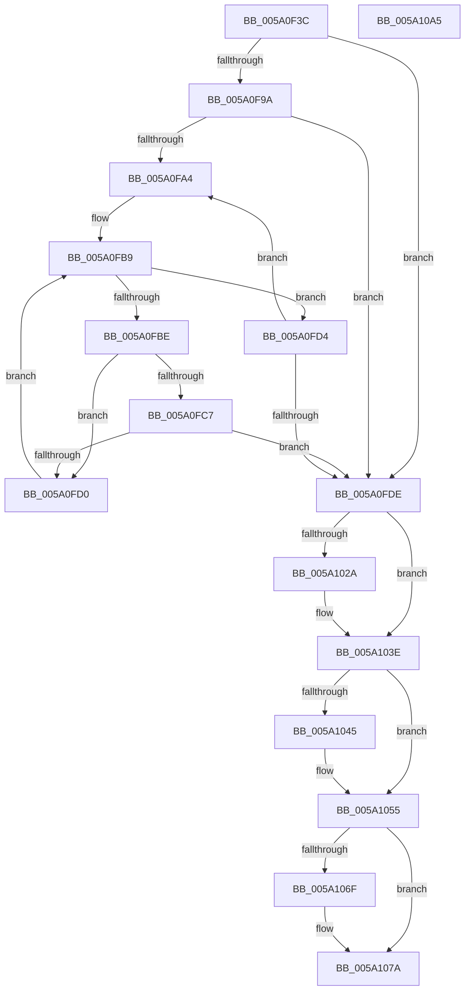

# IoAddPagesForPartialKernelDump

- RVA: `0x005A0F3C`–`0x005A10A6` (길이 `362` bytes)
- VA: `0x00000001405A0F3C`
- 실행 섹션: `.text`
- PDB 이름 있음: `예`; PDB Function 태그: `아니요`
- unwind 정보 RVA: `0x0008A668`
- 디코드: `94`개 명령, `362/362` bytes 표시
- 미해석 바이트: `0` (있으면 어셈블리에 `.byte`로 보존)

> 이 문서는 커널 이미지의 기계어와 PDB 기호를 분석해 생성했습니다. 4번과 5번은 함수 원형과 자료형을 바이너리 사용 방식에서 추정한 C 해석이며 원본 소스 복구 결과는 아닙니다.

## 1. Dependencies

- 직접 호출 지점: **9**; 고유 호출 대상: **7**
- 직접 호출자로 확인된 함수: **1**
- RIP 상대 이미지 참조: **6**

### Outgoing calls
- `0x005A0F79` → [IopDumpCallRemovePagesCallbacks](../59/IopDumpCallRemovePagesCallbacks_function_00594B44.md) (function, `0x00594B44`)
- `0x005A0F83` → [IoSaveBugCheckProgress](../59/IoSaveBugCheckProgress_function_00592E10.md) (function, `0x00592E10`)
- `0x005A0F91` → [MmIsAddressValidEx](../27/MmIsAddressValidEx_function_0027FDD0.md) (function, `0x0027FDD0`)
- `0x005A0FC7` → [ExpHeapDumpEnumLargeAllocs](../65/ExpHeapDumpEnumLargeAllocs_function_0065C6CC.md) (function, `0x0065C6CC`)
- `0x005A0FE3` → [IoSaveBugCheckProgress](../59/IoSaveBugCheckProgress_function_00592E10.md) (function, `0x00592E10`)
- `0x005A0FE8` → [IopCompactRemovePagesArray](IopCompactRemovePagesArray_function_005A1A34.md) (function, `0x005A1A34`)
- `0x005A101F` → [IopAddMiniDumpPagesToPartialKernelDump](IopAddMiniDumpPagesToPartialKernelDump_function_005A16F8.md) (function, `0x005A16F8`)
- `0x005A1037` → [IopAddLiveDumpPagesToPartialKernelDump](IopAddLiveDumpPagesToPartialKernelDump_function_005A13AC.md) (function, `0x005A13AC`)
- `0x005A107F` → [IoSaveBugCheckProgress](../59/IoSaveBugCheckProgress_function_00592E10.md) (function, `0x00592E10`)

### Direct callers
- [IoWriteCrashDump](../59/IoWriteCrashDump_function_005936D8.md) at `0x00593B50`
- [IoWriteCrashDump](../59/IoWriteCrashDump_function_005936D8.md) at `0x00593CA9`

### Static image references
- `0x005A0F59` → RVA `0x00E66050` (`.data`; read)
- `0x005A0F72` → RVA `0x00E66198` (`.data`; write)
- `0x005A0F8A` → RVA `0x005A2480` (`IopRemoveLargeAllocsFromPartialDump`; read)
- `0x005A0F9C` → RVA `0x00E6BF10` (`.data`; read)
- `0x005A0FAD` → RVA `0x00E6BF40` (`.data`; read)
- `0x005A105C` → RVA `0x00E66198` (`.data`; read)

## 2. Other-region calls and transfers

- 다른 실행 섹션으로 향하는 call: **0**
- 별도 외부 분기/꼬리 이동을 확인하지 못했습니다.

## 3. Assembly (complete function range)

```asm
005A0F3C  48 8B C4                        mov rax, rsp
005A0F3F  48 89 58 08                     mov qword ptr [rax + 8], rbx
005A0F43  48 89 68 10                     mov qword ptr [rax + 0x10], rbp
005A0F47  48 89 70 18                     mov qword ptr [rax + 0x18], rsi
005A0F4B  48 89 78 20                     mov qword ptr [rax + 0x20], rdi
005A0F4F  41 54                           push r12
005A0F51  41 56                           push r14
005A0F53  41 57                           push r15
005A0F55  48 83 EC 40                     sub rsp, 0x40
005A0F59  48 8B 05 F0 50 8C 00            mov rax, qword ptr [rip + 0x8c50f0]
005A0F60  4D 8B E1                        mov r12, r9
005A0F63  4D 8B F0                        mov r14, r8
005A0F66  4C 8B FA                        mov r15, rdx
005A0F69  8B E9                           mov ebp, ecx
005A0F6B  4C 8B 90 90 05 00 00            mov r10, qword ptr [rax + 0x590]
005A0F72  4C 89 15 1F 52 8C 00            mov qword ptr [rip + 0x8c521f], r10
005A0F79  E8 C6 3B FF FF                  call 0x140594b44
005A0F7E  B9 22 00 00 00                  mov ecx, 0x22
005A0F83  E8 88 1E FF FF                  call 0x140592e10
005A0F88  33 D2                           xor edx, edx
005A0F8A  48 8D 0D EF 14 00 00            lea rcx, [rip + 0x14ef]
005A0F91  E8 3A EE CD FF                  call 0x14027fdd0
005A0F96  84 C0                           test al, al
005A0F98  74 44                           je 0x1405a0fde
005A0F9A  33 DB                           xor ebx, ebx
005A0F9C  39 1D 6E AF 8C 00               cmp dword ptr [rip + 0x8caf6e], ebx
005A0FA2  76 3A                           jbe 0x1405a0fde
005A0FA4  8B C3                           mov eax, ebx
005A0FA6  48 69 F0 C0 20 00 00            imul rsi, rax, 0x20c0
005A0FAD  48 8D 05 8C AF 8C 00            lea rax, [rip + 0x8caf8c]
005A0FB4  48 03 F0                        add rsi, rax
005A0FB7  33 FF                           xor edi, edi
005A0FB9  83 FF 01                        cmp edi, 1
005A0FBC  77 16                           ja 0x1405a0fd4
005A0FBE  48 8B 0C FE                     mov rcx, qword ptr [rsi + rdi*8]
005A0FC2  48 85 C9                        test rcx, rcx
005A0FC5  74 09                           je 0x1405a0fd0
005A0FC7  E8 00 B7 0B 00                  call 0x14065c6cc
005A0FCC  85 C0                           test eax, eax
005A0FCE  78 0E                           js 0x1405a0fde
005A0FD0  FF C7                           inc edi
005A0FD2  EB E5                           jmp 0x1405a0fb9
005A0FD4  FF C3                           inc ebx
005A0FD6  3B 1D 34 AF 8C 00               cmp ebx, dword ptr [rip + 0x8caf34]
005A0FDC  72 C6                           jb 0x1405a0fa4
005A0FDE  B9 28 00 00 00                  mov ecx, 0x28
005A0FE3  E8 28 1E FF FF                  call 0x140592e10
005A0FE8  E8 47 0A 00 00                  call 0x1405a1a34
005A0FED  48 8B 84 24 90 00 00 00         mov rax, qword ptr [rsp + 0x90]
005A0FF5  4D 8B CC                        mov r9, r12
005A0FF8  48 8B BC 24 80 00 00 00         mov rdi, qword ptr [rsp + 0x80]
005A1000  4D 8B C6                        mov r8, r14
005A1003  48 89 44 24 30                  mov qword ptr [rsp + 0x30], rax
005A1008  49 8B D7                        mov rdx, r15
005A100B  48 8B 84 24 88 00 00 00         mov rax, qword ptr [rsp + 0x88]
005A1013  8B CD                           mov ecx, ebp
005A1015  48 89 44 24 28                  mov qword ptr [rsp + 0x28], rax
005A101A  48 89 7C 24 20                  mov qword ptr [rsp + 0x20], rdi
005A101F  E8 D4 06 00 00                  call 0x1405a16f8
005A1024  8B D8                           mov ebx, eax
005A1026  85 C0                           test eax, eax
005A1028  78 14                           js 0x1405a103e
005A102A  4D 8B C6                        mov r8, r14
005A102D  48 89 7C 24 20                  mov qword ptr [rsp + 0x20], rdi
005A1032  49 8B D7                        mov rdx, r15
005A1035  8B CD                           mov ecx, ebp
005A1037  E8 70 03 00 00                  call 0x1405a13ac
005A103C  8B D8                           mov ebx, eax
005A103E  3D 23 00 00 C0                  cmp eax, 0xc0000023
005A1043  75 10                           jne 0x1405a1055
005A1045  48 8B 05 04 50 8C 00            mov rax, qword ptr [rip + 0x8c5004]
005A104C  83 88 58 05 00 00 10            or dword ptr [rax + 0x558], 0x10
005A1053  33 DB                           xor ebx, ebx
005A1055  48 8B 05 F4 4F 8C 00            mov rax, qword ptr [rip + 0x8c4ff4]
005A105C  48 8B 15 35 51 8C 00            mov rdx, qword ptr [rip + 0x8c5135]
005A1063  48 8B 88 90 05 00 00            mov rcx, qword ptr [rax + 0x590]
005A106A  48 3B CA                        cmp rcx, rdx
005A106D  76 0B                           jbe 0x1405a107a
005A106F  48 8B 40 08                     mov rax, qword ptr [rax + 8]
005A1073  48 2B CA                        sub rcx, rdx
005A1076  48 89 48 28                     mov qword ptr [rax + 0x28], rcx
005A107A  B9 2A 00 00 00                  mov ecx, 0x2a
005A107F  E8 8C 1D FF FF                  call 0x140592e10
005A1084  48 8B 6C 24 68                  mov rbp, qword ptr [rsp + 0x68]
005A1089  8B C3                           mov eax, ebx
005A108B  48 8B 5C 24 60                  mov rbx, qword ptr [rsp + 0x60]
005A1090  48 8B 74 24 70                  mov rsi, qword ptr [rsp + 0x70]
005A1095  48 8B 7C 24 78                  mov rdi, qword ptr [rsp + 0x78]
005A109A  48 83 C4 40                     add rsp, 0x40
005A109E  41 5F                           pop r15
005A10A0  41 5E                           pop r14
005A10A2  41 5C                           pop r12
005A10A4  C3                              ret
005A10A5  CC                              int3
```

## 4. C-style interpretation (structured pseudocode)

```c
__int64 __fastcall IoAddPagesForPartialKernelDump(int a1, __int64 a2, __int64 a3, __int64 a4, __int64 a5, __int64 a6, __int64 a7)
{
    __int64 result;
    __int64 v_rbx;
    __int64 v_rdi;
    __int64 v_rsi;
    __int64 v_rsp;
    unsigned __int64 v_stack_m28;
    unsigned __int64 v_stack_m30;
    unsigned __int64 v_stack_m38;
    unsigned __int64 v_stack_p10;
    unsigned __int64 v_stack_p18;
    unsigned __int64 v_stack_p20;
    unsigned __int64 v_stack_p8;

    *(unsigned __int64 *)(v_rsp + 8) = v_rbx;
    *(unsigned __int64 *)(v_rsp + 16) = v_rbp;
    *(unsigned __int64 *)(v_rsp + 24) = v_rsi;
    *(unsigned __int64 *)(v_rsp + 32) = v_rdi;
    v_rsp = (v_rsp) - (64);
    *(unsigned __int64 *)(v_rip + 9196063) = *(unsigned __int64 *)(*(unsigned __int64 *)(v_rip + 9195760) + 1424);
    result = IopDumpCallRemovePagesCallbacks(a1, a2, a3, a4);
    result = IoSaveBugCheckProgress(34, a2, a3, a4);
    a2 = 0;
    result = MmIsAddressValidEx(v_rip + 5359, a2, a3, a4);
    if ((unsigned __int8)(result) == 0) goto loc_005A0FDE;
    v_rbx = 0;
    if ((*(unsigned int *)(v_rip + 9219950)) <= 0) goto loc_005A0FDE;
loc_005A0FA4:
    v_rsi = (v_rsi) * (0);
    v_rsi = (v_rsi) + (v_rip + 9219980);
    v_rdi = 0;
loc_005A0FB9:
    if (0 > 1) goto loc_005A0FD4;
    if (*(unsigned __int64 *)(v_rsi + v_rdi * 8) == 0) goto loc_005A0FD0;
    result = ExpHeapDumpEnumLargeAllocs(*(unsigned __int64 *)(v_rsi + v_rdi * 8), a2, a3, a4);
    if (sign_flag) goto loc_005A0FDE;
loc_005A0FD0:
    v_rdi = (unsigned int)((v_rdi) + 1);
    goto loc_005A0FB9;
loc_005A0FD4:
    v_rbx = (unsigned int)((v_rbx) + 1);
    if (((unsigned int)(v_rbx)) < (*(unsigned int *)(v_rip + 9219892))) goto loc_005A0FA4;
loc_005A0FDE:
    result = IoSaveBugCheckProgress(40, a2, a3, a4);
    result = IopCompactRemovePagesArray(40, a2, a3, a4);
    v_stack_m28 = a7;
    v_stack_m30 = a6;
    v_stack_m38 = a5;
    result = IopAddMiniDumpPagesToPartialKernelDump((unsigned int)((unsigned int)((unsigned int)(a1))), 0, a3, a4);
    v_rbx = (unsigned int)((unsigned int)(result));
    if (!(sign_flag)) {
        a3 = a3;
        v_stack_m38 = a5;
        a2 = 0;
        a1 = (unsigned int)((unsigned int)(a1));
        result = IopAddLiveDumpPagesToPartialKernelDump(a1, a2, a3, a4);
        v_rbx = (unsigned int)(result);
    }
    if (((unsigned int)(result)) == 0xC0000023ULL) {
        result = *(unsigned __int64 *)(v_rip + 9195524);
        v_rbx = 0;
    }
    result = *(unsigned __int64 *)(v_rip + 9195508);
    if ((*(unsigned __int64 *)(*(unsigned __int64 *)(v_rip + 9195508) + 1424)) >= = (*(unsigned __int64 *)(v_rip + 9195829))) {
        result = *(unsigned __int64 *)(*(unsigned __int64 *)(v_rip + 9195508) + 8);
        a1 = (*(unsigned __int64 *)(*(unsigned __int64 *)(v_rip + 9195508) + 1424)) - (*(unsigned __int64 *)(v_rip + 9195829));
        *(unsigned __int64 *)(result + 40) = a1;
    }
    result = IoSaveBugCheckProgress(42, *(unsigned __int64 *)(v_rip + 9195829), a3, a4);
    v_rsp = (v_rsp) + (64);
    return 0;
}
```

## 5. (Beta) C Style

```c
int64_t IoAddPagesForPartialKernelDump(int32_t Arg1, int64_t Arg2, int64_t Arg3, int64_t Arg4, int64_t Arg5, int64_t Arg6, int64_t Arg7)
{
    int64_t result;
    int64_t local_rbx;
    int64_t local_rdi;
    int64_t local_rsi;
    int64_t local_rsp;
    uint64_t v_stack_m28;
    uint64_t v_stack_m30;
    uint64_t v_stack_m38;
    uint64_t v_stack_p10;
    uint64_t v_stack_p18;
    uint64_t v_stack_p20;
    uint64_t v_stack_p8;

    *(uint64_t *)(local_rsp + 0x8) = local_rbx;
    *(uint64_t *)(local_rsp + 0x10) = local_rbp;
    *(uint64_t *)(local_rsp + 0x18) = local_rsi;
    *(uint64_t *)(local_rsp + 0x20) = local_rdi;
    local_rsp = (local_rsp) - (64);
    *(uint64_t *)(v_rip + 0x8C521F) = *(uint64_t *)(*(uint64_t *)(v_rip + 0x8C50F0) + 0x590);
    result = IopDumpCallRemovePagesCallbacks(Arg1, Arg2, Arg3, Arg4);
    result = IoSaveBugCheckProgress(34, Arg2, Arg3, Arg4);
    Arg2 = 0;
    result = MmIsAddressValidEx(v_rip + 5359, Arg2, Arg3, Arg4);
    if ((uint8_t)(result) == 0) goto loc_005A0FDE;
    local_rbx = 0;
    if ((*(uint32_t *)(v_rip + 0x8CAF6E)) <= 0) goto loc_005A0FDE;
loc_005A0FA4:
    local_rsi = (local_rsi) * (0);
    local_rsi = (local_rsi) + (v_rip + 9219980);
    local_rdi = 0;
loc_005A0FB9:
    if (0 > 1) goto loc_005A0FD4;
    if (*(uint64_t *)(local_rsi + local_rdi * 8) == 0) goto loc_005A0FD0;
    result = ExpHeapDumpEnumLargeAllocs(*(uint64_t *)(local_rsi + local_rdi * 8), Arg2, Arg3, Arg4);
    if (sign_flag) goto loc_005A0FDE;
loc_005A0FD0:
    local_rdi = (uint32_t)((local_rdi) + 1);
    goto loc_005A0FB9;
loc_005A0FD4:
    local_rbx = (uint32_t)((local_rbx) + 1);
    if (((uint32_t)(local_rbx)) < (*(uint32_t *)(v_rip + 0x8CAF34))) goto loc_005A0FA4;
loc_005A0FDE:
    result = IoSaveBugCheckProgress(40, Arg2, Arg3, Arg4);
    result = IopCompactRemovePagesArray(40, Arg2, Arg3, Arg4);
    v_stack_m28 = Arg7;
    v_stack_m30 = Arg6;
    v_stack_m38 = Arg5;
    result = IopAddMiniDumpPagesToPartialKernelDump((uint32_t)((uint32_t)((uint32_t)(Arg1))), 0, Arg3, Arg4);
    local_rbx = (uint32_t)((uint32_t)(result));
    if (!(sign_flag)) {
        Arg3 = Arg3;
        v_stack_m38 = Arg5;
        Arg2 = 0;
        Arg1 = (uint32_t)((uint32_t)(Arg1));
        result = IopAddLiveDumpPagesToPartialKernelDump(Arg1, Arg2, Arg3, Arg4);
        local_rbx = (uint32_t)(result);
    }
    if (((uint32_t)(result)) == 0xC0000023ULL) {
        result = *(uint64_t *)(v_rip + 0x8C5004);
        local_rbx = 0;
    }
    result = *(uint64_t *)(v_rip + 0x8C4FF4);
    if ((*(uint64_t *)(*(uint64_t *)(v_rip + 0x8C4FF4) + 0x590)) >= = (*(uint64_t *)(v_rip + 0x8C5135))) {
        result = *(uint64_t *)(*(uint64_t *)(v_rip + 0x8C4FF4) + 0x8);
        Arg1 = (*(uint64_t *)(*(uint64_t *)(v_rip + 0x8C4FF4) + 0x590)) - (*(uint64_t *)(v_rip + 0x8C5135));
        *(uint64_t *)(result + 0x28) = Arg1;
    }
    result = IoSaveBugCheckProgress(42, *(uint64_t *)(v_rip + 0x8C5135), Arg3, Arg4);
    local_rsp = (local_rsp) + (64);
    return 0;
}
```

## 6. Execution-region graph

[열기: 2D/3D 그래프와 함수 탐색 컨트롤 패널](../../../control-panel.html?section=text&rva=0x005A0F3C&view=graph)

- 2D 그래프는 위에서 아래로 흐르고, 3D 그래프는 빈 공간을 드래그해 회전합니다. Shift+드래그는 이동, 휠은 확대·축소, 함수 노드 선택은 대상 보고서 이동입니다.

### Static fallback


