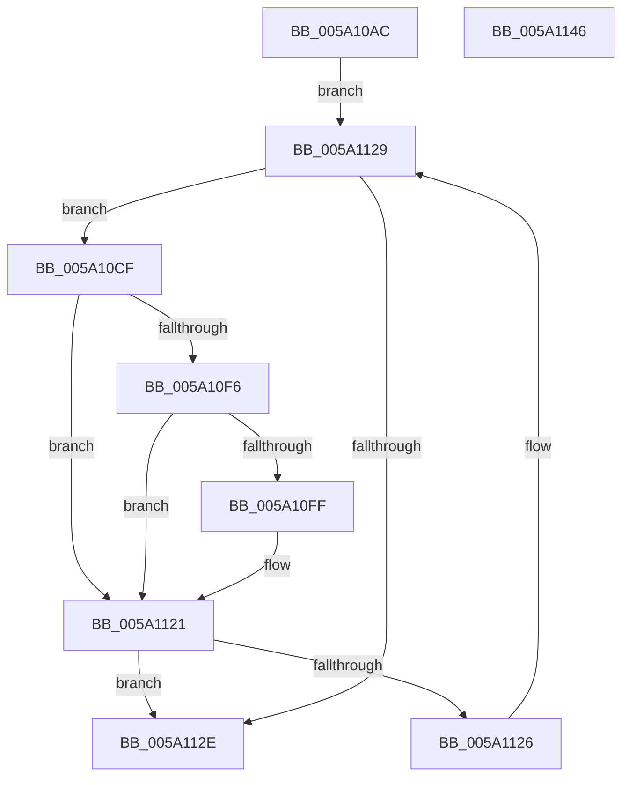

# IoAddProcessThreadsToDump

- RVA: `0x005A10AC`–`0x005A1147` (길이 `155` bytes)
- VA: `0x00000001405A10AC`
- 실행 섹션: `.text`
- PDB 이름 있음: `예`; PDB Function 태그: `아니요`
- unwind 정보 RVA: `0x00066400`
- 디코드: `42`개 명령, `155/155` bytes 표시
- 미해석 바이트: `0` (있으면 어셈블리에 `.byte`로 보존)

> 이 문서는 커널 이미지의 기계어와 PDB 기호를 분석해 생성했습니다. 4번과 5번은 함수 원형과 자료형을 바이너리 사용 방식에서 추정한 C 해석이며 원본 소스 복구 결과는 아닙니다.

## 1. Dependencies

- 직접 호출 지점: **2**; 고유 호출 대상: **2**
- 직접 호출자로 확인된 함수: **2**
- RIP 상대 이미지 참조: **1**

### Outgoing calls
- `0x005A10EA` → [MmAddRangeToCrashDump](../67/MmAddRangeToCrashDump_function_0067D8B0.md) (function, `0x0067D8B0`)
- `0x005A1117` → [KeEnumerateKernelStackSegments](../2A/KeEnumerateKernelStackSegments_function_002A13B8.md) (function, `0x002A13B8`)

### Direct callers
- [IopLiveDumpAddProcessesCallback](../59/IopLiveDumpAddProcessesCallback_function_00599150.md) at `0x0059916C`
- [IopPartialDumpAddProcessesCallback](IopPartialDumpAddProcessesCallback_function_005A2460.md) at `0x005A2464`

### Static image references
- `0x005A1109` → RVA `0x005A1210` (`IoAddThreadStackToDump`; read)

## 2. Other-region calls and transfers

- 다른 실행 섹션으로 향하는 call: **0**
- 별도 외부 분기/꼬리 이동을 확인하지 못했습니다.

## 3. Assembly (complete function range)

```asm
005A10AC  48 89 5C 24 08                  mov qword ptr [rsp + 8], rbx
005A10B1  48 89 6C 24 10                  mov qword ptr [rsp + 0x10], rbp
005A10B6  48 89 74 24 18                  mov qword ptr [rsp + 0x18], rsi
005A10BB  57                              push rdi
005A10BC  48 83 EC 30                     sub rsp, 0x30
005A10C0  48 8D 7A 30                     lea rdi, [rdx + 0x30]
005A10C4  48 8B E9                        mov rbp, rcx
005A10C7  48 8B 1F                        mov rbx, qword ptr [rdi]
005A10CA  45 33 C0                        xor r8d, r8d
005A10CD  EB 5A                           jmp 0x1405a1129
005A10CF  0F 57 C0                        xorps xmm0, xmm0
005A10D2  48 8D B3 08 FD FF FF            lea rsi, [rbx - 0x2f8]
005A10D9  48 8B D6                        mov rdx, rsi
005A10DC  41 B8 98 07 00 00               mov r8d, 0x798
005A10E2  48 8B CD                        mov rcx, rbp
005A10E5  0F 11 44 24 20                  movups xmmword ptr [rsp + 0x20], xmm0
005A10EA  E8 C1 C7 0D 00                  call 0x14067d8b0
005A10EF  44 8B C0                        mov r8d, eax
005A10F2  85 C0                           test eax, eax
005A10F4  78 2B                           js 0x1405a1121
005A10F6  F7 46 78 00 00 02 00            test dword ptr [rsi + 0x78], 0x20000
005A10FD  74 22                           je 0x1405a1121
005A10FF  4C 8D 44 24 20                  lea r8, [rsp + 0x20]
005A1104  48 89 6C 24 20                  mov qword ptr [rsp + 0x20], rbp
005A1109  48 8D 15 00 01 00 00            lea rdx, [rip + 0x100]
005A1110  89 44 24 28                     mov dword ptr [rsp + 0x28], eax
005A1114  48 8B CE                        mov rcx, rsi
005A1117  E8 9C 02 D0 FF                  call 0x1402a13b8
005A111C  44 8B 44 24 28                  mov r8d, dword ptr [rsp + 0x28]
005A1121  45 85 C0                        test r8d, r8d
005A1124  78 08                           js 0x1405a112e
005A1126  48 8B 1B                        mov rbx, qword ptr [rbx]
005A1129  48 3B DF                        cmp rbx, rdi
005A112C  75 A1                           jne 0x1405a10cf
005A112E  48 8B 5C 24 40                  mov rbx, qword ptr [rsp + 0x40]
005A1133  41 8B C0                        mov eax, r8d
005A1136  48 8B 6C 24 48                  mov rbp, qword ptr [rsp + 0x48]
005A113B  48 8B 74 24 50                  mov rsi, qword ptr [rsp + 0x50]
005A1140  48 83 C4 30                     add rsp, 0x30
005A1144  5F                              pop rdi
005A1145  C3                              ret
005A1146  CC                              int3
```

## 4. C-style interpretation (structured pseudocode)

```c
__int64 __fastcall IoAddProcessThreadsToDump(__int64 a1, __int64 a2, int a3)
{
    __int64 result;
    __int64 v_rsp;
    unsigned int v_stack_m10;
    unsigned __int64 v_stack_m18;
    unsigned __int64 v_stack_p10;
    unsigned __int64 v_stack_p18;
    unsigned __int64 v_stack_p8;

    v_stack_p8 = v_rbx;
    v_stack_p10 = v_rbp;
    v_stack_p18 = v_rsi;
    v_rsp = (v_rsp) - (48);
    a3 = 0;
    goto loc_005A1129;
loc_005A10CF:
    v_stack_m18 = v_xmm0;
    result = MmAddRangeToCrashDump(a1, *(unsigned __int64 *)(a2 + 48) - 760, (unsigned int)(0x798ULL), a4);
    if (sign_flag) goto loc_005A1121;
    if (((*(unsigned int *)(*(unsigned __int64 *)(a2 + 48) - 760 + 120)) & (0x20000ULL)) != 0) {
        a3 = v_stack_m18;
        v_stack_m18 = a1;
        a2 = v_rip + 256;
        v_stack_m10 = (unsigned int)(result);
        a1 = *(unsigned __int64 *)(a2 + 48) - 760;
        result = KeEnumerateKernelStackSegments(a1, a2, a3, a4);
        a3 = v_stack_m10;
    }
    if (sign_flag) goto loc_005A112E;
loc_005A1129:
    if ((*(unsigned __int64 *)(*(unsigned __int64 *)(a2 + 48))) != (a2 + 48)) goto loc_005A10CF;
loc_005A112E:
    v_rsp = (v_rsp) + (48);
    return (unsigned int)(a3);
}
```

## 5. (Beta) C Style

```c
int64_t IoAddProcessThreadsToDump(int64_t Arg1, void *Arg2, int32_t Arg3)
{
    uint8_t *arg2 = (uint8_t *)Arg2;

    int64_t result;
    int64_t local_rsp;
    uint32_t v_stack_m10;
    uint64_t v_stack_m18;
    uint64_t v_stack_p10;
    uint64_t v_stack_p18;
    uint64_t v_stack_p8;

    v_stack_p8 = local_rbx;
    v_stack_p10 = local_rbp;
    v_stack_p18 = local_rsi;
    local_rsp = (local_rsp) - (48);
    Arg3 = 0;
    goto loc_005A1129;
loc_005A10CF:
    v_stack_m18 = v_xmm0;
    result = MmAddRangeToCrashDump(Arg1, *(uint64_t *)(arg2 + 0x30) - 760, (uint32_t)(0x798ULL), a4);
    if (sign_flag) goto loc_005A1121;
    if (((*(uint32_t *)(*(uint64_t *)(arg2 + 0x30) - 0x2F8 + 0x78)) & (0x20000ULL)) != 0) {
        Arg3 = v_stack_m18;
        v_stack_m18 = Arg1;
        Arg2 = v_rip + 256;
        v_stack_m10 = (uint32_t)(result);
        Arg1 = *(uint64_t *)(arg2 + 0x30) - 760;
        result = KeEnumerateKernelStackSegments(Arg1, Arg2, Arg3, a4);
        Arg3 = v_stack_m10;
    }
    if (sign_flag) goto loc_005A112E;
loc_005A1129:
    if ((*(uint64_t *)(*(uint64_t *)(arg2 + 0x30))) != (Arg2 + 48)) goto loc_005A10CF;
loc_005A112E:
    local_rsp = (local_rsp) + (48);
    return (uint32_t)(Arg3);
}
```

### 관측된 메모리 오프셋

구조체 형식이 확인되지 않은 접근은 인자 기준의 오프셋으로만 기록했습니다.

| 기준 인자 | 오프셋 표현 | 폭 (bit) | 접근 |
|---|---:|---:|---|
| `Arg2` | `+ 0x0` | `64` | `R` |
| `Arg2` | `+ 0x30` | `64` | `R` |

## 6. Execution-region graph

[열기: 2D/3D 그래프와 함수 탐색 컨트롤 패널](../../../control-panel.html?section=text&rva=0x005A10AC&view=graph)

- 2D 그래프는 위에서 아래로 흐르고, 3D 그래프는 빈 공간을 드래그해 회전합니다. Shift+드래그는 이동, 휠은 확대·축소, 함수 노드 선택은 대상 보고서 이동입니다.

### Static fallback


