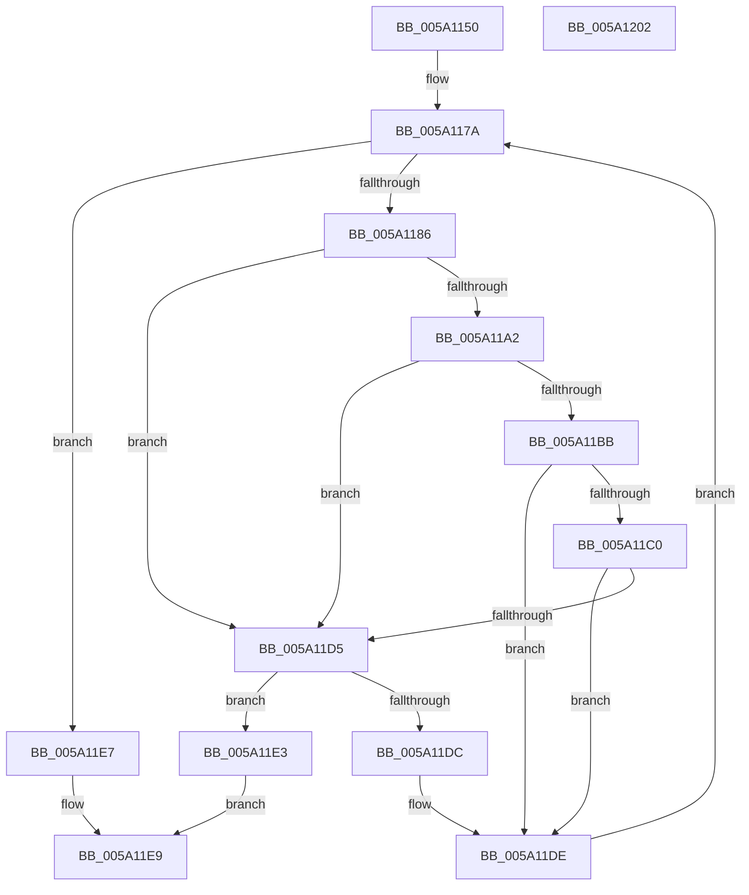

# IoAddProcessesToDump

- RVA: `0x005A1150`–`0x005A1203` (길이 `179` bytes)
- VA: `0x00000001405A1150`
- 실행 섹션: `.text`
- PDB 이름 있음: `예`; PDB Function 태그: `아니요`
- unwind 정보 RVA: `0x00060300`
- 디코드: `54`개 명령, `179/179` bytes 표시
- 미해석 바이트: `0` (있으면 어셈블리에 `.byte`로 보존)

> 이 문서는 커널 이미지의 기계어와 PDB 기호를 분석해 생성했습니다. 4번과 5번은 함수 원형과 자료형을 바이너리 사용 방식에서 추정한 C 해석이며 원본 소스 복구 결과는 아닙니다.

## 1. Dependencies

- 직접 호출 지점: **3**; 고유 호출 대상: **2**
- 직접 호출자로 확인된 함수: **2**
- RIP 상대 이미지 참조: **1**

### Outgoing calls
- `0x005A1199` → [MmAddRangeToCrashDump](../67/MmAddRangeToCrashDump_function_0067D8B0.md) (function, `0x0067D8B0`)
- `0x005A11B2` → [MmAddRangeToCrashDump](../67/MmAddRangeToCrashDump_function_0067D8B0.md) (function, `0x0067D8B0`)
- `0x005A11CC` → [guard_dispatch_icall](../6B/guard_dispatch_icall_function_006BAAD0.md) (function, `0x006BAAD0`)

### Direct callers
- [IopLiveDumpAddProcesses](../59/IopLiveDumpAddProcesses_function_00599120.md) at `0x00599134`
- [IopAddLiveDumpPagesToPartialKernelDump](IopAddLiveDumpPagesToPartialKernelDump_function_005A13AC.md) at `0x005A1633`

### Static image references
- `0x005A1168` → RVA `0x00F067C0` (`.data`; read)

## 2. Other-region calls and transfers

- 다른 실행 섹션으로 향하는 call: **0**
- 별도 외부 분기/꼬리 이동을 확인하지 못했습니다.

## 3. Assembly (complete function range)

```asm
005A1150  48 89 5C 24 08                  mov qword ptr [rsp + 8], rbx
005A1155  48 89 6C 24 10                  mov qword ptr [rsp + 0x10], rbp
005A115A  48 89 74 24 18                  mov qword ptr [rsp + 0x18], rsi
005A115F  57                              push rdi
005A1160  41 56                           push r14
005A1162  41 57                           push r15
005A1164  48 83 EC 20                     sub rsp, 0x20
005A1168  48 8B 1D 51 56 96 00            mov rbx, qword ptr [rip + 0x965651]
005A116F  4D 8B F8                        mov r15, r8
005A1172  4C 8B F2                        mov r14, rdx
005A1175  48 8B E9                        mov rbp, rcx
005A1178  33 FF                           xor edi, edi
005A117A  48 8D 05 3F 56 96 00            lea rax, [rip + 0x96563f]
005A1181  48 3B D8                        cmp rbx, rax
005A1184  74 61                           je 0x1405a11e7
005A1186  48 8D B3 28 FE FF FF            lea rsi, [rbx - 0x1d8]
005A118D  41 B8 40 08 00 00               mov r8d, 0x840
005A1193  48 8B D6                        mov rdx, rsi
005A1196  48 8B CD                        mov rcx, rbp
005A1199  E8 12 C7 0D 00                  call 0x14067d8b0
005A119E  85 C0                           test eax, eax
005A11A0  78 33                           js 0x1405a11d5
005A11A2  48 8B 96 E0 02 00 00            mov rdx, qword ptr [rsi + 0x2e0]
005A11A9  41 B8 D8 07 00 00               mov r8d, 0x7d8
005A11AF  48 8B CD                        mov rcx, rbp
005A11B2  E8 F9 C6 0D 00                  call 0x14067d8b0
005A11B7  85 C0                           test eax, eax
005A11B9  78 1A                           js 0x1405a11d5
005A11BB  4D 85 F6                        test r14, r14
005A11BE  74 1E                           je 0x1405a11de
005A11C0  4D 8B C7                        mov r8, r15
005A11C3  48 8B D6                        mov rdx, rsi
005A11C6  48 8B CD                        mov rcx, rbp
005A11C9  49 8B C6                        mov rax, r14
005A11CC  E8 FF 98 11 00                  call 0x1406baad0
005A11D1  85 C0                           test eax, eax
005A11D3  79 09                           jns 0x1405a11de
005A11D5  3D 23 00 00 C0                  cmp eax, 0xc0000023
005A11DA  74 07                           je 0x1405a11e3
005A11DC  8B F8                           mov edi, eax
005A11DE  48 8B 1B                        mov rbx, qword ptr [rbx]
005A11E1  EB 97                           jmp 0x1405a117a
005A11E3  33 C0                           xor eax, eax
005A11E5  EB 02                           jmp 0x1405a11e9
005A11E7  8B C7                           mov eax, edi
005A11E9  48 8B 5C 24 40                  mov rbx, qword ptr [rsp + 0x40]
005A11EE  48 8B 6C 24 48                  mov rbp, qword ptr [rsp + 0x48]
005A11F3  48 8B 74 24 50                  mov rsi, qword ptr [rsp + 0x50]
005A11F8  48 83 C4 20                     add rsp, 0x20
005A11FC  41 5F                           pop r15
005A11FE  41 5E                           pop r14
005A1200  5F                              pop rdi
005A1201  C3                              ret
005A1202  CC                              int3
```

## 4. C-style interpretation (structured pseudocode)

```c
__int64 __fastcall IoAddProcessesToDump(__int64 a1, __int64 a2, __int64 a3)
{
    __int64 result;
    __int64 v_rdi;
    __int64 v_rsp;
    unsigned __int64 v_stack_p10;
    unsigned __int64 v_stack_p18;
    unsigned __int64 v_stack_p8;

    v_stack_p8 = v_rbx;
    v_stack_p10 = v_rbp;
    v_stack_p18 = v_rsi;
    v_rsp = (v_rsp) - (32);
    v_rdi = 0;
loc_005A117A:
    if ((*(unsigned __int64 *)(v_rip + 9852497)) == (v_rip + 9852479)) goto loc_005A11E7;
    result = MmAddRangeToCrashDump(a1, *(unsigned __int64 *)(v_rip + 9852497) - 472, (unsigned int)(0x840ULL), a4);
    if (sign_flag) goto loc_005A11D5;
    result = MmAddRangeToCrashDump(a1, *(unsigned __int64 *)(*(unsigned __int64 *)(v_rip + 9852497) - 472 + 736), (unsigned int)(0x7D8ULL), a4);
    if (sign_flag) goto loc_005A11D5;
    if (a2 == 0) goto loc_005A11DE;
    result = guard_dispatch_icall(a1, *(unsigned __int64 *)(v_rip + 9852497) - 472, a3, a4);
    if (!sign_flag) goto loc_005A11DE;
loc_005A11D5:
    if (((unsigned int)(result)) == 0xC0000023ULL) goto loc_005A11E3;
loc_005A11DE:
    goto loc_005A117A;
loc_005A11E3:
    result = 0;
    goto loc_005A11E9;
loc_005A11E7:
loc_005A11E9:
    v_rsp = (v_rsp) + (32);
    return (unsigned int)((unsigned int)((unsigned int)((unsigned int)(result))));
}
```

## 5. (Beta) C Style

```c
int64_t IoAddProcessesToDump(int64_t Arg1, int64_t Arg2, int64_t Arg3)
{
    int64_t result;
    int64_t local_rdi;
    int64_t local_rsp;
    uint64_t v_stack_p10;
    uint64_t v_stack_p18;
    uint64_t v_stack_p8;

    v_stack_p8 = local_rbx;
    v_stack_p10 = local_rbp;
    v_stack_p18 = local_rsi;
    local_rsp = (local_rsp) - (32);
    local_rdi = 0;
loc_005A117A:
    if ((*(uint64_t *)(v_rip + 0x965651)) == (v_rip + 9852479)) goto loc_005A11E7;
    result = MmAddRangeToCrashDump(Arg1, *(uint64_t *)(v_rip + 0x965651) - 472, (uint32_t)(0x840ULL), a4);
    if (sign_flag) goto loc_005A11D5;
    result = MmAddRangeToCrashDump(Arg1, *(uint64_t *)(*(uint64_t *)(v_rip + 0x965651) - 0x1D8 + 0x2E0), (uint32_t)(0x7D8ULL), a4);
    if (sign_flag) goto loc_005A11D5;
    if (Arg2 == 0) goto loc_005A11DE;
    result = guard_dispatch_icall(Arg1, *(uint64_t *)(v_rip + 0x965651) - 472, Arg3, a4);
    if (!sign_flag) goto loc_005A11DE;
loc_005A11D5:
    if (((uint32_t)(result)) == 0xC0000023ULL) goto loc_005A11E3;
loc_005A11DE:
    goto loc_005A117A;
loc_005A11E3:
    result = 0;
    goto loc_005A11E9;
loc_005A11E7:
loc_005A11E9:
    local_rsp = (local_rsp) + (32);
    return (uint32_t)((uint32_t)((uint32_t)((uint32_t)(result))));
}
```

## 6. Execution-region graph

[열기: 2D/3D 그래프와 함수 탐색 컨트롤 패널](../../../control-panel.html?section=text&rva=0x005A1150&view=graph)

- 2D 그래프는 위에서 아래로 흐르고, 3D 그래프는 빈 공간을 드래그해 회전합니다. Shift+드래그는 이동, 휠은 확대·축소, 함수 노드 선택은 대상 보고서 이동입니다.

### Static fallback


