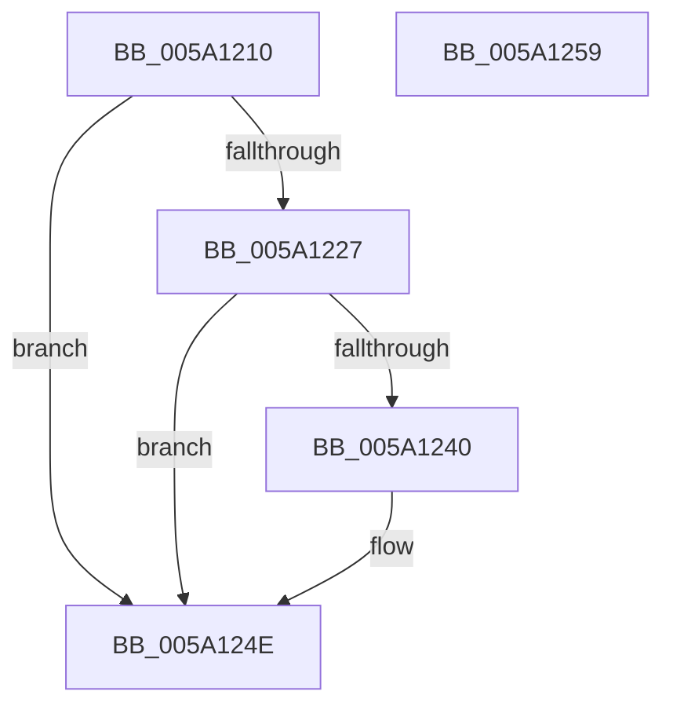

# IoAddThreadStackToDump

- RVA: `0x005A1210`–`0x005A125A` (길이 `74` bytes)
- VA: `0x00000001405A1210`
- 실행 섹션: `.text`
- PDB 이름 있음: `예`; PDB Function 태그: `아니요`
- unwind 정보 RVA: `0x0005CAAC`
- 디코드: `24`개 명령, `74/74` bytes 표시
- 미해석 바이트: `0` (있으면 어셈블리에 `.byte`로 보존)

> 이 문서는 커널 이미지의 기계어와 PDB 기호를 분석해 생성했습니다. 4번과 5번은 함수 원형과 자료형을 바이너리 사용 방식에서 추정한 C 해석이며 원본 소스 복구 결과는 아닙니다.

## 1. Dependencies

- 직접 호출 지점: **2**; 고유 호출 대상: **2**
- 직접 호출자로 확인된 함수: **0**
- RIP 상대 이미지 참조: **0**

### Outgoing calls
- `0x005A1234` → [MmAddRangeToCrashDump](../67/MmAddRangeToCrashDump_function_0067D8B0.md) (function, `0x0067D8B0`)
- `0x005A1246` → [IopAddStackSegmentKernelShadowStackToDump](IopAddStackSegmentKernelShadowStackToDump_function_005A1884.md) (function, `0x005A1884`)

### Direct callers
- 이 함수 시작 RVA로 연결되는 직접 call은 확인되지 않았습니다. 간접 호출은 완전히 역산할 수 없습니다.

### Static image references
- 디코드된 RIP-relative 메모리 참조가 없습니다.

## 2. Other-region calls and transfers

- 다른 실행 섹션으로 향하는 call: **0**
- 별도 외부 분기/꼬리 이동을 확인하지 못했습니다.

## 3. Assembly (complete function range)

```asm
005A1210  48 89 5C 24 08                  mov qword ptr [rsp + 8], rbx
005A1215  57                              push rdi
005A1216  48 83 EC 20                     sub rsp, 0x20
005A121A  41 83 78 08 00                  cmp dword ptr [r8 + 8], 0
005A121F  49 8B D8                        mov rbx, r8
005A1222  48 8B FA                        mov rdi, rdx
005A1225  7C 27                           jl 0x1405a124e
005A1227  48 8B 52 08                     mov rdx, qword ptr [rdx + 8]
005A122B  4C 8B 07                        mov r8, qword ptr [rdi]
005A122E  48 8B 0B                        mov rcx, qword ptr [rbx]
005A1231  4C 2B C2                        sub r8, rdx
005A1234  E8 77 C6 0D 00                  call 0x14067d8b0
005A1239  89 43 08                        mov dword ptr [rbx + 8], eax
005A123C  85 C0                           test eax, eax
005A123E  78 0E                           js 0x1405a124e
005A1240  48 8B 0B                        mov rcx, qword ptr [rbx]
005A1243  48 8B D7                        mov rdx, rdi
005A1246  E8 39 06 00 00                  call 0x1405a1884
005A124B  89 43 08                        mov dword ptr [rbx + 8], eax
005A124E  48 8B 5C 24 30                  mov rbx, qword ptr [rsp + 0x30]
005A1253  48 83 C4 20                     add rsp, 0x20
005A1257  5F                              pop rdi
005A1258  C3                              ret
005A1259  CC                              int3
```

## 4. C-style interpretation (structured pseudocode)

```c
__int64 __fastcall IoAddThreadStackToDump(__int64 a1, __int64 a2, __int64 a3)
{
    __int64 result;
    __int64 v_rsp;
    unsigned __int64 v_stack_p8;

    v_stack_p8 = v_rbx;
    v_rsp = (v_rsp) - (32);
    if ((*(unsigned int *)(a3 + 8)) < 0) goto loc_005A124E;
    a3 = (*(unsigned __int64 *)(a2)) - (*(unsigned __int64 *)(a2 + 8));
    result = MmAddRangeToCrashDump(*(unsigned __int64 *)(a3), *(unsigned __int64 *)(a2 + 8), a3, a4);
    *(unsigned int *)(a3 + 8) = (unsigned int)(result);
    if (!(sign_flag)) {
        a1 = *(unsigned __int64 *)(a3);
        a2 = a2;
        result = IopAddStackSegmentKernelShadowStackToDump(a1, a2, a3, a4);
        *(unsigned int *)(a3 + 8) = (unsigned int)(result);
    }
    v_rsp = (v_rsp) + (32);
    return result;
}
```

## 5. (Beta) C Style

```c
int64_t IoAddThreadStackToDump(int64_t Arg1, void *Arg2, void *Arg3)
{
    uint8_t *arg2 = (uint8_t *)Arg2;
    uint8_t *arg3 = (uint8_t *)Arg3;

    int64_t result;
    int64_t local_rsp;
    uint64_t v_stack_p8;

    v_stack_p8 = local_rbx;
    local_rsp = (local_rsp) - (32);
    if ((*(uint32_t *)(arg3 + 0x8)) < 0) goto loc_005A124E;
    Arg3 = (*(uint64_t *)(arg2)) - (*(uint64_t *)(arg2 + 0x8));
    result = MmAddRangeToCrashDump(*(uint64_t *)(arg3), *(uint64_t *)(arg2 + 0x8), Arg3, a4);
    *(uint32_t *)(arg3 + 0x8) = (uint32_t)(result);
    if (!(sign_flag)) {
        Arg1 = *(uint64_t *)(arg3);
        Arg2 = Arg2;
        result = IopAddStackSegmentKernelShadowStackToDump(Arg1, Arg2, Arg3, a4);
        *(uint32_t *)(arg3 + 0x8) = (uint32_t)(result);
    }
    local_rsp = (local_rsp) + (32);
    return result;
}
```

### 관측된 메모리 오프셋

구조체 형식이 확인되지 않은 접근은 인자 기준의 오프셋으로만 기록했습니다.

| 기준 인자 | 오프셋 표현 | 폭 (bit) | 접근 |
|---|---:|---:|---|
| `Arg2` | `+ 0x0` | `64` | `R` |
| `Arg2` | `+ 0x8` | `64` | `R` |
| `Arg3` | `+ 0x0` | `64` | `R` |
| `Arg3` | `+ 0x8` | `32` | `R` |
| `Arg3` | `+ 0x8` | `32` | `W` |

## 6. Execution-region graph

[열기: 2D/3D 그래프와 함수 탐색 컨트롤 패널](../../../control-panel.html?section=text&rva=0x005A1210&view=graph)

- 2D 그래프는 위에서 아래로 흐르고, 3D 그래프는 빈 공간을 드래그해 회전합니다. Shift+드래그는 이동, 휠은 확대·축소, 함수 노드 선택은 대상 보고서 이동입니다.

### Static fallback


