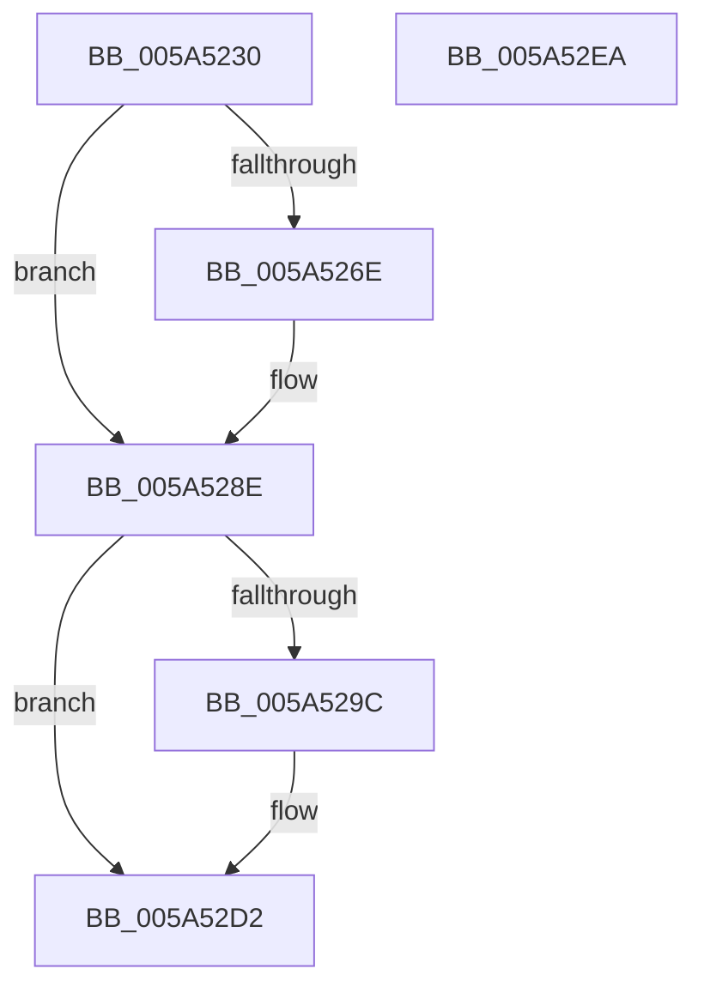

# IoEnumerateKsrPersistentMemoryEx

- RVA: `0x005A5230`–`0x005A52EB` (길이 `187` bytes)
- VA: `0x00000001405A5230`
- 실행 섹션: `.text`
- PDB 이름 있음: `예`; PDB Function 태그: `아니요`
- unwind 정보 RVA: `0x000C8204`
- 디코드: `52`개 명령, `187/187` bytes 표시
- 미해석 바이트: `0` (있으면 어셈블리에 `.byte`로 보존)

> 이 문서는 커널 이미지의 기계어와 PDB 기호를 분석해 생성했습니다. 4번과 5번은 함수 원형과 자료형을 바이너리 사용 방식에서 추정한 C 해석이며 원본 소스 복구 결과는 아닙니다.

## 1. Dependencies

- 직접 호출 지점: **4**; 고유 호출 대상: **4**
- 직접 호출자로 확인된 함수: **0**
- RIP 상대 이미지 참조: **3**

### Outgoing calls
- `0x005A5288` → [KeBugCheckEx](../4F/KeBugCheckEx_function_004FD660.md) (function, `0x004FD660`)
- `0x005A5293` → [PipGetDriverKsrGuid](../../page/72/PipGetDriverKsrGuid_function_00725100.md) (function, `0x00725100`)
- `0x005A52C6` → `ext-ms-win-ntos-ksr-l1-1-5.dll!KsrEnumeratePersistedMemory` (import, 간접 대상; import `ext-ms-win-ntos-ksr-l1-1-5.dll!KsrEnumeratePersistedMemory`)
- `0x005A52DA` → [_security_check_cookie](../6A/_security_check_cookie_function_006AC640.md) (function, `0x006AC640`)

### Direct callers
- 이 함수 시작 RVA로 연결되는 직접 call은 확인되지 않았습니다. 간접 호출은 완전히 역산할 수 없습니다.

### Static image references
- `0x005A523B` → RVA `0x00E0A740` (`.data`; read)
- `0x005A52A6` → RVA `0x005A5300` (`PipEnumeratePersistedMemoryCallback`; read)
- `0x005A52C6` → RVA `0x00151330` (`ext-ms-win-ntos-ksr-l1-1-5.dll!KsrEnumeratePersistedMemory (IAT)`; read)

## 2. Other-region calls and transfers

- 다른 실행 섹션으로 향하는 call: **1**
  - `0x005A5293` → [PipGetDriverKsrGuid](../../page/72/PipGetDriverKsrGuid_function_00725100.md) (`.text` → `PAGE`)
- 별도 외부 분기/꼬리 이동을 확인하지 못했습니다.

## 3. Assembly (complete function range)

```asm
005A5230  40 53                           push rbx
005A5232  55                              push rbp
005A5233  56                              push rsi
005A5234  57                              push rdi
005A5235  41 56                           push r14
005A5237  48 83 EC 70                     sub rsp, 0x70
005A523B  48 8B 05 FE 54 86 00            mov rax, qword ptr [rip + 0x8654fe]
005A5242  48 33 C4                        xor rax, rsp
005A5245  48 89 44 24 68                  mov qword ptr [rsp + 0x68], rax
005A524A  4C 8B B4 24 C0 00 00 00         mov r14, qword ptr [rsp + 0xc0]
005A5252  0F 57 C0                        xorps xmm0, xmm0
005A5255  0F 11 44 24 58                  movups xmmword ptr [rsp + 0x58], xmm0
005A525A  49 8B E9                        mov rbp, r9
005A525D  49 8B F0                        mov rsi, r8
005A5260  48 8B FA                        mov rdi, rdx
005A5263  48 8B D9                        mov rbx, rcx
005A5266  44 0F 20 C0                     mov rax, cr8
005A526A  84 C0                           test al, al
005A526C  74 20                           je 0x1405a528e
005A526E  44 0F 20 C0                     mov rax, cr8
005A5272  48 83 64 24 20 00               and qword ptr [rsp + 0x20], 0
005A5278  45 33 C9                        xor r9d, r9d
005A527B  44 0F B6 C0                     movzx r8d, al
005A527F  B9 21 01 00 00                  mov ecx, 0x121
005A5284  41 8D 51 01                     lea edx, [r9 + 1]
005A5288  E8 D3 83 F5 FF                  call 0x1404fd660
005A528D  CC                              int3
005A528E  48 8D 54 24 58                  lea rdx, [rsp + 0x58]
005A5293  E8 68 FE 17 00                  call 0x140725100
005A5298  85 C0                           test eax, eax
005A529A  78 36                           js 0x1405a52d2
005A529C  4C 8D 44 24 30                  lea r8, [rsp + 0x30]
005A52A1  48 89 5C 24 30                  mov qword ptr [rsp + 0x30], rbx
005A52A6  48 8D 15 53 00 00 00            lea rdx, [rip + 0x53]
005A52AD  48 89 7C 24 38                  mov qword ptr [rsp + 0x38], rdi
005A52B2  48 8D 4C 24 58                  lea rcx, [rsp + 0x58]
005A52B7  48 89 74 24 40                  mov qword ptr [rsp + 0x40], rsi
005A52BC  48 89 6C 24 48                  mov qword ptr [rsp + 0x48], rbp
005A52C1  4C 89 74 24 50                  mov qword ptr [rsp + 0x50], r14
005A52C6  48 FF 15 63 C0 BA FF            call qword ptr [rip - 0x453f9d]
005A52CD  0F 1F 44 00 00                  nop dword ptr [rax + rax]
005A52D2  48 8B 4C 24 68                  mov rcx, qword ptr [rsp + 0x68]
005A52D7  48 33 CC                        xor rcx, rsp
005A52DA  E8 61 73 10 00                  call 0x1406ac640
005A52DF  48 83 C4 70                     add rsp, 0x70
005A52E3  41 5E                           pop r14
005A52E5  5F                              pop rdi
005A52E6  5E                              pop rsi
005A52E7  5D                              pop rbp
005A52E8  5B                              pop rbx
005A52E9  C3                              ret
005A52EA  CC                              int3
```

## 4. C-style interpretation (structured pseudocode)

```c
__int64 __fastcall IoEnumerateKsrPersistentMemoryEx(__int64 a1, __int64 a2, __int64 a3, __int64 a4, __int64 a5)
{
    __int64 result;
    __int64 v_rsp;
    unsigned __int64 v_stack_m30;
    unsigned __int64 v_stack_m40;
    unsigned __int64 v_stack_m48;
    unsigned __int64 v_stack_m50;
    unsigned __int64 v_stack_m58;
    unsigned __int64 v_stack_m60;
    unsigned __int64 v_stack_m68;
    unsigned __int64 v_stack_m78;

    v_rsp = (v_rsp) - (112);
    result = (*(unsigned __int64 *)(v_rip + 8803582)) ^ (v_rsp);
    v_stack_m30 = result;
    v_stack_m40 = v_xmm0;
    result = v_cr8;
    if ((unsigned __int8)(v_cr8) != 0) {
        result = v_cr8;
        a4 = 0;
        a3 = (unsigned __int8)(result);
        a1 = 289;
        a2 = a4 + 1;
        result = KeBugCheckEx(a1, a2, a3, a4);
    }
    result = PipGetDriverKsrGuid(a1, v_stack_m40, a3, a4);
    if (!(sign_flag)) {
        a3 = v_stack_m68;
        v_stack_m68 = a1;
        a2 = v_rip + 83;
        v_stack_m60 = a2;
        a1 = v_stack_m40;
        v_stack_m58 = a3;
        v_stack_m50 = 0;
        v_stack_m48 = a5;
        result = ext_ms_win_ntos_ksr_l1_1_5_dll_KsrEnumeratePersistedMemory(a1, a2, a3, a4);
    }
    a1 = (v_stack_m30) ^ (v_rsp);
    result = _security_check_cookie(a1, a2, a3, a4);
    v_rsp = (v_rsp) + (112);
    return result;
}
```

## 5. (Beta) C Style

```c
int64_t IoEnumerateKsrPersistentMemoryEx(int64_t Arg1, int64_t Arg2, int64_t Arg3, int64_t Arg4, int64_t Arg5)
{
    int64_t result;
    int64_t local_rsp;
    uint64_t v_stack_m30;
    uint64_t v_stack_m40;
    uint64_t v_stack_m48;
    uint64_t v_stack_m50;
    uint64_t v_stack_m58;
    uint64_t v_stack_m60;
    uint64_t v_stack_m68;
    uint64_t v_stack_m78;

    local_rsp = (local_rsp) - (112);
    result = (*(uint64_t *)(v_rip + 0x8654FE)) ^ (local_rsp);
    v_stack_m30 = result;
    v_stack_m40 = v_xmm0;
    result = v_cr8;
    if ((uint8_t)(v_cr8) != 0) {
        result = v_cr8;
        Arg4 = 0;
        Arg3 = (uint8_t)(result);
        Arg1 = 289;
        Arg2 = Arg4 + 1;
        result = KeBugCheckEx(Arg1, Arg2, Arg3, Arg4);
    }
    result = PipGetDriverKsrGuid(Arg1, v_stack_m40, Arg3, Arg4);
    if (!(sign_flag)) {
        Arg3 = v_stack_m68;
        v_stack_m68 = Arg1;
        Arg2 = v_rip + 83;
        v_stack_m60 = Arg2;
        Arg1 = v_stack_m40;
        v_stack_m58 = Arg3;
        v_stack_m50 = 0;
        v_stack_m48 = Arg5;
        result = kernel_indirect_call(Arg1, Arg2, Arg3, Arg4);
    }
    Arg1 = (v_stack_m30) ^ (local_rsp);
    result = _security_check_cookie(Arg1, Arg2, Arg3, Arg4);
    local_rsp = (local_rsp) + (112);
    return result;
}
```

## 6. Execution-region graph

[열기: 2D/3D 그래프와 함수 탐색 컨트롤 패널](../../../control-panel.html?section=text&rva=0x005A5230&view=graph)

- 2D 그래프는 위에서 아래로 흐르고, 3D 그래프는 빈 공간을 드래그해 회전합니다. Shift+드래그는 이동, 휠은 확대·축소, 함수 노드 선택은 대상 보고서 이동입니다.

### Static fallback


