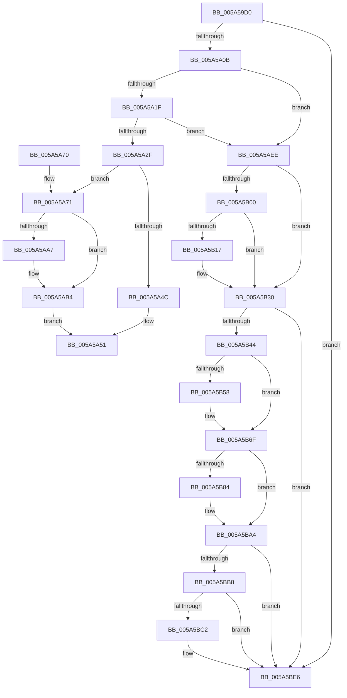

# IoRequestDeviceEjectEx

- RVA: `0x005A59D0`–`0x005A5BFF` (길이 `559` bytes)
- VA: `0x00000001405A59D0`
- 실행 섹션: `.text`
- PDB 이름 있음: `예`; PDB Function 태그: `아니요`
- unwind 정보 RVA: `0x000C84B0`
- 디코드: `136`개 명령, `559/559` bytes 표시
- 미해석 바이트: `0` (있으면 어셈블리에 `.byte`로 보존)

> 이 문서는 커널 이미지의 기계어와 PDB 기호를 분석해 생성했습니다. 4번과 5번은 함수 원형과 자료형을 바이너리 사용 방식에서 추정한 C 해석이며 원본 소스 복구 결과는 아닙니다.

## 1. Dependencies

- 직접 호출 지점: **16**; 고유 호출 대상: **6**
- 직접 호출자로 확인된 함수: **1**
- RIP 상대 이미지 참조: **1**

### Outgoing calls
- `0x005A5A3F` → [ExAllocatePool2](../../poolcode/B8/ExAllocatePool2_function_00B820F0.md) (function, `0x00B820F0`)
- `0x005A5A90` → [memcpy](../6C/memcpy_function_006C6840.md) (function, `0x006C6840`)
- `0x005A5AAF` → [ObfReferenceObjectWithTag](../21/ObfReferenceObjectWithTag_function_00210710.md) (function, `0x00210710`)
- `0x005A5AE2` → [ExQueueWorkItem](../2F/ExQueueWorkItem_function_002F9520.md) (function, `0x002F9520`)
- `0x005A5AF2` → [IoAddTriageDumpDataBlock](../42/IoAddTriageDumpDataBlock_function_00428374.md) (function, `0x00428374`)
- `0x005A5B04` → [IoAddTriageDumpDataBlock](../42/IoAddTriageDumpDataBlock_function_00428374.md) (function, `0x00428374`)
- `0x005A5B1A` → [IoAddTriageDumpDataBlock](../42/IoAddTriageDumpDataBlock_function_00428374.md) (function, `0x00428374`)
- `0x005A5B2B` → [IoAddTriageDumpDataBlock](../42/IoAddTriageDumpDataBlock_function_00428374.md) (function, `0x00428374`)
- `0x005A5B4D` → [IoAddTriageDumpDataBlock](../42/IoAddTriageDumpDataBlock_function_00428374.md) (function, `0x00428374`)
- `0x005A5B5E` → [IoAddTriageDumpDataBlock](../42/IoAddTriageDumpDataBlock_function_00428374.md) (function, `0x00428374`)
- `0x005A5B6A` → [IoAddTriageDumpDataBlock](../42/IoAddTriageDumpDataBlock_function_00428374.md) (function, `0x00428374`)
- `0x005A5B87` → [IoAddTriageDumpDataBlock](../42/IoAddTriageDumpDataBlock_function_00428374.md) (function, `0x00428374`)
- `0x005A5B9F` → [IoAddTriageDumpDataBlock](../42/IoAddTriageDumpDataBlock_function_00428374.md) (function, `0x00428374`)
- `0x005A5BC5` → [IoAddTriageDumpDataBlock](../42/IoAddTriageDumpDataBlock_function_00428374.md) (function, `0x00428374`)
- `0x005A5BE1` → [IoAddTriageDumpDataBlock](../42/IoAddTriageDumpDataBlock_function_00428374.md) (function, `0x00428374`)
- `0x005A5BF9` → [KeBugCheckEx](../4F/KeBugCheckEx_function_004FD660.md) (function, `0x004FD660`)

### Direct callers
- [IoRequestDeviceEject](IoRequestDeviceEject_function_005A59B0.md) at `0x005A59BC`

### Static image references
- `0x005A5AC3` → RVA `0x0072A6D0` (`PnpRequestDeviceEjectExWorker`; read)

## 2. Other-region calls and transfers

- 다른 실행 섹션으로 향하는 call: **1**
  - `0x005A5A3F` → [ExAllocatePool2](../../poolcode/B8/ExAllocatePool2_function_00B820F0.md) (`.text` → `POOLCODE`)
- 별도 외부 분기/꼬리 이동을 확인하지 못했습니다.

## 3. Assembly (complete function range)

```asm
005A59D0  48 8B C4                        mov rax, rsp
005A59D3  48 89 58 08                     mov qword ptr [rax + 8], rbx
005A59D7  48 89 68 10                     mov qword ptr [rax + 0x10], rbp
005A59DB  48 89 70 18                     mov qword ptr [rax + 0x18], rsi
005A59DF  48 89 78 20                     mov qword ptr [rax + 0x20], rdi
005A59E3  41 54                           push r12
005A59E5  41 56                           push r14
005A59E7  41 57                           push r15
005A59E9  48 83 EC 30                     sub rsp, 0x30
005A59ED  45 33 FF                        xor r15d, r15d
005A59F0  49 8B F1                        mov rsi, r9
005A59F3  49 8B E8                        mov rbp, r8
005A59F6  4C 8B F2                        mov r14, rdx
005A59F9  48 8B D9                        mov rbx, rcx
005A59FC  41 BC 02 00 00 00               mov r12d, 2
005A5A02  48 85 C9                        test rcx, rcx
005A5A05  0F 84 DB 01 00 00               je 0x1405a5be6
005A5A0B  48 8B 81 38 01 00 00            mov rax, qword ptr [rcx + 0x138]
005A5A12  48 8B 40 28                     mov rax, qword ptr [rax + 0x28]
005A5A16  48 85 C0                        test rax, rax
005A5A19  0F 84 CF 00 00 00               je 0x1405a5aee
005A5A1F  F7 80 8C 01 00 00 00 00 02 00   test dword ptr [rax + 0x18c], 0x20000
005A5A29  0F 85 BF 00 00 00               jne 0x1405a5aee
005A5A2F  BA D8 05 00 00                  mov edx, 0x5d8
005A5A34  41 8D 4C 24 3E                  lea ecx, [r12 + 0x3e]
005A5A39  41 B8 50 6E 70 46               mov r8d, 0x46706e50
005A5A3F  E8 AC C6 5D 00                  call 0x140b820f0
005A5A44  48 8B F8                        mov rdi, rax
005A5A47  48 85 C0                        test rax, rax
005A5A4A  75 25                           jne 0x1405a5a71
005A5A4C  B8 9A 00 00 C0                  mov eax, 0xc000009a
005A5A51  48 8B 5C 24 50                  mov rbx, qword ptr [rsp + 0x50]
005A5A56  48 8B 6C 24 58                  mov rbp, qword ptr [rsp + 0x58]
005A5A5B  48 8B 74 24 60                  mov rsi, qword ptr [rsp + 0x60]
005A5A60  48 8B 7C 24 68                  mov rdi, qword ptr [rsp + 0x68]
005A5A65  48 83 C4 30                     add rsp, 0x30
005A5A69  41 5F                           pop r15
005A5A6B  41 5E                           pop r14
005A5A6D  41 5C                           pop r12
005A5A6F  C3                              ret
005A5A70  CC                              int3
005A5A71  48 8B 83 38 01 00 00            mov rax, qword ptr [rbx + 0x138]
005A5A78  48 8D 4F 40                     lea rcx, [rdi + 0x40]
005A5A7C  48 8B 58 28                     mov rbx, qword ptr [rax + 0x28]
005A5A80  4C 89 37                        mov qword ptr [rdi], r14
005A5A83  48 89 6F 08                     mov qword ptr [rdi + 8], rbp
005A5A87  44 0F B7 43 28                  movzx r8d, word ptr [rbx + 0x28]
005A5A8C  48 8B 53 30                     mov rdx, qword ptr [rbx + 0x30]
005A5A90  E8 AB 0D 12 00                  call 0x1406c6840
005A5A95  0F B7 43 28                     movzx eax, word ptr [rbx + 0x28]
005A5A99  48 D1 E8                        shr rax, 1
005A5A9C  66 44 89 7C 47 40               mov word ptr [rdi + rax*2 + 0x40], r15w
005A5AA2  48 85 F6                        test rsi, rsi
005A5AA5  74 0D                           je 0x1405a5ab4
005A5AA7  BA 50 6E 70 45                  mov edx, 0x45706e50
005A5AAC  48 8B CE                        mov rcx, rsi
005A5AAF  E8 5C AC C6 FF                  call 0x140210710
005A5AB4  48 8D 4F 20                     lea rcx, [rdi + 0x20]
005A5AB8  48 89 77 10                     mov qword ptr [rdi + 0x10], rsi
005A5ABC  44 89 BF D0 01 00 00            mov dword ptr [rdi + 0x1d0], r15d
005A5AC3  48 8D 05 06 4C 18 00            lea rax, [rip + 0x184c06]
005A5ACA  66 44 89 BF D4 01 00 00         mov word ptr [rdi + 0x1d4], r15w
005A5AD2  BA 01 00 00 00                  mov edx, 1
005A5AD7  48 89 41 10                     mov qword ptr [rcx + 0x10], rax
005A5ADB  48 89 79 18                     mov qword ptr [rcx + 0x18], rdi
005A5ADF  4C 89 39                        mov qword ptr [rcx], r15
005A5AE2  E8 39 3A D5 FF                  call 0x1402f9520
005A5AE7  33 C0                           xor eax, eax
005A5AE9  E9 63 FF FF FF                  jmp 0x1405a5a51
005A5AEE  0F B7 51 02                     movzx edx, word ptr [rcx + 2]
005A5AF2  E8 7D 28 E8 FF                  call 0x140428374
005A5AF7  48 8B 4B 08                     mov rcx, qword ptr [rbx + 8]
005A5AFB  48 85 C9                        test rcx, rcx
005A5AFE  74 30                           je 0x1405a5b30
005A5B00  0F BF 51 02                     movsx edx, word ptr [rcx + 2]
005A5B04  E8 6B 28 E8 FF                  call 0x140428374
005A5B09  48 8B 4B 08                     mov rcx, qword ptr [rbx + 8]
005A5B0D  48 83 C1 38                     add rcx, 0x38
005A5B11  66 44 39 39                     cmp word ptr [rcx], r15w
005A5B15  74 19                           je 0x1405a5b30
005A5B17  41 8B D4                        mov edx, r12d
005A5B1A  E8 55 28 E8 FF                  call 0x140428374
005A5B1F  48 8B 4B 08                     mov rcx, qword ptr [rbx + 8]
005A5B23  0F B7 51 38                     movzx edx, word ptr [rcx + 0x38]
005A5B27  48 8B 49 40                     mov rcx, qword ptr [rcx + 0x40]
005A5B2B  E8 44 28 E8 FF                  call 0x140428374
005A5B30  48 8B 83 38 01 00 00            mov rax, qword ptr [rbx + 0x138]
005A5B37  48 8B 48 28                     mov rcx, qword ptr [rax + 0x28]
005A5B3B  48 85 C9                        test rcx, rcx
005A5B3E  0F 84 A2 00 00 00               je 0x1405a5be6
005A5B44  BA 88 03 00 00                  mov edx, 0x388
005A5B49  48 8D 79 28                     lea rdi, [rcx + 0x28]
005A5B4D  E8 22 28 E8 FF                  call 0x140428374
005A5B52  66 44 39 3F                     cmp word ptr [rdi], r15w
005A5B56  74 17                           je 0x1405a5b6f
005A5B58  41 8B D4                        mov edx, r12d
005A5B5B  48 8B CF                        mov rcx, rdi
005A5B5E  E8 11 28 E8 FF                  call 0x140428374
005A5B63  0F B7 17                        movzx edx, word ptr [rdi]
005A5B66  48 8B 4F 08                     mov rcx, qword ptr [rdi + 8]
005A5B6A  E8 05 28 E8 FF                  call 0x140428374
005A5B6F  48 8B 83 38 01 00 00            mov rax, qword ptr [rbx + 0x138]
005A5B76  48 8B 48 28                     mov rcx, qword ptr [rax + 0x28]
005A5B7A  48 83 C1 38                     add rcx, 0x38
005A5B7E  66 44 39 39                     cmp word ptr [rcx], r15w
005A5B82  74 20                           je 0x1405a5ba4
005A5B84  41 8B D4                        mov edx, r12d
005A5B87  E8 E8 27 E8 FF                  call 0x140428374
005A5B8C  48 8B 83 38 01 00 00            mov rax, qword ptr [rbx + 0x138]
005A5B93  48 8B 48 28                     mov rcx, qword ptr [rax + 0x28]
005A5B97  0F B7 51 38                     movzx edx, word ptr [rcx + 0x38]
005A5B9B  48 8B 49 40                     mov rcx, qword ptr [rcx + 0x40]
005A5B9F  E8 D0 27 E8 FF                  call 0x140428374
005A5BA4  48 8B 83 38 01 00 00            mov rax, qword ptr [rbx + 0x138]
005A5BAB  48 8B 48 28                     mov rcx, qword ptr [rax + 0x28]
005A5BAF  48 8B 41 10                     mov rax, qword ptr [rcx + 0x10]
005A5BB3  48 85 C0                        test rax, rax
005A5BB6  74 2E                           je 0x1405a5be6
005A5BB8  48 8D 48 38                     lea rcx, [rax + 0x38]
005A5BBC  66 44 39 39                     cmp word ptr [rcx], r15w
005A5BC0  74 24                           je 0x1405a5be6
005A5BC2  41 8B D4                        mov edx, r12d
005A5BC5  E8 AA 27 E8 FF                  call 0x140428374
005A5BCA  48 8B 83 38 01 00 00            mov rax, qword ptr [rbx + 0x138]
005A5BD1  48 8B 48 28                     mov rcx, qword ptr [rax + 0x28]
005A5BD5  48 8B 49 10                     mov rcx, qword ptr [rcx + 0x10]
005A5BD9  0F B7 51 38                     movzx edx, word ptr [rcx + 0x38]
005A5BDD  48 8B 49 40                     mov rcx, qword ptr [rcx + 0x40]
005A5BE1  E8 8E 27 E8 FF                  call 0x140428374
005A5BE6  45 33 C9                        xor r9d, r9d
005A5BE9  4C 89 7C 24 20                  mov qword ptr [rsp + 0x20], r15
005A5BEE  4C 8B C3                        mov r8, rbx
005A5BF1  49 8B D4                        mov rdx, r12
005A5BF4  B9 CA 00 00 00                  mov ecx, 0xca
005A5BF9  E8 62 7A F5 FF                  call 0x1404fd660
005A5BFE  CC                              int3
```

## 4. C-style interpretation (structured pseudocode)

```c
__int64 __fastcall IoRequestDeviceEjectEx(__int64 a1, __int64 a2, __int64 a3, __int64 a4)
{
    __int64 result;
    __int64 v_r15;
    __int64 v_rsp;
    unsigned __int64 v_stack_p10;
    unsigned __int64 v_stack_p18;
    unsigned __int64 v_stack_p20;
    unsigned __int64 v_stack_p8;

    *(unsigned __int64 *)(v_rsp + 8) = v_rbx;
    *(unsigned __int64 *)(v_rsp + 16) = v_rbp;
    *(unsigned __int64 *)(v_rsp + 24) = v_rsi;
    *(unsigned __int64 *)(v_rsp + 32) = v_rdi;
    v_rsp = (v_rsp) - (48);
    v_r15 = 0;
    if (a1 == 0) goto loc_005A5BE6;
    if (*(unsigned __int64 *)(*(unsigned __int64 *)(a1 + 312) + 40) == 0) goto loc_005A5AEE;
    if (((*(unsigned int *)(*(unsigned __int64 *)(*(unsigned __int64 *)(a1 + 312) + 40) + 396)) & (0x20000ULL)) != 0) goto loc_005A5AEE;
    result = ExAllocatePool2(2 + 62, (unsigned int)(0x5D8ULL), (unsigned int)(0x46706E50ULL), a4);
    if (result != 0) goto loc_005A5A71;
loc_005A5A51:
    v_rsp = (v_rsp) + (48);
    return (unsigned int)(0xC000009AULL);
loc_005A5A71:
    *(unsigned __int64 *)(v_stack_p20) = a2;
    *(unsigned __int64 *)(v_stack_p20 + 8) = v_stack_p10;
    result = memcpy(v_stack_p20 + 64, *(unsigned __int64 *)(*(unsigned __int64 *)(*(unsigned __int64 *)(v_stack_p8 + 312) + 40) + 48), *(unsigned __int16 *)(*(unsigned __int64 *)(*(unsigned __int64 *)(v_stack_p8 + 312) + 40) + 40), a4);
    result = (*(unsigned __int16 *)(*(unsigned __int64 *)(*(unsigned __int64 *)(v_stack_p8 + 312) + 40) + 40)) >> (1);
    *(unsigned __int16 *)(v_stack_p20 + result * 2 + 64) = 0;
    if (v_stack_p18 != 0) {
        a2 = 0x45706E50ULL;
        a1 = v_stack_p18;
        result = ObfReferenceObjectWithTag(a1, a2, *(unsigned __int16 *)(*(unsigned __int64 *)(*(unsigned __int64 *)(v_stack_p8 + 312) + 40) + 40), a4);
    }
    *(unsigned __int64 *)(v_stack_p20 + 16) = v_stack_p18;
    *(unsigned int *)(v_stack_p20 + 464) = 0;
    *(unsigned __int16 *)(v_stack_p20 + 468) = 0;
    *(unsigned __int64 *)(v_stack_p20 + 32 + 16) = v_rip + 1592326;
    *(unsigned __int64 *)(v_stack_p20 + 32 + 24) = v_stack_p20;
    *(unsigned __int64 *)(v_stack_p20 + 32) = 0;
    result = ExQueueWorkItem(v_stack_p20 + 32, 1, *(unsigned __int16 *)(*(unsigned __int64 *)(*(unsigned __int64 *)(v_stack_p8 + 312) + 40) + 40), a4);
    result = 0;
    goto loc_005A5A51;
loc_005A5AEE:
    result = IoAddTriageDumpDataBlock(v_stack_p20 + 32, *(unsigned __int16 *)(v_stack_p20 + 32 + 2), *(unsigned __int16 *)(*(unsigned __int64 *)(*(unsigned __int64 *)(v_stack_p8 + 312) + 40) + 40), a4);
    if (*(unsigned __int64 *)(*(unsigned __int64 *)(*(unsigned __int64 *)(v_stack_p8 + 312) + 40) + 8) == 0) goto loc_005A5B30;
    result = IoAddTriageDumpDataBlock(*(unsigned __int64 *)(*(unsigned __int64 *)(*(unsigned __int64 *)(v_stack_p8 + 312) + 40) + 8), (__int16)(*(unsigned __int16 *)(*(unsigned __int64 *)(*(unsigned __int64 *)(*(unsigned __int64 *)(v_stack_p8 + 312) + 40) + 8) + 2)), *(unsigned __int16 *)(*(unsigned __int64 *)(*(unsigned __int64 *)(v_stack_p8 + 312) + 40) + 40), a4);
    a1 = (*(unsigned __int64 *)(*(unsigned __int64 *)(*(unsigned __int64 *)(v_stack_p8 + 312) + 40) + 8)) + (56);
    if ((*(unsigned __int16 *)(a1)) != 0) {
        a2 = 2;
        result = IoAddTriageDumpDataBlock(a1, a2, *(unsigned __int16 *)(*(unsigned __int64 *)(*(unsigned __int64 *)(v_stack_p8 + 312) + 40) + 40), a4);
        a1 = *(unsigned __int64 *)(*(unsigned __int64 *)(*(unsigned __int64 *)(v_stack_p8 + 312) + 40) + 8);
        a2 = *(unsigned __int16 *)(a1 + 56);
        a1 = *(unsigned __int64 *)(a1 + 64);
        result = IoAddTriageDumpDataBlock(a1, a2, *(unsigned __int16 *)(*(unsigned __int64 *)(*(unsigned __int64 *)(v_stack_p8 + 312) + 40) + 40), a4);
    }
    if (*(unsigned __int64 *)(*(unsigned __int64 *)(*(unsigned __int64 *)(*(unsigned __int64 *)(v_stack_p8 + 312) + 40) + 312) + 40) == 0) goto loc_005A5BE6;
    result = IoAddTriageDumpDataBlock(*(unsigned __int64 *)(*(unsigned __int64 *)(*(unsigned __int64 *)(*(unsigned __int64 *)(v_stack_p8 + 312) + 40) + 312) + 40), 904, *(unsigned __int16 *)(*(unsigned __int64 *)(*(unsigned __int64 *)(v_stack_p8 + 312) + 40) + 40), a4);
    if ((*(unsigned __int16 *)(*(unsigned __int64 *)(*(unsigned __int64 *)(*(unsigned __int64 *)(*(unsigned __int64 *)(v_stack_p8 + 312) + 40) + 312) + 40) + 40)) != 0) {
        a2 = 2;
        a1 = *(unsigned __int64 *)(*(unsigned __int64 *)(*(unsigned __int64 *)(*(unsigned __int64 *)(v_stack_p8 + 312) + 40) + 312) + 40) + 40;
        result = IoAddTriageDumpDataBlock(a1, a2, *(unsigned __int16 *)(*(unsigned __int64 *)(*(unsigned __int64 *)(v_stack_p8 + 312) + 40) + 40), a4);
        a2 = *(unsigned __int16 *)(*(unsigned __int64 *)(*(unsigned __int64 *)(*(unsigned __int64 *)(*(unsigned __int64 *)(v_stack_p8 + 312) + 40) + 312) + 40) + 40);
        a1 = *(unsigned __int64 *)(*(unsigned __int64 *)(*(unsigned __int64 *)(*(unsigned __int64 *)(*(unsigned __int64 *)(v_stack_p8 + 312) + 40) + 312) + 40) + 40 + 8);
        result = IoAddTriageDumpDataBlock(a1, a2, *(unsigned __int16 *)(*(unsigned __int64 *)(*(unsigned __int64 *)(v_stack_p8 + 312) + 40) + 40), a4);
    }
    a1 = (*(unsigned __int64 *)(*(unsigned __int64 *)(*(unsigned __int64 *)(*(unsigned __int64 *)(v_stack_p8 + 312) + 40) + 312) + 40)) + (56);
    result = *(unsigned __int64 *)(*(unsigned __int64 *)(*(unsigned __int64 *)(v_stack_p8 + 312) + 40) + 312);
    if ((*(unsigned __int16 *)(a1)) != 0) {
        a2 = 2;
        result = IoAddTriageDumpDataBlock(a1, a2, *(unsigned __int16 *)(*(unsigned __int64 *)(*(unsigned __int64 *)(v_stack_p8 + 312) + 40) + 40), a4);
        result = *(unsigned __int64 *)(*(unsigned __int64 *)(*(unsigned __int64 *)(v_stack_p8 + 312) + 40) + 312);
        a1 = *(unsigned __int64 *)(result + 40);
        a2 = *(unsigned __int16 *)(a1 + 56);
        a1 = *(unsigned __int64 *)(a1 + 64);
        result = IoAddTriageDumpDataBlock(a1, a2, *(unsigned __int16 *)(*(unsigned __int64 *)(*(unsigned __int64 *)(v_stack_p8 + 312) + 40) + 40), a4);
    }
    if (*(unsigned __int64 *)(*(unsigned __int64 *)(*(unsigned __int64 *)(*(unsigned __int64 *)(*(unsigned __int64 *)(v_stack_p8 + 312) + 40) + 312) + 40) + 16) == 0) goto loc_005A5BE6;
    result = *(unsigned __int64 *)(*(unsigned __int64 *)(*(unsigned __int64 *)(*(unsigned __int64 *)(*(unsigned __int64 *)(v_stack_p8 + 312) + 40) + 312) + 40) + 16);
    if ((*(unsigned __int16 *)(*(unsigned __int64 *)(*(unsigned __int64 *)(*(unsigned __int64 *)(*(unsigned __int64 *)(*(unsigned __int64 *)(v_stack_p8 + 312) + 40) + 312) + 40) + 16) + 56)) != 0) {
        a2 = 2;
        result = IoAddTriageDumpDataBlock(*(unsigned __int64 *)(*(unsigned __int64 *)(*(unsigned __int64 *)(*(unsigned __int64 *)(*(unsigned __int64 *)(v_stack_p8 + 312) + 40) + 312) + 40) + 16) + 56, a2, *(unsigned __int16 *)(*(unsigned __int64 *)(*(unsigned __int64 *)(v_stack_p8 + 312) + 40) + 40), a4);
        result = *(unsigned __int64 *)(*(unsigned __int64 *)(*(unsigned __int64 *)(v_stack_p8 + 312) + 40) + 312);
        a1 = *(unsigned __int64 *)(result + 40);
        a1 = *(unsigned __int64 *)(a1 + 16);
        a2 = *(unsigned __int16 *)(a1 + 56);
        a1 = *(unsigned __int64 *)(a1 + 64);
        result = IoAddTriageDumpDataBlock(a1, a2, *(unsigned __int16 *)(*(unsigned __int64 *)(*(unsigned __int64 *)(v_stack_p8 + 312) + 40) + 40), a4);
    }
    a4 = 0;
    v_stack_p20 = 0;
    result = KeBugCheckEx(202, 2, *(unsigned __int64 *)(*(unsigned __int64 *)(v_stack_p8 + 312) + 40), a4);
    return result;
}
```

## 5. (Beta) C Style

```c
int64_t IoRequestDeviceEjectEx(void *Arg1, int64_t Arg2, int64_t Arg3, int64_t Arg4)
{
    uint8_t *arg1 = (uint8_t *)Arg1;

    int64_t result;
    int64_t local_r15;
    int64_t local_rsp;
    uint64_t v_stack_p10;
    uint64_t v_stack_p18;
    uint64_t v_stack_p20;
    uint64_t v_stack_p8;

    *(uint64_t *)(local_rsp + 0x8) = local_rbx;
    *(uint64_t *)(local_rsp + 0x10) = local_rbp;
    *(uint64_t *)(local_rsp + 0x18) = local_rsi;
    *(uint64_t *)(local_rsp + 0x20) = local_rdi;
    local_rsp = (local_rsp) - (48);
    local_r15 = 0;
    if (Arg1 == NULL) goto loc_005A5BE6;
    if (*(uint64_t *)(*(uint64_t *)(arg1 + 0x138) + 0x28) == 0) goto loc_005A5AEE;
    if (((*(uint32_t *)(*(uint64_t *)(*(uint64_t *)(arg1 + 0x138) + 0x28) + 0x18C)) & (0x20000ULL)) != 0) goto loc_005A5AEE;
    result = ExAllocatePool2(2 + 62, (uint32_t)(0x5D8ULL), (uint32_t)(0x46706E50ULL), Arg4);
    if (result != 0) goto loc_005A5A71;
loc_005A5A51:
    local_rsp = (local_rsp) + (48);
    return (uint32_t)(0xC000009AULL);
loc_005A5A71:
    *(uint64_t *)(v_stack_p20) = Arg2;
    *(uint64_t *)(v_stack_p20 + 0x8) = v_stack_p10;
    result = memcpy(v_stack_p20 + 64, *(uint64_t *)(*(uint64_t *)(*(uint64_t *)(v_stack_p8 + 0x138) + 0x28) + 0x30), *(uint16_t *)(*(uint64_t *)(*(uint64_t *)(v_stack_p8 + 0x138) + 0x28) + 0x28), Arg4);
    result = (*(uint16_t *)(*(uint64_t *)(*(uint64_t *)(v_stack_p8 + 0x138) + 0x28) + 0x28)) >> (1);
    *(uint16_t *)(v_stack_p20 + result * 2 + 0x40) = 0;
    if (v_stack_p18 != 0) {
        Arg2 = 0x45706E50ULL;
        Arg1 = v_stack_p18;
        result = ObfReferenceObjectWithTag(Arg1, Arg2, *(uint16_t *)(*(uint64_t *)(*(uint64_t *)(v_stack_p8 + 0x138) + 0x28) + 0x28), Arg4);
    }
    *(uint64_t *)(v_stack_p20 + 0x10) = v_stack_p18;
    *(uint32_t *)(v_stack_p20 + 0x1D0) = 0;
    *(uint16_t *)(v_stack_p20 + 0x1D4) = 0;
    *(uint64_t *)(v_stack_p20 + 0x20 + 0x10) = v_rip + 1592326;
    *(uint64_t *)(v_stack_p20 + 0x20 + 0x18) = v_stack_p20;
    *(uint64_t *)(v_stack_p20 + 0x20) = 0;
    result = ExQueueWorkItem(v_stack_p20 + 32, 1, *(uint16_t *)(*(uint64_t *)(*(uint64_t *)(v_stack_p8 + 0x138) + 0x28) + 0x28), Arg4);
    result = 0;
    goto loc_005A5A51;
loc_005A5AEE:
    result = IoAddTriageDumpDataBlock(v_stack_p20 + 32, *(uint16_t *)(v_stack_p20 + 0x20 + 0x2), *(uint16_t *)(*(uint64_t *)(*(uint64_t *)(v_stack_p8 + 0x138) + 0x28) + 0x28), Arg4);
    if (*(uint64_t *)(*(uint64_t *)(*(uint64_t *)(v_stack_p8 + 0x138) + 0x28) + 0x8) == 0) goto loc_005A5B30;
    result = IoAddTriageDumpDataBlock(*(uint64_t *)(*(uint64_t *)(*(uint64_t *)(v_stack_p8 + 0x138) + 0x28) + 0x8), (int16_t)(*(uint16_t *)(*(uint64_t *)(*(uint64_t *)(*(uint64_t *)(v_stack_p8 + 0x138) + 0x28) + 0x8) + 0x2)), *(uint16_t *)(*(uint64_t *)(*(uint64_t *)(v_stack_p8 + 0x138) + 0x28) + 0x28), Arg4);
    Arg1 = (*(uint64_t *)(*(uint64_t *)(*(uint64_t *)(v_stack_p8 + 0x138) + 0x28) + 0x8)) + (56);
    if ((*(uint16_t *)(arg1)) != 0) {
        Arg2 = 2;
        result = IoAddTriageDumpDataBlock(Arg1, Arg2, *(uint16_t *)(*(uint64_t *)(*(uint64_t *)(v_stack_p8 + 0x138) + 0x28) + 0x28), Arg4);
        Arg1 = *(uint64_t *)(*(uint64_t *)(*(uint64_t *)(v_stack_p8 + 0x138) + 0x28) + 0x8);
        Arg2 = *(uint16_t *)(arg1 + 0x38);
        Arg1 = *(uint64_t *)(arg1 + 0x40);
        result = IoAddTriageDumpDataBlock(Arg1, Arg2, *(uint16_t *)(*(uint64_t *)(*(uint64_t *)(v_stack_p8 + 0x138) + 0x28) + 0x28), Arg4);
    }
    if (*(uint64_t *)(*(uint64_t *)(*(uint64_t *)(*(uint64_t *)(v_stack_p8 + 0x138) + 0x28) + 0x138) + 0x28) == 0) goto loc_005A5BE6;
    result = IoAddTriageDumpDataBlock(*(uint64_t *)(*(uint64_t *)(*(uint64_t *)(*(uint64_t *)(v_stack_p8 + 0x138) + 0x28) + 0x138) + 0x28), 904, *(uint16_t *)(*(uint64_t *)(*(uint64_t *)(v_stack_p8 + 0x138) + 0x28) + 0x28), Arg4);
    if ((*(uint16_t *)(*(uint64_t *)(*(uint64_t *)(*(uint64_t *)(*(uint64_t *)(v_stack_p8 + 0x138) + 0x28) + 0x138) + 0x28) + 0x28)) != 0) {
        Arg2 = 2;
        Arg1 = *(uint64_t *)(*(uint64_t *)(*(uint64_t *)(*(uint64_t *)(v_stack_p8 + 0x138) + 0x28) + 0x138) + 0x28) + 40;
        result = IoAddTriageDumpDataBlock(Arg1, Arg2, *(uint16_t *)(*(uint64_t *)(*(uint64_t *)(v_stack_p8 + 0x138) + 0x28) + 0x28), Arg4);
        Arg2 = *(uint16_t *)(*(uint64_t *)(*(uint64_t *)(*(uint64_t *)(*(uint64_t *)(v_stack_p8 + 0x138) + 0x28) + 0x138) + 0x28) + 0x28);
        Arg1 = *(uint64_t *)(*(uint64_t *)(*(uint64_t *)(*(uint64_t *)(*(uint64_t *)(v_stack_p8 + 0x138) + 0x28) + 0x138) + 0x28) + 0x28 + 0x8);
        result = IoAddTriageDumpDataBlock(Arg1, Arg2, *(uint16_t *)(*(uint64_t *)(*(uint64_t *)(v_stack_p8 + 0x138) + 0x28) + 0x28), Arg4);
    }
    Arg1 = (*(uint64_t *)(*(uint64_t *)(*(uint64_t *)(*(uint64_t *)(v_stack_p8 + 0x138) + 0x28) + 0x138) + 0x28)) + (56);
    result = *(uint64_t *)(*(uint64_t *)(*(uint64_t *)(v_stack_p8 + 0x138) + 0x28) + 0x138);
    if ((*(uint16_t *)(arg1)) != 0) {
        Arg2 = 2;
        result = IoAddTriageDumpDataBlock(Arg1, Arg2, *(uint16_t *)(*(uint64_t *)(*(uint64_t *)(v_stack_p8 + 0x138) + 0x28) + 0x28), Arg4);
        result = *(uint64_t *)(*(uint64_t *)(*(uint64_t *)(v_stack_p8 + 0x138) + 0x28) + 0x138);
        Arg1 = *(uint64_t *)(result + 0x28);
        Arg2 = *(uint16_t *)(arg1 + 0x38);
        Arg1 = *(uint64_t *)(arg1 + 0x40);
        result = IoAddTriageDumpDataBlock(Arg1, Arg2, *(uint16_t *)(*(uint64_t *)(*(uint64_t *)(v_stack_p8 + 0x138) + 0x28) + 0x28), Arg4);
    }
    if (*(uint64_t *)(*(uint64_t *)(*(uint64_t *)(*(uint64_t *)(*(uint64_t *)(v_stack_p8 + 0x138) + 0x28) + 0x138) + 0x28) + 0x10) == 0) goto loc_005A5BE6;
    result = *(uint64_t *)(*(uint64_t *)(*(uint64_t *)(*(uint64_t *)(*(uint64_t *)(v_stack_p8 + 0x138) + 0x28) + 0x138) + 0x28) + 0x10);
    if ((*(uint16_t *)(*(uint64_t *)(*(uint64_t *)(*(uint64_t *)(*(uint64_t *)(*(uint64_t *)(v_stack_p8 + 0x138) + 0x28) + 0x138) + 0x28) + 0x10) + 0x38)) != 0) {
        Arg2 = 2;
        result = IoAddTriageDumpDataBlock(*(uint64_t *)(*(uint64_t *)(*(uint64_t *)(*(uint64_t *)(*(uint64_t *)(v_stack_p8 + 0x138) + 0x28) + 0x138) + 0x28) + 0x10) + 56, Arg2, *(uint16_t *)(*(uint64_t *)(*(uint64_t *)(v_stack_p8 + 0x138) + 0x28) + 0x28), Arg4);
        result = *(uint64_t *)(*(uint64_t *)(*(uint64_t *)(v_stack_p8 + 0x138) + 0x28) + 0x138);
        Arg1 = *(uint64_t *)(result + 0x28);
        Arg1 = *(uint64_t *)(arg1 + 0x10);
        Arg2 = *(uint16_t *)(arg1 + 0x38);
        Arg1 = *(uint64_t *)(arg1 + 0x40);
        result = IoAddTriageDumpDataBlock(Arg1, Arg2, *(uint16_t *)(*(uint64_t *)(*(uint64_t *)(v_stack_p8 + 0x138) + 0x28) + 0x28), Arg4);
    }
    Arg4 = 0;
    v_stack_p20 = 0;
    result = KeBugCheckEx(202, 2, *(uint64_t *)(*(uint64_t *)(v_stack_p8 + 0x138) + 0x28), Arg4);
    return result;
}
```

### 관측된 메모리 오프셋

구조체 형식이 확인되지 않은 접근은 인자 기준의 오프셋으로만 기록했습니다.

| 기준 인자 | 오프셋 표현 | 폭 (bit) | 접근 |
|---|---:|---:|---|
| `Arg1` | `+ 0x8` | `64` | `R` |
| `Arg1` | `+ 0x138` | `64` | `R` |

## 6. Execution-region graph

[열기: 2D/3D 그래프와 함수 탐색 컨트롤 패널](../../../control-panel.html?section=text&rva=0x005A59D0&view=graph)

- 2D 그래프는 위에서 아래로 흐르고, 3D 그래프는 빈 공간을 드래그해 회전합니다. Shift+드래그는 이동, 휠은 확대·축소, 함수 노드 선택은 대상 보고서 이동입니다.

### Static fallback


