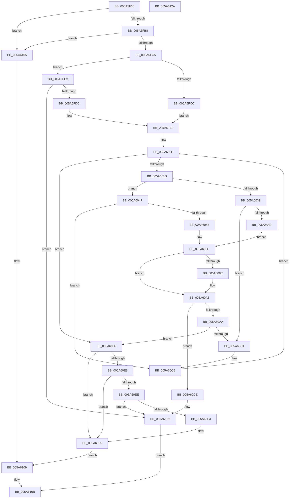

# IoTranslateBusAddress

- RVA: `0x005A5F60`–`0x005A612B` (길이 `459` bytes)
- VA: `0x00000001405A5F60`
- 실행 섹션: `.text`
- PDB 이름 있음: `예`; PDB Function 태그: `아니요`
- unwind 정보 RVA: `0x000C8564`
- 디코드: `136`개 명령, `459/459` bytes 표시
- 미해석 바이트: `0` (있으면 어셈블리에 `.byte`로 보존)

> 이 문서는 커널 이미지의 기계어와 PDB 기호를 분석해 생성했습니다. 4번과 5번은 함수 원형과 자료형을 바이너리 사용 방식에서 추정한 C 해석이며 원본 소스 복구 결과는 아닙니다.

## 1. Dependencies

- 직접 호출 지점: **10**; 고유 호출 대상: **8**
- 직접 호출자로 확인된 함수: **0**
- RIP 상대 이미지 참조: **2**

### Outgoing calls
- `0x005A5FF8` → [PpDevNodeLockTree](../../page/A1/PpDevNodeLockTree_function_00A19310.md) (function, `0x00A19310`)
- `0x005A6002` → [IopFindLegacyBusDeviceNode](../../page/AA/IopFindLegacyBusDeviceNode_function_00AAB698.md) (function, `0x00AAB698`)
- `0x005A6027` → [IopFindResourceHandlerInfo](../../page/A9/IopFindResourceHandlerInfo_function_00A9B644.md) (function, `0x00A9B644`)
- `0x005A6040` → [IopQueryResourceHandlerInterface](../../page/A8/IopQueryResourceHandlerInterface_function_00A830E4.md) (function, `0x00A830E4`)
- `0x005A6081` → [guard_dispatch_icall](../6B/guard_dispatch_icall_function_006BAAD0.md) (function, `0x006BAAD0`)
- `0x005A6096` → [guard_dispatch_icall](../6B/guard_dispatch_icall_function_006BAAD0.md) (function, `0x006BAAD0`)
- `0x005A60A0` → [ExFreePoolWithTag](../../poolcode/B8/ExFreePoolWithTag_function_00B82870.md) (function, `0x00B82870`)
- `0x005A60D0` → [PpDevNodeUnlockTree](../../page/A2/PpDevNodeUnlockTree_function_00A21290.md) (function, `0x00A21290`)
- `0x005A60DB` → [PpDevNodeUnlockTree](../../page/A2/PpDevNodeUnlockTree_function_00A21290.md) (function, `0x00A21290`)
- `0x005A6112` → [_security_check_cookie](../6A/_security_check_cookie_function_006AC640.md) (function, `0x006AC640`)

### Direct callers
- 이 함수 시작 RVA로 연결되는 직접 call은 확인되지 않았습니다. 간접 호출은 완전히 역산할 수 없습니다.

### Static image references
- `0x005A5F78` → RVA `0x00E0A740` (`.data`; read)
- `0x005A5FB8` → RVA `0x00F8C438` (`.data`; read)

## 2. Other-region calls and transfers

- 다른 실행 섹션으로 향하는 call: **7**
  - `0x005A5FF8` → [PpDevNodeLockTree](../../page/A1/PpDevNodeLockTree_function_00A19310.md) (`.text` → `PAGE`)
  - `0x005A6002` → [IopFindLegacyBusDeviceNode](../../page/AA/IopFindLegacyBusDeviceNode_function_00AAB698.md) (`.text` → `PAGE`)
  - `0x005A6027` → [IopFindResourceHandlerInfo](../../page/A9/IopFindResourceHandlerInfo_function_00A9B644.md) (`.text` → `PAGE`)
  - `0x005A6040` → [IopQueryResourceHandlerInterface](../../page/A8/IopQueryResourceHandlerInterface_function_00A830E4.md) (`.text` → `PAGE`)
  - `0x005A60A0` → [ExFreePoolWithTag](../../poolcode/B8/ExFreePoolWithTag_function_00B82870.md) (`.text` → `POOLCODE`)
  - `0x005A60D0` → [PpDevNodeUnlockTree](../../page/A2/PpDevNodeUnlockTree_function_00A21290.md) (`.text` → `PAGE`)
  - `0x005A60DB` → [PpDevNodeUnlockTree](../../page/A2/PpDevNodeUnlockTree_function_00A21290.md) (`.text` → `PAGE`)
- 별도 외부 분기/꼬리 이동을 확인하지 못했습니다.

## 3. Assembly (complete function range)

```asm
005A5F60  40 55                           push rbp
005A5F62  56                              push rsi
005A5F63  57                              push rdi
005A5F64  41 54                           push r12
005A5F66  41 55                           push r13
005A5F68  41 56                           push r14
005A5F6A  41 57                           push r15
005A5F6C  48 8D 6C 24 E1                  lea rbp, [rsp - 0x1f]
005A5F71  48 81 EC 90 00 00 00            sub rsp, 0x90
005A5F78  48 8B 05 C1 47 86 00            mov rax, qword ptr [rip + 0x8647c1]
005A5F7F  48 33 C4                        xor rax, rsp
005A5F82  48 89 45 17                     mov qword ptr [rbp + 0x17], rax
005A5F86  4C 8B 6D 7F                     mov r13, qword ptr [rbp + 0x7f]
005A5F8A  33 FF                           xor edi, edi
005A5F8C  33 C0                           xor eax, eax
005A5F8E  4C 89 4D DF                     mov qword ptr [rbp - 0x21], r9
005A5F92  0F 57 C0                        xorps xmm0, xmm0
005A5F95  89 45 0F                        mov dword ptr [rbp + 0xf], eax
005A5F98  44 8B FA                        mov r15d, edx
005A5F9B  48 89 7D CF                     mov qword ptr [rbp - 0x31], rdi
005A5F9F  8B F1                           mov esi, ecx
005A5FA1  48 89 7D D7                     mov qword ptr [rbp - 0x29], rdi
005A5FA5  89 7D F7                        mov dword ptr [rbp - 9], edi
005A5FA8  0F 11 45 FF                     movups xmmword ptr [rbp - 1], xmm0
005A5FAC  44 0F 20 C0                     mov rax, cr8
005A5FB0  84 C0                           test al, al
005A5FB2  0F 85 4D 01 00 00               jne 0x1405a6105
005A5FB8  48 39 3D 79 64 9E 00            cmp qword ptr [rip + 0x9e6479], rdi
005A5FBF  0F 84 40 01 00 00               je 0x1405a6105
005A5FC5  41 8B 01                        mov eax, dword ptr [r9]
005A5FC8  85 C0                           test eax, eax
005A5FCA  75 07                           jne 0x1405a5fd3
005A5FCC  0F B7 CF                        movzx ecx, di
005A5FCF  B0 03                           mov al, 3
005A5FD1  EB 0D                           jmp 0x1405a5fe0
005A5FD3  83 F8 01                        cmp eax, 1
005A5FD6  0F 85 F9 00 00 00               jne 0x1405a60d5
005A5FDC  8B C8                           mov ecx, eax
005A5FDE  8A C1                           mov al, cl
005A5FE0  66 89 4D E9                     mov word ptr [rbp - 0x17], cx
005A5FE4  33 C9                           xor ecx, ecx
005A5FE6  88 45 E7                        mov byte ptr [rbp - 0x19], al
005A5FE9  C6 45 E8 03                     mov byte ptr [rbp - 0x18], 3
005A5FED  4C 89 45 EB                     mov qword ptr [rbp - 0x15], r8
005A5FF1  C7 45 F3 01 00 00 00            mov dword ptr [rbp - 0xd], 1
005A5FF8  E8 13 33 47 00                  call 0x140a19310
005A5FFD  41 8B D7                        mov edx, r15d
005A6000  8B CE                           mov ecx, esi
005A6002  E8 91 56 50 00                  call 0x140aab698
005A6007  44 8A 45 E7                     mov r8b, byte ptr [rbp - 0x19]
005A600B  48 8B F0                        mov rsi, rax
005A600E  48 3B 35 23 64 9E 00            cmp rsi, qword ptr [rip + 0x9e6423]
005A6015  0F 84 BE 00 00 00               je 0x1405a60d9
005A601B  4C 8D 4D D7                     lea r9, [rbp - 0x29]
005A601F  48 8B D6                        mov rdx, rsi
005A6022  B9 01 00 00 00                  mov ecx, 1
005A6027  E8 18 56 4F 00                  call 0x140a9b644
005A602C  44 8A E0                        mov r12b, al
005A602F  84 C0                           test al, al
005A6031  75 1C                           jne 0x1405a604f
005A6033  48 8B 56 20                     mov rdx, qword ptr [rsi + 0x20]
005A6037  4C 8D 4D CF                     lea r9, [rbp - 0x31]
005A603B  B9 01 00 00 00                  mov ecx, 1
005A6040  E8 9F D0 4D 00                  call 0x140a830e4
005A6045  85 C0                           test eax, eax
005A6047  78 78                           js 0x1405a60c1
005A6049  4C 8B 75 CF                     mov r14, qword ptr [rbp - 0x31]
005A604D  EB 0D                           jmp 0x1405a605c
005A604F  4C 8B 75 D7                     mov r14, qword ptr [rbp - 0x29]
005A6053  4D 85 F6                        test r14, r14
005A6056  74 6D                           je 0x1405a60c5
005A6058  4D 8B 76 18                     mov r14, qword ptr [r14 + 0x18]
005A605C  49 8B 46 20                     mov rax, qword ptr [r14 + 0x20]
005A6060  48 8D 4D FF                     lea rcx, [rbp - 1]
005A6064  48 89 4C 24 30                  mov qword ptr [rsp + 0x30], rcx
005A6069  48 8D 55 E7                     lea rdx, [rbp - 0x19]
005A606D  49 8B 4E 08                     mov rcx, qword ptr [r14 + 8]
005A6071  45 33 C9                        xor r9d, r9d
005A6074  48 89 7C 24 28                  mov qword ptr [rsp + 0x28], rdi
005A6079  45 33 C0                        xor r8d, r8d
005A607C  48 89 7C 24 20                  mov qword ptr [rsp + 0x20], rdi
005A6081  E8 4A 4A 11 00                  call 0x1406baad0
005A6086  44 8B F8                        mov r15d, eax
005A6089  45 84 E4                        test r12b, r12b
005A608C  75 17                           jne 0x1405a60a5
005A608E  49 8B 46 18                     mov rax, qword ptr [r14 + 0x18]
005A6092  49 8B 4E 08                     mov rcx, qword ptr [r14 + 8]
005A6096  E8 35 4A 11 00                  call 0x1406baad0
005A609B  33 D2                           xor edx, edx
005A609D  49 8B CE                        mov rcx, r14
005A60A0  E8 CB C7 5D 00                  call 0x140b82870
005A60A5  45 85 FF                        test r15d, r15d
005A60A8  78 24                           js 0x1405a60ce
005A60AA  8B 45 0F                        mov eax, dword ptr [rbp + 0xf]
005A60AD  89 45 F7                        mov dword ptr [rbp - 9], eax
005A60B0  0F 10 45 FF                     movups xmm0, xmmword ptr [rbp - 1]
005A60B4  0F 11 45 E7                     movups xmmword ptr [rbp - 0x19], xmm0
005A60B8  41 81 FF 20 01 00 00            cmp r15d, 0x120
005A60BF  74 18                           je 0x1405a60d9
005A60C1  44 8A 45 E7                     mov r8b, byte ptr [rbp - 0x19]
005A60C5  48 8B 76 10                     mov rsi, qword ptr [rsi + 0x10]
005A60C9  E9 40 FF FF FF                  jmp 0x1405a600e
005A60CE  33 C9                           xor ecx, ecx
005A60D0  E8 BB B1 47 00                  call 0x140a21290
005A60D5  32 C0                           xor al, al
005A60D7  EB 32                           jmp 0x1405a610b
005A60D9  33 C9                           xor ecx, ecx
005A60DB  E8 B0 B1 47 00                  call 0x140a21290
005A60E0  0F B6 45 E7                     movzx eax, byte ptr [rbp - 0x19]
005A60E4  83 F8 03                        cmp eax, 3
005A60E7  74 0C                           je 0x1405a60f5
005A60E9  83 F8 07                        cmp eax, 7
005A60EC  74 07                           je 0x1405a60f5
005A60EE  83 F8 01                        cmp eax, 1
005A60F1  75 E2                           jne 0x1405a60d5
005A60F3  8B F8                           mov edi, eax
005A60F5  48 8B 45 DF                     mov rax, qword ptr [rbp - 0x21]
005A60F9  89 38                           mov dword ptr [rax], edi
005A60FB  48 8B 4D EB                     mov rcx, qword ptr [rbp - 0x15]
005A60FF  49 89 4D 00                     mov qword ptr [r13], rcx
005A6103  EB 04                           jmp 0x1405a6109
005A6105  4D 89 45 00                     mov qword ptr [r13], r8
005A6109  B0 01                           mov al, 1
005A610B  48 8B 4D 17                     mov rcx, qword ptr [rbp + 0x17]
005A610F  48 33 CC                        xor rcx, rsp
005A6112  E8 29 65 10 00                  call 0x1406ac640
005A6117  48 81 C4 90 00 00 00            add rsp, 0x90
005A611E  41 5F                           pop r15
005A6120  41 5E                           pop r14
005A6122  41 5D                           pop r13
005A6124  41 5C                           pop r12
005A6126  5F                              pop rdi
005A6127  5E                              pop rsi
005A6128  5D                              pop rbp
005A6129  C3                              ret
005A612A  CC                              int3
```

## 4. C-style interpretation (structured pseudocode)

```c
__int64 __fastcall IoTranslateBusAddress(int a1, int a2, __int64 a3, __int64 a4, __int64 a5)
{
    __int64 result;
    __int64 v_rdi;
    __int64 v_rsp;
    unsigned __int64 v_stack_m40;
    unsigned int v_stack_m48;
    unsigned __int64 v_stack_m57;
    unsigned __int64 v_stack_m58;
    unsigned int v_stack_m60;
    unsigned int v_stack_m64;
    unsigned __int64 v_stack_m6C;
    unsigned __int16 v_stack_m6E;
    unsigned __int8 v_stack_m6F;
    unsigned __int8 v_stack_m70;
    unsigned __int64 v_stack_m78;
    unsigned __int64 v_stack_m80;
    unsigned __int64 v_stack_m88;
    unsigned __int64 v_stack_m98;
    unsigned __int64 v_stack_mA0;
    unsigned __int64 v_stack_mA8;

    v_rsp = (v_rsp) - (144);
    result = (*(unsigned __int64 *)(v_rip + 8800193)) ^ (v_rsp);
    v_stack_m40 = result;
    v_rdi = 0;
    result = 0;
    v_stack_m78 = a4;
    v_stack_m48 = 0;
    v_stack_m88 = 0;
    v_stack_m80 = 0;
    v_stack_m60 = 0;
    v_stack_m58 = v_xmm0;
    if ((unsigned __int8)(v_cr8) != 0) goto loc_005A6105;
    if ((*(unsigned __int64 *)(v_rip + 10380409)) == 0) goto loc_005A6105;
    if ((unsigned int)((unsigned int)(*(unsigned int *)(a4))) != 0) goto loc_005A5FD3;
    goto loc_005A5FE0;
loc_005A5FD3:
    if (3 != 1) goto loc_005A60D5;
loc_005A5FE0:
    v_stack_m6E = 3;
    a1 = 0;
    v_stack_m70 = 3;
    v_stack_m6F = 3;
    v_stack_m6C = a3;
    v_stack_m64 = 1;
    result = PpDevNodeLockTree(a1, a2, a3, a4);
    result = IopFindLegacyBusDeviceNode((unsigned int)((unsigned int)((unsigned int)(a1))), (unsigned int)((unsigned int)((unsigned int)(a2))), a3, a4);
loc_005A600E:
    if (result == (*(unsigned __int64 *)(v_rip + 10380323))) goto loc_005A60D9;
    result = IopFindResourceHandlerInfo(1, result, v_stack_m70, v_stack_m80);
    if ((unsigned __int8)(result) != 0) goto loc_005A604F;
    result = IopQueryResourceHandlerInterface(1, *(unsigned __int64 *)(result + 32), v_stack_m70, v_stack_m88);
    if (sign_flag) goto loc_005A60C1;
    goto loc_005A605C;
loc_005A604F:
    if (v_stack_m80 == 0) goto loc_005A60C5;
loc_005A605C:
    v_stack_m98 = v_stack_m58;
    a4 = 0;
    v_stack_mA0 = 0;
    a3 = 0;
    v_stack_mA8 = 0;
    result = guard_dispatch_icall(*(unsigned __int64 *)(*(unsigned __int64 *)(v_stack_m80 + 24) + 8), v_stack_m70, a3, a4);
    if ((unsigned __int8)((unsigned __int8)(result)) == 0) {
        result = *(unsigned __int64 *)(*(unsigned __int64 *)(v_stack_m80 + 24) + 24);
        a1 = *(unsigned __int64 *)(*(unsigned __int64 *)(v_stack_m80 + 24) + 8);
        result = guard_dispatch_icall(a1, v_stack_m70, a3, a4);
        a2 = 0;
        a1 = *(unsigned __int64 *)(v_stack_m80 + 24);
        result = ExFreePoolWithTag(a1, a2, a3, a4);
    }
    if (sign_flag) goto loc_005A60CE;
    v_stack_m60 = (unsigned int)((unsigned int)(v_stack_m48));
    v_stack_m70 = v_xmm0;
    if (((unsigned int)((unsigned int)((unsigned int)(result)))) == 288) goto loc_005A60D9;
loc_005A60C1:
loc_005A60C5:
    goto loc_005A600E;
loc_005A60CE:
    a1 = 0;
    result = PpDevNodeUnlockTree(a1, a2, v_stack_m70, a4);
loc_005A60D5:
    result = 0;
    goto loc_005A610B;
loc_005A60D9:
    a1 = 0;
    result = PpDevNodeUnlockTree(a1, a2, v_stack_m70, a4);
    if (((unsigned int)(v_stack_m70)) == 3) goto loc_005A60F5;
    if (((unsigned int)(v_stack_m70)) == 7) goto loc_005A60F5;
    if (((unsigned int)(v_stack_m70)) != 1) goto loc_005A60D5;
loc_005A60F5:
    *(unsigned int *)(v_stack_m78) = (unsigned int)((unsigned int)((unsigned int)(v_stack_m70)));
    *(unsigned __int64 *)(a5) = v_stack_m6C;
    goto loc_005A6109;
loc_005A6105:
    *(unsigned __int64 *)(a5) = v_stack_m70;
loc_005A6109:
loc_005A610B:
    a1 = (v_stack_m40) ^ (v_rsp);
    result = _security_check_cookie(a1, a2, v_stack_m70, a4);
    v_rsp = (v_rsp) + (144);
    return result;
}
```

## 5. (Beta) C Style

```c
int64_t IoTranslateBusAddress(int32_t Arg1, int32_t Arg2, int64_t Arg3, void *Arg4, void *Arg5)
{
    uint8_t *arg4 = (uint8_t *)Arg4;
    uint8_t *arg5 = (uint8_t *)Arg5;

    int64_t result;
    int64_t local_rdi;
    int64_t local_rsp;
    uint64_t v_stack_m40;
    uint32_t v_stack_m48;
    uint64_t v_stack_m57;
    uint64_t v_stack_m58;
    uint32_t v_stack_m60;
    uint32_t v_stack_m64;
    uint64_t v_stack_m6C;
    uint16_t v_stack_m6E;
    uint8_t v_stack_m6F;
    uint8_t v_stack_m70;
    uint64_t v_stack_m78;
    uint64_t v_stack_m80;
    uint64_t v_stack_m88;
    uint64_t v_stack_m98;
    uint64_t v_stack_mA0;
    uint64_t v_stack_mA8;

    local_rsp = (local_rsp) - (144);
    result = (*(uint64_t *)(v_rip + 0x8647C1)) ^ (local_rsp);
    v_stack_m40 = result;
    local_rdi = 0;
    result = 0;
    v_stack_m78 = Arg4;
    v_stack_m48 = 0;
    v_stack_m88 = 0;
    v_stack_m80 = 0;
    v_stack_m60 = 0;
    v_stack_m58 = v_xmm0;
    if ((uint8_t)(v_cr8) != 0) goto loc_005A6105;
    if ((*(uint64_t *)(v_rip + 0x9E6479)) == 0) goto loc_005A6105;
    if ((uint32_t)((uint32_t)(*(uint32_t *)(arg4))) != 0) goto loc_005A5FD3;
    goto loc_005A5FE0;
loc_005A5FD3:
    if (3 != 1) goto loc_005A60D5;
loc_005A5FE0:
    v_stack_m6E = 3;
    Arg1 = 0;
    v_stack_m70 = 3;
    v_stack_m6F = 3;
    v_stack_m6C = Arg3;
    v_stack_m64 = 1;
    result = PpDevNodeLockTree(Arg1, Arg2, Arg3, Arg4);
    result = IopFindLegacyBusDeviceNode((uint32_t)((uint32_t)((uint32_t)(Arg1))), (uint32_t)((uint32_t)((uint32_t)(Arg2))), Arg3, Arg4);
loc_005A600E:
    if (result == (*(uint64_t *)(v_rip + 0x9E6423))) goto loc_005A60D9;
    result = IopFindResourceHandlerInfo(1, result, v_stack_m70, v_stack_m80);
    if ((uint8_t)(result) != 0) goto loc_005A604F;
    result = IopQueryResourceHandlerInterface(1, *(uint64_t *)(result + 0x20), v_stack_m70, v_stack_m88);
    if (sign_flag) goto loc_005A60C1;
    goto loc_005A605C;
loc_005A604F:
    if (v_stack_m80 == 0) goto loc_005A60C5;
loc_005A605C:
    v_stack_m98 = v_stack_m58;
    Arg4 = 0;
    v_stack_mA0 = 0;
    Arg3 = 0;
    v_stack_mA8 = 0;
    result = guard_dispatch_icall(*(uint64_t *)(*(uint64_t *)(v_stack_m80 + 0x18) + 0x8), v_stack_m70, Arg3, Arg4);
    if ((uint8_t)((uint8_t)(result)) == 0) {
        result = *(uint64_t *)(*(uint64_t *)(v_stack_m80 + 0x18) + 0x18);
        Arg1 = *(uint64_t *)(*(uint64_t *)(v_stack_m80 + 0x18) + 0x8);
        result = guard_dispatch_icall(Arg1, v_stack_m70, Arg3, Arg4);
        Arg2 = 0;
        Arg1 = *(uint64_t *)(v_stack_m80 + 0x18);
        result = ExFreePoolWithTag(Arg1, Arg2, Arg3, Arg4);
    }
    if (sign_flag) goto loc_005A60CE;
    v_stack_m60 = (uint32_t)((uint32_t)(v_stack_m48));
    v_stack_m70 = v_xmm0;
    if (((uint32_t)((uint32_t)((uint32_t)(result)))) == 288) goto loc_005A60D9;
loc_005A60C1:
loc_005A60C5:
    goto loc_005A600E;
loc_005A60CE:
    Arg1 = 0;
    result = PpDevNodeUnlockTree(Arg1, Arg2, v_stack_m70, Arg4);
loc_005A60D5:
    result = 0;
    goto loc_005A610B;
loc_005A60D9:
    Arg1 = 0;
    result = PpDevNodeUnlockTree(Arg1, Arg2, v_stack_m70, Arg4);
    if (((uint32_t)(v_stack_m70)) == 3) goto loc_005A60F5;
    if (((uint32_t)(v_stack_m70)) == 7) goto loc_005A60F5;
    if (((uint32_t)(v_stack_m70)) != 1) goto loc_005A60D5;
loc_005A60F5:
    *(uint32_t *)(v_stack_m78) = (uint32_t)((uint32_t)((uint32_t)(v_stack_m70)));
    *(uint64_t *)(arg5) = v_stack_m6C;
    goto loc_005A6109;
loc_005A6105:
    *(uint64_t *)(arg5) = v_stack_m70;
loc_005A6109:
loc_005A610B:
    Arg1 = (v_stack_m40) ^ (local_rsp);
    result = _security_check_cookie(Arg1, Arg2, v_stack_m70, Arg4);
    local_rsp = (local_rsp) + (144);
    return result;
}
```

### 관측된 메모리 오프셋

구조체 형식이 확인되지 않은 접근은 인자 기준의 오프셋으로만 기록했습니다.

| 기준 인자 | 오프셋 표현 | 폭 (bit) | 접근 |
|---|---:|---:|---|
| `Arg4` | `+ 0x0` | `32` | `R` |
| `Arg5` | `+ 0x0` | `64` | `W` |

## 6. Execution-region graph

[열기: 2D/3D 그래프와 함수 탐색 컨트롤 패널](../../../control-panel.html?section=text&rva=0x005A5F60&view=graph)

- 2D 그래프는 위에서 아래로 흐르고, 3D 그래프는 빈 공간을 드래그해 회전합니다. Shift+드래그는 이동, 휠은 확대·축소, 함수 노드 선택은 대상 보고서 이동입니다.

### Static fallback


