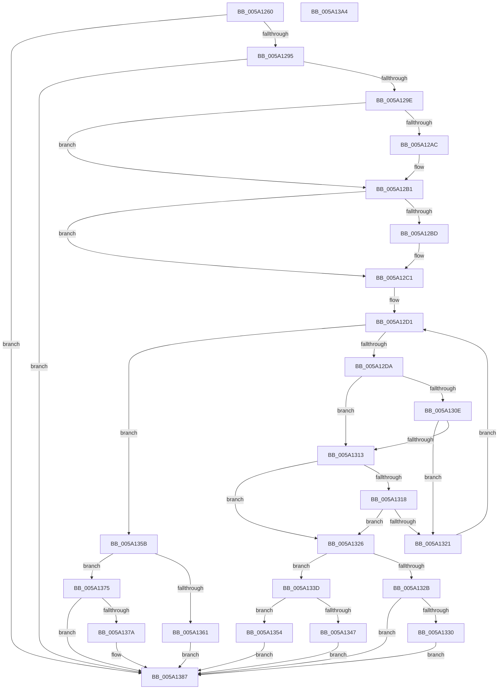

# IopAddAddressRangeToRemovePagesArray

- RVA: `0x005A1260`–`0x005A13A5` (길이 `325` bytes)
- VA: `0x00000001405A1260`
- 실행 섹션: `.text`
- PDB 이름 있음: `예`; PDB Function 태그: `아니요`
- unwind 정보 RVA: `0x00075C18`
- 디코드: `97`개 명령, `325/325` bytes 표시
- 미해석 바이트: `0` (있으면 어셈블리에 `.byte`로 보존)

> 이 문서는 커널 이미지의 기계어와 PDB 기호를 분석해 생성했습니다. 4번과 5번은 함수 원형과 자료형을 바이너리 사용 방식에서 추정한 C 해석이며 원본 소스 복구 결과는 아닙니다.

## 1. Dependencies

- 직접 호출 지점: **1**; 고유 호출 대상: **1**
- 직접 호출자로 확인된 함수: **1**
- RIP 상대 이미지 참조: **2**

### Outgoing calls
- `0x005A12AC` → [IopCompactRemovePagesArray](IopCompactRemovePagesArray_function_005A1A34.md) (function, `0x005A1A34`)

### Direct callers
- [IopRemovePageDumpRange](../59/IopRemovePageDumpRange_function_00595EAC.md) at `0x00595FC1`
- [IopRemovePageDumpRange](../59/IopRemovePageDumpRange_function_00595EAC.md) at `0x00595FF9`

### Static image references
- `0x005A1282` → RVA `0x00E661A0` (`.data`; read)
- `0x005A12C7` → RVA `0x00E66050` (`.data`; read)

## 2. Other-region calls and transfers

- 다른 실행 섹션으로 향하는 call: **0**
- 별도 외부 분기/꼬리 이동을 확인하지 못했습니다.

## 3. Assembly (complete function range)

```asm
005A1260  48 89 5C 24 08                  mov qword ptr [rsp + 8], rbx
005A1265  48 89 6C 24 10                  mov qword ptr [rsp + 0x10], rbp
005A126A  48 89 74 24 18                  mov qword ptr [rsp + 0x18], rsi
005A126F  57                              push rdi
005A1270  41 54                           push r12
005A1272  41 55                           push r13
005A1274  41 56                           push r14
005A1276  41 57                           push r15
005A1278  48 83 EC 20                     sub rsp, 0x20
005A127C  48 8B F9                        mov rdi, rcx
005A127F  45 33 F6                        xor r14d, r14d
005A1282  48 8B 0D 17 4F 8C 00            mov rcx, qword ptr [rip + 0x8c4f17]
005A1289  48 8B F2                        mov rsi, rdx
005A128C  48 85 C9                        test rcx, rcx
005A128F  0F 84 F2 00 00 00               je 0x1405a1387
005A1295  48 85 D2                        test rdx, rdx
005A1298  0F 84 E9 00 00 00               je 0x1405a1387
005A129E  8B 41 04                        mov eax, dword ptr [rcx + 4]
005A12A1  48 8D 5A FF                     lea rbx, [rdx - 1]
005A12A5  48 03 DF                        add rbx, rdi
005A12A8  39 01                           cmp dword ptr [rcx], eax
005A12AA  75 05                           jne 0x1405a12b1
005A12AC  E8 83 07 00 00                  call 0x1405a1a34
005A12B1  48 8B 15 E8 4E 8C 00            mov rdx, qword ptr [rip + 0x8c4ee8]
005A12B8  44 39 32                        cmp dword ptr [rdx], r14d
005A12BB  76 04                           jbe 0x1405a12c1
005A12BD  4C 8B 72 10                     mov r14, qword ptr [rdx + 0x10]
005A12C1  44 8B 3A                        mov r15d, dword ptr [rdx]
005A12C4  45 33 D2                        xor r10d, r10d
005A12C7  4C 8B 25 82 4D 8C 00            mov r12, qword ptr [rip + 0x8c4d82]
005A12CE  45 33 DB                        xor r11d, r11d
005A12D1  45 3B D7                        cmp r10d, r15d
005A12D4  0F 83 81 00 00 00               jae 0x1405a135b
005A12DA  45 8B CA                        mov r9d, r10d
005A12DD  4D 03 C9                        add r9, r9
005A12E0  41 8B CA                        mov ecx, r10d
005A12E3  4A 8B 44 CA 10                  mov rax, qword ptr [rdx + r9*8 + 0x10]
005A12E8  4A 8B 6C CA 08                  mov rbp, qword ptr [rdx + r9*8 + 8]
005A12ED  49 3B C6                        cmp rax, r14
005A12F0  4C 0F 42 D9                     cmovb r11, rcx
005A12F4  4C 8D 2C 28                     lea r13, [rax + rbp]
005A12F8  49 0F 43 C6                     cmovae rax, r14
005A12FC  4C 8B F0                        mov r14, rax
005A12FF  4D 8D 45 FF                     lea r8, [r13 - 1]
005A1303  49 8B 44 24 08                  mov rax, qword ptr [r12 + 8]
005A1308  4C 3B 40 30                     cmp r8, qword ptr [rax + 0x30]
005A130C  73 05                           jae 0x1405a1313
005A130E  49 3B FD                        cmp rdi, r13
005A1311  77 0E                           ja 0x1405a1321
005A1313  48 85 ED                        test rbp, rbp
005A1316  74 0E                           je 0x1405a1326
005A1318  48 8D 45 FF                     lea rax, [rbp - 1]
005A131C  48 3B D8                        cmp rbx, rax
005A131F  73 05                           jae 0x1405a1326
005A1321  41 FF C2                        inc r10d
005A1324  EB AB                           jmp 0x1405a12d1
005A1326  48 3B FD                        cmp rdi, rbp
005A1329  72 12                           jb 0x1405a133d
005A132B  49 3B D8                        cmp rbx, r8
005A132E  76 57                           jbe 0x1405a1387
005A1330  48 2B DD                        sub rbx, rbp
005A1333  48 FF C3                        inc rbx
005A1336  4A 89 5C CA 10                  mov qword ptr [rdx + r9*8 + 0x10], rbx
005A133B  EB 4A                           jmp 0x1405a1387
005A133D  4A 89 7C CA 08                  mov qword ptr [rdx + r9*8 + 8], rdi
005A1342  49 3B D8                        cmp rbx, r8
005A1345  77 0D                           ja 0x1405a1354
005A1347  4C 2B C7                        sub r8, rdi
005A134A  49 FF C0                        inc r8
005A134D  4E 89 44 CA 10                  mov qword ptr [rdx + r9*8 + 0x10], r8
005A1352  EB 33                           jmp 0x1405a1387
005A1354  4A 89 74 CA 10                  mov qword ptr [rdx + r9*8 + 0x10], rsi
005A1359  EB 2C                           jmp 0x1405a1387
005A135B  44 3B 52 04                     cmp r10d, dword ptr [rdx + 4]
005A135F  73 14                           jae 0x1405a1375
005A1361  41 8B C2                        mov eax, r10d
005A1364  48 03 C0                        add rax, rax
005A1367  48 89 7C C2 08                  mov qword ptr [rdx + rax*8 + 8], rdi
005A136C  48 89 74 C2 10                  mov qword ptr [rdx + rax*8 + 0x10], rsi
005A1371  FF 02                           inc dword ptr [rdx]
005A1373  EB 12                           jmp 0x1405a1387
005A1375  4C 3B F6                        cmp r14, rsi
005A1378  73 0D                           jae 0x1405a1387
005A137A  4D 03 DB                        add r11, r11
005A137D  4A 89 7C DA 08                  mov qword ptr [rdx + r11*8 + 8], rdi
005A1382  4A 89 74 DA 10                  mov qword ptr [rdx + r11*8 + 0x10], rsi
005A1387  48 8B 5C 24 50                  mov rbx, qword ptr [rsp + 0x50]
005A138C  48 8B 6C 24 58                  mov rbp, qword ptr [rsp + 0x58]
005A1391  48 8B 74 24 60                  mov rsi, qword ptr [rsp + 0x60]
005A1396  48 83 C4 20                     add rsp, 0x20
005A139A  41 5F                           pop r15
005A139C  41 5E                           pop r14
005A139E  41 5D                           pop r13
005A13A0  41 5C                           pop r12
005A13A2  5F                              pop rdi
005A13A3  C3                              ret
005A13A4  CC                              int3
```

## 4. C-style interpretation (structured pseudocode)

```c
__int64 __fastcall IopAddAddressRangeToRemovePagesArray(__int64 a1, __int64 a2)
{
    __int64 result;
    __int64 v_r10;
    __int64 v_r11;
    __int64 v_r14;
    __int64 v_rbx;
    __int64 v_rsp;
    unsigned __int64 v_stack_p10;
    unsigned __int64 v_stack_p18;
    unsigned __int64 v_stack_p8;

    v_stack_p8 = v_rbx;
    v_stack_p10 = v_rbp;
    v_stack_p18 = v_rsi;
    v_rsp = (v_rsp) - (32);
    v_r14 = 0;
    if (*(unsigned __int64 *)(v_rip + 9195287) == 0) goto loc_005A1387;
    if (a2 == 0) goto loc_005A1387;
    v_rbx = (a2 - 1) + (a1);
    result = (unsigned int)(*(unsigned int *)(*(unsigned __int64 *)(v_rip + 9195287) + 4));
    if ((*(unsigned int *)(*(unsigned __int64 *)(v_rip + 9195287))) == ((unsigned int)((unsigned int)(*(unsigned int *)(*(unsigned __int64 *)(v_rip + 9195287) + 4))))) {
        result = IopCompactRemovePagesArray(*(unsigned __int64 *)(v_rip + 9195287), a2, a3, a4);
    }
    if ((*(unsigned int *)(*(unsigned __int64 *)(v_rip + 9195240))) >= = 0) {
        v_r14 = *(unsigned __int64 *)(*(unsigned __int64 *)(v_rip + 9195240) + 16);
    }
    v_r10 = 0;
    v_r11 = 0;
loc_005A12D1:
    if (0 >= ((unsigned int)((unsigned int)(*(unsigned int *)(*(unsigned __int64 *)(v_rip + 9195240)))))) goto loc_005A135B;
    a4 = (0) + (0);
    if ((*(unsigned __int64 *)(*(unsigned __int64 *)(v_rip + 9195240) + a4 * 8 + 16)) < v_r14) { v_r11 = 0; }
    result = *(unsigned __int64 *)(*(unsigned __int64 *)(v_rip + 9195240) + a4 * 8 + 16);
    if ((*(unsigned __int64 *)(*(unsigned __int64 *)(v_rip + 9195240) + a4 * 8 + 16)) >= v_r14) { result = v_r14; }
    if ((*(unsigned __int64 *)(*(unsigned __int64 *)(v_rip + 9195240) + a4 * 8 + 16) + *(unsigned __int64 *)(*(unsigned __int64 *)(v_rip + 9195240) + a4 * 8 + 8) * 1 - 1) >= (*(unsigned __int64 *)(*(unsigned __int64 *)(*(unsigned __int64 *)(v_rip + 9194882) + 8) + 48))) goto loc_005A1313;
    if (a1 > (*(unsigned __int64 *)(*(unsigned __int64 *)(v_rip + 9195240) + a4 * 8 + 16) + *(unsigned __int64 *)(*(unsigned __int64 *)(v_rip + 9195240) + a4 * 8 + 8) * 1)) goto loc_005A1321;
loc_005A1313:
    if (*(unsigned __int64 *)(*(unsigned __int64 *)(v_rip + 9195240) + a4 * 8 + 8) == 0) goto loc_005A1326;
    if (v_rbx >= (*(unsigned __int64 *)(*(unsigned __int64 *)(v_rip + 9195240) + a4 * 8 + 8) - 1)) goto loc_005A1326;
loc_005A1321:
    v_r10 = (unsigned int)((v_r10) + 1);
    goto loc_005A12D1;
loc_005A1326:
    if (a1 < (*(unsigned __int64 *)(*(unsigned __int64 *)(v_rip + 9195240) + a4 * 8 + 8))) goto loc_005A133D;
    if (v_rbx <= (*(unsigned __int64 *)(*(unsigned __int64 *)(v_rip + 9195240) + a4 * 8 + 16) + *(unsigned __int64 *)(*(unsigned __int64 *)(v_rip + 9195240) + a4 * 8 + 8) * 1 - 1)) goto loc_005A1387;
    v_rbx = (v_rbx) - (*(unsigned __int64 *)(*(unsigned __int64 *)(v_rip + 9195240) + a4 * 8 + 8));
    v_rbx = (v_rbx) + 1;
    *(unsigned __int64 *)(*(unsigned __int64 *)(v_rip + 9195240) + a4 * 8 + 16) = v_rbx;
    goto loc_005A1387;
loc_005A133D:
    *(unsigned __int64 *)(*(unsigned __int64 *)(v_rip + 9195240) + a4 * 8 + 8) = a1;
    if (v_rbx > (*(unsigned __int64 *)(*(unsigned __int64 *)(v_rip + 9195240) + a4 * 8 + 16) + *(unsigned __int64 *)(*(unsigned __int64 *)(v_rip + 9195240) + a4 * 8 + 8) * 1 - 1)) goto loc_005A1354;
    a3 = (*(unsigned __int64 *)(*(unsigned __int64 *)(v_rip + 9195240) + a4 * 8 + 16) + *(unsigned __int64 *)(*(unsigned __int64 *)(v_rip + 9195240) + a4 * 8 + 8) * 1 - 1) - (a1);
    a3 = (a3) + 1;
    *(unsigned __int64 *)(*(unsigned __int64 *)(v_rip + 9195240) + a4 * 8 + 16) = a3;
    goto loc_005A1387;
loc_005A1354:
    *(unsigned __int64 *)(*(unsigned __int64 *)(v_rip + 9195240) + a4 * 8 + 16) = a2;
    goto loc_005A1387;
loc_005A135B:
    if (((unsigned int)(v_r10)) >= (*(unsigned int *)(*(unsigned __int64 *)(v_rip + 9195240) + 4))) goto loc_005A1375;
    result = ((unsigned int)((unsigned int)(v_r10))) + ((unsigned int)((unsigned int)(v_r10)));
    *(unsigned __int64 *)(*(unsigned __int64 *)(v_rip + 9195240) + result * 8 + 8) = a1;
    *(unsigned __int64 *)(*(unsigned __int64 *)(v_rip + 9195240) + result * 8 + 16) = a2;
    goto loc_005A1387;
loc_005A1375:
    if (result < a2) {
        v_r11 = (v_r11) + (v_r11);
        *(unsigned __int64 *)(*(unsigned __int64 *)(v_rip + 9195240) + v_r11 * 8 + 8) = a1;
        *(unsigned __int64 *)(*(unsigned __int64 *)(v_rip + 9195240) + v_r11 * 8 + 16) = a2;
    }
    v_rsp = (v_rsp) + (32);
    return result;
}
```

## 5. (Beta) C Style

```c
int64_t IopAddAddressRangeToRemovePagesArray(int64_t Arg1, int64_t Arg2)
{
    int64_t result;
    int64_t local_r10;
    int64_t local_r11;
    int64_t local_r14;
    int64_t local_rbx;
    int64_t local_rsp;
    uint64_t v_stack_p10;
    uint64_t v_stack_p18;
    uint64_t v_stack_p8;

    v_stack_p8 = local_rbx;
    v_stack_p10 = local_rbp;
    v_stack_p18 = local_rsi;
    local_rsp = (local_rsp) - (32);
    local_r14 = 0;
    if (*(uint64_t *)(v_rip + 0x8C4F17) == 0) goto loc_005A1387;
    if (Arg2 == 0) goto loc_005A1387;
    local_rbx = (Arg2 - 1) + (Arg1);
    result = (uint32_t)(*(uint32_t *)(*(uint64_t *)(v_rip + 0x8C4F17) + 0x4));
    if ((*(uint32_t *)(*(uint64_t *)(v_rip + 0x8C4F17))) == ((uint32_t)((uint32_t)(*(uint32_t *)(*(uint64_t *)(v_rip + 0x8C4F17) + 0x4))))) {
        result = IopCompactRemovePagesArray(*(uint64_t *)(v_rip + 0x8C4F17), Arg2, a3, a4);
    }
    if ((*(uint32_t *)(*(uint64_t *)(v_rip + 0x8C4EE8))) >= = 0) {
        local_r14 = *(uint64_t *)(*(uint64_t *)(v_rip + 0x8C4EE8) + 0x10);
    }
    local_r10 = 0;
    local_r11 = 0;
loc_005A12D1:
    if (0 >= ((uint32_t)((uint32_t)(*(uint32_t *)(*(uint64_t *)(v_rip + 0x8C4EE8)))))) goto loc_005A135B;
    a4 = (0) + (0);
    if ((*(uint64_t *)(*(uint64_t *)(v_rip + 0x8C4EE8) + a4 * 8 + 0x10)) < local_r14) { local_r11 = 0; }
    result = *(uint64_t *)(*(uint64_t *)(v_rip + 0x8C4EE8) + a4 * 8 + 0x10);
    if ((*(uint64_t *)(*(uint64_t *)(v_rip + 0x8C4EE8) + a4 * 8 + 0x10)) >= local_r14) { result = local_r14; }
    if ((*(uint64_t *)(*(uint64_t *)(v_rip + 0x8C4EE8) + a4 * 8 + 0x10) + *(uint64_t *)(*(uint64_t *)(v_rip + 0x8C4EE8) + a4 * 8 + 0x8) * 1 - 1) >= (*(uint64_t *)(*(uint64_t *)(*(uint64_t *)(v_rip + 0x8C4D82) + 0x8) + 0x30))) goto loc_005A1313;
    if (Arg1 > (*(uint64_t *)(*(uint64_t *)(v_rip + 0x8C4EE8) + a4 * 8 + 0x10) + *(uint64_t *)(*(uint64_t *)(v_rip + 0x8C4EE8) + a4 * 8 + 0x8) * 1)) goto loc_005A1321;
loc_005A1313:
    if (*(uint64_t *)(*(uint64_t *)(v_rip + 0x8C4EE8) + a4 * 8 + 0x8) == 0) goto loc_005A1326;
    if (local_rbx >= (*(uint64_t *)(*(uint64_t *)(v_rip + 0x8C4EE8) + a4 * 8 + 0x8) - 1)) goto loc_005A1326;
loc_005A1321:
    local_r10 = (uint32_t)((local_r10) + 1);
    goto loc_005A12D1;
loc_005A1326:
    if (Arg1 < (*(uint64_t *)(*(uint64_t *)(v_rip + 0x8C4EE8) + a4 * 8 + 0x8))) goto loc_005A133D;
    if (local_rbx <= (*(uint64_t *)(*(uint64_t *)(v_rip + 0x8C4EE8) + a4 * 8 + 0x10) + *(uint64_t *)(*(uint64_t *)(v_rip + 0x8C4EE8) + a4 * 8 + 0x8) * 1 - 1)) goto loc_005A1387;
    local_rbx = (local_rbx) - (*(uint64_t *)(*(uint64_t *)(v_rip + 0x8C4EE8) + a4 * 8 + 0x8));
    local_rbx = (local_rbx) + 1;
    *(uint64_t *)(*(uint64_t *)(v_rip + 0x8C4EE8) + a4 * 8 + 0x10) = local_rbx;
    goto loc_005A1387;
loc_005A133D:
    *(uint64_t *)(*(uint64_t *)(v_rip + 0x8C4EE8) + a4 * 8 + 0x8) = Arg1;
    if (local_rbx > (*(uint64_t *)(*(uint64_t *)(v_rip + 0x8C4EE8) + a4 * 8 + 0x10) + *(uint64_t *)(*(uint64_t *)(v_rip + 0x8C4EE8) + a4 * 8 + 0x8) * 1 - 1)) goto loc_005A1354;
    a3 = (*(uint64_t *)(*(uint64_t *)(v_rip + 0x8C4EE8) + a4 * 8 + 0x10) + *(uint64_t *)(*(uint64_t *)(v_rip + 0x8C4EE8) + a4 * 8 + 0x8) * 1 - 1) - (Arg1);
    a3 = (a3) + 1;
    *(uint64_t *)(*(uint64_t *)(v_rip + 0x8C4EE8) + a4 * 8 + 0x10) = a3;
    goto loc_005A1387;
loc_005A1354:
    *(uint64_t *)(*(uint64_t *)(v_rip + 0x8C4EE8) + a4 * 8 + 0x10) = Arg2;
    goto loc_005A1387;
loc_005A135B:
    if (((uint32_t)(local_r10)) >= (*(uint32_t *)(*(uint64_t *)(v_rip + 0x8C4EE8) + 0x4))) goto loc_005A1375;
    result = ((uint32_t)((uint32_t)(local_r10))) + ((uint32_t)((uint32_t)(local_r10)));
    *(uint64_t *)(*(uint64_t *)(v_rip + 0x8C4EE8) + result * 8 + 0x8) = Arg1;
    *(uint64_t *)(*(uint64_t *)(v_rip + 0x8C4EE8) + result * 8 + 0x10) = Arg2;
    goto loc_005A1387;
loc_005A1375:
    if (result < Arg2) {
        local_r11 = (local_r11) + (local_r11);
        *(uint64_t *)(*(uint64_t *)(v_rip + 0x8C4EE8) + local_r11 * 8 + 0x8) = Arg1;
        *(uint64_t *)(*(uint64_t *)(v_rip + 0x8C4EE8) + local_r11 * 8 + 0x10) = Arg2;
    }
    local_rsp = (local_rsp) + (32);
    return result;
}
```

## 6. Execution-region graph

[열기: 2D/3D 그래프와 함수 탐색 컨트롤 패널](../../../control-panel.html?section=text&rva=0x005A1260&view=graph)

- 2D 그래프는 위에서 아래로 흐르고, 3D 그래프는 빈 공간을 드래그해 회전합니다. Shift+드래그는 이동, 휠은 확대·축소, 함수 노드 선택은 대상 보고서 이동입니다.

### Static fallback


