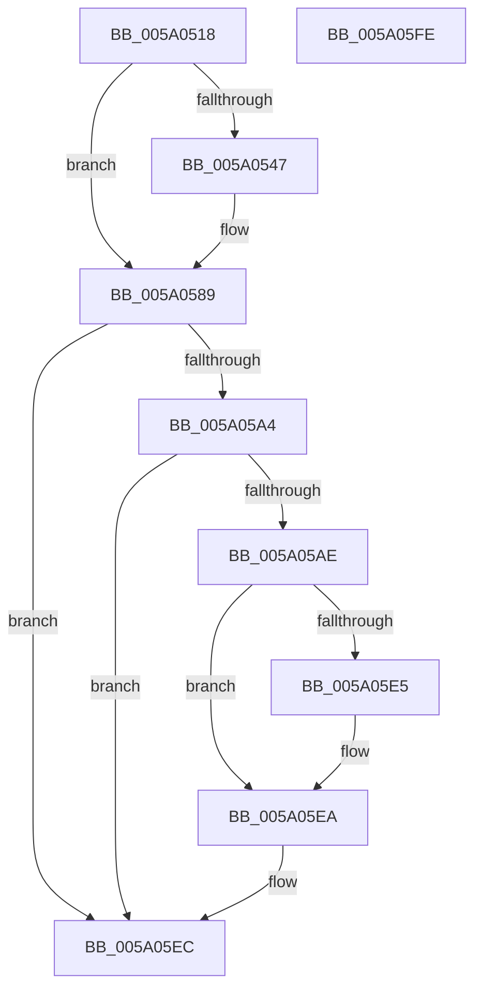

# IopAddBugcheckDirectedTransitionTriageData

- RVA: `0x005A0518`–`0x005A05FF` (길이 `231` bytes)
- VA: `0x00000001405A0518`
- 실행 섹션: `.text`
- PDB 이름 있음: `예`; PDB Function 태그: `아니요`
- unwind 정보 RVA: `0x00060BC4`
- 디코드: `59`개 명령, `231/231` bytes 표시
- 미해석 바이트: `0` (있으면 어셈블리에 `.byte`로 보존)

> 이 문서는 커널 이미지의 기계어와 PDB 기호를 분석해 생성했습니다. 4번과 5번은 함수 원형과 자료형을 바이너리 사용 방식에서 추정한 C 해석이며 원본 소스 복구 결과는 아닙니다.

## 1. Dependencies

- 직접 호출 지점: **10**; 고유 호출 대상: **9**
- 직접 호출자로 확인된 함수: **1**
- RIP 상대 이미지 참조: **2**

### Outgoing calls
- `0x005A056E` → [wil_details_FeatureReporting_ReportUsageToService](../53/wil_details_FeatureReporting_ReportUsageToService_function_0053E6E4.md) (function, `0x0053E6E4`)
- `0x005A0584` → [wil_details_FeatureStateCache_TryEnableDeviceUsageFastPath](../53/wil_details_FeatureStateCache_TryEnableDeviceUsageFastPath_function_0053E774.md) (function, `0x0053E774`)
- `0x005A058C` → [IopAddBugcheckTriageDevice](IopAddBugcheckTriageDevice_function_005A0814.md) (function, `0x005A0814`)
- `0x005A059B` → [IopIsAddressRangeValid](../4B/IopIsAddressRangeValid_function_004B6CBC.md) (function, `0x004B6CBC`)
- `0x005A05B3` → [IoAddTriageDumpDataBlock](../42/IoAddTriageDumpDataBlock_function_00428374.md) (function, `0x00428374`)
- `0x005A05BC` → [IopAddBugcheckTriagePowerIrps](IopAddBugcheckTriagePowerIrps_function_005A0C38.md) (function, `0x005A0C38`)
- `0x005A05C5` → [IopAddBugcheckTriagePowerIrpWorkers](IopAddBugcheckTriagePowerIrpWorkers_function_005A0B84.md) (function, `0x005A0B84`)
- `0x005A05CE` → [IopAddBugcheckTriageWorkQueue](IopAddBugcheckTriageWorkQueue_function_005A0E88.md) (function, `0x005A0E88`)
- `0x005A05D7` → [IopAddBugcheckTriageWorkQueue](IopAddBugcheckTriageWorkQueue_function_005A0E88.md) (function, `0x005A0E88`)
- `0x005A05E5` → [IopAddBugcheckTriageThread](IopAddBugcheckTriageThread_function_005A0CF8.md) (function, `0x005A0CF8`)

### Direct callers
- [IopAddBugcheckTriageDataFromParameters](../59/IopAddBugcheckTriageDataFromParameters_function_00593E54.md) at `0x00594008`

### Static image references
- `0x005A0538` → RVA `0x00FC4790` (`.data`; read)
- `0x005A054C` → RVA `0x000DD710` (`.rdata`; read)

## 2. Other-region calls and transfers

- 다른 실행 섹션으로 향하는 call: **0**
- 별도 외부 분기/꼬리 이동을 확인하지 못했습니다.

## 3. Assembly (complete function range)

```asm
005A0518  48 89 5C 24 08                  mov qword ptr [rsp + 8], rbx
005A051D  48 89 74 24 10                  mov qword ptr [rsp + 0x10], rsi
005A0522  57                              push rdi
005A0523  48 83 EC 20                     sub rsp, 0x20
005A0527  48 8B DA                        mov rbx, rdx
005A052A  48 8B F1                        mov rsi, rcx
005A052D  BF 01 00 00 C0                  mov edi, 0xc0000001
005A0532  48 83 64 24 40 00               and qword ptr [rsp + 0x40], 0
005A0538  8B 15 52 42 A2 00               mov edx, dword ptr [rip + 0xa24252]
005A053E  89 54 24 40                     mov dword ptr [rsp + 0x40], edx
005A0542  F6 C2 10                        test dl, 0x10
005A0545  75 42                           jne 0x1405a0589
005A0547  48 8B 44 24 40                  mov rax, qword ptr [rsp + 0x40]
005A054C  48 8D 0D BD D1 B3 FF            lea rcx, [rip - 0x4c2e43]
005A0553  41 B9 01 00 00 00               mov r9d, 1
005A0559  48 89 44 24 40                  mov qword ptr [rsp + 0x40], rax
005A055E  41 0B D1                        or edx, r9d
005A0561  89 54 24 40                     mov dword ptr [rsp + 0x40], edx
005A0565  48 8B 54 24 40                  mov rdx, qword ptr [rsp + 0x40]
005A056A  45 8D 41 02                     lea r8d, [r9 + 2]
005A056E  E8 71 E1 F9 FF                  call 0x14053e6e4
005A0573  48 8B 4C 24 40                  mov rcx, qword ptr [rsp + 0x40]
005A0578  4C 8D 05 91 D1 B3 FF            lea r8, [rip - 0x4c2e6f]
005A057F  BA 03 00 00 00                  mov edx, 3
005A0584  E8 EB E1 F9 FF                  call 0x14053e774
005A0589  48 8B CE                        mov rcx, rsi
005A058C  E8 83 02 00 00                  call 0x1405a0814
005A0591  BE 48 00 00 00                  mov esi, 0x48
005A0596  48 8B CB                        mov rcx, rbx
005A0599  8B D6                           mov edx, esi
005A059B  E8 1C 67 F1 FF                  call 0x1404b6cbc
005A05A0  84 C0                           test al, al
005A05A2  74 48                           je 0x1405a05ec
005A05A4  B8 05 80 00 00                  mov eax, 0x8005
005A05A9  66 39 03                        cmp word ptr [rbx], ax
005A05AC  75 3E                           jne 0x1405a05ec
005A05AE  8B D6                           mov edx, esi
005A05B0  48 8B CB                        mov rcx, rbx
005A05B3  E8 BC 7D E8 FF                  call 0x140428374
005A05B8  48 8B 4B 08                     mov rcx, qword ptr [rbx + 8]
005A05BC  E8 77 06 00 00                  call 0x1405a0c38
005A05C1  48 8B 4B 10                     mov rcx, qword ptr [rbx + 0x10]
005A05C5  E8 BA 05 00 00                  call 0x1405a0b84
005A05CA  48 8B 4B 18                     mov rcx, qword ptr [rbx + 0x18]
005A05CE  E8 B5 08 00 00                  call 0x1405a0e88
005A05D3  48 8B 4B 20                     mov rcx, qword ptr [rbx + 0x20]
005A05D7  E8 AC 08 00 00                  call 0x1405a0e88
005A05DC  48 8B 4B 38                     mov rcx, qword ptr [rbx + 0x38]
005A05E0  48 85 C9                        test rcx, rcx
005A05E3  74 05                           je 0x1405a05ea
005A05E5  E8 0E 07 00 00                  call 0x1405a0cf8
005A05EA  33 FF                           xor edi, edi
005A05EC  48 8B 5C 24 30                  mov rbx, qword ptr [rsp + 0x30]
005A05F1  8B C7                           mov eax, edi
005A05F3  48 8B 74 24 38                  mov rsi, qword ptr [rsp + 0x38]
005A05F8  48 83 C4 20                     add rsp, 0x20
005A05FC  5F                              pop rdi
005A05FD  C3                              ret
005A05FE  CC                              int3
```

## 4. C-style interpretation (structured pseudocode)

```c
__int64 __fastcall IopAddBugcheckDirectedTransitionTriageData(__int64 a1, __int64 a2)
{
    __int64 result;
    __int64 v_rdi;
    __int64 v_rsp;
    unsigned __int64 v_stack_p10;
    unsigned __int64 v_stack_p18;
    unsigned __int64 v_stack_p8;

    v_stack_p8 = v_rbx;
    v_stack_p10 = v_rsi;
    v_rsp = (v_rsp) - (32);
    v_stack_p18 = (unsigned int)((unsigned int)(*(unsigned int *)(v_rip + 10633810)));
    if ((((unsigned __int8)((unsigned int)(*(unsigned int *)(v_rip + 10633810)))) & (16)) == 0) {
        result = v_stack_p18;
        a1 = v_rip - 4992579;
        a4 = 1;
        v_stack_p18 = result;
        a2 = (unsigned int)(((unsigned int)(*(unsigned int *)(v_rip + 10633810))) | ((unsigned int)(a4)));
        v_stack_p18 = (unsigned int)(a2);
        a2 = v_stack_p18;
        a3 = a4 + 2;
        result = wil_details_FeatureReporting_ReportUsageToService(a1, a2, a3, a4);
        a1 = v_stack_p18;
        a3 = v_rip - 4992623;
        a2 = 3;
        result = wil_details_FeatureStateCache_TryEnableDeviceUsageFastPath(a1, a2, a3, a4);
    }
    result = IopAddBugcheckTriageDevice(a1, a2, a3, a4);
    result = IopIsAddressRangeValid(a2, 72, a3, a4);
    if ((unsigned __int8)(result) == 0) goto loc_005A05EC;
    if ((*(unsigned __int16 *)(a2)) != ((unsigned __int16)((unsigned int)(0x8005ULL)))) goto loc_005A05EC;
    result = IoAddTriageDumpDataBlock(a2, 72, a3, a4);
    result = IopAddBugcheckTriagePowerIrps(*(unsigned __int64 *)(a2 + 8), 72, a3, a4);
    result = IopAddBugcheckTriagePowerIrpWorkers(*(unsigned __int64 *)(a2 + 16), 72, a3, a4);
    result = IopAddBugcheckTriageWorkQueue(*(unsigned __int64 *)(a2 + 24), 72, a3, a4);
    result = IopAddBugcheckTriageWorkQueue(*(unsigned __int64 *)(a2 + 32), 72, a3, a4);
    if (*(unsigned __int64 *)(a2 + 56) != 0) {
        result = IopAddBugcheckTriageThread(*(unsigned __int64 *)(a2 + 56), 72, a3, a4);
    }
    v_rdi = 0;
loc_005A05EC:
    v_rsp = (v_rsp) + (32);
    return 0;
}
```

## 5. (Beta) C Style

```c
int64_t IopAddBugcheckDirectedTransitionTriageData(int64_t Arg1, void *Arg2)
{
    uint8_t *arg2 = (uint8_t *)Arg2;

    int64_t result;
    int64_t local_rdi;
    int64_t local_rsp;
    uint64_t v_stack_p10;
    uint64_t v_stack_p18;
    uint64_t v_stack_p8;

    v_stack_p8 = local_rbx;
    v_stack_p10 = local_rsi;
    local_rsp = (local_rsp) - (32);
    v_stack_p18 = (uint32_t)((uint32_t)(*(uint32_t *)(v_rip + 0xA24252)));
    if ((((uint8_t)((uint32_t)(*(uint32_t *)(v_rip + 0xA24252)))) & (16)) == 0) {
        result = v_stack_p18;
        Arg1 = v_rip - 4992579;
        a4 = 1;
        v_stack_p18 = result;
        Arg2 = (uint32_t)(((uint32_t)(*(uint32_t *)(v_rip + 0xA24252))) | ((uint32_t)(a4)));
        v_stack_p18 = (uint32_t)(Arg2);
        Arg2 = v_stack_p18;
        a3 = a4 + 2;
        result = wil_details_FeatureReporting_ReportUsageToService(Arg1, Arg2, a3, a4);
        Arg1 = v_stack_p18;
        a3 = v_rip - 4992623;
        Arg2 = 3;
        result = wil_details_FeatureStateCache_TryEnableDeviceUsageFastPath(Arg1, Arg2, a3, a4);
    }
    result = IopAddBugcheckTriageDevice(Arg1, Arg2, a3, a4);
    result = IopIsAddressRangeValid(Arg2, 72, a3, a4);
    if ((uint8_t)(result) == 0) goto loc_005A05EC;
    if ((*(uint16_t *)(arg2)) != ((uint16_t)((uint32_t)(0x8005ULL)))) goto loc_005A05EC;
    result = IoAddTriageDumpDataBlock(Arg2, 72, a3, a4);
    result = IopAddBugcheckTriagePowerIrps(*(uint64_t *)(arg2 + 0x8), 72, a3, a4);
    result = IopAddBugcheckTriagePowerIrpWorkers(*(uint64_t *)(arg2 + 0x10), 72, a3, a4);
    result = IopAddBugcheckTriageWorkQueue(*(uint64_t *)(arg2 + 0x18), 72, a3, a4);
    result = IopAddBugcheckTriageWorkQueue(*(uint64_t *)(arg2 + 0x20), 72, a3, a4);
    if (*(uint64_t *)(arg2 + 0x38) != 0) {
        result = IopAddBugcheckTriageThread(*(uint64_t *)(arg2 + 0x38), 72, a3, a4);
    }
    local_rdi = 0;
loc_005A05EC:
    local_rsp = (local_rsp) + (32);
    return 0;
}
```

### 관측된 메모리 오프셋

구조체 형식이 확인되지 않은 접근은 인자 기준의 오프셋으로만 기록했습니다.

| 기준 인자 | 오프셋 표현 | 폭 (bit) | 접근 |
|---|---:|---:|---|
| `Arg2` | `+ 0x0` | `16` | `R` |
| `Arg2` | `+ 0x8` | `64` | `R` |
| `Arg2` | `+ 0x10` | `64` | `R` |
| `Arg2` | `+ 0x18` | `64` | `R` |
| `Arg2` | `+ 0x20` | `64` | `R` |
| `Arg2` | `+ 0x38` | `64` | `R` |

## 6. Execution-region graph

[열기: 2D/3D 그래프와 함수 탐색 컨트롤 패널](../../../control-panel.html?section=text&rva=0x005A0518&view=graph)

- 2D 그래프는 위에서 아래로 흐르고, 3D 그래프는 빈 공간을 드래그해 회전합니다. Shift+드래그는 이동, 휠은 확대·축소, 함수 노드 선택은 대상 보고서 이동입니다.

### Static fallback


