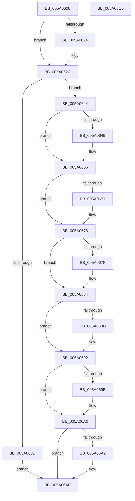

# IopAddBugcheckPnpWatchdogTriageData

- RVA: `0x005A0608`–`0x005A06C1` (길이 `185` bytes)
- VA: `0x00000001405A0608`
- 실행 섹션: `.text`
- PDB 이름 있음: `예`; PDB Function 태그: `아니요`
- unwind 정보 RVA: `0x00060BC4`
- 디코드: `54`개 명령, `185/185` bytes 표시
- 미해석 바이트: `0` (있으면 어셈블리에 `.byte`로 보존)

> 이 문서는 커널 이미지의 기계어와 PDB 기호를 분석해 생성했습니다. 4번과 5번은 함수 원형과 자료형을 바이너리 사용 방식에서 추정한 C 해석이며 원본 소스 복구 결과는 아닙니다.

## 1. Dependencies

- 직접 호출 지점: **10**; 고유 호출 대상: **7**
- 직접 호출자로 확인된 함수: **1**
- RIP 상대 이미지 참조: **0**

### Outgoing calls
- `0x005A0627` → [IopAddBugcheckTriageThread](IopAddBugcheckTriageThread_function_005A0CF8.md) (function, `0x005A0CF8`)
- `0x005A0634` → [IopIsAddressRangeValid](../4B/IopIsAddressRangeValid_function_004B6CBC.md) (function, `0x004B6CBC`)
- `0x005A0651` → [IoAddTriageDumpDataBlock](../42/IoAddTriageDumpDataBlock_function_00428374.md) (function, `0x00428374`)
- `0x005A065A` → [IopAddBugcheckTriageCompletionQueue](IopAddBugcheckTriageCompletionQueue_function_005A0758.md) (function, `0x005A0758`)
- `0x005A0663` → [IopAddBugcheckTriageWorkQueue](IopAddBugcheckTriageWorkQueue_function_005A0E88.md) (function, `0x005A0E88`)
- `0x005A0671` → [IopAddBugcheckTriageThread](IopAddBugcheckTriageThread_function_005A0CF8.md) (function, `0x005A0CF8`)
- `0x005A067F` → [IopAddBugcheckTriageThread](IopAddBugcheckTriageThread_function_005A0CF8.md) (function, `0x005A0CF8`)
- `0x005A068D` → [IopAddBugcheckTriageThread](IopAddBugcheckTriageThread_function_005A0CF8.md) (function, `0x005A0CF8`)
- `0x005A069B` → [IopAddBugcheckTriageDevice](IopAddBugcheckTriageDevice_function_005A0814.md) (function, `0x005A0814`)
- `0x005A06A9` → [IopAddBugcheckTriageDeviceNode](IopAddBugcheckTriageDeviceNode_function_005A091C.md) (function, `0x005A091C`)

### Direct callers
- [IopAddBugcheckTriageDataFromParameters](../59/IopAddBugcheckTriageDataFromParameters_function_00593E54.md) at `0x005940B1`

### Static image references
- 디코드된 RIP-relative 메모리 참조가 없습니다.

## 2. Other-region calls and transfers

- 다른 실행 섹션으로 향하는 call: **0**
- 별도 외부 분기/꼬리 이동을 확인하지 못했습니다.

## 3. Assembly (complete function range)

```asm
005A0608  48 89 5C 24 08                  mov qword ptr [rsp + 8], rbx
005A060D  48 89 74 24 10                  mov qword ptr [rsp + 0x10], rsi
005A0612  57                              push rdi
005A0613  48 83 EC 20                     sub rsp, 0x20
005A0617  33 DB                           xor ebx, ebx
005A0619  40 8A F2                        mov sil, dl
005A061C  48 8B F9                        mov rdi, rcx
005A061F  4D 85 C0                        test r8, r8
005A0622  74 08                           je 0x1405a062c
005A0624  49 8B C8                        mov rcx, r8
005A0627  E8 CC 06 00 00                  call 0x1405a0cf8
005A062C  BA 50 00 00 00                  mov edx, 0x50
005A0631  48 8B CF                        mov rcx, rdi
005A0634  E8 83 66 F1 FF                  call 0x1404b6cbc
005A0639  84 C0                           test al, al
005A063B  75 07                           jne 0x1405a0644
005A063D  BB 01 00 00 C0                  mov ebx, 0xc0000001
005A0642  EB 6A                           jmp 0x1405a06ae
005A0644  40 84 F6                        test sil, sil
005A0647  74 0D                           je 0x1405a0656
005A0649  BA 50 00 00 00                  mov edx, 0x50
005A064E  48 8B CF                        mov rcx, rdi
005A0651  E8 1E 7D E8 FF                  call 0x140428374
005A0656  48 8B 4F 28                     mov rcx, qword ptr [rdi + 0x28]
005A065A  E8 F9 00 00 00                  call 0x1405a0758
005A065F  48 8B 4F 30                     mov rcx, qword ptr [rdi + 0x30]
005A0663  E8 20 08 00 00                  call 0x1405a0e88
005A0668  48 8B 4F 10                     mov rcx, qword ptr [rdi + 0x10]
005A066C  48 85 C9                        test rcx, rcx
005A066F  74 05                           je 0x1405a0676
005A0671  E8 82 06 00 00                  call 0x1405a0cf8
005A0676  48 8B 4F 18                     mov rcx, qword ptr [rdi + 0x18]
005A067A  48 85 C9                        test rcx, rcx
005A067D  74 05                           je 0x1405a0684
005A067F  E8 74 06 00 00                  call 0x1405a0cf8
005A0684  48 8B 4F 20                     mov rcx, qword ptr [rdi + 0x20]
005A0688  48 85 C9                        test rcx, rcx
005A068B  74 05                           je 0x1405a0692
005A068D  E8 66 06 00 00                  call 0x1405a0cf8
005A0692  48 8B 4F 40                     mov rcx, qword ptr [rdi + 0x40]
005A0696  48 85 C9                        test rcx, rcx
005A0699  74 05                           je 0x1405a06a0
005A069B  E8 74 01 00 00                  call 0x1405a0814
005A06A0  48 8B 4F 38                     mov rcx, qword ptr [rdi + 0x38]
005A06A4  48 85 C9                        test rcx, rcx
005A06A7  74 05                           je 0x1405a06ae
005A06A9  E8 6E 02 00 00                  call 0x1405a091c
005A06AE  48 8B 74 24 38                  mov rsi, qword ptr [rsp + 0x38]
005A06B3  8B C3                           mov eax, ebx
005A06B5  48 8B 5C 24 30                  mov rbx, qword ptr [rsp + 0x30]
005A06BA  48 83 C4 20                     add rsp, 0x20
005A06BE  5F                              pop rdi
005A06BF  C3                              ret
005A06C0  CC                              int3
```

## 4. C-style interpretation (structured pseudocode)

```c
__int64 __fastcall IopAddBugcheckPnpWatchdogTriageData(__int64 a1, unsigned __int8 a2, __int64 a3)
{
    __int64 result;
    __int64 v_rbx;
    __int64 v_rsp;
    unsigned __int64 v_stack_p10;
    unsigned __int64 v_stack_p8;

    v_stack_p8 = v_rbx;
    v_stack_p10 = v_rsi;
    v_rsp = (v_rsp) - (32);
    v_rbx = 0;
    if (a3 != 0) {
        a1 = a3;
        result = IopAddBugcheckTriageThread(a1, a2, a3, a4);
    }
    result = IopIsAddressRangeValid(a1, 80, a3, a4);
    if ((unsigned __int8)(result) != 0) goto loc_005A0644;
    goto loc_005A06AE;
loc_005A0644:
    if (a2 != 0) {
        a2 = 80;
        a1 = a1;
        result = IoAddTriageDumpDataBlock(a1, a2, a3, a4);
    }
    result = IopAddBugcheckTriageCompletionQueue(*(unsigned __int64 *)(a1 + 40), a2, a3, a4);
    result = IopAddBugcheckTriageWorkQueue(*(unsigned __int64 *)(a1 + 48), a2, a3, a4);
    if (*(unsigned __int64 *)(a1 + 16) != 0) {
        result = IopAddBugcheckTriageThread(*(unsigned __int64 *)(a1 + 16), a2, a3, a4);
    }
    if (*(unsigned __int64 *)(a1 + 24) != 0) {
        result = IopAddBugcheckTriageThread(*(unsigned __int64 *)(a1 + 24), a2, a3, a4);
    }
    if (*(unsigned __int64 *)(a1 + 32) != 0) {
        result = IopAddBugcheckTriageThread(*(unsigned __int64 *)(a1 + 32), a2, a3, a4);
    }
    if (*(unsigned __int64 *)(a1 + 64) != 0) {
        result = IopAddBugcheckTriageDevice(*(unsigned __int64 *)(a1 + 64), a2, a3, a4);
    }
    if (*(unsigned __int64 *)(a1 + 56) != 0) {
        result = IopAddBugcheckTriageDeviceNode(*(unsigned __int64 *)(a1 + 56), a2, a3, a4);
    }
    v_rsp = (v_rsp) + (32);
    return (unsigned int)((unsigned int)((unsigned int)(0xC0000001ULL)));
}
```

## 5. (Beta) C Style

```c
int64_t IopAddBugcheckPnpWatchdogTriageData(void *Arg1, uint8_t Arg2, int64_t Arg3)
{
    uint8_t *arg1 = (uint8_t *)Arg1;

    int64_t result;
    int64_t local_rbx;
    int64_t local_rsp;
    uint64_t v_stack_p10;
    uint64_t v_stack_p8;

    v_stack_p8 = local_rbx;
    v_stack_p10 = local_rsi;
    local_rsp = (local_rsp) - (32);
    local_rbx = 0;
    if (Arg3 != 0) {
        Arg1 = Arg3;
        result = IopAddBugcheckTriageThread(Arg1, Arg2, Arg3, a4);
    }
    result = IopIsAddressRangeValid(Arg1, 80, Arg3, a4);
    if ((uint8_t)(result) != 0) goto loc_005A0644;
    goto loc_005A06AE;
loc_005A0644:
    if (Arg2 != 0) {
        Arg2 = 80;
        Arg1 = Arg1;
        result = IoAddTriageDumpDataBlock(Arg1, Arg2, Arg3, a4);
    }
    result = IopAddBugcheckTriageCompletionQueue(*(uint64_t *)(arg1 + 0x28), Arg2, Arg3, a4);
    result = IopAddBugcheckTriageWorkQueue(*(uint64_t *)(arg1 + 0x30), Arg2, Arg3, a4);
    if (*(uint64_t *)(arg1 + 0x10) != 0) {
        result = IopAddBugcheckTriageThread(*(uint64_t *)(arg1 + 0x10), Arg2, Arg3, a4);
    }
    if (*(uint64_t *)(arg1 + 0x18) != 0) {
        result = IopAddBugcheckTriageThread(*(uint64_t *)(arg1 + 0x18), Arg2, Arg3, a4);
    }
    if (*(uint64_t *)(arg1 + 0x20) != 0) {
        result = IopAddBugcheckTriageThread(*(uint64_t *)(arg1 + 0x20), Arg2, Arg3, a4);
    }
    if (*(uint64_t *)(arg1 + 0x40) != 0) {
        result = IopAddBugcheckTriageDevice(*(uint64_t *)(arg1 + 0x40), Arg2, Arg3, a4);
    }
    if (*(uint64_t *)(arg1 + 0x38) != 0) {
        result = IopAddBugcheckTriageDeviceNode(*(uint64_t *)(arg1 + 0x38), Arg2, Arg3, a4);
    }
    local_rsp = (local_rsp) + (32);
    return (uint32_t)((uint32_t)((uint32_t)(0xC0000001ULL)));
}
```

### 관측된 메모리 오프셋

구조체 형식이 확인되지 않은 접근은 인자 기준의 오프셋으로만 기록했습니다.

| 기준 인자 | 오프셋 표현 | 폭 (bit) | 접근 |
|---|---:|---:|---|
| `Arg1` | `+ 0x10` | `64` | `R` |
| `Arg1` | `+ 0x18` | `64` | `R` |
| `Arg1` | `+ 0x20` | `64` | `R` |
| `Arg1` | `+ 0x28` | `64` | `R` |
| `Arg1` | `+ 0x30` | `64` | `R` |
| `Arg1` | `+ 0x38` | `64` | `R` |
| `Arg1` | `+ 0x40` | `64` | `R` |

## 6. Execution-region graph

[열기: 2D/3D 그래프와 함수 탐색 컨트롤 패널](../../../control-panel.html?section=text&rva=0x005A0608&view=graph)

- 2D 그래프는 위에서 아래로 흐르고, 3D 그래프는 빈 공간을 드래그해 회전합니다. Shift+드래그는 이동, 휠은 확대·축소, 함수 노드 선택은 대상 보고서 이동입니다.

### Static fallback


