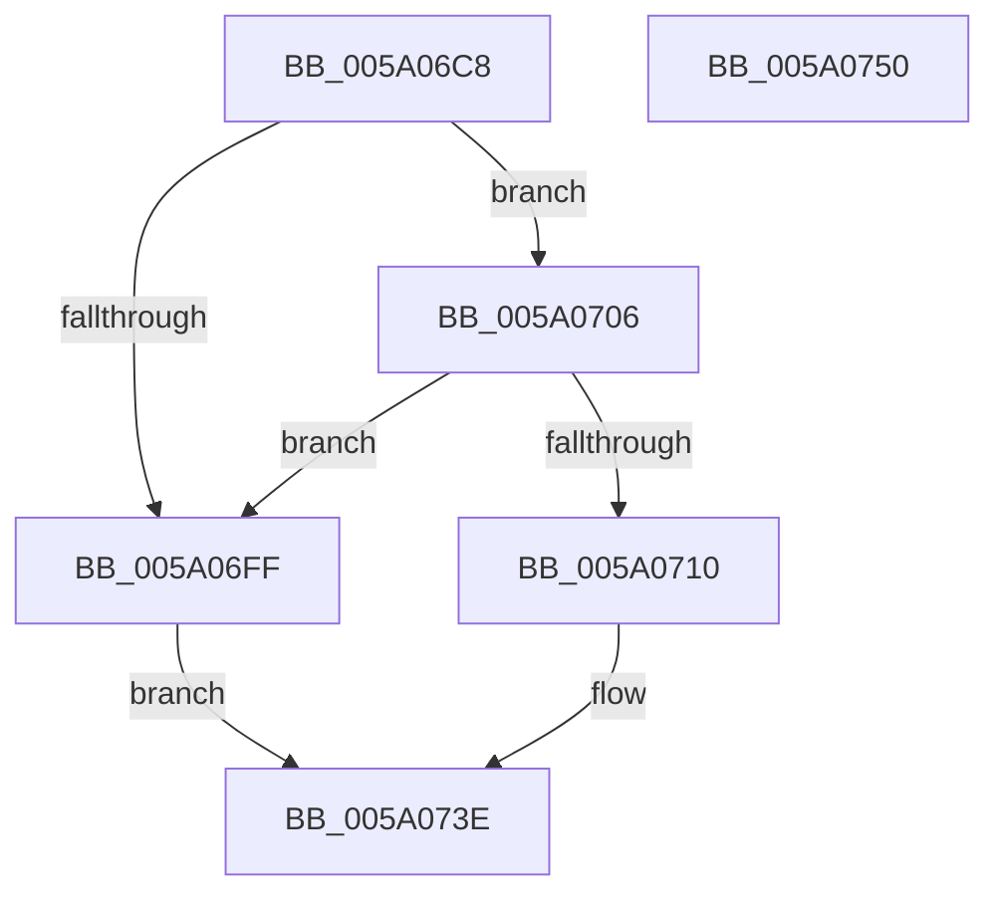

# IopAddBugcheckPowerTriageData

- RVA: `0x005A06C8`–`0x005A0751` (길이 `137` bytes)
- VA: `0x00000001405A06C8`
- 실행 섹션: `.text`
- PDB 이름 있음: `예`; PDB Function 태그: `아니요`
- unwind 정보 RVA: `0x00060BC4`
- 디코드: `40`개 명령, `137/137` bytes 표시
- 미해석 바이트: `0` (있으면 어셈블리에 `.byte`로 보존)

> 이 문서는 커널 이미지의 기계어와 PDB 기호를 분석해 생성했습니다. 4번과 5번은 함수 원형과 자료형을 바이너리 사용 방식에서 추정한 C 해석이며 원본 소스 복구 결과는 아닙니다.

## 1. Dependencies

- 직접 호출 지점: **8**; 고유 호출 대상: **7**
- 직접 호출자로 확인된 함수: **1**
- RIP 상대 이미지 참조: **0**

### Outgoing calls
- `0x005A06DF` → [IopAddBugcheckTriageDevice](IopAddBugcheckTriageDevice_function_005A0814.md) (function, `0x005A0814`)
- `0x005A06E9` → [IopAddBugcheckTriageIrp](IopAddBugcheckTriageIrp_function_005A0A0C.md) (function, `0x005A0A0C`)
- `0x005A06F6` → [IopIsAddressRangeValid](../4B/IopIsAddressRangeValid_function_004B6CBC.md) (function, `0x004B6CBC`)
- `0x005A0715` → [IoAddTriageDumpDataBlock](../42/IoAddTriageDumpDataBlock_function_00428374.md) (function, `0x00428374`)
- `0x005A071E` → [IopAddBugcheckTriagePowerIrps](IopAddBugcheckTriagePowerIrps_function_005A0C38.md) (function, `0x005A0C38`)
- `0x005A0727` → [IopAddBugcheckTriagePowerIrpWorkers](IopAddBugcheckTriagePowerIrpWorkers_function_005A0B84.md) (function, `0x005A0B84`)
- `0x005A0730` → [IopAddBugcheckTriageWorkQueue](IopAddBugcheckTriageWorkQueue_function_005A0E88.md) (function, `0x005A0E88`)
- `0x005A0739` → [IopAddBugcheckTriageWorkQueue](IopAddBugcheckTriageWorkQueue_function_005A0E88.md) (function, `0x005A0E88`)

### Direct callers
- [IopAddBugcheckTriageDataFromParameters](../59/IopAddBugcheckTriageDataFromParameters_function_00593E54.md) at `0x00593FEE`

### Static image references
- 디코드된 RIP-relative 메모리 참조가 없습니다.

## 2. Other-region calls and transfers

- 다른 실행 섹션으로 향하는 call: **0**
- 별도 외부 분기/꼬리 이동을 확인하지 못했습니다.

## 3. Assembly (complete function range)

```asm
005A06C8  48 89 5C 24 08                  mov qword ptr [rsp + 8], rbx
005A06CD  48 89 74 24 10                  mov qword ptr [rsp + 0x10], rsi
005A06D2  57                              push rdi
005A06D3  48 83 EC 20                     sub rsp, 0x20
005A06D7  49 8B D8                        mov rbx, r8
005A06DA  48 8B F2                        mov rsi, rdx
005A06DD  33 FF                           xor edi, edi
005A06DF  E8 30 01 00 00                  call 0x1405a0814
005A06E4  B2 01                           mov dl, 1
005A06E6  48 8B CB                        mov rcx, rbx
005A06E9  E8 1E 03 00 00                  call 0x1405a0a0c
005A06EE  8D 5F 28                        lea ebx, [rdi + 0x28]
005A06F1  48 8B CE                        mov rcx, rsi
005A06F4  8B D3                           mov edx, ebx
005A06F6  E8 C1 65 F1 FF                  call 0x1404b6cbc
005A06FB  84 C0                           test al, al
005A06FD  75 07                           jne 0x1405a0706
005A06FF  BF 01 00 00 C0                  mov edi, 0xc0000001
005A0704  EB 38                           jmp 0x1405a073e
005A0706  B8 00 80 00 00                  mov eax, 0x8000
005A070B  66 39 06                        cmp word ptr [rsi], ax
005A070E  75 EF                           jne 0x1405a06ff
005A0710  8B D3                           mov edx, ebx
005A0712  48 8B CE                        mov rcx, rsi
005A0715  E8 5A 7C E8 FF                  call 0x140428374
005A071A  48 8B 4E 08                     mov rcx, qword ptr [rsi + 8]
005A071E  E8 15 05 00 00                  call 0x1405a0c38
005A0723  48 8B 4E 10                     mov rcx, qword ptr [rsi + 0x10]
005A0727  E8 58 04 00 00                  call 0x1405a0b84
005A072C  48 8B 4E 18                     mov rcx, qword ptr [rsi + 0x18]
005A0730  E8 53 07 00 00                  call 0x1405a0e88
005A0735  48 8B 4E 20                     mov rcx, qword ptr [rsi + 0x20]
005A0739  E8 4A 07 00 00                  call 0x1405a0e88
005A073E  48 8B 5C 24 30                  mov rbx, qword ptr [rsp + 0x30]
005A0743  8B C7                           mov eax, edi
005A0745  48 8B 74 24 38                  mov rsi, qword ptr [rsp + 0x38]
005A074A  48 83 C4 20                     add rsp, 0x20
005A074E  5F                              pop rdi
005A074F  C3                              ret
005A0750  CC                              int3
```

## 4. C-style interpretation (structured pseudocode)

```c
__int64 __fastcall IopAddBugcheckPowerTriageData(__int64 a1, __int64 a2, __int64 a3)
{
    __int64 result;
    __int64 v_rdi;
    __int64 v_rsp;
    unsigned __int64 v_stack_p10;
    unsigned __int64 v_stack_p8;

    v_stack_p8 = v_rbx;
    v_stack_p10 = v_rsi;
    v_rsp = (v_rsp) - (32);
    v_rdi = 0;
    result = IopAddBugcheckTriageDevice(a1, a2, a3, a4);
    result = IopAddBugcheckTriageIrp(a3, 1, a3, a4);
    result = IopIsAddressRangeValid(a2, (unsigned int)((unsigned int)(v_rdi + 40)), a3, a4);
    if ((unsigned __int8)(result) != 0) goto loc_005A0706;
loc_005A06FF:
    goto loc_005A073E;
loc_005A0706:
    if ((*(unsigned __int16 *)(a2)) != ((unsigned __int16)((unsigned int)(0x8000ULL)))) goto loc_005A06FF;
    result = IoAddTriageDumpDataBlock(a2, (unsigned int)((unsigned int)(v_rdi + 40)), a3, a4);
    result = IopAddBugcheckTriagePowerIrps(*(unsigned __int64 *)(a2 + 8), (unsigned int)((unsigned int)(v_rdi + 40)), a3, a4);
    result = IopAddBugcheckTriagePowerIrpWorkers(*(unsigned __int64 *)(a2 + 16), (unsigned int)((unsigned int)(v_rdi + 40)), a3, a4);
    result = IopAddBugcheckTriageWorkQueue(*(unsigned __int64 *)(a2 + 24), (unsigned int)((unsigned int)(v_rdi + 40)), a3, a4);
    result = IopAddBugcheckTriageWorkQueue(*(unsigned __int64 *)(a2 + 32), (unsigned int)((unsigned int)(v_rdi + 40)), a3, a4);
loc_005A073E:
    v_rsp = (v_rsp) + (32);
    return (unsigned int)((unsigned int)((unsigned int)(0xC0000001ULL)));
}
```

## 5. (Beta) C Style

```c
int64_t IopAddBugcheckPowerTriageData(int64_t Arg1, void *Arg2, int64_t Arg3)
{
    uint8_t *arg2 = (uint8_t *)Arg2;

    int64_t result;
    int64_t local_rdi;
    int64_t local_rsp;
    uint64_t v_stack_p10;
    uint64_t v_stack_p8;

    v_stack_p8 = local_rbx;
    v_stack_p10 = local_rsi;
    local_rsp = (local_rsp) - (32);
    local_rdi = 0;
    result = IopAddBugcheckTriageDevice(Arg1, Arg2, Arg3, a4);
    result = IopAddBugcheckTriageIrp(Arg3, 1, Arg3, a4);
    result = IopIsAddressRangeValid(Arg2, (uint32_t)((uint32_t)(local_rdi + 40)), Arg3, a4);
    if ((uint8_t)(result) != 0) goto loc_005A0706;
loc_005A06FF:
    goto loc_005A073E;
loc_005A0706:
    if ((*(uint16_t *)(arg2)) != ((uint16_t)((uint32_t)(0x8000ULL)))) goto loc_005A06FF;
    result = IoAddTriageDumpDataBlock(Arg2, (uint32_t)((uint32_t)(local_rdi + 40)), Arg3, a4);
    result = IopAddBugcheckTriagePowerIrps(*(uint64_t *)(arg2 + 0x8), (uint32_t)((uint32_t)(local_rdi + 40)), Arg3, a4);
    result = IopAddBugcheckTriagePowerIrpWorkers(*(uint64_t *)(arg2 + 0x10), (uint32_t)((uint32_t)(local_rdi + 40)), Arg3, a4);
    result = IopAddBugcheckTriageWorkQueue(*(uint64_t *)(arg2 + 0x18), (uint32_t)((uint32_t)(local_rdi + 40)), Arg3, a4);
    result = IopAddBugcheckTriageWorkQueue(*(uint64_t *)(arg2 + 0x20), (uint32_t)((uint32_t)(local_rdi + 40)), Arg3, a4);
loc_005A073E:
    local_rsp = (local_rsp) + (32);
    return (uint32_t)((uint32_t)((uint32_t)(0xC0000001ULL)));
}
```

### 관측된 메모리 오프셋

구조체 형식이 확인되지 않은 접근은 인자 기준의 오프셋으로만 기록했습니다.

| 기준 인자 | 오프셋 표현 | 폭 (bit) | 접근 |
|---|---:|---:|---|
| `Arg2` | `+ 0x0` | `16` | `R` |
| `Arg2` | `+ 0x8` | `64` | `R` |
| `Arg2` | `+ 0x10` | `64` | `R` |
| `Arg2` | `+ 0x18` | `64` | `R` |
| `Arg2` | `+ 0x20` | `64` | `R` |

## 6. Execution-region graph

[열기: 2D/3D 그래프와 함수 탐색 컨트롤 패널](../../../control-panel.html?section=text&rva=0x005A06C8&view=graph)

- 2D 그래프는 위에서 아래로 흐르고, 3D 그래프는 빈 공간을 드래그해 회전합니다. Shift+드래그는 이동, 휠은 확대·축소, 함수 노드 선택은 대상 보고서 이동입니다.

### Static fallback


