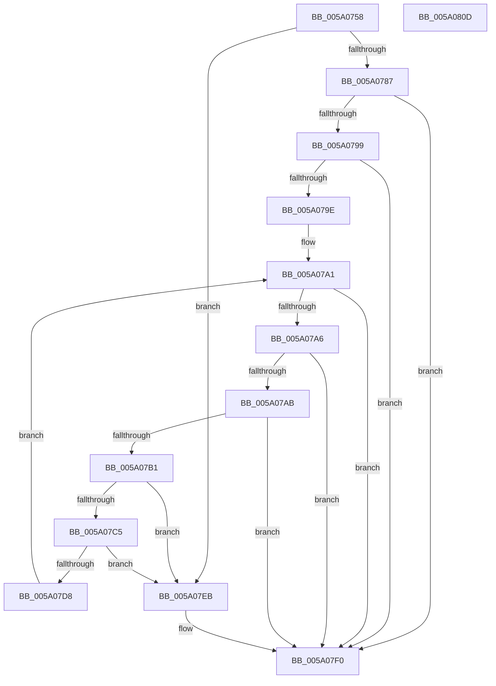

# IopAddBugcheckTriageCompletionQueue

- RVA: `0x005A0758`–`0x005A080E` (길이 `182` bytes)
- VA: `0x00000001405A0758`
- 실행 섹션: `.text`
- PDB 이름 있음: `예`; PDB Function 태그: `아니요`
- unwind 정보 RVA: `0x0005E6B4`
- 디코드: `57`개 명령, `182/182` bytes 표시
- 미해석 바이트: `0` (있으면 어셈블리에 `.byte`로 보존)

> 이 문서는 커널 이미지의 기계어와 PDB 기호를 분석해 생성했습니다. 4번과 5번은 함수 원형과 자료형을 바이너리 사용 방식에서 추정한 C 해석이며 원본 소스 복구 결과는 아닙니다.

## 1. Dependencies

- 직접 호출 지점: **5**; 고유 호출 대상: **3**
- 직접 호출자로 확인된 함수: **2**
- RIP 상대 이미지 참조: **0**

### Outgoing calls
- `0x005A077E` → [IopIsAddressRangeValid](../4B/IopIsAddressRangeValid_function_004B6CBC.md) (function, `0x004B6CBC`)
- `0x005A078C` → [IoAddTriageDumpDataBlock](../42/IoAddTriageDumpDataBlock_function_00428374.md) (function, `0x00428374`)
- `0x005A07BC` → [IopIsAddressRangeValid](../4B/IopIsAddressRangeValid_function_004B6CBC.md) (function, `0x004B6CBC`)
- `0x005A07CD` → [IoAddTriageDumpDataBlock](../42/IoAddTriageDumpDataBlock_function_00428374.md) (function, `0x00428374`)
- `0x005A07DC` → [IopAddBugcheckTriageDeviceNode](IopAddBugcheckTriageDeviceNode_function_005A091C.md) (function, `0x005A091C`)

### Direct callers
- [IopAddBugcheckTriageDataFromParameters](../59/IopAddBugcheckTriageDataFromParameters_function_00593E54.md) at `0x00593FBA`
- [IopAddBugcheckPnpWatchdogTriageData](IopAddBugcheckPnpWatchdogTriageData_function_005A0608.md) at `0x005A065A`

### Static image references
- 디코드된 RIP-relative 메모리 참조가 없습니다.

## 2. Other-region calls and transfers

- 다른 실행 섹션으로 향하는 call: **0**
- 별도 외부 분기/꼬리 이동을 확인하지 못했습니다.

## 3. Assembly (complete function range)

```asm
005A0758  48 8B C4                        mov rax, rsp
005A075B  48 89 58 08                     mov qword ptr [rax + 8], rbx
005A075F  48 89 68 10                     mov qword ptr [rax + 0x10], rbp
005A0763  48 89 70 18                     mov qword ptr [rax + 0x18], rsi
005A0767  48 89 78 20                     mov qword ptr [rax + 0x20], rdi
005A076B  41 56                           push r14
005A076D  48 83 EC 20                     sub rsp, 0x20
005A0771  33 DB                           xor ebx, ebx
005A0773  48 8B F1                        mov rsi, rcx
005A0776  45 33 F6                        xor r14d, r14d
005A0779  8D 7B 10                        lea edi, [rbx + 0x10]
005A077C  8B D7                           mov edx, edi
005A077E  E8 39 65 F1 FF                  call 0x1404b6cbc
005A0783  84 C0                           test al, al
005A0785  74 64                           je 0x1405a07eb
005A0787  8B D7                           mov edx, edi
005A0789  48 8B CE                        mov rcx, rsi
005A078C  E8 E3 7B E8 FF                  call 0x140428374
005A0791  48 8B 3E                        mov rdi, qword ptr [rsi]
005A0794  48 85 FF                        test rdi, rdi
005A0797  74 57                           je 0x1405a07f0
005A0799  48 3B FE                        cmp rdi, rsi
005A079C  74 52                           je 0x1405a07f0
005A079E  48 8B EE                        mov rbp, rsi
005A07A1  48 85 FF                        test rdi, rdi
005A07A4  74 4A                           je 0x1405a07f0
005A07A6  48 3B FE                        cmp rdi, rsi
005A07A9  74 45                           je 0x1405a07f0
005A07AB  41 83 FE 0A                     cmp r14d, 0xa
005A07AF  7D 3F                           jge 0x1405a07f0
005A07B1  BA 18 00 00 00                  mov edx, 0x18
005A07B6  48 8B CF                        mov rcx, rdi
005A07B9  41 FF C6                        inc r14d
005A07BC  E8 FB 64 F1 FF                  call 0x1404b6cbc
005A07C1  84 C0                           test al, al
005A07C3  74 26                           je 0x1405a07eb
005A07C5  BA 18 00 00 00                  mov edx, 0x18
005A07CA  48 8B CF                        mov rcx, rdi
005A07CD  E8 A2 7B E8 FF                  call 0x140428374
005A07D2  48 39 6F 08                     cmp qword ptr [rdi + 8], rbp
005A07D6  75 13                           jne 0x1405a07eb
005A07D8  48 8B 4F 10                     mov rcx, qword ptr [rdi + 0x10]
005A07DC  E8 3B 01 00 00                  call 0x1405a091c
005A07E1  48 8B EF                        mov rbp, rdi
005A07E4  8B D8                           mov ebx, eax
005A07E6  48 8B 3F                        mov rdi, qword ptr [rdi]
005A07E9  EB B6                           jmp 0x1405a07a1
005A07EB  BB 01 00 00 C0                  mov ebx, 0xc0000001
005A07F0  48 8B 6C 24 38                  mov rbp, qword ptr [rsp + 0x38]
005A07F5  8B C3                           mov eax, ebx
005A07F7  48 8B 5C 24 30                  mov rbx, qword ptr [rsp + 0x30]
005A07FC  48 8B 74 24 40                  mov rsi, qword ptr [rsp + 0x40]
005A0801  48 8B 7C 24 48                  mov rdi, qword ptr [rsp + 0x48]
005A0806  48 83 C4 20                     add rsp, 0x20
005A080A  41 5E                           pop r14
005A080C  C3                              ret
005A080D  CC                              int3
```

## 4. C-style interpretation (structured pseudocode)

```c
__int64 __fastcall IopAddBugcheckTriageCompletionQueue(__int64 a1)
{
    __int64 result;
    __int64 v_r14;
    __int64 v_rbx;
    __int64 v_rsp;
    unsigned __int64 v_stack_p10;
    unsigned __int64 v_stack_p18;
    unsigned __int64 v_stack_p20;
    unsigned __int64 v_stack_p8;

    *(unsigned __int64 *)(v_rsp + 8) = v_rbx;
    *(unsigned __int64 *)(v_rsp + 16) = v_rbp;
    *(unsigned __int64 *)(v_rsp + 24) = v_rsi;
    *(unsigned __int64 *)(v_rsp + 32) = v_rdi;
    v_rsp = (v_rsp) - (32);
    v_rbx = 0;
    v_r14 = 0;
    result = IopIsAddressRangeValid(a1, (unsigned int)((unsigned int)(v_rbx + 16)), a3, a4);
    if ((unsigned __int8)(result) == 0) goto loc_005A07EB;
    result = IoAddTriageDumpDataBlock(a1, (unsigned int)((unsigned int)(v_rbx + 16)), a3, a4);
    if (*(unsigned __int64 *)(a1) == 0) goto loc_005A07F0;
    if ((*(unsigned __int64 *)(a1)) == a1) goto loc_005A07F0;
loc_005A07A1:
    if (*(unsigned __int64 *)(a1) == 0) goto loc_005A07F0;
    if ((*(unsigned __int64 *)(a1)) == a1) goto loc_005A07F0;
    if (0 >= 10) goto loc_005A07F0;
    v_r14 = (unsigned int)((v_r14) + 1);
    result = IopIsAddressRangeValid(*(unsigned __int64 *)(a1), 24, a3, a4);
    if ((unsigned __int8)(result) == 0) goto loc_005A07EB;
    result = IoAddTriageDumpDataBlock(*(unsigned __int64 *)(a1), 24, a3, a4);
    if ((*(unsigned __int64 *)(*(unsigned __int64 *)(a1) + 8)) != a1) goto loc_005A07EB;
    result = IopAddBugcheckTriageDeviceNode(*(unsigned __int64 *)(*(unsigned __int64 *)(a1) + 16), 24, a3, a4);
    goto loc_005A07A1;
loc_005A07EB:
loc_005A07F0:
    v_rsp = (v_rsp) + (32);
    return (unsigned int)((unsigned int)((unsigned int)(0xC0000001ULL)));
}
```

## 5. (Beta) C Style

```c
int64_t IopAddBugcheckTriageCompletionQueue(void *Arg1)
{
    uint8_t *arg1 = (uint8_t *)Arg1;

    int64_t result;
    int64_t local_r14;
    int64_t local_rbx;
    int64_t local_rsp;
    uint64_t v_stack_p10;
    uint64_t v_stack_p18;
    uint64_t v_stack_p20;
    uint64_t v_stack_p8;

    *(uint64_t *)(local_rsp + 0x8) = local_rbx;
    *(uint64_t *)(local_rsp + 0x10) = local_rbp;
    *(uint64_t *)(local_rsp + 0x18) = local_rsi;
    *(uint64_t *)(local_rsp + 0x20) = local_rdi;
    local_rsp = (local_rsp) - (32);
    local_rbx = 0;
    local_r14 = 0;
    result = IopIsAddressRangeValid(Arg1, (uint32_t)((uint32_t)(local_rbx + 16)), a3, a4);
    if ((uint8_t)(result) == 0) goto loc_005A07EB;
    result = IoAddTriageDumpDataBlock(Arg1, (uint32_t)((uint32_t)(local_rbx + 16)), a3, a4);
    if (*(uint64_t *)(arg1) == 0) goto loc_005A07F0;
    if ((*(uint64_t *)(arg1)) == Arg1) goto loc_005A07F0;
loc_005A07A1:
    if (*(uint64_t *)(arg1) == 0) goto loc_005A07F0;
    if ((*(uint64_t *)(arg1)) == Arg1) goto loc_005A07F0;
    if (0 >= 10) goto loc_005A07F0;
    local_r14 = (uint32_t)((local_r14) + 1);
    result = IopIsAddressRangeValid(*(uint64_t *)(arg1), 24, a3, a4);
    if ((uint8_t)(result) == 0) goto loc_005A07EB;
    result = IoAddTriageDumpDataBlock(*(uint64_t *)(arg1), 24, a3, a4);
    if ((*(uint64_t *)(*(uint64_t *)(arg1) + 0x8)) != Arg1) goto loc_005A07EB;
    result = IopAddBugcheckTriageDeviceNode(*(uint64_t *)(*(uint64_t *)(arg1) + 0x10), 24, a3, a4);
    goto loc_005A07A1;
loc_005A07EB:
loc_005A07F0:
    local_rsp = (local_rsp) + (32);
    return (uint32_t)((uint32_t)((uint32_t)(0xC0000001ULL)));
}
```

### 관측된 메모리 오프셋

구조체 형식이 확인되지 않은 접근은 인자 기준의 오프셋으로만 기록했습니다.

| 기준 인자 | 오프셋 표현 | 폭 (bit) | 접근 |
|---|---:|---:|---|
| `Arg1` | `+ 0x0` | `64` | `R` |

## 6. Execution-region graph

[열기: 2D/3D 그래프와 함수 탐색 컨트롤 패널](../../../control-panel.html?section=text&rva=0x005A0758&view=graph)

- 2D 그래프는 위에서 아래로 흐르고, 3D 그래프는 빈 공간을 드래그해 회전합니다. Shift+드래그는 이동, 휠은 확대·축소, 함수 노드 선택은 대상 보고서 이동입니다.

### Static fallback


