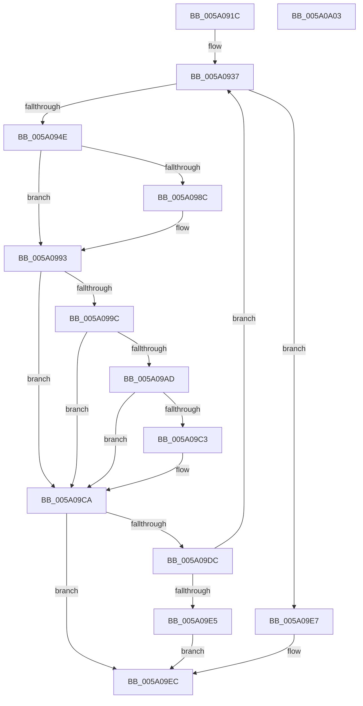

# IopAddBugcheckTriageDeviceNode

- RVA: `0x005A091C`–`0x005A0A04` (길이 `232` bytes)
- VA: `0x00000001405A091C`
- 실행 섹션: `.text`
- PDB 이름 있음: `예`; PDB Function 태그: `아니요`
- unwind 정보 RVA: `0x00066400`
- 디코드: `63`개 명령, `232/232` bytes 표시
- 미해석 바이트: `0` (있으면 어셈블리에 `.byte`로 보존)

> 이 문서는 커널 이미지의 기계어와 PDB 기호를 분석해 생성했습니다. 4번과 5번은 함수 원형과 자료형을 바이너리 사용 방식에서 추정한 C 해석이며 원본 소스 복구 결과는 아닙니다.

## 1. Dependencies

- 직접 호출 지점: **9**; 고유 호출 대상: **5**
- 직접 호출자로 확인된 함수: **4**
- RIP 상대 이미지 참조: **0**

### Outgoing calls
- `0x005A0941` → [IopIsAddressRangeValid](../4B/IopIsAddressRangeValid_function_004B6CBC.md) (function, `0x004B6CBC`)
- `0x005A0956` → [IoAddTriageDumpDataBlock](../42/IoAddTriageDumpDataBlock_function_00428374.md) (function, `0x00428374`)
- `0x005A096A` → [IopAddBugcheckTriageUnicodeString](IopAddBugcheckTriageUnicodeString_function_005A0DF4.md) (function, `0x005A0DF4`)
- `0x005A097E` → [IopAddBugcheckTriageUnicodeString](IopAddBugcheckTriageUnicodeString_function_005A0DF4.md) (function, `0x005A0DF4`)
- `0x005A098E` → [IopAddBugcheckTriageIrp](IopAddBugcheckTriageIrp_function_005A0A0C.md) (function, `0x005A0A0C`)
- `0x005A09A4` → [IopIsAddressRangeValid](../4B/IopIsAddressRangeValid_function_004B6CBC.md) (function, `0x004B6CBC`)
- `0x005A09B5` → [IoAddTriageDumpDataBlock](../42/IoAddTriageDumpDataBlock_function_00428374.md) (function, `0x00428374`)
- `0x005A09C5` → [IopAddBugcheckTriageIrp](IopAddBugcheckTriageIrp_function_005A0A0C.md) (function, `0x005A0A0C`)
- `0x005A09CE` → [IopAddBugcheckTriageDevice](IopAddBugcheckTriageDevice_function_005A0814.md) (function, `0x005A0814`)

### Direct callers
- [IopAddBugcheckTriageDataFromParameters](../59/IopAddBugcheckTriageDataFromParameters_function_00593E54.md) at `0x00593FD5`
- [IopAddBugcheckTriageDataFromParameters](../59/IopAddBugcheckTriageDataFromParameters_function_00593E54.md) at `0x0059405B`
- [IopAddBugcheckPnpWatchdogTriageData](IopAddBugcheckPnpWatchdogTriageData_function_005A0608.md) at `0x005A06A9`
- [IopAddBugcheckTriageCompletionQueue](IopAddBugcheckTriageCompletionQueue_function_005A0758.md) at `0x005A07DC`
- [IopAddBugcheckTriageIrp](IopAddBugcheckTriageIrp_function_005A0A0C.md) at `0x005A0B40`

### Static image references
- 디코드된 RIP-relative 메모리 참조가 없습니다.

## 2. Other-region calls and transfers

- 다른 실행 섹션으로 향하는 call: **0**
- 별도 외부 분기/꼬리 이동을 확인하지 못했습니다.

## 3. Assembly (complete function range)

```asm
005A091C  48 89 5C 24 08                  mov qword ptr [rsp + 8], rbx
005A0921  48 89 6C 24 10                  mov qword ptr [rsp + 0x10], rbp
005A0926  48 89 74 24 18                  mov qword ptr [rsp + 0x18], rsi
005A092B  57                              push rdi
005A092C  48 83 EC 30                     sub rsp, 0x30
005A0930  33 DB                           xor ebx, ebx
005A0932  48 8B F9                        mov rdi, rcx
005A0935  8B EB                           mov ebp, ebx
005A0937  BA 58 00 00 00                  mov edx, 0x58
005A093C  48 8B CF                        mov rcx, rdi
005A093F  FF C5                           inc ebp
005A0941  E8 76 63 F1 FF                  call 0x1404b6cbc
005A0946  84 C0                           test al, al
005A0948  0F 84 99 00 00 00               je 0x1405a09e7
005A094E  BA 58 00 00 00                  mov edx, 0x58
005A0953  48 8B CF                        mov rcx, rdi
005A0956  E8 19 7A E8 FF                  call 0x140428374
005A095B  0F 10 47 28                     movups xmm0, xmmword ptr [rdi + 0x28]
005A095F  48 8D 4C 24 20                  lea rcx, [rsp + 0x20]
005A0964  F3 0F 7F 44 24 20               movdqu xmmword ptr [rsp + 0x20], xmm0
005A096A  E8 85 04 00 00                  call 0x1405a0df4
005A096F  0F 10 47 38                     movups xmm0, xmmword ptr [rdi + 0x38]
005A0973  48 8D 4C 24 20                  lea rcx, [rsp + 0x20]
005A0978  F3 0F 7F 44 24 20               movdqu xmmword ptr [rsp + 0x20], xmm0
005A097E  E8 71 04 00 00                  call 0x1405a0df4
005A0983  48 8B 4F 48                     mov rcx, qword ptr [rdi + 0x48]
005A0987  48 85 C9                        test rcx, rcx
005A098A  74 07                           je 0x1405a0993
005A098C  33 D2                           xor edx, edx
005A098E  E8 79 00 00 00                  call 0x1405a0a0c
005A0993  48 8B 77 50                     mov rsi, qword ptr [rdi + 0x50]
005A0997  48 85 F6                        test rsi, rsi
005A099A  74 2E                           je 0x1405a09ca
005A099C  BA 38 00 00 00                  mov edx, 0x38
005A09A1  48 8B CE                        mov rcx, rsi
005A09A4  E8 13 63 F1 FF                  call 0x1404b6cbc
005A09A9  84 C0                           test al, al
005A09AB  74 1D                           je 0x1405a09ca
005A09AD  BA 38 00 00 00                  mov edx, 0x38
005A09B2  48 8B CE                        mov rcx, rsi
005A09B5  E8 BA 79 E8 FF                  call 0x140428374
005A09BA  48 8B 4E 10                     mov rcx, qword ptr [rsi + 0x10]
005A09BE  48 85 C9                        test rcx, rcx
005A09C1  74 07                           je 0x1405a09ca
005A09C3  33 D2                           xor edx, edx
005A09C5  E8 42 00 00 00                  call 0x1405a0a0c
005A09CA  48 8B 4F 20                     mov rcx, qword ptr [rdi + 0x20]
005A09CE  E8 41 FE FF FF                  call 0x1405a0814
005A09D3  48 8B 7F 10                     mov rdi, qword ptr [rdi + 0x10]
005A09D7  48 85 FF                        test rdi, rdi
005A09DA  74 10                           je 0x1405a09ec
005A09DC  83 FD 0A                        cmp ebp, 0xa
005A09DF  0F 8C 52 FF FF FF               jl 0x1405a0937
005A09E5  EB 05                           jmp 0x1405a09ec
005A09E7  BB 01 00 00 C0                  mov ebx, 0xc0000001
005A09EC  48 8B 6C 24 48                  mov rbp, qword ptr [rsp + 0x48]
005A09F1  8B C3                           mov eax, ebx
005A09F3  48 8B 5C 24 40                  mov rbx, qword ptr [rsp + 0x40]
005A09F8  48 8B 74 24 50                  mov rsi, qword ptr [rsp + 0x50]
005A09FD  48 83 C4 30                     add rsp, 0x30
005A0A01  5F                              pop rdi
005A0A02  C3                              ret
005A0A03  CC                              int3
```

## 4. C-style interpretation (structured pseudocode)

```c
__int64 __fastcall IopAddBugcheckTriageDeviceNode(__int64 a1)
{
    __int64 result;
    __int64 v_rbp;
    __int64 v_rbx;
    __int64 v_rsp;
    unsigned __int64 v_stack_m18;
    unsigned __int64 v_stack_p10;
    unsigned __int64 v_stack_p18;
    unsigned __int64 v_stack_p8;

    v_stack_p8 = v_rbx;
    v_stack_p10 = v_rbp;
    v_stack_p18 = v_rsi;
    v_rsp = (v_rsp) - (48);
    v_rbx = 0;
loc_005A0937:
    v_rbp = (unsigned int)((0) + 1);
    result = IopIsAddressRangeValid(a1, 88, a3, a4);
    if ((unsigned __int8)(result) == 0) goto loc_005A09E7;
    result = IoAddTriageDumpDataBlock(a1, 88, a3, a4);
    v_stack_m18 = v_xmm0;
    result = IopAddBugcheckTriageUnicodeString(v_stack_m18, 88, a3, a4);
    v_stack_m18 = v_xmm0;
    result = IopAddBugcheckTriageUnicodeString(v_stack_m18, 88, a3, a4);
    if (*(unsigned __int64 *)(a1 + 72) != 0) {
        a2 = 0;
        result = IopAddBugcheckTriageIrp(*(unsigned __int64 *)(a1 + 72), a2, a3, a4);
    }
    if (*(unsigned __int64 *)(a1 + 80) == 0) goto loc_005A09CA;
    result = IopIsAddressRangeValid(*(unsigned __int64 *)(a1 + 80), 56, a3, a4);
    if ((unsigned __int8)(result) == 0) goto loc_005A09CA;
    result = IoAddTriageDumpDataBlock(*(unsigned __int64 *)(a1 + 80), 56, a3, a4);
    if (*(unsigned __int64 *)(*(unsigned __int64 *)(a1 + 80) + 16) != 0) {
        a2 = 0;
        result = IopAddBugcheckTriageIrp(*(unsigned __int64 *)(*(unsigned __int64 *)(a1 + 80) + 16), a2, a3, a4);
    }
    result = IopAddBugcheckTriageDevice(*(unsigned __int64 *)(a1 + 32), a2, a3, a4);
    if (*(unsigned __int64 *)(a1 + 16) == 0) goto loc_005A09EC;
    if (((unsigned int)(v_rbp)) < 10) goto loc_005A0937;
    goto loc_005A09EC;
loc_005A09E7:
loc_005A09EC:
    v_rsp = (v_rsp) + (48);
    return (unsigned int)((unsigned int)((unsigned int)(0xC0000001ULL)));
}
```

## 5. (Beta) C Style

```c
int64_t IopAddBugcheckTriageDeviceNode(int64_t Arg1)
{
    int64_t result;
    int64_t local_rbp;
    int64_t local_rbx;
    int64_t local_rsp;
    uint64_t v_stack_m18;
    uint64_t v_stack_p10;
    uint64_t v_stack_p18;
    uint64_t v_stack_p8;

    v_stack_p8 = local_rbx;
    v_stack_p10 = local_rbp;
    v_stack_p18 = local_rsi;
    local_rsp = (local_rsp) - (48);
    local_rbx = 0;
loc_005A0937:
    local_rbp = (uint32_t)((0) + 1);
    result = IopIsAddressRangeValid(Arg1, 88, a3, a4);
    if ((uint8_t)(result) == 0) goto loc_005A09E7;
    result = IoAddTriageDumpDataBlock(Arg1, 88, a3, a4);
    v_stack_m18 = v_xmm0;
    result = IopAddBugcheckTriageUnicodeString(v_stack_m18, 88, a3, a4);
    v_stack_m18 = v_xmm0;
    result = IopAddBugcheckTriageUnicodeString(v_stack_m18, 88, a3, a4);
    if (*(uint64_t *)(Arg1 + 0x48) != 0) {
        a2 = 0;
        result = IopAddBugcheckTriageIrp(*(uint64_t *)(Arg1 + 0x48), a2, a3, a4);
    }
    if (*(uint64_t *)(Arg1 + 0x50) == 0) goto loc_005A09CA;
    result = IopIsAddressRangeValid(*(uint64_t *)(Arg1 + 0x50), 56, a3, a4);
    if ((uint8_t)(result) == 0) goto loc_005A09CA;
    result = IoAddTriageDumpDataBlock(*(uint64_t *)(Arg1 + 0x50), 56, a3, a4);
    if (*(uint64_t *)(*(uint64_t *)(Arg1 + 0x50) + 0x10) != 0) {
        a2 = 0;
        result = IopAddBugcheckTriageIrp(*(uint64_t *)(*(uint64_t *)(Arg1 + 0x50) + 0x10), a2, a3, a4);
    }
    result = IopAddBugcheckTriageDevice(*(uint64_t *)(Arg1 + 0x20), a2, a3, a4);
    if (*(uint64_t *)(Arg1 + 0x10) == 0) goto loc_005A09EC;
    if (((uint32_t)(local_rbp)) < 10) goto loc_005A0937;
    goto loc_005A09EC;
loc_005A09E7:
loc_005A09EC:
    local_rsp = (local_rsp) + (48);
    return (uint32_t)((uint32_t)((uint32_t)(0xC0000001ULL)));
}
```

## 6. Execution-region graph

[열기: 2D/3D 그래프와 함수 탐색 컨트롤 패널](../../../control-panel.html?section=text&rva=0x005A091C&view=graph)

- 2D 그래프는 위에서 아래로 흐르고, 3D 그래프는 빈 공간을 드래그해 회전합니다. Shift+드래그는 이동, 휠은 확대·축소, 함수 노드 선택은 대상 보고서 이동입니다.

### Static fallback


