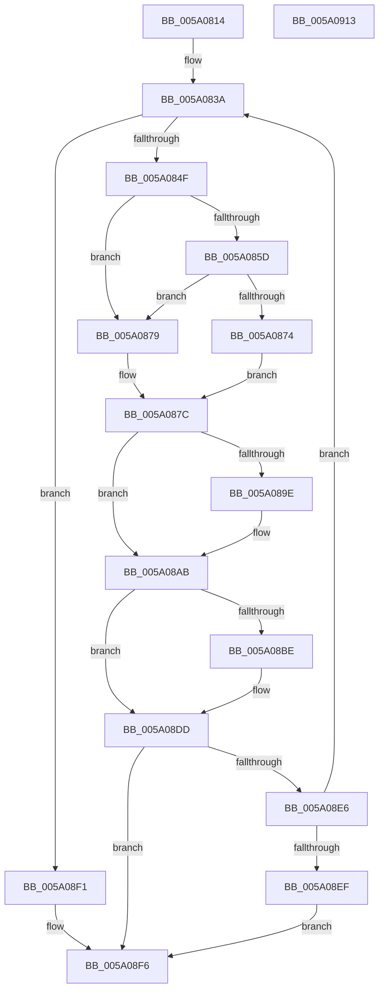

# IopAddBugcheckTriageDevice

- RVA: `0x005A0814`–`0x005A0914` (길이 `256` bytes)
- VA: `0x00000001405A0814`
- 실행 섹션: `.text`
- PDB 이름 있음: `예`; PDB Function 태그: `아니요`
- unwind 정보 RVA: `0x0005D7BC`
- 디코드: `72`개 명령, `256/256` bytes 표시
- 미해석 바이트: `0` (있으면 어셈블리에 `.byte`로 보존)

> 이 문서는 커널 이미지의 기계어와 PDB 기호를 분석해 생성했습니다. 4번과 5번은 함수 원형과 자료형을 바이너리 사용 방식에서 추정한 C 해석이며 원본 소스 복구 결과는 아닙니다.

## 1. Dependencies

- 직접 호출 지점: **8**; 고유 호출 대상: **3**
- 직접 호출자로 확인된 함수: **5**
- RIP 상대 이미지 참조: **0**

### Outgoing calls
- `0x005A0842` → [IopIsAddressRangeValid](../4B/IopIsAddressRangeValid_function_004B6CBC.md) (function, `0x004B6CBC`)
- `0x005A086B` → [IopIsAddressRangeValid](../4B/IopIsAddressRangeValid_function_004B6CBC.md) (function, `0x004B6CBC`)
- `0x005A0881` → [IoAddTriageDumpDataBlock](../42/IoAddTriageDumpDataBlock_function_00428374.md) (function, `0x00428374`)
- `0x005A0895` → [IopIsAddressRangeValid](../4B/IopIsAddressRangeValid_function_004B6CBC.md) (function, `0x004B6CBC`)
- `0x005A08A6` → [IoAddTriageDumpDataBlock](../42/IoAddTriageDumpDataBlock_function_00428374.md) (function, `0x00428374`)
- `0x005A08B5` → [IopIsAddressRangeValid](../4B/IopIsAddressRangeValid_function_004B6CBC.md) (function, `0x004B6CBC`)
- `0x005A08C4` → [IoAddTriageDumpDataBlock](../42/IoAddTriageDumpDataBlock_function_00428374.md) (function, `0x00428374`)
- `0x005A08D8` → [IopAddBugcheckTriageUnicodeString](IopAddBugcheckTriageUnicodeString_function_005A0DF4.md) (function, `0x005A0DF4`)

### Direct callers
- [IopAddBugcheckDirectedTransitionTriageData](IopAddBugcheckDirectedTransitionTriageData_function_005A0518.md) at `0x005A058C`
- [IopAddBugcheckPnpWatchdogTriageData](IopAddBugcheckPnpWatchdogTriageData_function_005A0608.md) at `0x005A069B`
- [IopAddBugcheckPowerTriageData](IopAddBugcheckPowerTriageData_function_005A06C8.md) at `0x005A06DF`
- [IopAddBugcheckTriageDeviceNode](IopAddBugcheckTriageDeviceNode_function_005A091C.md) at `0x005A09CE`
- [IopAddBugcheckTriagePowerIrps](IopAddBugcheckTriagePowerIrps_function_005A0C38.md) at `0x005A0CC2`

### Static image references
- 디코드된 RIP-relative 메모리 참조가 없습니다.

## 2. Other-region calls and transfers

- 다른 실행 섹션으로 향하는 call: **0**
- 별도 외부 분기/꼬리 이동을 확인하지 못했습니다.

## 3. Assembly (complete function range)

```asm
005A0814  48 8B C4                        mov rax, rsp
005A0817  48 89 58 08                     mov qword ptr [rax + 8], rbx
005A081B  48 89 68 10                     mov qword ptr [rax + 0x10], rbp
005A081F  48 89 70 18                     mov qword ptr [rax + 0x18], rsi
005A0823  48 89 78 20                     mov qword ptr [rax + 0x20], rdi
005A0827  41 56                           push r14
005A0829  48 83 EC 30                     sub rsp, 0x30
005A082D  33 DB                           xor ebx, ebx
005A082F  48 8B F9                        mov rdi, rcx
005A0832  8B EB                           mov ebp, ebx
005A0834  41 BE 50 01 00 00               mov r14d, 0x150
005A083A  49 8B D6                        mov rdx, r14
005A083D  48 8B CF                        mov rcx, rdi
005A0840  FF C5                           inc ebp
005A0842  E8 75 64 F1 FF                  call 0x1404b6cbc
005A0847  84 C0                           test al, al
005A0849  0F 84 A2 00 00 00               je 0x1405a08f1
005A084F  0F B7 47 02                     movzx eax, word ptr [rdi + 2]
005A0853  B9 00 30 00 00                  mov ecx, 0x3000
005A0858  66 3B C1                        cmp ax, cx
005A085B  77 1C                           ja 0x1405a0879
005A085D  48 8D 70 07                     lea rsi, [rax + 7]
005A0861  48 8B CF                        mov rcx, rdi
005A0864  48 8B D6                        mov rdx, rsi
005A0867  48 83 E2 F8                     and rdx, 0xfffffffffffffff8
005A086B  E8 4C 64 F1 FF                  call 0x1404b6cbc
005A0870  84 C0                           test al, al
005A0872  74 05                           je 0x1405a0879
005A0874  83 E6 F8                        and esi, 0xfffffff8
005A0877  EB 03                           jmp 0x1405a087c
005A0879  41 8B F6                        mov esi, r14d
005A087C  8B D6                           mov edx, esi
005A087E  48 8B CF                        mov rcx, rdi
005A0881  E8 EE 7A E8 FF                  call 0x140428374
005A0886  48 8B B7 38 01 00 00            mov rsi, qword ptr [rdi + 0x138]
005A088D  BA 70 00 00 00                  mov edx, 0x70
005A0892  48 8B CE                        mov rcx, rsi
005A0895  E8 22 64 F1 FF                  call 0x1404b6cbc
005A089A  84 C0                           test al, al
005A089C  74 0D                           je 0x1405a08ab
005A089E  BA 70 00 00 00                  mov edx, 0x70
005A08A3  48 8B CE                        mov rcx, rsi
005A08A6  E8 C9 7A E8 FF                  call 0x140428374
005A08AB  48 8B 77 08                     mov rsi, qword ptr [rdi + 8]
005A08AF  49 8B D6                        mov rdx, r14
005A08B2  48 8B CE                        mov rcx, rsi
005A08B5  E8 02 64 F1 FF                  call 0x1404b6cbc
005A08BA  84 C0                           test al, al
005A08BC  74 1F                           je 0x1405a08dd
005A08BE  41 8B D6                        mov edx, r14d
005A08C1  48 8B CE                        mov rcx, rsi
005A08C4  E8 AB 7A E8 FF                  call 0x140428374
005A08C9  0F 10 46 38                     movups xmm0, xmmword ptr [rsi + 0x38]
005A08CD  48 8D 4C 24 20                  lea rcx, [rsp + 0x20]
005A08D2  F3 0F 7F 44 24 20               movdqu xmmword ptr [rsp + 0x20], xmm0
005A08D8  E8 17 05 00 00                  call 0x1405a0df4
005A08DD  48 8B 7F 18                     mov rdi, qword ptr [rdi + 0x18]
005A08E1  48 85 FF                        test rdi, rdi
005A08E4  74 10                           je 0x1405a08f6
005A08E6  83 FD 0A                        cmp ebp, 0xa
005A08E9  0F 8C 4B FF FF FF               jl 0x1405a083a
005A08EF  EB 05                           jmp 0x1405a08f6
005A08F1  BB 01 00 00 C0                  mov ebx, 0xc0000001
005A08F6  48 8B 6C 24 48                  mov rbp, qword ptr [rsp + 0x48]
005A08FB  8B C3                           mov eax, ebx
005A08FD  48 8B 5C 24 40                  mov rbx, qword ptr [rsp + 0x40]
005A0902  48 8B 74 24 50                  mov rsi, qword ptr [rsp + 0x50]
005A0907  48 8B 7C 24 58                  mov rdi, qword ptr [rsp + 0x58]
005A090C  48 83 C4 30                     add rsp, 0x30
005A0910  41 5E                           pop r14
005A0912  C3                              ret
005A0913  CC                              int3
```

## 4. C-style interpretation (structured pseudocode)

```c
__int64 __fastcall IopAddBugcheckTriageDevice(__int64 a1)
{
    __int64 result;
    __int64 v_rbp;
    __int64 v_rbx;
    __int64 v_rsi;
    __int64 v_rsp;
    unsigned __int64 v_stack_m18;
    unsigned __int64 v_stack_p10;
    unsigned __int64 v_stack_p18;
    unsigned __int64 v_stack_p20;
    unsigned __int64 v_stack_p8;

    *(unsigned __int64 *)(v_rsp + 8) = v_rbx;
    *(unsigned __int64 *)(v_rsp + 16) = v_rbp;
    *(unsigned __int64 *)(v_rsp + 24) = v_rsi;
    *(unsigned __int64 *)(v_rsp + 32) = v_rdi;
    v_rsp = (v_rsp) - (48);
    v_rbx = 0;
loc_005A083A:
    v_rbp = (unsigned int)((0) + 1);
    result = IopIsAddressRangeValid(a1, 336, a3, a4);
    if ((unsigned __int8)(result) == 0) goto loc_005A08F1;
    if (((unsigned __int16)(*(unsigned __int16 *)(a1 + 2))) > ((unsigned __int16)((unsigned int)(0x3000ULL)))) goto loc_005A0879;
    a2 = (*(unsigned __int16 *)(a1 + 2) + 7) & (-8);
    result = IopIsAddressRangeValid(a1, a2, a3, a4);
    if ((unsigned __int8)(result) == 0) goto loc_005A0879;
    v_rsi = (unsigned int)((*(unsigned __int16 *)(a1 + 2) + 7) & (0xFFFFFFF8ULL));
    goto loc_005A087C;
loc_005A0879:
loc_005A087C:
    result = IoAddTriageDumpDataBlock(a1, 336, a3, a4);
    result = IopIsAddressRangeValid(*(unsigned __int64 *)(a1 + 312), 112, a3, a4);
    if ((unsigned __int8)(result) != 0) {
        a2 = 112;
        a1 = *(unsigned __int64 *)(a1 + 312);
        result = IoAddTriageDumpDataBlock(a1, a2, a3, a4);
    }
    result = IopIsAddressRangeValid(*(unsigned __int64 *)(a1 + 8), 336, a3, a4);
    if ((unsigned __int8)(result) != 0) {
        a2 = 336;
        a1 = *(unsigned __int64 *)(a1 + 8);
        result = IoAddTriageDumpDataBlock(a1, a2, a3, a4);
        a1 = v_stack_m18;
        v_stack_m18 = v_xmm0;
        result = IopAddBugcheckTriageUnicodeString(a1, a2, a3, a4);
    }
    if (*(unsigned __int64 *)(a1 + 24) == 0) goto loc_005A08F6;
    if (((unsigned int)(v_rbp)) < 10) goto loc_005A083A;
    goto loc_005A08F6;
loc_005A08F1:
loc_005A08F6:
    v_rsp = (v_rsp) + (48);
    return (unsigned int)((unsigned int)((unsigned int)(0xC0000001ULL)));
}
```

## 5. (Beta) C Style

```c
int64_t IopAddBugcheckTriageDevice(int64_t Arg1)
{
    int64_t result;
    int64_t local_rbp;
    int64_t local_rbx;
    int64_t local_rsi;
    int64_t local_rsp;
    uint64_t v_stack_m18;
    uint64_t v_stack_p10;
    uint64_t v_stack_p18;
    uint64_t v_stack_p20;
    uint64_t v_stack_p8;

    *(uint64_t *)(local_rsp + 0x8) = local_rbx;
    *(uint64_t *)(local_rsp + 0x10) = local_rbp;
    *(uint64_t *)(local_rsp + 0x18) = local_rsi;
    *(uint64_t *)(local_rsp + 0x20) = local_rdi;
    local_rsp = (local_rsp) - (48);
    local_rbx = 0;
loc_005A083A:
    local_rbp = (uint32_t)((0) + 1);
    result = IopIsAddressRangeValid(Arg1, 336, a3, a4);
    if ((uint8_t)(result) == 0) goto loc_005A08F1;
    if (((uint16_t)(*(uint16_t *)(Arg1 + 0x2))) > ((uint16_t)((uint32_t)(0x3000ULL)))) goto loc_005A0879;
    a2 = (*(uint16_t *)(Arg1 + 0x2) + 7) & (-8);
    result = IopIsAddressRangeValid(Arg1, a2, a3, a4);
    if ((uint8_t)(result) == 0) goto loc_005A0879;
    local_rsi = (uint32_t)((*(uint16_t *)(Arg1 + 0x2) + 7) & (0xFFFFFFF8ULL));
    goto loc_005A087C;
loc_005A0879:
loc_005A087C:
    result = IoAddTriageDumpDataBlock(Arg1, 336, a3, a4);
    result = IopIsAddressRangeValid(*(uint64_t *)(Arg1 + 0x138), 112, a3, a4);
    if ((uint8_t)(result) != 0) {
        a2 = 112;
        Arg1 = *(uint64_t *)(Arg1 + 0x138);
        result = IoAddTriageDumpDataBlock(Arg1, a2, a3, a4);
    }
    result = IopIsAddressRangeValid(*(uint64_t *)(Arg1 + 0x8), 336, a3, a4);
    if ((uint8_t)(result) != 0) {
        a2 = 336;
        Arg1 = *(uint64_t *)(Arg1 + 0x8);
        result = IoAddTriageDumpDataBlock(Arg1, a2, a3, a4);
        Arg1 = v_stack_m18;
        v_stack_m18 = v_xmm0;
        result = IopAddBugcheckTriageUnicodeString(Arg1, a2, a3, a4);
    }
    if (*(uint64_t *)(Arg1 + 0x18) == 0) goto loc_005A08F6;
    if (((uint32_t)(local_rbp)) < 10) goto loc_005A083A;
    goto loc_005A08F6;
loc_005A08F1:
loc_005A08F6:
    local_rsp = (local_rsp) + (48);
    return (uint32_t)((uint32_t)((uint32_t)(0xC0000001ULL)));
}
```

## 6. Execution-region graph

[열기: 2D/3D 그래프와 함수 탐색 컨트롤 패널](../../../control-panel.html?section=text&rva=0x005A0814&view=graph)

- 2D 그래프는 위에서 아래로 흐르고, 3D 그래프는 빈 공간을 드래그해 회전합니다. Shift+드래그는 이동, 휠은 확대·축소, 함수 노드 선택은 대상 보고서 이동입니다.

### Static fallback


