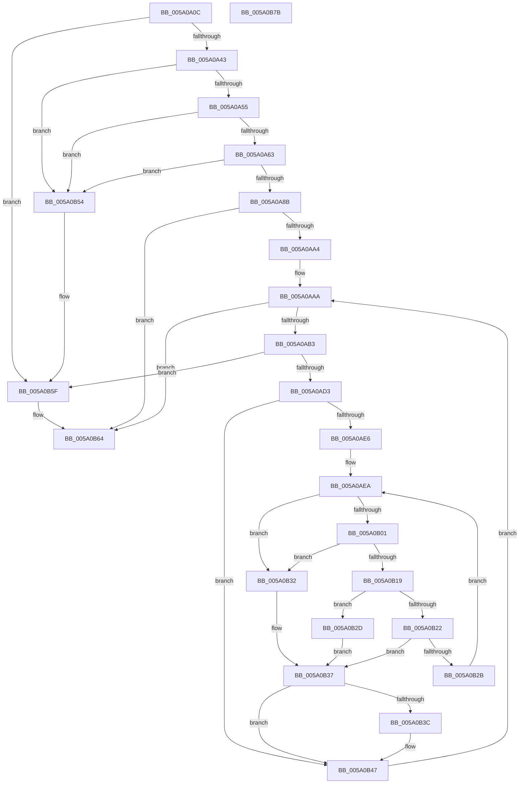

# IopAddBugcheckTriageIrp

- RVA: `0x005A0A0C`–`0x005A0B7C` (길이 `368` bytes)
- VA: `0x00000001405A0A0C`
- 실행 섹션: `.text`
- PDB 이름 있음: `예`; PDB Function 태그: `아니요`
- unwind 정보 RVA: `0x000AA2A0`
- 디코드: `103`개 명령, `368/368` bytes 표시
- 미해석 바이트: `0` (있으면 어셈블리에 `.byte`로 보존)

> 이 문서는 커널 이미지의 기계어와 PDB 기호를 분석해 생성했습니다. 4번과 5번은 함수 원형과 자료형을 바이너리 사용 방식에서 추정한 C 해석이며 원본 소스 복구 결과는 아닙니다.

## 1. Dependencies

- 직접 호출 지점: **7**; 고유 호출 대상: **3**
- 직접 호출자로 확인된 함수: **4**
- RIP 상대 이미지 참조: **0**

### Outgoing calls
- `0x005A0A36` → [IopIsAddressRangeValid](../4B/IopIsAddressRangeValid_function_004B6CBC.md) (function, `0x004B6CBC`)
- `0x005A0A7E` → [IopIsAddressRangeValid](../4B/IopIsAddressRangeValid_function_004B6CBC.md) (function, `0x004B6CBC`)
- `0x005A0A95` → [IoAddTriageDumpDataBlock](../42/IoAddTriageDumpDataBlock_function_00428374.md) (function, `0x00428374`)
- `0x005A0AF8` → [IopIsAddressRangeValid](../4B/IopIsAddressRangeValid_function_004B6CBC.md) (function, `0x004B6CBC`)
- `0x005A0B10` → [IopIsAddressRangeValid](../4B/IopIsAddressRangeValid_function_004B6CBC.md) (function, `0x004B6CBC`)
- `0x005A0B40` → [IopAddBugcheckTriageDeviceNode](IopAddBugcheckTriageDeviceNode_function_005A091C.md) (function, `0x005A091C`)
- `0x005A0B5A` → [IoAddTriageDumpDataBlock](../42/IoAddTriageDumpDataBlock_function_00428374.md) (function, `0x00428374`)

### Direct callers
- [IopAddBugcheckPowerTriageData](IopAddBugcheckPowerTriageData_function_005A06C8.md) at `0x005A06E9`
- [IopAddBugcheckTriageDeviceNode](IopAddBugcheckTriageDeviceNode_function_005A091C.md) at `0x005A098E`
- [IopAddBugcheckTriageDeviceNode](IopAddBugcheckTriageDeviceNode_function_005A091C.md) at `0x005A09C5`
- [IopAddBugcheckTriagePowerIrps](IopAddBugcheckTriagePowerIrps_function_005A0C38.md) at `0x005A0CB9`
- [IopAddBugcheckTriageThread](IopAddBugcheckTriageThread_function_005A0CF8.md) at `0x005A0DBF`

### Static image references
- 디코드된 RIP-relative 메모리 참조가 없습니다.

## 2. Other-region calls and transfers

- 다른 실행 섹션으로 향하는 call: **0**
- 별도 외부 분기/꼬리 이동을 확인하지 못했습니다.

## 3. Assembly (complete function range)

```asm
005A0A0C  48 89 5C 24 08                  mov qword ptr [rsp + 8], rbx
005A0A11  55                              push rbp
005A0A12  56                              push rsi
005A0A13  57                              push rdi
005A0A14  41 54                           push r12
005A0A16  41 55                           push r13
005A0A18  41 56                           push r14
005A0A1A  41 57                           push r15
005A0A1C  48 83 EC 20                     sub rsp, 0x20
005A0A20  83 64 24 70 00                  and dword ptr [rsp + 0x70], 0
005A0A25  44 8A F2                        mov r14b, dl
005A0A28  41 BC D0 00 00 00               mov r12d, 0xd0
005A0A2E  48 8B F9                        mov rdi, rcx
005A0A31  41 8B D4                        mov edx, r12d
005A0A34  33 DB                           xor ebx, ebx
005A0A36  E8 81 62 F1 FF                  call 0x1404b6cbc
005A0A3B  84 C0                           test al, al
005A0A3D  0F 84 1C 01 00 00               je 0x1405a0b5f
005A0A43  0F B7 47 02                     movzx eax, word ptr [rdi + 2]
005A0A47  B9 00 08 00 00                  mov ecx, 0x800
005A0A4C  66 3B C1                        cmp ax, cx
005A0A4F  0F 87 FF 00 00 00               ja 0x1405a0b54
005A0A55  0F BE 6F 42                     movsx ebp, byte ptr [rdi + 0x42]
005A0A59  40 80 FD 40                     cmp bpl, 0x40
005A0A5D  0F 8F F1 00 00 00               jg 0x1405a0b54
005A0A63  48 8D 70 07                     lea rsi, [rax + 7]
005A0A67  48 89 44 24 78                  mov qword ptr [rsp + 0x78], rax
005A0A6C  48 C1 EE 03                     shr rsi, 3
005A0A70  48 8B CF                        mov rcx, rdi
005A0A73  44 8B F8                        mov r15d, eax
005A0A76  48 8D 14 F5 00 00 00 00         lea rdx, [rsi*8]
005A0A7E  E8 39 62 F1 FF                  call 0x1404b6cbc
005A0A83  84 C0                           test al, al
005A0A85  0F 84 C9 00 00 00               je 0x1405a0b54
005A0A8B  8D 14 F5 00 00 00 00            lea edx, [rsi*8]
005A0A92  48 8B CF                        mov rcx, rdi
005A0A95  E8 DA 78 E8 FF                  call 0x140428374
005A0A9A  41 80 FE 01                     cmp r14b, 1
005A0A9E  0F 85 C0 00 00 00               jne 0x1405a0b64
005A0AA4  45 33 F6                        xor r14d, r14d
005A0AA7  44 8B ED                        mov r13d, ebp
005A0AAA  45 3B F5                        cmp r14d, r13d
005A0AAD  0F 8D B1 00 00 00               jge 0x1405a0b64
005A0AB3  49 0F BE C6                     movsx rax, r14b
005A0AB7  49 8D 0C 3F                     lea rcx, [r15 + rdi]
005A0ABB  48 8D 2C C0                     lea rbp, [rax + rax*8]
005A0ABF  48 8D 87 18 01 00 00            lea rax, [rdi + 0x118]
005A0AC6  48 8D 04 E8                     lea rax, [rax + rbp*8]
005A0ACA  48 3B C1                        cmp rax, rcx
005A0ACD  0F 87 8C 00 00 00               ja 0x1405a0b5f
005A0AD3  48 8B AC EF F8 00 00 00         mov rbp, qword ptr [rdi + rbp*8 + 0xf8]
005A0ADB  45 33 FF                        xor r15d, r15d
005A0ADE  40 32 F6                        xor sil, sil
005A0AE1  48 85 ED                        test rbp, rbp
005A0AE4  74 61                           je 0x1405a0b47
005A0AE6  8B 44 24 70                     mov eax, dword ptr [rsp + 0x70]
005A0AEA  FF C0                           inc eax
005A0AEC  BA 50 01 00 00                  mov edx, 0x150
005A0AF1  48 8B CD                        mov rcx, rbp
005A0AF4  89 44 24 70                     mov dword ptr [rsp + 0x70], eax
005A0AF8  E8 BF 61 F1 FF                  call 0x1404b6cbc
005A0AFD  84 C0                           test al, al
005A0AFF  74 31                           je 0x1405a0b32
005A0B01  4C 8B BD 38 01 00 00            mov r15, qword ptr [rbp + 0x138]
005A0B08  BA 70 00 00 00                  mov edx, 0x70
005A0B0D  49 8B CF                        mov rcx, r15
005A0B10  E8 A7 61 F1 FF                  call 0x1404b6cbc
005A0B15  84 C0                           test al, al
005A0B17  74 19                           je 0x1405a0b32
005A0B19  49 8B 6F 30                     mov rbp, qword ptr [r15 + 0x30]
005A0B1D  48 85 ED                        test rbp, rbp
005A0B20  74 0B                           je 0x1405a0b2d
005A0B22  8B 44 24 70                     mov eax, dword ptr [rsp + 0x70]
005A0B26  83 F8 0A                        cmp eax, 0xa
005A0B29  7D 0C                           jge 0x1405a0b37
005A0B2B  EB BD                           jmp 0x1405a0aea
005A0B2D  40 B6 01                        mov sil, 1
005A0B30  EB 05                           jmp 0x1405a0b37
005A0B32  BB 01 00 00 C0                  mov ebx, 0xc0000001
005A0B37  40 84 F6                        test sil, sil
005A0B3A  74 0B                           je 0x1405a0b47
005A0B3C  49 8B 4F 28                     mov rcx, qword ptr [r15 + 0x28]
005A0B40  E8 D7 FD FF FF                  call 0x1405a091c
005A0B45  8B D8                           mov ebx, eax
005A0B47  4C 8B 7C 24 78                  mov r15, qword ptr [rsp + 0x78]
005A0B4C  41 FF C6                        inc r14d
005A0B4F  E9 56 FF FF FF                  jmp 0x1405a0aaa
005A0B54  41 8B D4                        mov edx, r12d
005A0B57  48 8B CF                        mov rcx, rdi
005A0B5A  E8 15 78 E8 FF                  call 0x140428374
005A0B5F  BB 01 00 00 C0                  mov ebx, 0xc0000001
005A0B64  8B C3                           mov eax, ebx
005A0B66  48 8B 5C 24 60                  mov rbx, qword ptr [rsp + 0x60]
005A0B6B  48 83 C4 20                     add rsp, 0x20
005A0B6F  41 5F                           pop r15
005A0B71  41 5E                           pop r14
005A0B73  41 5D                           pop r13
005A0B75  41 5C                           pop r12
005A0B77  5F                              pop rdi
005A0B78  5E                              pop rsi
005A0B79  5D                              pop rbp
005A0B7A  C3                              ret
005A0B7B  CC                              int3
```

## 4. C-style interpretation (structured pseudocode)

```c
__int64 __fastcall IopAddBugcheckTriageIrp(__int64 a1, unsigned __int8 a2)
{
    __int64 result;
    __int64 v_r14;
    __int64 v_r15;
    __int64 v_rbx;
    __int64 v_rsi;
    __int64 v_rsp;
    unsigned int v_stack_p18;
    unsigned __int64 v_stack_p20;
    unsigned __int64 v_stack_p8;

    v_stack_p8 = v_rbx;
    v_rsp = (v_rsp) - (32);
    v_rbx = 0;
    result = IopIsAddressRangeValid(a1, 208, a3, a4);
    if ((unsigned __int8)(result) == 0) goto loc_005A0B5F;
    if (((unsigned __int16)(*(unsigned __int16 *)(a1 + 2))) > ((unsigned __int16)((unsigned int)(0x800ULL)))) goto loc_005A0B54;
    if (((unsigned __int8)((__int8)(*(unsigned __int8 *)(a1 + 66)))) > 64) goto loc_005A0B54;
    v_stack_p20 = *(unsigned __int16 *)(a1 + 2);
    v_rsi = (*(unsigned __int16 *)(a1 + 2) + 7) >> (3);
    result = IopIsAddressRangeValid(a1, v_rsi * 8, a3, a4);
    if ((unsigned __int8)(result) == 0) goto loc_005A0B54;
    result = IoAddTriageDumpDataBlock(a1, v_rsi * 8, a3, a4);
    if (a2 != 1) goto loc_005A0B64;
    v_r14 = 0;
loc_005A0AAA:
    if (0 >= ((unsigned int)((unsigned int)((unsigned int)((__int8)(*(unsigned __int8 *)(a1 + 66))))))) goto loc_005A0B64;
    if ((a1 + 280 + (__int8)(0) + (__int8)(0) * 8 * 8) > ((unsigned int)((unsigned int)(*(unsigned __int16 *)(a1 + 2))) + a1 * 1)) goto loc_005A0B5F;
    v_r15 = 0;
    v_rsi = 0;
    if (*(unsigned __int64 *)(a1 + (__int8)(0) + (__int8)(0) * 8 * 8 + 248) == 0) goto loc_005A0B47;
loc_005A0AEA:
    result = (unsigned int)(((unsigned int)(v_stack_p18)) + 1);
    v_stack_p18 = (unsigned int)(result);
    result = IopIsAddressRangeValid(*(unsigned __int64 *)(a1 + (__int8)(0) + (__int8)(0) * 8 * 8 + 248), 336, a3, a4);
    if ((unsigned __int8)(result) == 0) goto loc_005A0B32;
    result = IopIsAddressRangeValid(*(unsigned __int64 *)(*(unsigned __int64 *)(a1 + (__int8)(0) + (__int8)(0) * 8 * 8 + 248) + 312), 112, a3, a4);
    if ((unsigned __int8)(result) == 0) goto loc_005A0B32;
    if (*(unsigned __int64 *)(*(unsigned __int64 *)(*(unsigned __int64 *)(a1 + (__int8)(0) + (__int8)(0) * 8 * 8 + 248) + 312) + 48) == 0) goto loc_005A0B2D;
    if (((unsigned int)((unsigned int)(v_stack_p18))) >= 10) goto loc_005A0B37;
    goto loc_005A0AEA;
loc_005A0B2D:
    goto loc_005A0B37;
loc_005A0B32:
loc_005A0B37:
    result = (unsigned int)(v_stack_p18);
    v_rbx = (unsigned int)(0xC0000001ULL);
    if (1 != 0) {
        a1 = *(unsigned __int64 *)(*(unsigned __int64 *)(*(unsigned __int64 *)(a1 + (__int8)(0) + (__int8)(0) * 8 * 8 + 248) + 312) + 40);
        result = IopAddBugcheckTriageDeviceNode(a1, 112, a3, a4);
        v_rbx = (unsigned int)(result);
    }
    v_r14 = (unsigned int)((v_r14) + 1);
    goto loc_005A0AAA;
loc_005A0B54:
    result = IoAddTriageDumpDataBlock(a1, 208, a3, a4);
loc_005A0B5F:
loc_005A0B64:
    v_rsp = (v_rsp) + (32);
    return (unsigned int)((unsigned int)((unsigned int)(0xC0000001ULL)));
}
```

## 5. (Beta) C Style

```c
int64_t IopAddBugcheckTriageIrp(void *Arg1, uint8_t Arg2)
{
    uint8_t *arg1 = (uint8_t *)Arg1;

    int64_t result;
    int64_t local_r14;
    int64_t local_r15;
    int64_t local_rbx;
    int64_t local_rsi;
    int64_t local_rsp;
    uint32_t v_stack_p18;
    uint64_t v_stack_p20;
    uint64_t v_stack_p8;

    v_stack_p8 = local_rbx;
    local_rsp = (local_rsp) - (32);
    local_rbx = 0;
    result = IopIsAddressRangeValid(Arg1, 208, a3, a4);
    if ((uint8_t)(result) == 0) goto loc_005A0B5F;
    if (((uint16_t)(*(uint16_t *)(arg1 + 0x2))) > ((uint16_t)((uint32_t)(0x800ULL)))) goto loc_005A0B54;
    if (((uint8_t)((int8_t)(*(uint8_t *)(arg1 + 0x42)))) > 64) goto loc_005A0B54;
    v_stack_p20 = *(uint16_t *)(arg1 + 0x2);
    local_rsi = (*(uint16_t *)(arg1 + 0x2) + 7) >> (3);
    result = IopIsAddressRangeValid(Arg1, local_rsi * 8, a3, a4);
    if ((uint8_t)(result) == 0) goto loc_005A0B54;
    result = IoAddTriageDumpDataBlock(Arg1, local_rsi * 8, a3, a4);
    if (Arg2 != 1) goto loc_005A0B64;
    local_r14 = 0;
loc_005A0AAA:
    if (0 >= ((uint32_t)((uint32_t)((uint32_t)((int8_t)(*(uint8_t *)(arg1 + 0x42))))))) goto loc_005A0B64;
    if ((Arg1 + 280 + (int8_t)(0) + (int8_t)(0) * 8 * 8) > ((uint32_t)((uint32_t)(*(uint16_t *)(arg1 + 0x2))) + Arg1 * 1)) goto loc_005A0B5F;
    local_r15 = 0;
    local_rsi = 0;
    if (*(uint64_t *)(arg1 + (int8_t)(0) + (int8_t)(0) * 8 * 8 + 0xF8) == 0) goto loc_005A0B47;
loc_005A0AEA:
    result = (uint32_t)(((uint32_t)(v_stack_p18)) + 1);
    v_stack_p18 = (uint32_t)(result);
    result = IopIsAddressRangeValid(*(uint64_t *)(arg1 + (int8_t)(0) + (int8_t)(0) * 8 * 8 + 0xF8), 336, a3, a4);
    if ((uint8_t)(result) == 0) goto loc_005A0B32;
    result = IopIsAddressRangeValid(*(uint64_t *)(*(uint64_t *)(arg1 + (int8_t)(0) + (int8_t)(0) * 8 * 8 + 0xF8) + 0x138), 112, a3, a4);
    if ((uint8_t)(result) == 0) goto loc_005A0B32;
    if (*(uint64_t *)(*(uint64_t *)(*(uint64_t *)(arg1 + (int8_t)(0) + (int8_t)(0) * 8 * 8 + 0xF8) + 0x138) + 0x30) == 0) goto loc_005A0B2D;
    if (((uint32_t)((uint32_t)(v_stack_p18))) >= 10) goto loc_005A0B37;
    goto loc_005A0AEA;
loc_005A0B2D:
    goto loc_005A0B37;
loc_005A0B32:
loc_005A0B37:
    result = (uint32_t)(v_stack_p18);
    local_rbx = (uint32_t)(0xC0000001ULL);
    if (1 != 0) {
        Arg1 = *(uint64_t *)(*(uint64_t *)(*(uint64_t *)(arg1 + (int8_t)(0) + (int8_t)(0) * 8 * 8 + 0xF8) + 0x138) + 0x28);
        result = IopAddBugcheckTriageDeviceNode(Arg1, 112, a3, a4);
        local_rbx = (uint32_t)(result);
    }
    local_r14 = (uint32_t)((local_r14) + 1);
    goto loc_005A0AAA;
loc_005A0B54:
    result = IoAddTriageDumpDataBlock(Arg1, 208, a3, a4);
loc_005A0B5F:
loc_005A0B64:
    local_rsp = (local_rsp) + (32);
    return (uint32_t)((uint32_t)((uint32_t)(0xC0000001ULL)));
}
```

### 관측된 메모리 오프셋

구조체 형식이 확인되지 않은 접근은 인자 기준의 오프셋으로만 기록했습니다.

| 기준 인자 | 오프셋 표현 | 폭 (bit) | 접근 |
|---|---:|---:|---|
| `Arg1` | `+ 0x0 + rbp*8` | `64` | `R` |
| `Arg1` | `+ 0x2` | `16` | `R` |
| `Arg1` | `+ 0x42` | `8` | `R` |
| `Arg1` | `+ 0xF8 + rbp*8` | `64` | `R` |
| `Arg1` | `+ 0x118` | `64` | `R` |

## 6. Execution-region graph

[열기: 2D/3D 그래프와 함수 탐색 컨트롤 패널](../../../control-panel.html?section=text&rva=0x005A0A0C&view=graph)

- 2D 그래프는 위에서 아래로 흐르고, 3D 그래프는 빈 공간을 드래그해 회전합니다. Shift+드래그는 이동, 휠은 확대·축소, 함수 노드 선택은 대상 보고서 이동입니다.

### Static fallback


