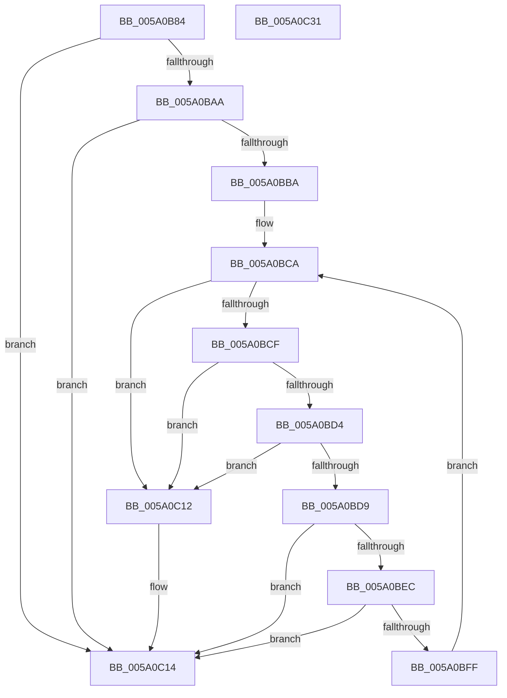

# IopAddBugcheckTriagePowerIrpWorkers

- RVA: `0x005A0B84`–`0x005A0C32` (길이 `174` bytes)
- VA: `0x00000001405A0B84`
- 실행 섹션: `.text`
- PDB 이름 있음: `예`; PDB Function 태그: `아니요`
- unwind 정보 RVA: `0x0005E6B4`
- 디코드: `55`개 명령, `174/174` bytes 표시
- 미해석 바이트: `0` (있으면 어셈블리에 `.byte`로 보존)

> 이 문서는 커널 이미지의 기계어와 PDB 기호를 분석해 생성했습니다. 4번과 5번은 함수 원형과 자료형을 바이너리 사용 방식에서 추정한 C 해석이며 원본 소스 복구 결과는 아닙니다.

## 1. Dependencies

- 직접 호출 지점: **5**; 고유 호출 대상: **3**
- 직접 호출자로 확인된 함수: **2**
- RIP 상대 이미지 참조: **0**

### Outgoing calls
- `0x005A0BB1` → [IopIsAddressRangeValid](../4B/IopIsAddressRangeValid_function_004B6CBC.md) (function, `0x004B6CBC`)
- `0x005A0BBF` → [IoAddTriageDumpDataBlock](../42/IoAddTriageDumpDataBlock_function_00428374.md) (function, `0x00428374`)
- `0x005A0BE3` → [IopIsAddressRangeValid](../4B/IopIsAddressRangeValid_function_004B6CBC.md) (function, `0x004B6CBC`)
- `0x005A0BF4` → [IoAddTriageDumpDataBlock](../42/IoAddTriageDumpDataBlock_function_00428374.md) (function, `0x00428374`)
- `0x005A0C03` → [IopAddBugcheckTriageThread](IopAddBugcheckTriageThread_function_005A0CF8.md) (function, `0x005A0CF8`)

### Direct callers
- [IopAddBugcheckDirectedTransitionTriageData](IopAddBugcheckDirectedTransitionTriageData_function_005A0518.md) at `0x005A05C5`
- [IopAddBugcheckPowerTriageData](IopAddBugcheckPowerTriageData_function_005A06C8.md) at `0x005A0727`

### Static image references
- 디코드된 RIP-relative 메모리 참조가 없습니다.

## 2. Other-region calls and transfers

- 다른 실행 섹션으로 향하는 call: **0**
- 별도 외부 분기/꼬리 이동을 확인하지 못했습니다.

## 3. Assembly (complete function range)

```asm
005A0B84  48 8B C4                        mov rax, rsp
005A0B87  48 89 58 08                     mov qword ptr [rax + 8], rbx
005A0B8B  48 89 68 10                     mov qword ptr [rax + 0x10], rbp
005A0B8F  48 89 70 18                     mov qword ptr [rax + 0x18], rsi
005A0B93  48 89 78 20                     mov qword ptr [rax + 0x20], rdi
005A0B97  41 56                           push r14
005A0B99  48 83 EC 20                     sub rsp, 0x20
005A0B9D  48 8B F9                        mov rdi, rcx
005A0BA0  BE 01 00 00 C0                  mov esi, 0xc0000001
005A0BA5  48 85 C9                        test rcx, rcx
005A0BA8  74 6A                           je 0x1405a0c14
005A0BAA  33 ED                           xor ebp, ebp
005A0BAC  8D 5D 10                        lea ebx, [rbp + 0x10]
005A0BAF  8B D3                           mov edx, ebx
005A0BB1  E8 06 61 F1 FF                  call 0x1404b6cbc
005A0BB6  84 C0                           test al, al
005A0BB8  74 5A                           je 0x1405a0c14
005A0BBA  8B D3                           mov edx, ebx
005A0BBC  48 8B CF                        mov rcx, rdi
005A0BBF  E8 B0 77 E8 FF                  call 0x140428374
005A0BC4  48 8B 1F                        mov rbx, qword ptr [rdi]
005A0BC7  4C 8B F7                        mov r14, rdi
005A0BCA  48 85 DB                        test rbx, rbx
005A0BCD  74 43                           je 0x1405a0c12
005A0BCF  48 3B DF                        cmp rbx, rdi
005A0BD2  74 3E                           je 0x1405a0c12
005A0BD4  83 FD 0A                        cmp ebp, 0xa
005A0BD7  7D 39                           jge 0x1405a0c12
005A0BD9  BA 18 00 00 00                  mov edx, 0x18
005A0BDE  48 8B CB                        mov rcx, rbx
005A0BE1  FF C5                           inc ebp
005A0BE3  E8 D4 60 F1 FF                  call 0x1404b6cbc
005A0BE8  84 C0                           test al, al
005A0BEA  74 28                           je 0x1405a0c14
005A0BEC  BA 18 00 00 00                  mov edx, 0x18
005A0BF1  48 8B CB                        mov rcx, rbx
005A0BF4  E8 7B 77 E8 FF                  call 0x140428374
005A0BF9  4C 39 73 08                     cmp qword ptr [rbx + 8], r14
005A0BFD  75 15                           jne 0x1405a0c14
005A0BFF  48 8B 4B 10                     mov rcx, qword ptr [rbx + 0x10]
005A0C03  E8 F0 00 00 00                  call 0x1405a0cf8
005A0C08  4C 8B F3                        mov r14, rbx
005A0C0B  8B F0                           mov esi, eax
005A0C0D  48 8B 1B                        mov rbx, qword ptr [rbx]
005A0C10  EB B8                           jmp 0x1405a0bca
005A0C12  33 F6                           xor esi, esi
005A0C14  48 8B 5C 24 30                  mov rbx, qword ptr [rsp + 0x30]
005A0C19  8B C6                           mov eax, esi
005A0C1B  48 8B 74 24 40                  mov rsi, qword ptr [rsp + 0x40]
005A0C20  48 8B 6C 24 38                  mov rbp, qword ptr [rsp + 0x38]
005A0C25  48 8B 7C 24 48                  mov rdi, qword ptr [rsp + 0x48]
005A0C2A  48 83 C4 20                     add rsp, 0x20
005A0C2E  41 5E                           pop r14
005A0C30  C3                              ret
005A0C31  CC                              int3
```

## 4. C-style interpretation (structured pseudocode)

```c
__int64 __fastcall IopAddBugcheckTriagePowerIrpWorkers(__int64 a1)
{
    __int64 result;
    __int64 v_rbp;
    __int64 v_rsi;
    __int64 v_rsp;
    unsigned __int64 v_stack_p10;
    unsigned __int64 v_stack_p18;
    unsigned __int64 v_stack_p20;
    unsigned __int64 v_stack_p8;

    *(unsigned __int64 *)(v_rsp + 8) = v_rbx;
    *(unsigned __int64 *)(v_rsp + 16) = v_rbp;
    *(unsigned __int64 *)(v_rsp + 24) = v_rsi;
    *(unsigned __int64 *)(v_rsp + 32) = v_rdi;
    v_rsp = (v_rsp) - (32);
    if (a1 == 0) goto loc_005A0C14;
    v_rbp = 0;
    result = IopIsAddressRangeValid(a1, (unsigned int)((unsigned int)(v_rbp + 16)), a3, a4);
    if ((unsigned __int8)(result) == 0) goto loc_005A0C14;
    result = IoAddTriageDumpDataBlock(a1, (unsigned int)((unsigned int)(v_rbp + 16)), a3, a4);
loc_005A0BCA:
    if (*(unsigned __int64 *)(a1) == 0) goto loc_005A0C12;
    if ((*(unsigned __int64 *)(a1)) == a1) goto loc_005A0C12;
    if (0 >= 10) goto loc_005A0C12;
    v_rbp = (unsigned int)((v_rbp) + 1);
    result = IopIsAddressRangeValid(*(unsigned __int64 *)(a1), 24, a3, a4);
    if ((unsigned __int8)(result) == 0) goto loc_005A0C14;
    result = IoAddTriageDumpDataBlock(*(unsigned __int64 *)(a1), 24, a3, a4);
    if ((*(unsigned __int64 *)(*(unsigned __int64 *)(a1) + 8)) != a1) goto loc_005A0C14;
    result = IopAddBugcheckTriageThread(*(unsigned __int64 *)(*(unsigned __int64 *)(a1) + 16), 24, a3, a4);
    goto loc_005A0BCA;
loc_005A0C12:
    v_rsi = 0;
loc_005A0C14:
    v_rsp = (v_rsp) + (32);
    return 0;
}
```

## 5. (Beta) C Style

```c
int64_t IopAddBugcheckTriagePowerIrpWorkers(void *Arg1)
{
    uint8_t *arg1 = (uint8_t *)Arg1;

    int64_t result;
    int64_t local_rbp;
    int64_t local_rsi;
    int64_t local_rsp;
    uint64_t v_stack_p10;
    uint64_t v_stack_p18;
    uint64_t v_stack_p20;
    uint64_t v_stack_p8;

    *(uint64_t *)(local_rsp + 0x8) = local_rbx;
    *(uint64_t *)(local_rsp + 0x10) = local_rbp;
    *(uint64_t *)(local_rsp + 0x18) = local_rsi;
    *(uint64_t *)(local_rsp + 0x20) = local_rdi;
    local_rsp = (local_rsp) - (32);
    if (Arg1 == NULL) goto loc_005A0C14;
    local_rbp = 0;
    result = IopIsAddressRangeValid(Arg1, (uint32_t)((uint32_t)(local_rbp + 16)), a3, a4);
    if ((uint8_t)(result) == 0) goto loc_005A0C14;
    result = IoAddTriageDumpDataBlock(Arg1, (uint32_t)((uint32_t)(local_rbp + 16)), a3, a4);
loc_005A0BCA:
    if (*(uint64_t *)(arg1) == 0) goto loc_005A0C12;
    if ((*(uint64_t *)(arg1)) == Arg1) goto loc_005A0C12;
    if (0 >= 10) goto loc_005A0C12;
    local_rbp = (uint32_t)((local_rbp) + 1);
    result = IopIsAddressRangeValid(*(uint64_t *)(arg1), 24, a3, a4);
    if ((uint8_t)(result) == 0) goto loc_005A0C14;
    result = IoAddTriageDumpDataBlock(*(uint64_t *)(arg1), 24, a3, a4);
    if ((*(uint64_t *)(*(uint64_t *)(arg1) + 0x8)) != Arg1) goto loc_005A0C14;
    result = IopAddBugcheckTriageThread(*(uint64_t *)(*(uint64_t *)(arg1) + 0x10), 24, a3, a4);
    goto loc_005A0BCA;
loc_005A0C12:
    local_rsi = 0;
loc_005A0C14:
    local_rsp = (local_rsp) + (32);
    return 0;
}
```

### 관측된 메모리 오프셋

구조체 형식이 확인되지 않은 접근은 인자 기준의 오프셋으로만 기록했습니다.

| 기준 인자 | 오프셋 표현 | 폭 (bit) | 접근 |
|---|---:|---:|---|
| `Arg1` | `+ 0x0` | `64` | `R` |

## 6. Execution-region graph

[열기: 2D/3D 그래프와 함수 탐색 컨트롤 패널](../../../control-panel.html?section=text&rva=0x005A0B84&view=graph)

- 2D 그래프는 위에서 아래로 흐르고, 3D 그래프는 빈 공간을 드래그해 회전합니다. Shift+드래그는 이동, 휠은 확대·축소, 함수 노드 선택은 대상 보고서 이동입니다.

### Static fallback


