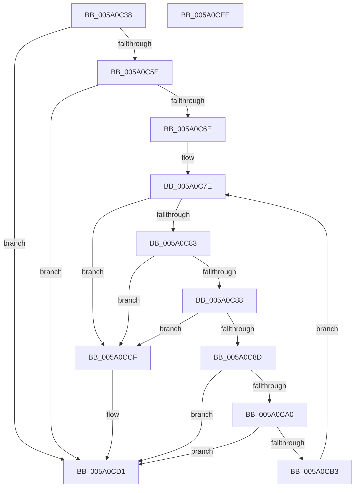

# IopAddBugcheckTriagePowerIrps

- RVA: `0x005A0C38`–`0x005A0CEF` (길이 `183` bytes)
- VA: `0x00000001405A0C38`
- 실행 섹션: `.text`
- PDB 이름 있음: `예`; PDB Function 태그: `아니요`
- unwind 정보 RVA: `0x0005E6B4`
- 디코드: `57`개 명령, `183/183` bytes 표시
- 미해석 바이트: `0` (있으면 어셈블리에 `.byte`로 보존)

> 이 문서는 커널 이미지의 기계어와 PDB 기호를 분석해 생성했습니다. 4번과 5번은 함수 원형과 자료형을 바이너리 사용 방식에서 추정한 C 해석이며 원본 소스 복구 결과는 아닙니다.

## 1. Dependencies

- 직접 호출 지점: **6**; 고유 호출 대상: **4**
- 직접 호출자로 확인된 함수: **2**
- RIP 상대 이미지 참조: **0**

### Outgoing calls
- `0x005A0C65` → [IopIsAddressRangeValid](../4B/IopIsAddressRangeValid_function_004B6CBC.md) (function, `0x004B6CBC`)
- `0x005A0C73` → [IoAddTriageDumpDataBlock](../42/IoAddTriageDumpDataBlock_function_00428374.md) (function, `0x00428374`)
- `0x005A0C97` → [IopIsAddressRangeValid](../4B/IopIsAddressRangeValid_function_004B6CBC.md) (function, `0x004B6CBC`)
- `0x005A0CA8` → [IoAddTriageDumpDataBlock](../42/IoAddTriageDumpDataBlock_function_00428374.md) (function, `0x00428374`)
- `0x005A0CB9` → [IopAddBugcheckTriageIrp](IopAddBugcheckTriageIrp_function_005A0A0C.md) (function, `0x005A0A0C`)
- `0x005A0CC2` → [IopAddBugcheckTriageDevice](IopAddBugcheckTriageDevice_function_005A0814.md) (function, `0x005A0814`)

### Direct callers
- [IopAddBugcheckDirectedTransitionTriageData](IopAddBugcheckDirectedTransitionTriageData_function_005A0518.md) at `0x005A05BC`
- [IopAddBugcheckPowerTriageData](IopAddBugcheckPowerTriageData_function_005A06C8.md) at `0x005A071E`

### Static image references
- 디코드된 RIP-relative 메모리 참조가 없습니다.

## 2. Other-region calls and transfers

- 다른 실행 섹션으로 향하는 call: **0**
- 별도 외부 분기/꼬리 이동을 확인하지 못했습니다.

## 3. Assembly (complete function range)

```asm
005A0C38  48 8B C4                        mov rax, rsp
005A0C3B  48 89 58 08                     mov qword ptr [rax + 8], rbx
005A0C3F  48 89 68 10                     mov qword ptr [rax + 0x10], rbp
005A0C43  48 89 70 18                     mov qword ptr [rax + 0x18], rsi
005A0C47  48 89 78 20                     mov qword ptr [rax + 0x20], rdi
005A0C4B  41 56                           push r14
005A0C4D  48 83 EC 20                     sub rsp, 0x20
005A0C51  48 8B F9                        mov rdi, rcx
005A0C54  BE 01 00 00 C0                  mov esi, 0xc0000001
005A0C59  48 85 C9                        test rcx, rcx
005A0C5C  74 73                           je 0x1405a0cd1
005A0C5E  33 ED                           xor ebp, ebp
005A0C60  8D 5D 10                        lea ebx, [rbp + 0x10]
005A0C63  8B D3                           mov edx, ebx
005A0C65  E8 52 60 F1 FF                  call 0x1404b6cbc
005A0C6A  84 C0                           test al, al
005A0C6C  74 63                           je 0x1405a0cd1
005A0C6E  8B D3                           mov edx, ebx
005A0C70  48 8B CF                        mov rcx, rdi
005A0C73  E8 FC 76 E8 FF                  call 0x140428374
005A0C78  48 8B 1F                        mov rbx, qword ptr [rdi]
005A0C7B  4C 8B F7                        mov r14, rdi
005A0C7E  48 85 DB                        test rbx, rbx
005A0C81  74 4C                           je 0x1405a0ccf
005A0C83  48 3B DF                        cmp rbx, rdi
005A0C86  74 47                           je 0x1405a0ccf
005A0C88  83 FD 0A                        cmp ebp, 0xa
005A0C8B  7D 42                           jge 0x1405a0ccf
005A0C8D  BA 20 00 00 00                  mov edx, 0x20
005A0C92  48 8B CB                        mov rcx, rbx
005A0C95  FF C5                           inc ebp
005A0C97  E8 20 60 F1 FF                  call 0x1404b6cbc
005A0C9C  84 C0                           test al, al
005A0C9E  74 31                           je 0x1405a0cd1
005A0CA0  BA 20 00 00 00                  mov edx, 0x20
005A0CA5  48 8B CB                        mov rcx, rbx
005A0CA8  E8 C7 76 E8 FF                  call 0x140428374
005A0CAD  4C 39 73 08                     cmp qword ptr [rbx + 8], r14
005A0CB1  75 1E                           jne 0x1405a0cd1
005A0CB3  48 8B 4B 10                     mov rcx, qword ptr [rbx + 0x10]
005A0CB7  B2 01                           mov dl, 1
005A0CB9  E8 4E FD FF FF                  call 0x1405a0a0c
005A0CBE  48 8B 4B 18                     mov rcx, qword ptr [rbx + 0x18]
005A0CC2  E8 4D FB FF FF                  call 0x1405a0814
005A0CC7  4C 8B F3                        mov r14, rbx
005A0CCA  48 8B 1B                        mov rbx, qword ptr [rbx]
005A0CCD  EB AF                           jmp 0x1405a0c7e
005A0CCF  33 F6                           xor esi, esi
005A0CD1  48 8B 5C 24 30                  mov rbx, qword ptr [rsp + 0x30]
005A0CD6  8B C6                           mov eax, esi
005A0CD8  48 8B 74 24 40                  mov rsi, qword ptr [rsp + 0x40]
005A0CDD  48 8B 6C 24 38                  mov rbp, qword ptr [rsp + 0x38]
005A0CE2  48 8B 7C 24 48                  mov rdi, qword ptr [rsp + 0x48]
005A0CE7  48 83 C4 20                     add rsp, 0x20
005A0CEB  41 5E                           pop r14
005A0CED  C3                              ret
005A0CEE  CC                              int3
```

## 4. C-style interpretation (structured pseudocode)

```c
__int64 __fastcall IopAddBugcheckTriagePowerIrps(__int64 a1)
{
    __int64 result;
    __int64 v_rbp;
    __int64 v_rsi;
    __int64 v_rsp;
    unsigned __int64 v_stack_p10;
    unsigned __int64 v_stack_p18;
    unsigned __int64 v_stack_p20;
    unsigned __int64 v_stack_p8;

    *(unsigned __int64 *)(v_rsp + 8) = v_rbx;
    *(unsigned __int64 *)(v_rsp + 16) = v_rbp;
    *(unsigned __int64 *)(v_rsp + 24) = v_rsi;
    *(unsigned __int64 *)(v_rsp + 32) = v_rdi;
    v_rsp = (v_rsp) - (32);
    if (a1 == 0) goto loc_005A0CD1;
    v_rbp = 0;
    result = IopIsAddressRangeValid(a1, (unsigned int)((unsigned int)(v_rbp + 16)), a3, a4);
    if ((unsigned __int8)(result) == 0) goto loc_005A0CD1;
    result = IoAddTriageDumpDataBlock(a1, (unsigned int)((unsigned int)(v_rbp + 16)), a3, a4);
loc_005A0C7E:
    if (*(unsigned __int64 *)(a1) == 0) goto loc_005A0CCF;
    if ((*(unsigned __int64 *)(a1)) == a1) goto loc_005A0CCF;
    if (0 >= 10) goto loc_005A0CCF;
    v_rbp = (unsigned int)((v_rbp) + 1);
    result = IopIsAddressRangeValid(*(unsigned __int64 *)(a1), 32, a3, a4);
    if ((unsigned __int8)(result) == 0) goto loc_005A0CD1;
    result = IoAddTriageDumpDataBlock(*(unsigned __int64 *)(a1), 32, a3, a4);
    if ((*(unsigned __int64 *)(*(unsigned __int64 *)(a1) + 8)) != a1) goto loc_005A0CD1;
    result = IopAddBugcheckTriageIrp(*(unsigned __int64 *)(*(unsigned __int64 *)(a1) + 16), 1, a3, a4);
    result = IopAddBugcheckTriageDevice(*(unsigned __int64 *)(*(unsigned __int64 *)(a1) + 24), 1, a3, a4);
    goto loc_005A0C7E;
loc_005A0CCF:
    v_rsi = 0;
loc_005A0CD1:
    v_rsp = (v_rsp) + (32);
    return 0;
}
```

## 5. (Beta) C Style

```c
int64_t IopAddBugcheckTriagePowerIrps(void *Arg1)
{
    uint8_t *arg1 = (uint8_t *)Arg1;

    int64_t result;
    int64_t local_rbp;
    int64_t local_rsi;
    int64_t local_rsp;
    uint64_t v_stack_p10;
    uint64_t v_stack_p18;
    uint64_t v_stack_p20;
    uint64_t v_stack_p8;

    *(uint64_t *)(local_rsp + 0x8) = local_rbx;
    *(uint64_t *)(local_rsp + 0x10) = local_rbp;
    *(uint64_t *)(local_rsp + 0x18) = local_rsi;
    *(uint64_t *)(local_rsp + 0x20) = local_rdi;
    local_rsp = (local_rsp) - (32);
    if (Arg1 == NULL) goto loc_005A0CD1;
    local_rbp = 0;
    result = IopIsAddressRangeValid(Arg1, (uint32_t)((uint32_t)(local_rbp + 16)), a3, a4);
    if ((uint8_t)(result) == 0) goto loc_005A0CD1;
    result = IoAddTriageDumpDataBlock(Arg1, (uint32_t)((uint32_t)(local_rbp + 16)), a3, a4);
loc_005A0C7E:
    if (*(uint64_t *)(arg1) == 0) goto loc_005A0CCF;
    if ((*(uint64_t *)(arg1)) == Arg1) goto loc_005A0CCF;
    if (0 >= 10) goto loc_005A0CCF;
    local_rbp = (uint32_t)((local_rbp) + 1);
    result = IopIsAddressRangeValid(*(uint64_t *)(arg1), 32, a3, a4);
    if ((uint8_t)(result) == 0) goto loc_005A0CD1;
    result = IoAddTriageDumpDataBlock(*(uint64_t *)(arg1), 32, a3, a4);
    if ((*(uint64_t *)(*(uint64_t *)(arg1) + 0x8)) != Arg1) goto loc_005A0CD1;
    result = IopAddBugcheckTriageIrp(*(uint64_t *)(*(uint64_t *)(arg1) + 0x10), 1, a3, a4);
    result = IopAddBugcheckTriageDevice(*(uint64_t *)(*(uint64_t *)(arg1) + 0x18), 1, a3, a4);
    goto loc_005A0C7E;
loc_005A0CCF:
    local_rsi = 0;
loc_005A0CD1:
    local_rsp = (local_rsp) + (32);
    return 0;
}
```

### 관측된 메모리 오프셋

구조체 형식이 확인되지 않은 접근은 인자 기준의 오프셋으로만 기록했습니다.

| 기준 인자 | 오프셋 표현 | 폭 (bit) | 접근 |
|---|---:|---:|---|
| `Arg1` | `+ 0x0` | `64` | `R` |

## 6. Execution-region graph

[열기: 2D/3D 그래프와 함수 탐색 컨트롤 패널](../../../control-panel.html?section=text&rva=0x005A0C38&view=graph)

- 2D 그래프는 위에서 아래로 흐르고, 3D 그래프는 빈 공간을 드래그해 회전합니다. Shift+드래그는 이동, 휠은 확대·축소, 함수 노드 선택은 대상 보고서 이동입니다.

### Static fallback


