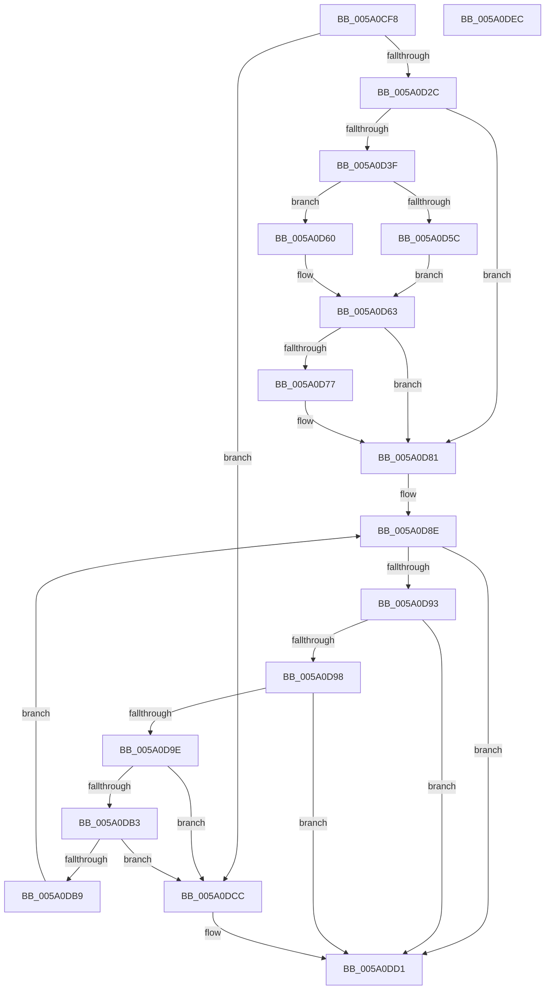

# IopAddBugcheckTriageThread

- RVA: `0x005A0CF8`–`0x005A0DED` (길이 `245` bytes)
- VA: `0x00000001405A0CF8`
- 실행 섹션: `.text`
- PDB 이름 있음: `예`; PDB Function 태그: `아니요`
- unwind 정보 RVA: `0x00060300`
- 디코드: `74`개 명령, `245/245` bytes 표시
- 미해석 바이트: `0` (있으면 어셈블리에 `.byte`로 보존)

> 이 문서는 커널 이미지의 기계어와 PDB 기호를 분석해 생성했습니다. 4번과 5번은 함수 원형과 자료형을 바이너리 사용 방식에서 추정한 C 해석이며 원본 소스 복구 결과는 아닙니다.

## 1. Dependencies

- 직접 호출 지점: **6**; 고유 호출 대상: **4**
- 직접 호출자로 확인된 함수: **7**
- RIP 상대 이미지 참조: **0**

### Outgoing calls
- `0x005A0D1F` → [IopIsAddressRangeValid](../4B/IopIsAddressRangeValid_function_004B6CBC.md) (function, `0x004B6CBC`)
- `0x005A0D31` → [IoAddTriageDumpDataBlock](../42/IoAddTriageDumpDataBlock_function_00428374.md) (function, `0x00428374`)
- `0x005A0D6E` → [IopGetMaxValidMemorySize](../59/IopGetMaxValidMemorySize_function_0059559C.md) (function, `0x0059559C`)
- `0x005A0D7C` → [IoAddTriageDumpDataBlock](../42/IoAddTriageDumpDataBlock_function_00428374.md) (function, `0x00428374`)
- `0x005A0DAA` → [IopIsAddressRangeValid](../4B/IopIsAddressRangeValid_function_004B6CBC.md) (function, `0x004B6CBC`)
- `0x005A0DBF` → [IopAddBugcheckTriageIrp](IopAddBugcheckTriageIrp_function_005A0A0C.md) (function, `0x005A0A0C`)

### Direct callers
- [IoAddBugcheckTriageThread](../59/IoAddBugcheckTriageThread_function_00591A20.md) at `0x00591A24`
- [IopAddBugcheckTriageDataFromParameters](../59/IopAddBugcheckTriageDataFromParameters_function_00593E54.md) at `0x00593F2C`
- [IopAddBugcheckTriageDataFromParameters](../59/IopAddBugcheckTriageDataFromParameters_function_00593E54.md) at `0x00593F85`
- [IopAddBugcheckTriageDataFromParameters](../59/IopAddBugcheckTriageDataFromParameters_function_00593E54.md) at `0x00594044`
- [IopAddBugcheckTriageDataFromParameters](../59/IopAddBugcheckTriageDataFromParameters_function_00593E54.md) at `0x00594116`
- [IopAddBugcheckTriageDataFromParameters](../59/IopAddBugcheckTriageDataFromParameters_function_00593E54.md) at `0x00594141`
- [IopAddBugcheckDirectedTransitionTriageData](IopAddBugcheckDirectedTransitionTriageData_function_005A0518.md) at `0x005A05E5`
- [IopAddBugcheckPnpWatchdogTriageData](IopAddBugcheckPnpWatchdogTriageData_function_005A0608.md) at `0x005A0627`
- [IopAddBugcheckPnpWatchdogTriageData](IopAddBugcheckPnpWatchdogTriageData_function_005A0608.md) at `0x005A0671`
- [IopAddBugcheckPnpWatchdogTriageData](IopAddBugcheckPnpWatchdogTriageData_function_005A0608.md) at `0x005A067F`
- [IopAddBugcheckPnpWatchdogTriageData](IopAddBugcheckPnpWatchdogTriageData_function_005A0608.md) at `0x005A068D`
- [IopAddBugcheckTriagePowerIrpWorkers](IopAddBugcheckTriagePowerIrpWorkers_function_005A0B84.md) at `0x005A0C03`
- [IopAddBugcheckTriageWorkQueue](IopAddBugcheckTriageWorkQueue_function_005A0E88.md) at `0x005A0F06`
- [KiCollectTriageDumpDataBlocks](../5B/KiCollectTriageDumpDataBlocks_function_005B43F8.md) at `0x005B458A`

### Static image references
- 디코드된 RIP-relative 메모리 참조가 없습니다.

## 2. Other-region calls and transfers

- 다른 실행 섹션으로 향하는 call: **0**
- 별도 외부 분기/꼬리 이동을 확인하지 못했습니다.

## 3. Assembly (complete function range)

```asm
005A0CF8  48 89 5C 24 08                  mov qword ptr [rsp + 8], rbx
005A0CFD  48 89 6C 24 10                  mov qword ptr [rsp + 0x10], rbp
005A0D02  48 89 74 24 18                  mov qword ptr [rsp + 0x18], rsi
005A0D07  57                              push rdi
005A0D08  41 56                           push r14
005A0D0A  41 57                           push r15
005A0D0C  48 83 EC 20                     sub rsp, 0x20
005A0D10  BE 98 07 00 00                  mov esi, 0x798
005A0D15  33 DB                           xor ebx, ebx
005A0D17  8B D6                           mov edx, esi
005A0D19  48 8B F9                        mov rdi, rcx
005A0D1C  44 8B FB                        mov r15d, ebx
005A0D1F  E8 98 5F F1 FF                  call 0x1404b6cbc
005A0D24  84 C0                           test al, al
005A0D26  0F 84 A0 00 00 00               je 0x1405a0dcc
005A0D2C  8B D6                           mov edx, esi
005A0D2E  48 8B CF                        mov rcx, rdi
005A0D31  E8 3E 76 E8 FF                  call 0x140428374
005A0D36  F7 47 78 00 00 02 00            test dword ptr [rdi + 0x78], 0x20000
005A0D3D  74 42                           je 0x1405a0d81
005A0D3F  48 8B 57 38                     mov rdx, qword ptr [rdi + 0x38]
005A0D43  41 B8 FF 3F 00 00               mov r8d, 0x3fff
005A0D49  48 8B 47 30                     mov rax, qword ptr [rdi + 0x30]
005A0D4D  48 8B 4F 58                     mov rcx, qword ptr [rdi + 0x58]
005A0D51  48 8B C2                        mov rax, rdx
005A0D54  48 2B C1                        sub rax, rcx
005A0D57  49 3B C0                        cmp rax, r8
005A0D5A  73 04                           jae 0x1405a0d60
005A0D5C  2B D1                           sub edx, ecx
005A0D5E  EB 03                           jmp 0x1405a0d63
005A0D60  41 8B D0                        mov edx, r8d
005A0D63  48 8D 71 07                     lea rsi, [rcx + 7]
005A0D67  48 83 E6 F8                     and rsi, 0xfffffffffffffff8
005A0D6B  48 8B CE                        mov rcx, rsi
005A0D6E  E8 29 48 FF FF                  call 0x14059559c
005A0D73  85 C0                           test eax, eax
005A0D75  74 0A                           je 0x1405a0d81
005A0D77  8B D0                           mov edx, eax
005A0D79  48 8B CE                        mov rcx, rsi
005A0D7C  E8 F3 75 E8 FF                  call 0x140428374
005A0D81  48 8D B7 40 05 00 00            lea rsi, [rdi + 0x540]
005A0D88  48 8B 3E                        mov rdi, qword ptr [rsi]
005A0D8B  4C 8B F6                        mov r14, rsi
005A0D8E  48 85 FF                        test rdi, rdi
005A0D91  74 3E                           je 0x1405a0dd1
005A0D93  48 3B FE                        cmp rdi, rsi
005A0D96  74 39                           je 0x1405a0dd1
005A0D98  41 83 FF 0A                     cmp r15d, 0xa
005A0D9C  7D 33                           jge 0x1405a0dd1
005A0D9E  BA D0 00 00 00                  mov edx, 0xd0
005A0DA3  48 8D 4F E0                     lea rcx, [rdi - 0x20]
005A0DA7  41 FF C7                        inc r15d
005A0DAA  E8 0D 5F F1 FF                  call 0x1404b6cbc
005A0DAF  84 C0                           test al, al
005A0DB1  74 19                           je 0x1405a0dcc
005A0DB3  4C 39 77 08                     cmp qword ptr [rdi + 8], r14
005A0DB7  75 13                           jne 0x1405a0dcc
005A0DB9  B2 01                           mov dl, 1
005A0DBB  48 8D 4F E0                     lea rcx, [rdi - 0x20]
005A0DBF  E8 48 FC FF FF                  call 0x1405a0a0c
005A0DC4  4C 8B F7                        mov r14, rdi
005A0DC7  48 8B 3F                        mov rdi, qword ptr [rdi]
005A0DCA  EB C2                           jmp 0x1405a0d8e
005A0DCC  BB 01 00 00 C0                  mov ebx, 0xc0000001
005A0DD1  48 8B 6C 24 48                  mov rbp, qword ptr [rsp + 0x48]
005A0DD6  8B C3                           mov eax, ebx
005A0DD8  48 8B 5C 24 40                  mov rbx, qword ptr [rsp + 0x40]
005A0DDD  48 8B 74 24 50                  mov rsi, qword ptr [rsp + 0x50]
005A0DE2  48 83 C4 20                     add rsp, 0x20
005A0DE6  41 5F                           pop r15
005A0DE8  41 5E                           pop r14
005A0DEA  5F                              pop rdi
005A0DEB  C3                              ret
005A0DEC  CC                              int3
```

## 4. C-style interpretation (structured pseudocode)

```c
__int64 __fastcall IopAddBugcheckTriageThread(__int64 a1)
{
    __int64 result;
    __int64 v_r15;
    __int64 v_rbx;
    __int64 v_rsi;
    __int64 v_rsp;
    unsigned __int64 v_stack_p10;
    unsigned __int64 v_stack_p18;
    unsigned __int64 v_stack_p8;

    v_stack_p8 = v_rbx;
    v_stack_p10 = v_rbp;
    v_stack_p18 = v_rsi;
    v_rsp = (v_rsp) - (32);
    v_rbx = 0;
    result = IopIsAddressRangeValid(a1, (unsigned int)((unsigned int)((unsigned int)(0x798ULL))), a3, a4);
    if ((unsigned __int8)(result) == 0) goto loc_005A0DCC;
    result = IoAddTriageDumpDataBlock(a1, (unsigned int)((unsigned int)((unsigned int)(0x798ULL))), a3, a4);
    if (((*(unsigned int *)(a1 + 120)) & (0x20000ULL)) == 0) goto loc_005A0D81;
    result = (*(unsigned __int64 *)(a1 + 56)) - (*(unsigned __int64 *)(a1 + 88));
    if (result >= ((unsigned int)(0x3FFFULL))) goto loc_005A0D60;
    a2 = (unsigned int)((*(unsigned __int64 *)(a1 + 56)) - ((unsigned int)(*(unsigned __int64 *)(a1 + 88))));
    goto loc_005A0D63;
loc_005A0D60:
loc_005A0D63:
    v_rsi = (*(unsigned __int64 *)(a1 + 88) + 7) & (-8);
    result = IopGetMaxValidMemorySize(v_rsi, (unsigned int)((unsigned int)((unsigned int)(0x3FFFULL))), (unsigned int)(0x3FFFULL), a4);
    if ((unsigned int)(result) != 0) {
        a2 = (unsigned int)(result);
        a1 = v_rsi;
        result = IoAddTriageDumpDataBlock(a1, a2, (unsigned int)(0x3FFFULL), a4);
    }
loc_005A0D8E:
    if (*(unsigned __int64 *)(a1 + 1344) == 0) goto loc_005A0DD1;
    if ((*(unsigned __int64 *)(a1 + 1344)) == (a1 + 1344)) goto loc_005A0DD1;
    if (0 >= 10) goto loc_005A0DD1;
    v_r15 = (unsigned int)((0) + 1);
    result = IopIsAddressRangeValid(*(unsigned __int64 *)(a1 + 1344) - 32, 208, (unsigned int)(0x3FFFULL), a4);
    if ((unsigned __int8)(result) == 0) goto loc_005A0DCC;
    if ((*(unsigned __int64 *)(*(unsigned __int64 *)(a1 + 1344) + 8)) != (a1 + 1344)) goto loc_005A0DCC;
    result = IopAddBugcheckTriageIrp(*(unsigned __int64 *)(a1 + 1344) - 32, 1, (unsigned int)(0x3FFFULL), a4);
    goto loc_005A0D8E;
loc_005A0DCC:
loc_005A0DD1:
    v_rsp = (v_rsp) + (32);
    return (unsigned int)((unsigned int)((unsigned int)(0xC0000001ULL)));
}
```

## 5. (Beta) C Style

```c
int64_t IopAddBugcheckTriageThread(void *Arg1)
{
    uint8_t *arg1 = (uint8_t *)Arg1;

    int64_t result;
    int64_t local_r15;
    int64_t local_rbx;
    int64_t local_rsi;
    int64_t local_rsp;
    uint64_t v_stack_p10;
    uint64_t v_stack_p18;
    uint64_t v_stack_p8;

    v_stack_p8 = local_rbx;
    v_stack_p10 = local_rbp;
    v_stack_p18 = local_rsi;
    local_rsp = (local_rsp) - (32);
    local_rbx = 0;
    result = IopIsAddressRangeValid(Arg1, (uint32_t)((uint32_t)((uint32_t)(0x798ULL))), a3, a4);
    if ((uint8_t)(result) == 0) goto loc_005A0DCC;
    result = IoAddTriageDumpDataBlock(Arg1, (uint32_t)((uint32_t)((uint32_t)(0x798ULL))), a3, a4);
    if (((*(uint32_t *)(arg1 + 0x78)) & (0x20000ULL)) == 0) goto loc_005A0D81;
    result = (*(uint64_t *)(arg1 + 0x38)) - (*(uint64_t *)(arg1 + 0x58));
    if (result >= ((uint32_t)(0x3FFFULL))) goto loc_005A0D60;
    a2 = (uint32_t)((*(uint64_t *)(arg1 + 0x38)) - ((uint32_t)(*(uint64_t *)(arg1 + 0x58))));
    goto loc_005A0D63;
loc_005A0D60:
loc_005A0D63:
    local_rsi = (*(uint64_t *)(arg1 + 0x58) + 7) & (-8);
    result = IopGetMaxValidMemorySize(local_rsi, (uint32_t)((uint32_t)((uint32_t)(0x3FFFULL))), (uint32_t)(0x3FFFULL), a4);
    if ((uint32_t)(result) != 0) {
        a2 = (uint32_t)(result);
        Arg1 = local_rsi;
        result = IoAddTriageDumpDataBlock(Arg1, a2, (uint32_t)(0x3FFFULL), a4);
    }
loc_005A0D8E:
    if (*(uint64_t *)(arg1 + 0x540) == 0) goto loc_005A0DD1;
    if ((*(uint64_t *)(arg1 + 0x540)) == (Arg1 + 1344)) goto loc_005A0DD1;
    if (0 >= 10) goto loc_005A0DD1;
    local_r15 = (uint32_t)((0) + 1);
    result = IopIsAddressRangeValid(*(uint64_t *)(arg1 + 0x540) - 32, 208, (uint32_t)(0x3FFFULL), a4);
    if ((uint8_t)(result) == 0) goto loc_005A0DCC;
    if ((*(uint64_t *)(*(uint64_t *)(arg1 + 0x540) + 0x8)) != (Arg1 + 1344)) goto loc_005A0DCC;
    result = IopAddBugcheckTriageIrp(*(uint64_t *)(arg1 + 0x540) - 32, 1, (uint32_t)(0x3FFFULL), a4);
    goto loc_005A0D8E;
loc_005A0DCC:
loc_005A0DD1:
    local_rsp = (local_rsp) + (32);
    return (uint32_t)((uint32_t)((uint32_t)(0xC0000001ULL)));
}
```

### 관측된 메모리 오프셋

구조체 형식이 확인되지 않은 접근은 인자 기준의 오프셋으로만 기록했습니다.

| 기준 인자 | 오프셋 표현 | 폭 (bit) | 접근 |
|---|---:|---:|---|
| `Arg1` | `+ 0x0` | `64` | `R` |
| `Arg1` | `+ 0x30` | `64` | `R` |
| `Arg1` | `+ 0x38` | `64` | `R` |
| `Arg1` | `+ 0x58` | `64` | `R` |
| `Arg1` | `+ 0x78` | `32` | `R` |
| `Arg1` | `+ 0x540` | `64` | `R` |

## 6. Execution-region graph

[열기: 2D/3D 그래프와 함수 탐색 컨트롤 패널](../../../control-panel.html?section=text&rva=0x005A0CF8&view=graph)

- 2D 그래프는 위에서 아래로 흐르고, 3D 그래프는 빈 공간을 드래그해 회전합니다. Shift+드래그는 이동, 휠은 확대·축소, 함수 노드 선택은 대상 보고서 이동입니다.

### Static fallback


