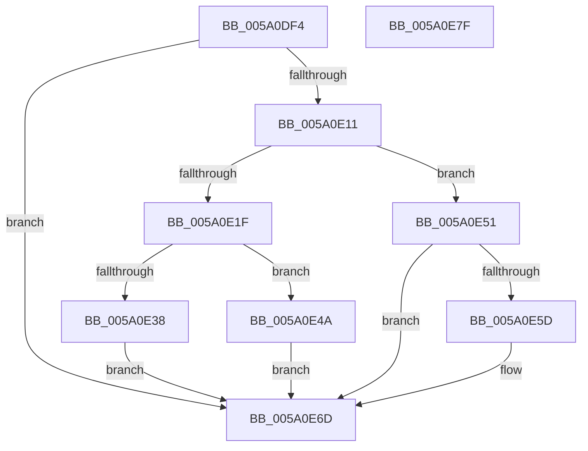

# IopAddBugcheckTriageUnicodeString

- RVA: `0x005A0DF4`–`0x005A0E80` (길이 `140` bytes)
- VA: `0x00000001405A0DF4`
- 실행 섹션: `.text`
- PDB 이름 있음: `예`; PDB Function 태그: `아니요`
- unwind 정보 RVA: `0x00060BC4`
- 디코드: `40`개 명령, `140/140` bytes 표시
- 미해석 바이트: `0` (있으면 어셈블리에 `.byte`로 보존)

> 이 문서는 커널 이미지의 기계어와 PDB 기호를 분석해 생성했습니다. 4번과 5번은 함수 원형과 자료형을 바이너리 사용 방식에서 추정한 C 해석이며 원본 소스 복구 결과는 아닙니다.

## 1. Dependencies

- 직접 호출 지점: **4**; 고유 호출 대상: **2**
- 직접 호출자로 확인된 함수: **2**
- RIP 상대 이미지 참조: **0**

### Outgoing calls
- `0x005A0E2F` → [IopIsAddressRangeValid](../4B/IopIsAddressRangeValid_function_004B6CBC.md) (function, `0x004B6CBC`)
- `0x005A0E43` → [IoAddTriageDumpDataBlock](../42/IoAddTriageDumpDataBlock_function_00428374.md) (function, `0x00428374`)
- `0x005A0E54` → [IopIsAddressRangeValid](../4B/IopIsAddressRangeValid_function_004B6CBC.md) (function, `0x004B6CBC`)
- `0x005A0E63` → [IoAddTriageDumpDataBlock](../42/IoAddTriageDumpDataBlock_function_00428374.md) (function, `0x00428374`)

### Direct callers
- [IopAddBugcheckTriageDevice](IopAddBugcheckTriageDevice_function_005A0814.md) at `0x005A08D8`
- [IopAddBugcheckTriageDeviceNode](IopAddBugcheckTriageDeviceNode_function_005A091C.md) at `0x005A096A`
- [IopAddBugcheckTriageDeviceNode](IopAddBugcheckTriageDeviceNode_function_005A091C.md) at `0x005A097E`

### Static image references
- 디코드된 RIP-relative 메모리 참조가 없습니다.

## 2. Other-region calls and transfers

- 다른 실행 섹션으로 향하는 call: **0**
- 별도 외부 분기/꼬리 이동을 확인하지 못했습니다.

## 3. Assembly (complete function range)

```asm
005A0DF4  48 89 5C 24 08                  mov qword ptr [rsp + 8], rbx
005A0DF9  48 89 74 24 10                  mov qword ptr [rsp + 0x10], rsi
005A0DFE  57                              push rdi
005A0DFF  48 83 EC 20                     sub rsp, 0x20
005A0E03  0F B7 41 02                     movzx eax, word ptr [rcx + 2]
005A0E07  33 DB                           xor ebx, ebx
005A0E09  48 8B F9                        mov rdi, rcx
005A0E0C  66 85 C0                        test ax, ax
005A0E0F  74 5C                           je 0x1405a0e6d
005A0E11  48 8B 49 08                     mov rcx, qword ptr [rcx + 8]
005A0E15  BE 00 01 00 00                  mov esi, 0x100
005A0E1A  66 3B C6                        cmp ax, si
005A0E1D  77 32                           ja 0x1405a0e51
005A0E1F  48 8D 70 07                     lea rsi, [rax + 7]
005A0E23  48 C1 EE 03                     shr rsi, 3
005A0E27  48 8D 14 F5 00 00 00 00         lea rdx, [rsi*8]
005A0E2F  E8 88 5E F1 FF                  call 0x1404b6cbc
005A0E34  84 C0                           test al, al
005A0E36  74 12                           je 0x1405a0e4a
005A0E38  48 8B 4F 08                     mov rcx, qword ptr [rdi + 8]
005A0E3C  8D 14 F5 00 00 00 00            lea edx, [rsi*8]
005A0E43  E8 2C 75 E8 FF                  call 0x140428374
005A0E48  EB 23                           jmp 0x1405a0e6d
005A0E4A  BB 01 00 00 C0                  mov ebx, 0xc0000001
005A0E4F  EB 1C                           jmp 0x1405a0e6d
005A0E51  48 8B D6                        mov rdx, rsi
005A0E54  E8 63 5E F1 FF                  call 0x1404b6cbc
005A0E59  84 C0                           test al, al
005A0E5B  74 10                           je 0x1405a0e6d
005A0E5D  48 8B 4F 08                     mov rcx, qword ptr [rdi + 8]
005A0E61  8B D6                           mov edx, esi
005A0E63  E8 0C 75 E8 FF                  call 0x140428374
005A0E68  BB 05 00 00 80                  mov ebx, 0x80000005
005A0E6D  48 8B 74 24 38                  mov rsi, qword ptr [rsp + 0x38]
005A0E72  8B C3                           mov eax, ebx
005A0E74  48 8B 5C 24 30                  mov rbx, qword ptr [rsp + 0x30]
005A0E79  48 83 C4 20                     add rsp, 0x20
005A0E7D  5F                              pop rdi
005A0E7E  C3                              ret
005A0E7F  CC                              int3
```

## 4. C-style interpretation (structured pseudocode)

```c
__int64 __fastcall IopAddBugcheckTriageUnicodeString(__int64 a1)
{
    __int64 result;
    __int64 v_rbx;
    __int64 v_rsi;
    __int64 v_rsp;
    unsigned __int64 v_stack_p10;
    unsigned __int64 v_stack_p8;

    v_stack_p8 = v_rbx;
    v_stack_p10 = v_rsi;
    v_rsp = (v_rsp) - (32);
    v_rbx = 0;
    if ((unsigned __int16)(*(unsigned __int16 *)(a1 + 2)) == 0) goto loc_005A0E6D;
    if (((unsigned __int16)(*(unsigned __int16 *)(a1 + 2))) > 256) goto loc_005A0E51;
    v_rsi = (*(unsigned __int16 *)(a1 + 2) + 7) >> (3);
    result = IopIsAddressRangeValid(*(unsigned __int64 *)(a1 + 8), v_rsi * 8, a3, a4);
    if ((unsigned __int8)(result) == 0) goto loc_005A0E4A;
    result = IoAddTriageDumpDataBlock(*(unsigned __int64 *)(a1 + 8), v_rsi * 8, a3, a4);
    goto loc_005A0E6D;
loc_005A0E4A:
    goto loc_005A0E6D;
loc_005A0E51:
    result = IopIsAddressRangeValid(*(unsigned __int64 *)(a1 + 8), v_rsi, a3, a4);
    v_rbx = (unsigned int)(0xC0000001ULL);
    if ((unsigned __int8)(result) != 0) {
        a1 = *(unsigned __int64 *)(a1 + 8);
        a2 = (unsigned int)(v_rsi);
        result = IoAddTriageDumpDataBlock(a1, a2, a3, a4);
        v_rbx = 0x80000005ULL;
    }
    v_rsp = (v_rsp) + (32);
    return (unsigned int)((unsigned int)(v_rbx));
}
```

## 5. (Beta) C Style

```c
int64_t IopAddBugcheckTriageUnicodeString(void *Arg1)
{
    uint8_t *arg1 = (uint8_t *)Arg1;

    int64_t result;
    int64_t local_rbx;
    int64_t local_rsi;
    int64_t local_rsp;
    uint64_t v_stack_p10;
    uint64_t v_stack_p8;

    v_stack_p8 = local_rbx;
    v_stack_p10 = local_rsi;
    local_rsp = (local_rsp) - (32);
    local_rbx = 0;
    if ((uint16_t)(*(uint16_t *)(arg1 + 0x2)) == 0) goto loc_005A0E6D;
    if (((uint16_t)(*(uint16_t *)(arg1 + 0x2))) > 256) goto loc_005A0E51;
    local_rsi = (*(uint16_t *)(arg1 + 0x2) + 7) >> (3);
    result = IopIsAddressRangeValid(*(uint64_t *)(arg1 + 0x8), local_rsi * 8, a3, a4);
    if ((uint8_t)(result) == 0) goto loc_005A0E4A;
    result = IoAddTriageDumpDataBlock(*(uint64_t *)(arg1 + 0x8), local_rsi * 8, a3, a4);
    goto loc_005A0E6D;
loc_005A0E4A:
    goto loc_005A0E6D;
loc_005A0E51:
    result = IopIsAddressRangeValid(*(uint64_t *)(arg1 + 0x8), local_rsi, a3, a4);
    local_rbx = (uint32_t)(0xC0000001ULL);
    if ((uint8_t)(result) != 0) {
        Arg1 = *(uint64_t *)(arg1 + 0x8);
        a2 = (uint32_t)(local_rsi);
        result = IoAddTriageDumpDataBlock(Arg1, a2, a3, a4);
        local_rbx = 0x80000005ULL;
    }
    local_rsp = (local_rsp) + (32);
    return (uint32_t)((uint32_t)(local_rbx));
}
```

### 관측된 메모리 오프셋

구조체 형식이 확인되지 않은 접근은 인자 기준의 오프셋으로만 기록했습니다.

| 기준 인자 | 오프셋 표현 | 폭 (bit) | 접근 |
|---|---:|---:|---|
| `Arg1` | `+ 0x2` | `16` | `R` |
| `Arg1` | `+ 0x8` | `64` | `R` |

## 6. Execution-region graph

[열기: 2D/3D 그래프와 함수 탐색 컨트롤 패널](../../../control-panel.html?section=text&rva=0x005A0DF4&view=graph)

- 2D 그래프는 위에서 아래로 흐르고, 3D 그래프는 빈 공간을 드래그해 회전합니다. Shift+드래그는 이동, 휠은 확대·축소, 함수 노드 선택은 대상 보고서 이동입니다.

### Static fallback


