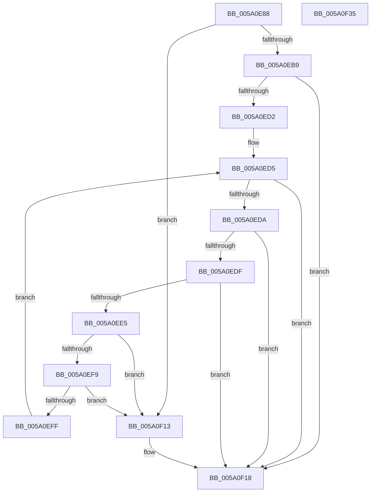

# IopAddBugcheckTriageWorkQueue

- RVA: `0x005A0E88`–`0x005A0F36` (길이 `174` bytes)
- VA: `0x00000001405A0E88`
- 실행 섹션: `.text`
- PDB 이름 있음: `예`; PDB Function 태그: `아니요`
- unwind 정보 RVA: `0x0005E6B4`
- 디코드: `52`개 명령, `174/174` bytes 표시
- 미해석 바이트: `0` (있으면 어셈블리에 `.byte`로 보존)

> 이 문서는 커널 이미지의 기계어와 PDB 기호를 분석해 생성했습니다. 4번과 5번은 함수 원형과 자료형을 바이너리 사용 방식에서 추정한 C 해석이며 원본 소스 복구 결과는 아닙니다.

## 1. Dependencies

- 직접 호출 지점: **4**; 고유 호출 대상: **3**
- 직접 호출자로 확인된 함수: **4**
- RIP 상대 이미지 참조: **0**

### Outgoing calls
- `0x005A0EB0` → [IopIsAddressRangeValid](../4B/IopIsAddressRangeValid_function_004B6CBC.md) (function, `0x004B6CBC`)
- `0x005A0EBE` → [IoAddTriageDumpDataBlock](../42/IoAddTriageDumpDataBlock_function_00428374.md) (function, `0x00428374`)
- `0x005A0EF0` → [IopIsAddressRangeValid](../4B/IopIsAddressRangeValid_function_004B6CBC.md) (function, `0x004B6CBC`)
- `0x005A0F06` → [IopAddBugcheckTriageThread](IopAddBugcheckTriageThread_function_005A0CF8.md) (function, `0x005A0CF8`)

### Direct callers
- [IopAddBugcheckTriageDataFromParameters](../59/IopAddBugcheckTriageDataFromParameters_function_00593E54.md) at `0x00593FC3`
- [IopAddBugcheckDirectedTransitionTriageData](IopAddBugcheckDirectedTransitionTriageData_function_005A0518.md) at `0x005A05CE`
- [IopAddBugcheckDirectedTransitionTriageData](IopAddBugcheckDirectedTransitionTriageData_function_005A0518.md) at `0x005A05D7`
- [IopAddBugcheckPnpWatchdogTriageData](IopAddBugcheckPnpWatchdogTriageData_function_005A0608.md) at `0x005A0663`
- [IopAddBugcheckPowerTriageData](IopAddBugcheckPowerTriageData_function_005A06C8.md) at `0x005A0730`
- [IopAddBugcheckPowerTriageData](IopAddBugcheckPowerTriageData_function_005A06C8.md) at `0x005A0739`

### Static image references
- 디코드된 RIP-relative 메모리 참조가 없습니다.

## 2. Other-region calls and transfers

- 다른 실행 섹션으로 향하는 call: **0**
- 별도 외부 분기/꼬리 이동을 확인하지 못했습니다.

## 3. Assembly (complete function range)

```asm
005A0E88  48 8B C4                        mov rax, rsp
005A0E8B  48 89 58 08                     mov qword ptr [rax + 8], rbx
005A0E8F  48 89 68 10                     mov qword ptr [rax + 0x10], rbp
005A0E93  48 89 70 18                     mov qword ptr [rax + 0x18], rsi
005A0E97  48 89 78 20                     mov qword ptr [rax + 0x20], rdi
005A0E9B  41 56                           push r14
005A0E9D  48 83 EC 20                     sub rsp, 0x20
005A0EA1  BF B0 02 00 00                  mov edi, 0x2b0
005A0EA6  33 DB                           xor ebx, ebx
005A0EA8  8B D7                           mov edx, edi
005A0EAA  48 8B F1                        mov rsi, rcx
005A0EAD  44 8B F3                        mov r14d, ebx
005A0EB0  E8 07 5E F1 FF                  call 0x1404b6cbc
005A0EB5  84 C0                           test al, al
005A0EB7  74 5A                           je 0x1405a0f13
005A0EB9  8B D7                           mov edx, edi
005A0EBB  48 8B CE                        mov rcx, rsi
005A0EBE  E8 B1 74 E8 FF                  call 0x140428374
005A0EC3  48 81 C6 A0 02 00 00            add rsi, 0x2a0
005A0ECA  48 8B 3E                        mov rdi, qword ptr [rsi]
005A0ECD  48 85 FF                        test rdi, rdi
005A0ED0  74 46                           je 0x1405a0f18
005A0ED2  48 8B EE                        mov rbp, rsi
005A0ED5  48 85 FF                        test rdi, rdi
005A0ED8  74 3E                           je 0x1405a0f18
005A0EDA  48 3B FE                        cmp rdi, rsi
005A0EDD  74 39                           je 0x1405a0f18
005A0EDF  41 83 FE 0A                     cmp r14d, 0xa
005A0EE3  7D 33                           jge 0x1405a0f18
005A0EE5  BA 10 00 00 00                  mov edx, 0x10
005A0EEA  48 8B CF                        mov rcx, rdi
005A0EED  41 FF C6                        inc r14d
005A0EF0  E8 C7 5D F1 FF                  call 0x1404b6cbc
005A0EF5  84 C0                           test al, al
005A0EF7  74 1A                           je 0x1405a0f13
005A0EF9  48 39 6F 08                     cmp qword ptr [rdi + 8], rbp
005A0EFD  75 14                           jne 0x1405a0f13
005A0EFF  48 8D 8F F8 FD FF FF            lea rcx, [rdi - 0x208]
005A0F06  E8 ED FD FF FF                  call 0x1405a0cf8
005A0F0B  48 8B EF                        mov rbp, rdi
005A0F0E  48 8B 3F                        mov rdi, qword ptr [rdi]
005A0F11  EB C2                           jmp 0x1405a0ed5
005A0F13  BB 01 00 00 C0                  mov ebx, 0xc0000001
005A0F18  48 8B 6C 24 38                  mov rbp, qword ptr [rsp + 0x38]
005A0F1D  8B C3                           mov eax, ebx
005A0F1F  48 8B 5C 24 30                  mov rbx, qword ptr [rsp + 0x30]
005A0F24  48 8B 74 24 40                  mov rsi, qword ptr [rsp + 0x40]
005A0F29  48 8B 7C 24 48                  mov rdi, qword ptr [rsp + 0x48]
005A0F2E  48 83 C4 20                     add rsp, 0x20
005A0F32  41 5E                           pop r14
005A0F34  C3                              ret
005A0F35  CC                              int3
```

## 4. C-style interpretation (structured pseudocode)

```c
__int64 __fastcall IopAddBugcheckTriageWorkQueue(__int64 a1)
{
    __int64 result;
    __int64 v_r14;
    __int64 v_rbx;
    __int64 v_rsi;
    __int64 v_rsp;
    unsigned __int64 v_stack_p10;
    unsigned __int64 v_stack_p18;
    unsigned __int64 v_stack_p20;
    unsigned __int64 v_stack_p8;

    *(unsigned __int64 *)(v_rsp + 8) = v_rbx;
    *(unsigned __int64 *)(v_rsp + 16) = v_rbp;
    *(unsigned __int64 *)(v_rsp + 24) = v_rsi;
    *(unsigned __int64 *)(v_rsp + 32) = v_rdi;
    v_rsp = (v_rsp) - (32);
    v_rbx = 0;
    result = IopIsAddressRangeValid(a1, 688, a3, a4);
    if ((unsigned __int8)(result) == 0) goto loc_005A0F13;
    result = IoAddTriageDumpDataBlock(a1, 688, a3, a4);
    v_rsi = (a1) + (672);
    if (*(unsigned __int64 *)(v_rsi) == 0) goto loc_005A0F18;
loc_005A0ED5:
    if (*(unsigned __int64 *)(v_rsi) == 0) goto loc_005A0F18;
    if ((*(unsigned __int64 *)(v_rsi)) == v_rsi) goto loc_005A0F18;
    if (0 >= 10) goto loc_005A0F18;
    v_r14 = (unsigned int)((0) + 1);
    result = IopIsAddressRangeValid(*(unsigned __int64 *)(v_rsi), 16, a3, a4);
    if ((unsigned __int8)(result) == 0) goto loc_005A0F13;
    if ((*(unsigned __int64 *)(*(unsigned __int64 *)(v_rsi) + 8)) != v_rsi) goto loc_005A0F13;
    result = IopAddBugcheckTriageThread(*(unsigned __int64 *)(v_rsi) - 520, 16, a3, a4);
    goto loc_005A0ED5;
loc_005A0F13:
loc_005A0F18:
    v_rsp = (v_rsp) + (32);
    return (unsigned int)((unsigned int)((unsigned int)(0xC0000001ULL)));
}
```

## 5. (Beta) C Style

```c
int64_t IopAddBugcheckTriageWorkQueue(void *Arg1)
{
    uint8_t *arg1 = (uint8_t *)Arg1;

    int64_t result;
    int64_t local_r14;
    int64_t local_rbx;
    int64_t local_rsi;
    int64_t local_rsp;
    uint64_t v_stack_p10;
    uint64_t v_stack_p18;
    uint64_t v_stack_p20;
    uint64_t v_stack_p8;

    *(uint64_t *)(local_rsp + 0x8) = local_rbx;
    *(uint64_t *)(local_rsp + 0x10) = local_rbp;
    *(uint64_t *)(local_rsp + 0x18) = local_rsi;
    *(uint64_t *)(local_rsp + 0x20) = local_rdi;
    local_rsp = (local_rsp) - (32);
    local_rbx = 0;
    result = IopIsAddressRangeValid(Arg1, 688, a3, a4);
    if ((uint8_t)(result) == 0) goto loc_005A0F13;
    result = IoAddTriageDumpDataBlock(Arg1, 688, a3, a4);
    local_rsi = (Arg1) + (672);
    if (*(uint64_t *)(local_rsi) == 0) goto loc_005A0F18;
loc_005A0ED5:
    if (*(uint64_t *)(local_rsi) == 0) goto loc_005A0F18;
    if ((*(uint64_t *)(local_rsi)) == local_rsi) goto loc_005A0F18;
    if (0 >= 10) goto loc_005A0F18;
    local_r14 = (uint32_t)((0) + 1);
    result = IopIsAddressRangeValid(*(uint64_t *)(local_rsi), 16, a3, a4);
    if ((uint8_t)(result) == 0) goto loc_005A0F13;
    if ((*(uint64_t *)(*(uint64_t *)(local_rsi) + 0x8)) != local_rsi) goto loc_005A0F13;
    result = IopAddBugcheckTriageThread(*(uint64_t *)(local_rsi) - 520, 16, a3, a4);
    goto loc_005A0ED5;
loc_005A0F13:
loc_005A0F18:
    local_rsp = (local_rsp) + (32);
    return (uint32_t)((uint32_t)((uint32_t)(0xC0000001ULL)));
}
```

### 관측된 메모리 오프셋

구조체 형식이 확인되지 않은 접근은 인자 기준의 오프셋으로만 기록했습니다.

| 기준 인자 | 오프셋 표현 | 폭 (bit) | 접근 |
|---|---:|---:|---|
| `Arg1` | `+ 0x0` | `64` | `R` |

## 6. Execution-region graph

[열기: 2D/3D 그래프와 함수 탐색 컨트롤 패널](../../../control-panel.html?section=text&rva=0x005A0E88&view=graph)

- 2D 그래프는 위에서 아래로 흐르고, 3D 그래프는 빈 공간을 드래그해 회전합니다. Shift+드래그는 이동, 휠은 확대·축소, 함수 노드 선택은 대상 보고서 이동입니다.

### Static fallback


