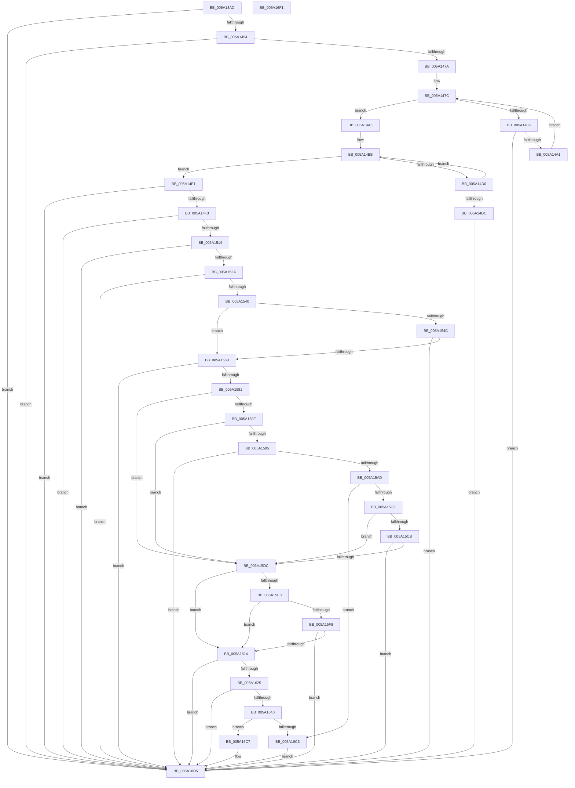

# IopAddLiveDumpPagesToPartialKernelDump

- RVA: `0x005A13AC`–`0x005A16F2` (길이 `838` bytes)
- VA: `0x00000001405A13AC`
- 실행 섹션: `.text`
- PDB 이름 있음: `예`; PDB Function 태그: `아니요`
- unwind 정보 RVA: `0x000C7D54`
- 디코드: `205`개 명령, `838/838` bytes 표시
- 미해석 바이트: `0` (있으면 어셈블리에 `.byte`로 보존)

> 이 문서는 커널 이미지의 기계어와 PDB 기호를 분석해 생성했습니다. 4번과 5번은 함수 원형과 자료형을 바이너리 사용 방식에서 추정한 C 해석이며 원본 소스 복구 결과는 아닙니다.

## 1. Dependencies

- 직접 호출 지점: **22**; 고유 호출 대상: **10**
- 직접 호출자로 확인된 함수: **1**
- RIP 상대 이미지 참조: **12**

### Outgoing calls
- `0x005A1447` → [MmAddRangeToCrashDump](../67/MmAddRangeToCrashDump_function_0067D8B0.md) (function, `0x0067D8B0`)
- `0x005A146D` → [MmAddRangeToCrashDump](../67/MmAddRangeToCrashDump_function_0067D8B0.md) (function, `0x0067D8B0`)
- `0x005A1494` → [MmAddRangeToCrashDump](../67/MmAddRangeToCrashDump_function_0067D8B0.md) (function, `0x0067D8B0`)
- `0x005A14C3` → [KeEnumerateNextProcessor](../41/KeEnumerateNextProcessor_function_00415480.md) (function, `0x00415480`)
- `0x005A14D3` → [IopMarkPagesForProcessorData](IopMarkPagesForProcessorData_function_005A21C8.md) (function, `0x005A21C8`)
- `0x005A14E6` → [MmAddPrivateDataToCrashDump](../67/MmAddPrivateDataToCrashDump_function_0067D794.md) (function, `0x0067D794`)
- `0x005A1507` → [MmAddRangeToCrashDump](../67/MmAddRangeToCrashDump_function_0067D8B0.md) (function, `0x0067D8B0`)
- `0x005A151D` → [MmAddPrivateDataToCrashDump](../67/MmAddPrivateDataToCrashDump_function_0067D794.md) (function, `0x0067D794`)
- `0x005A1533` → [MmAddPrivateDataToCrashDump](../67/MmAddPrivateDataToCrashDump_function_0067D794.md) (function, `0x0067D794`)
- `0x005A155E` → [MmAddRangeToCrashDump](../67/MmAddRangeToCrashDump_function_0067D8B0.md) (function, `0x0067D8B0`)
- `0x005A1574` → [MmAddPrivateDataToCrashDump](../67/MmAddPrivateDataToCrashDump_function_0067D794.md) (function, `0x0067D794`)
- `0x005A15A0` → [MmAddRangeToCrashDump](../67/MmAddRangeToCrashDump_function_0067D8B0.md) (function, `0x0067D8B0`)
- `0x005A15B5` → [IopLiveDumpMarkDeviceNode](../59/IopLiveDumpMarkDeviceNode_function_0059CC44.md) (function, `0x0059CC44`)
- `0x005A15CF` → [IopLiveDumpMarkDeviceNode](../59/IopLiveDumpMarkDeviceNode_function_0059CC44.md) (function, `0x0059CC44`)
- `0x005A1607` → [MmAddRangeToCrashDump](../67/MmAddRangeToCrashDump_function_0067D8B0.md) (function, `0x0067D8B0`)
- `0x005A1618` → [ExAddPrivateDataToCrashDump](../65/ExAddPrivateDataToCrashDump_function_00655D80.md) (function, `0x00655D80`)
- `0x005A1633` → [IoAddProcessesToDump](IoAddProcessesToDump_function_005A1150.md) (function, `0x005A1150`)
- `0x005A1643` → [IopDumpCallAddPagesCallbacks](../59/IopDumpCallAddPagesCallbacks_function_005949FC.md) (function, `0x005949FC`)
- `0x005A164D` → [IoSaveBugCheckProgress](../59/IoSaveBugCheckProgress_function_00592E10.md) (function, `0x00592E10`)
- `0x005A16AA` → [MmGetDumpRange](../67/MmGetDumpRange_function_0067DA68.md) (function, `0x0067DA68`)
- `0x005A16B4` → [IoSaveBugCheckProgress](../59/IoSaveBugCheckProgress_function_00592E10.md) (function, `0x00592E10`)
- `0x005A16D0` → [MmAddPrivateDataToCrashDump](../67/MmAddPrivateDataToCrashDump_function_0067D794.md) (function, `0x0067D794`)

### Direct callers
- [IoAddPagesForPartialKernelDump](IoAddPagesForPartialKernelDump_function_005A0F3C.md) at `0x005A1037`

### Static image references
- `0x005A13D3` → RVA `0x00E66198` (`.data`; read)
- `0x005A13E9` → RVA `0x00E01060` (`.data`; read)
- `0x005A13F0` → RVA `0x00E66050` (`.data`; read)
- `0x005A142C` → RVA `0x005931F0` (`IoSetDumpRange`; read)
- `0x005A1454` → RVA `0x00FC6A80` (`ALMOSTRO`; read)
- `0x005A145B` → RVA `0x00FC8C40` (`ALMOSTRO`; read)
- `0x005A14A5` → RVA `0x00FC7128` (`ALMOSTRO`; read)
- `0x005A14B0` → RVA `0x00FC7120` (`ALMOSTRO`; read)
- `0x005A1540` → RVA `0x00FC6B88` (`ALMOSTRO`; read)
- `0x005A15DC` → RVA `0x00E65EE8` (`.data`; read)
- `0x005A1628` → RVA `0x005A2460` (`IopPartialDumpAddProcessesCallback`; read)
- `0x005A169B` → RVA `0x005927B0` (`IoFreeDumpRange`; read)

## 2. Other-region calls and transfers

- 다른 실행 섹션으로 향하는 call: **0**
- 별도 외부 분기/꼬리 이동을 확인하지 못했습니다.

## 3. Assembly (complete function range)

```asm
005A13AC  48 8B C4                        mov rax, rsp
005A13AF  48 89 58 08                     mov qword ptr [rax + 8], rbx
005A13B3  48 89 70 10                     mov qword ptr [rax + 0x10], rsi
005A13B7  4C 89 48 20                     mov qword ptr [rax + 0x20], r9
005A13BB  55                              push rbp
005A13BC  57                              push rdi
005A13BD  41 54                           push r12
005A13BF  41 55                           push r13
005A13C1  41 56                           push r14
005A13C3  48 8D 68 A9                     lea rbp, [rax - 0x57]
005A13C7  48 81 EC A0 00 00 00            sub rsp, 0xa0
005A13CE  48 83 65 D7 00                  and qword ptr [rbp - 0x29], 0
005A13D3  4C 8D 2D BE 4D 8C 00            lea r13, [rip + 0x8c4dbe]
005A13DA  33 C0                           xor eax, eax
005A13DC  49 8B F8                        mov rdi, r8
005A13DF  21 45 77                        and dword ptr [rbp + 0x77], eax
005A13E2  48 8B F2                        mov rsi, rdx
005A13E5  48 89 45 EF                     mov qword ptr [rbp - 0x11], rax
005A13E9  48 8D 15 70 FC 85 00            lea rdx, [rip + 0x85fc70]
005A13F0  48 8B 05 59 4C 8C 00            mov rax, qword ptr [rip + 0x8c4c59]
005A13F7  44 8B F1                        mov r14d, ecx
005A13FA  0F 57 C0                        xorps xmm0, xmm0
005A13FD  48 8D 4D AF                     lea rcx, [rbp - 0x51]
005A1401  41 B8 A0 03 00 00               mov r8d, 0x3a0
005A1407  0F 11 45 DF                     movups xmmword ptr [rbp - 0x21], xmm0
005A140B  4C 8B 48 08                     mov r9, qword ptr [rax + 8]
005A140F  49 8B 41 30                     mov rax, qword ptr [r9 + 0x30]
005A1413  48 83 65 B7 00                  and qword ptr [rbp - 0x49], 0
005A1418  48 89 45 0F                     mov qword ptr [rbp + 0xf], rax
005A141C  49 8D 41 38                     lea rax, [r9 + 0x38]
005A1420  48 89 45 17                     mov qword ptr [rbp + 0x17], rax
005A1424  48 8D 45 0F                     lea rax, [rbp + 0xf]
005A1428  48 89 45 BF                     mov qword ptr [rbp - 0x41], rax
005A142C  48 8D 05 BD 1D FF FF            lea rax, [rip - 0xe243]
005A1433  48 89 45 AF                     mov qword ptr [rbp - 0x51], rax
005A1437  33 C0                           xor eax, eax
005A1439  83 C8 03                        or eax, 3
005A143C  4C 89 4D C7                     mov qword ptr [rbp - 0x39], r9
005A1440  89 45 D7                        mov dword ptr [rbp - 0x29], eax
005A1443  4C 89 6D CF                     mov qword ptr [rbp - 0x31], r13
005A1447  E8 64 C4 0D 00                  call 0x14067d8b0
005A144C  85 C0                           test eax, eax
005A144E  0F 88 81 02 00 00               js 0x1405a16d5
005A1454  44 8B 05 25 56 A2 00            mov r8d, dword ptr [rip + 0xa25625]
005A145B  4C 8D 25 DE 77 A2 00            lea r12, [rip + 0xa277de]
005A1462  49 C1 E0 03                     shl r8, 3
005A1466  48 8D 4D AF                     lea rcx, [rbp - 0x51]
005A146A  49 8B D4                        mov rdx, r12
005A146D  E8 3E C4 0D 00                  call 0x14067d8b0
005A1472  85 C0                           test eax, eax
005A1474  0F 88 5B 02 00 00               js 0x1405a16d5
005A147A  33 DB                           xor ebx, ebx
005A147C  8B 05 FE 55 A2 00               mov eax, dword ptr [rip + 0xa255fe]
005A1482  3B D8                           cmp ebx, eax
005A1484  73 1F                           jae 0x1405a14a5
005A1486  49 8B 14 DC                     mov rdx, qword ptr [r12 + rbx*8]
005A148A  48 8D 4D AF                     lea rcx, [rbp - 0x51]
005A148E  41 B8 00 CF 00 00               mov r8d, 0xcf00
005A1494  E8 17 C4 0D 00                  call 0x14067d8b0
005A1499  85 C0                           test eax, eax
005A149B  0F 88 34 02 00 00               js 0x1405a16d5
005A14A1  FF C3                           inc ebx
005A14A3  EB D7                           jmp 0x1405a147c
005A14A5  48 8B 05 7C 5C A2 00            mov rax, qword ptr [rip + 0xa25c7c]
005A14AC  48 89 45 E7                     mov qword ptr [rbp - 0x19], rax
005A14B0  48 8D 05 69 5C A2 00            lea rax, [rip + 0xa25c69]
005A14B7  48 89 45 DF                     mov qword ptr [rbp - 0x21], rax
005A14BB  48 8D 55 DF                     lea rdx, [rbp - 0x21]
005A14BF  48 8D 4D 77                     lea rcx, [rbp + 0x77]
005A14C3  E8 B8 3F E7 FF                  call 0x140415480
005A14C8  48 8D 4D AF                     lea rcx, [rbp - 0x51]
005A14CC  85 C0                           test eax, eax
005A14CE  75 11                           jne 0x1405a14e1
005A14D0  8B 55 77                        mov edx, dword ptr [rbp + 0x77]
005A14D3  E8 F0 0C 00 00                  call 0x1405a21c8
005A14D8  85 C0                           test eax, eax
005A14DA  79 DF                           jns 0x1405a14bb
005A14DC  E9 F4 01 00 00                  jmp 0x1405a16d5
005A14E1  BA 02 00 00 00                  mov edx, 2
005A14E6  E8 A9 C2 0D 00                  call 0x14067d794
005A14EB  85 C0                           test eax, eax
005A14ED  0F 88 E2 01 00 00               js 0x1405a16d5
005A14F3  48 BA 00 00 00 00 80 F7 FF FF   movabs rdx, 0xfffff78000000000
005A14FD  48 8D 4D AF                     lea rcx, [rbp - 0x51]
005A1501  41 B8 80 0A 00 00               mov r8d, 0xa80
005A1507  E8 A4 C3 0D 00                  call 0x14067d8b0
005A150C  85 C0                           test eax, eax
005A150E  0F 88 C1 01 00 00               js 0x1405a16d5
005A1514  BA 04 00 00 00                  mov edx, 4
005A1519  48 8D 4D AF                     lea rcx, [rbp - 0x51]
005A151D  E8 72 C2 0D 00                  call 0x14067d794
005A1522  85 C0                           test eax, eax
005A1524  0F 88 AB 01 00 00               js 0x1405a16d5
005A152A  BA 08 00 00 00                  mov edx, 8
005A152F  48 8D 4D AF                     lea rcx, [rbp - 0x51]
005A1533  E8 5C C2 0D 00                  call 0x14067d794
005A1538  85 C0                           test eax, eax
005A153A  0F 88 95 01 00 00               js 0x1405a16d5
005A1540  48 8B 15 41 56 A2 00            mov rdx, qword ptr [rip + 0xa25641]
005A1547  48 85 D2                        test rdx, rdx
005A154A  74 1F                           je 0x1405a156b
005A154C  44 8B 02                        mov r8d, dword ptr [rdx]
005A154F  48 8D 4D AF                     lea rcx, [rbp - 0x51]
005A1553  41 FF C8                        dec r8d
005A1556  49 83 C0 02                     add r8, 2
005A155A  49 C1 E0 04                     shl r8, 4
005A155E  E8 4D C3 0D 00                  call 0x14067d8b0
005A1563  85 C0                           test eax, eax
005A1565  0F 88 6A 01 00 00               js 0x1405a16d5
005A156B  BA 10 00 00 00                  mov edx, 0x10
005A1570  48 8D 4D AF                     lea rcx, [rbp - 0x51]
005A1574  E8 1B C2 0D 00                  call 0x14067d794
005A1579  85 C0                           test eax, eax
005A157B  0F 88 54 01 00 00               js 0x1405a16d5
005A1581  BB 23 00 00 C0                  mov ebx, 0xc0000023
005A1586  41 81 FE 5F 01 00 00            cmp r14d, 0x15f
005A158D  75 4D                           jne 0x1405a15dc
005A158F  48 83 FE 02                     cmp rsi, 2
005A1593  75 47                           jne 0x1405a15dc
005A1595  44 8D 46 36                     lea r8d, [rsi + 0x36]
005A1599  48 8B D7                        mov rdx, rdi
005A159C  48 8D 4D AF                     lea rcx, [rbp - 0x51]
005A15A0  E8 0B C3 0D 00                  call 0x14067d8b0
005A15A5  85 C0                           test eax, eax
005A15A7  0F 88 28 01 00 00               js 0x1405a16d5
005A15AD  48 8B 57 30                     mov rdx, qword ptr [rdi + 0x30]
005A15B1  48 8D 4D AF                     lea rcx, [rbp - 0x51]
005A15B5  E8 8A B6 FF FF                  call 0x14059cc44
005A15BA  3B C3                           cmp eax, ebx
005A15BC  0F 84 01 01 00 00               je 0x1405a16c3
005A15C2  48 8B 55 7F                     mov rdx, qword ptr [rbp + 0x7f]
005A15C6  48 85 D2                        test rdx, rdx
005A15C9  74 11                           je 0x1405a15dc
005A15CB  48 8D 4D AF                     lea rcx, [rbp - 0x51]
005A15CF  E8 70 B6 FF FF                  call 0x14059cc44
005A15D4  85 C0                           test eax, eax
005A15D6  0F 88 F9 00 00 00               js 0x1405a16d5
005A15DC  48 8B 15 05 49 8C 00            mov rdx, qword ptr [rip + 0x8c4905]
005A15E3  48 85 D2                        test rdx, rdx
005A15E6  74 2C                           je 0x1405a1614
005A15E8  48 8B 05 61 4A 8C 00            mov rax, qword ptr [rip + 0x8c4a61]
005A15EF  48 3B 90 30 05 00 00            cmp rdx, qword ptr [rax + 0x530]
005A15F6  74 1C                           je 0x1405a1614
005A15F8  44 8B 42 04                     mov r8d, dword ptr [rdx + 4]
005A15FC  48 8D 4D AF                     lea rcx, [rbp - 0x51]
005A1600  48 81 C2 00 E0 FF FF            add rdx, -0x2000
005A1607  E8 A4 C2 0D 00                  call 0x14067d8b0
005A160C  85 C0                           test eax, eax
005A160E  0F 88 C1 00 00 00               js 0x1405a16d5
005A1614  48 8D 4D AF                     lea rcx, [rbp - 0x51]
005A1618  E8 63 47 0B 00                  call 0x140655d80
005A161D  85 C0                           test eax, eax
005A161F  0F 88 B0 00 00 00               js 0x1405a16d5
005A1625  45 33 C0                        xor r8d, r8d
005A1628  48 8D 15 31 0E 00 00            lea rdx, [rip + 0xe31]
005A162F  48 8D 4D AF                     lea rcx, [rbp - 0x51]
005A1633  E8 18 FB FF FF                  call 0x1405a1150
005A1638  85 C0                           test eax, eax
005A163A  0F 88 95 00 00 00               js 0x1405a16d5
005A1640  41 8B CE                        mov ecx, r14d
005A1643  E8 B4 33 FF FF                  call 0x1405949fc
005A1648  B9 21 00 00 00                  mov ecx, 0x21
005A164D  E8 BE 17 FF FF                  call 0x140592e10
005A1652  48 83 65 07 00                  and qword ptr [rbp + 7], 0
005A1657  33 D2                           xor edx, edx
005A1659  48 8B 05 F0 49 8C 00            mov rax, qword ptr [rip + 0x8c49f0]
005A1660  44 8D 42 03                     lea r8d, [rdx + 3]
005A1664  48 8B 48 08                     mov rcx, qword ptr [rax + 8]
005A1668  48 8B 41 30                     mov rax, qword ptr [rcx + 0x30]
005A166C  48 89 45 1F                     mov qword ptr [rbp + 0x1f], rax
005A1670  48 8D 41 38                     lea rax, [rcx + 0x38]
005A1674  48 89 45 27                     mov qword ptr [rbp + 0x27], rax
005A1678  48 8D 45 1F                     lea rax, [rbp + 0x1f]
005A167C  48 89 4D F7                     mov qword ptr [rbp - 9], rcx
005A1680  33 C9                           xor ecx, ecx
005A1682  48 89 45 EF                     mov qword ptr [rbp - 0x11], rax
005A1686  83 C9 07                        or ecx, 7
005A1689  48 8D 05 60 1B FF FF            lea rax, [rip - 0xe4a0]
005A1690  89 4D 07                        mov dword ptr [rbp + 7], ecx
005A1693  48 89 45 DF                     mov qword ptr [rbp - 0x21], rax
005A1697  48 8D 4D DF                     lea rcx, [rbp - 0x21]
005A169B  48 8D 05 0E 11 FF FF            lea rax, [rip - 0xeef2]
005A16A2  4C 89 6D FF                     mov qword ptr [rbp - 1], r13
005A16A6  48 89 45 E7                     mov qword ptr [rbp - 0x19], rax
005A16AA  E8 B9 C3 0D 00                  call 0x14067da68
005A16AF  B9 29 00 00 00                  mov ecx, 0x29
005A16B4  E8 57 17 FF FF                  call 0x140592e10
005A16B9  48 83 3D D7 4A 8C 00 00         cmp qword ptr [rip + 0x8c4ad7], 0
005A16C1  75 04                           jne 0x1405a16c7
005A16C3  8B C3                           mov eax, ebx
005A16C5  EB 0E                           jmp 0x1405a16d5
005A16C7  BA 01 00 00 00                  mov edx, 1
005A16CC  48 8D 4D AF                     lea rcx, [rbp - 0x51]
005A16D0  E8 BF C0 0D 00                  call 0x14067d794
005A16D5  4C 8D 9C 24 A0 00 00 00         lea r11, [rsp + 0xa0]
005A16DD  49 8B 5B 30                     mov rbx, qword ptr [r11 + 0x30]
005A16E1  49 8B 73 38                     mov rsi, qword ptr [r11 + 0x38]
005A16E5  49 8B E3                        mov rsp, r11
005A16E8  41 5E                           pop r14
005A16EA  41 5D                           pop r13
005A16EC  41 5C                           pop r12
005A16EE  5F                              pop rdi
005A16EF  5D                              pop rbp
005A16F0  C3                              ret
005A16F1  CC                              int3
```

## 4. C-style interpretation (structured pseudocode)

```c
__int64 __fastcall IopAddLiveDumpPagesToPartialKernelDump(int a1, __int64 a2, __int64 a3, __int64 a4)
{
    __int64 result;
    __int64 v_rbx;
    __int64 v_rsp;
    unsigned __int64 v_stack_m28;

    *(unsigned __int64 *)(v_rsp + 8) = v_rbx;
    *(unsigned __int64 *)(v_rsp + 16) = v_rsi;
    *(unsigned __int64 *)(v_rsp + 32) = a4;
    v_rsp = (v_rsp) - (160);
    result = 0;
    *(unsigned __int64 *)(v_rsp - 87 - 17) = 0;
    *(unsigned __int64 *)(v_rsp - 87 - 33) = v_xmm0;
    *(unsigned __int64 *)(v_rsp - 87 + 15) = *(unsigned __int64 *)(*(unsigned __int64 *)(*(unsigned __int64 *)(v_rip + 9194585) + 8) + 48);
    *(unsigned __int64 *)(v_rsp - 87 + 23) = *(unsigned __int64 *)(*(unsigned __int64 *)(v_rip + 9194585) + 8) + 56;
    *(unsigned __int64 *)(v_rsp - 87 - 65) = v_rsp - 87 + 15;
    *(unsigned __int64 *)(v_rsp - 87 - 81) = v_rip - 57923;
    result = 0;
    result = (unsigned int)((result) | (3));
    *(unsigned __int64 *)(v_rsp - 87 - 57) = *(unsigned __int64 *)(*(unsigned __int64 *)(v_rip + 9194585) + 8);
    *(unsigned int *)(v_rsp - 87 - 41) = (unsigned int)(result);
    *(unsigned __int64 *)(v_rsp - 87 - 49) = v_rip + 9194942;
    result = MmAddRangeToCrashDump(v_rsp - 87 - 81, v_rip + 8780912, 928, *(unsigned __int64 *)(*(unsigned __int64 *)(v_rip + 9194585) + 8));
    if (sign_flag) goto loc_005A16D5;
    a3 = ((unsigned int)(*(unsigned int *)(v_rip + 10638885))) << (3);
    result = MmAddRangeToCrashDump(v_rsp - 87 - 81, v_rip + 10647518, a3, *(unsigned __int64 *)(*(unsigned __int64 *)(v_rip + 9194585) + 8));
    if (sign_flag) goto loc_005A16D5;
    v_rbx = 0;
loc_005A147C:
    if (0 >= ((unsigned int)((unsigned int)(*(unsigned int *)(v_rip + 10638846))))) goto loc_005A14A5;
    result = MmAddRangeToCrashDump(v_rsp - 87 - 81, *(unsigned __int64 *)(v_rip + 10647518 + v_rbx * 8), (unsigned int)(0xCF00ULL), *(unsigned __int64 *)(*(unsigned __int64 *)(v_rip + 9194585) + 8));
    if (sign_flag) goto loc_005A16D5;
    v_rbx = (unsigned int)((v_rbx) + 1);
    goto loc_005A147C;
loc_005A14A5:
    *(unsigned __int64 *)(v_rsp - 87 - 25) = *(unsigned __int64 *)(v_rip + 10640508);
    *(unsigned __int64 *)(v_rsp - 87 - 33) = v_rip + 10640489;
loc_005A14BB:
    result = KeEnumerateNextProcessor(v_rsp - 87 + 119, v_rsp - 87 - 33, (unsigned int)(0xCF00ULL), *(unsigned __int64 *)(*(unsigned __int64 *)(v_rip + 9194585) + 8));
    if ((unsigned int)(result) != 0) goto loc_005A14E1;
    result = IopMarkPagesForProcessorData(v_rsp - 87 - 81, (unsigned int)(*(unsigned int *)(v_rsp - 87 + 119)), (unsigned int)(0xCF00ULL), *(unsigned __int64 *)(*(unsigned __int64 *)(v_rip + 9194585) + 8));
    if (!sign_flag) goto loc_005A14BB;
    goto loc_005A16D5;
loc_005A14E1:
    result = MmAddPrivateDataToCrashDump(v_rsp - 87 - 81, 2, (unsigned int)(0xCF00ULL), *(unsigned __int64 *)(*(unsigned __int64 *)(v_rip + 9194585) + 8));
    if (sign_flag) goto loc_005A16D5;
    result = MmAddRangeToCrashDump(v_rsp - 87 - 81, 2, (unsigned int)(0xA80ULL), *(unsigned __int64 *)(*(unsigned __int64 *)(v_rip + 9194585) + 8));
    if (sign_flag) goto loc_005A16D5;
    result = MmAddPrivateDataToCrashDump(v_rsp - 87 - 81, 4, (unsigned int)(0xA80ULL), *(unsigned __int64 *)(*(unsigned __int64 *)(v_rip + 9194585) + 8));
    if (sign_flag) goto loc_005A16D5;
    result = MmAddPrivateDataToCrashDump(v_rsp - 87 - 81, 8, (unsigned int)(0xA80ULL), *(unsigned __int64 *)(*(unsigned __int64 *)(v_rip + 9194585) + 8));
    if (sign_flag) goto loc_005A16D5;
    if (*(unsigned __int64 *)(v_rip + 10638913) == 0) goto loc_005A156B;
    a3 = (unsigned int)(((unsigned int)(*(unsigned int *)(*(unsigned __int64 *)(v_rip + 10638913)))) - 1);
    a3 = (a3) + (2);
    a3 = (a3) << (4);
    result = MmAddRangeToCrashDump(v_rsp - 87 - 81, *(unsigned __int64 *)(v_rip + 10638913), a3, *(unsigned __int64 *)(*(unsigned __int64 *)(v_rip + 9194585) + 8));
    if (sign_flag) goto loc_005A16D5;
loc_005A156B:
    result = MmAddPrivateDataToCrashDump(v_rsp - 87 - 81, 16, a3, *(unsigned __int64 *)(*(unsigned __int64 *)(v_rip + 9194585) + 8));
    if (sign_flag) goto loc_005A16D5;
    if (((unsigned int)((unsigned int)(a1))) != 351) goto loc_005A15DC;
    if (a2 != 2) goto loc_005A15DC;
    result = MmAddRangeToCrashDump(v_rsp - 87 - 81, a3, a2 + 54, *(unsigned __int64 *)(*(unsigned __int64 *)(v_rip + 9194585) + 8));
    if (sign_flag) goto loc_005A16D5;
    result = IopLiveDumpMarkDeviceNode(v_rsp - 87 - 81, *(unsigned __int64 *)(a3 + 48), a2 + 54, *(unsigned __int64 *)(*(unsigned __int64 *)(v_rip + 9194585) + 8));
    if (((unsigned int)(result)) == ((unsigned int)((unsigned int)(0xC0000023ULL)))) goto loc_005A16C3;
    if (*(unsigned __int64 *)(v_rsp - 87 + 127) == 0) goto loc_005A15DC;
    result = IopLiveDumpMarkDeviceNode(v_rsp - 87 - 81, *(unsigned __int64 *)(v_rsp - 87 + 127), a2 + 54, *(unsigned __int64 *)(*(unsigned __int64 *)(v_rip + 9194585) + 8));
    if (sign_flag) goto loc_005A16D5;
loc_005A15DC:
    if (*(unsigned __int64 *)(v_rip + 9193733) == 0) goto loc_005A1614;
    if ((*(unsigned __int64 *)(v_rip + 9193733)) == (*(unsigned __int64 *)(*(unsigned __int64 *)(v_rip + 9194081) + 1328))) goto loc_005A1614;
    a2 = (*(unsigned __int64 *)(v_rip + 9193733)) + (0xFFFFFFFFFFFFE000ULL);
    result = MmAddRangeToCrashDump(v_rsp - 87 - 81, a2, (unsigned int)(*(unsigned int *)(*(unsigned __int64 *)(v_rip + 9193733) + 4)), *(unsigned __int64 *)(*(unsigned __int64 *)(v_rip + 9194585) + 8));
    if (sign_flag) goto loc_005A16D5;
loc_005A1614:
    result = ExAddPrivateDataToCrashDump(v_rsp - 87 - 81, a2, (unsigned int)(*(unsigned int *)(*(unsigned __int64 *)(v_rip + 9193733) + 4)), *(unsigned __int64 *)(*(unsigned __int64 *)(v_rip + 9194585) + 8));
    if (sign_flag) goto loc_005A16D5;
    a3 = 0;
    result = IoAddProcessesToDump(v_rsp - 87 - 81, v_rip + 3633, a3, *(unsigned __int64 *)(*(unsigned __int64 *)(v_rip + 9194585) + 8));
    if (sign_flag) goto loc_005A16D5;
    result = IopDumpCallAddPagesCallbacks((unsigned int)((unsigned int)((unsigned int)(a1))), v_rip + 3633, a3, *(unsigned __int64 *)(*(unsigned __int64 *)(v_rip + 9194585) + 8));
    result = IoSaveBugCheckProgress(33, v_rip + 3633, a3, *(unsigned __int64 *)(*(unsigned __int64 *)(v_rip + 9194585) + 8));
    a2 = 0;
    *(unsigned __int64 *)(v_rsp - 87 + 31) = *(unsigned __int64 *)(*(unsigned __int64 *)(*(unsigned __int64 *)(v_rip + 9193968) + 8) + 48);
    *(unsigned __int64 *)(v_rsp - 87 + 39) = *(unsigned __int64 *)(*(unsigned __int64 *)(v_rip + 9193968) + 8) + 56;
    *(unsigned __int64 *)(v_rsp - 87 - 9) = *(unsigned __int64 *)(*(unsigned __int64 *)(v_rip + 9193968) + 8);
    a1 = 0;
    *(unsigned __int64 *)(v_rsp - 87 - 17) = v_rsp - 87 + 31;
    a1 = (unsigned int)((a1) | (7));
    *(unsigned int *)(v_rsp - 87 + 7) = a1;
    *(unsigned __int64 *)(v_rsp - 87 - 33) = v_rip - 58528;
    *(unsigned __int64 *)(v_rsp - 87 - 1) = v_rip + 9194942;
    *(unsigned __int64 *)(v_rsp - 87 - 25) = v_rip - 61170;
    result = MmGetDumpRange(v_rsp - 87 - 33, a2, a2 + 3, *(unsigned __int64 *)(*(unsigned __int64 *)(v_rip + 9194585) + 8));
    result = IoSaveBugCheckProgress(41, a2, a2 + 3, *(unsigned __int64 *)(*(unsigned __int64 *)(v_rip + 9194585) + 8));
    if ((*(unsigned __int64 *)(v_rip + 9194199)) != 0) goto loc_005A16C7;
loc_005A16C3:
    goto loc_005A16D5;
loc_005A16C7:
    result = MmAddPrivateDataToCrashDump(v_rsp - 87 - 81, 1, a2 + 3, *(unsigned __int64 *)(*(unsigned __int64 *)(v_rip + 9194585) + 8));
loc_005A16D5:
    return result;
}
```

## 5. (Beta) C Style

```c
int64_t IopAddLiveDumpPagesToPartialKernelDump(int32_t Arg1, int64_t Arg2, void *Arg3, int64_t Arg4)
{
    uint8_t *arg3 = (uint8_t *)Arg3;

    int64_t result;
    int64_t local_rbx;
    int64_t local_rsp;
    uint64_t v_stack_m28;

    *(uint64_t *)(local_rsp + 0x8) = local_rbx;
    *(uint64_t *)(local_rsp + 0x10) = local_rsi;
    *(uint64_t *)(local_rsp + 0x20) = Arg4;
    local_rsp = (local_rsp) - (160);
    result = 0;
    *(uint64_t *)(local_rsp - 0x57 - 0x11) = 0;
    *(uint64_t *)(local_rsp - 0x57 - 0x21) = v_xmm0;
    *(uint64_t *)(local_rsp - 0x57 + 0xF) = *(uint64_t *)(*(uint64_t *)(*(uint64_t *)(v_rip + 0x8C4C59) + 0x8) + 0x30);
    *(uint64_t *)(local_rsp - 0x57 + 0x17) = *(uint64_t *)(*(uint64_t *)(v_rip + 0x8C4C59) + 0x8) + 56;
    *(uint64_t *)(local_rsp - 0x57 - 0x41) = local_rsp - 87 + 15;
    *(uint64_t *)(local_rsp - 0x57 - 0x51) = v_rip - 57923;
    result = 0;
    result = (uint32_t)((result) | (3));
    *(uint64_t *)(local_rsp - 0x57 - 0x39) = *(uint64_t *)(*(uint64_t *)(v_rip + 0x8C4C59) + 0x8);
    *(uint32_t *)(local_rsp - 0x57 - 0x29) = (uint32_t)(result);
    *(uint64_t *)(local_rsp - 0x57 - 0x31) = v_rip + 9194942;
    result = MmAddRangeToCrashDump(local_rsp - 87 - 81, v_rip + 8780912, 928, *(uint64_t *)(*(uint64_t *)(v_rip + 0x8C4C59) + 0x8));
    if (sign_flag) goto loc_005A16D5;
    Arg3 = ((uint32_t)(*(uint32_t *)(v_rip + 0xA25625))) << (3);
    result = MmAddRangeToCrashDump(local_rsp - 87 - 81, v_rip + 10647518, Arg3, *(uint64_t *)(*(uint64_t *)(v_rip + 0x8C4C59) + 0x8));
    if (sign_flag) goto loc_005A16D5;
    local_rbx = 0;
loc_005A147C:
    if (0 >= ((uint32_t)((uint32_t)(*(uint32_t *)(v_rip + 0xA255FE))))) goto loc_005A14A5;
    result = MmAddRangeToCrashDump(local_rsp - 87 - 81, *(uint64_t *)(v_rip + 0xA277DE + local_rbx * 8), (uint32_t)(0xCF00ULL), *(uint64_t *)(*(uint64_t *)(v_rip + 0x8C4C59) + 0x8));
    if (sign_flag) goto loc_005A16D5;
    local_rbx = (uint32_t)((local_rbx) + 1);
    goto loc_005A147C;
loc_005A14A5:
    *(uint64_t *)(local_rsp - 0x57 - 0x19) = *(uint64_t *)(v_rip + 0xA25C7C);
    *(uint64_t *)(local_rsp - 0x57 - 0x21) = v_rip + 10640489;
loc_005A14BB:
    result = KeEnumerateNextProcessor(local_rsp - 87 + 119, local_rsp - 87 - 33, (uint32_t)(0xCF00ULL), *(uint64_t *)(*(uint64_t *)(v_rip + 0x8C4C59) + 0x8));
    if ((uint32_t)(result) != 0) goto loc_005A14E1;
    result = IopMarkPagesForProcessorData(local_rsp - 87 - 81, (uint32_t)(*(uint32_t *)(local_rsp - 0x57 + 0x77)), (uint32_t)(0xCF00ULL), *(uint64_t *)(*(uint64_t *)(v_rip + 0x8C4C59) + 0x8));
    if (!sign_flag) goto loc_005A14BB;
    goto loc_005A16D5;
loc_005A14E1:
    result = MmAddPrivateDataToCrashDump(local_rsp - 87 - 81, 2, (uint32_t)(0xCF00ULL), *(uint64_t *)(*(uint64_t *)(v_rip + 0x8C4C59) + 0x8));
    if (sign_flag) goto loc_005A16D5;
    result = MmAddRangeToCrashDump(local_rsp - 87 - 81, 2, (uint32_t)(0xA80ULL), *(uint64_t *)(*(uint64_t *)(v_rip + 0x8C4C59) + 0x8));
    if (sign_flag) goto loc_005A16D5;
    result = MmAddPrivateDataToCrashDump(local_rsp - 87 - 81, 4, (uint32_t)(0xA80ULL), *(uint64_t *)(*(uint64_t *)(v_rip + 0x8C4C59) + 0x8));
    if (sign_flag) goto loc_005A16D5;
    result = MmAddPrivateDataToCrashDump(local_rsp - 87 - 81, 8, (uint32_t)(0xA80ULL), *(uint64_t *)(*(uint64_t *)(v_rip + 0x8C4C59) + 0x8));
    if (sign_flag) goto loc_005A16D5;
    if (*(uint64_t *)(v_rip + 0xA25641) == 0) goto loc_005A156B;
    Arg3 = (uint32_t)(((uint32_t)(*(uint32_t *)(*(uint64_t *)(v_rip + 0xA25641)))) - 1);
    Arg3 = (Arg3) + (2);
    Arg3 = (Arg3) << (4);
    result = MmAddRangeToCrashDump(local_rsp - 87 - 81, *(uint64_t *)(v_rip + 0xA25641), Arg3, *(uint64_t *)(*(uint64_t *)(v_rip + 0x8C4C59) + 0x8));
    if (sign_flag) goto loc_005A16D5;
loc_005A156B:
    result = MmAddPrivateDataToCrashDump(local_rsp - 87 - 81, 16, Arg3, *(uint64_t *)(*(uint64_t *)(v_rip + 0x8C4C59) + 0x8));
    if (sign_flag) goto loc_005A16D5;
    if (((uint32_t)((uint32_t)(Arg1))) != 351) goto loc_005A15DC;
    if (Arg2 != 2) goto loc_005A15DC;
    result = MmAddRangeToCrashDump(local_rsp - 87 - 81, Arg3, Arg2 + 54, *(uint64_t *)(*(uint64_t *)(v_rip + 0x8C4C59) + 0x8));
    if (sign_flag) goto loc_005A16D5;
    result = IopLiveDumpMarkDeviceNode(local_rsp - 87 - 81, *(uint64_t *)(arg3 + 0x30), Arg2 + 54, *(uint64_t *)(*(uint64_t *)(v_rip + 0x8C4C59) + 0x8));
    if (((uint32_t)(result)) == ((uint32_t)((uint32_t)(0xC0000023ULL)))) goto loc_005A16C3;
    if (*(uint64_t *)(local_rsp - 0x57 + 0x7F) == 0) goto loc_005A15DC;
    result = IopLiveDumpMarkDeviceNode(local_rsp - 87 - 81, *(uint64_t *)(local_rsp - 0x57 + 0x7F), Arg2 + 54, *(uint64_t *)(*(uint64_t *)(v_rip + 0x8C4C59) + 0x8));
    if (sign_flag) goto loc_005A16D5;
loc_005A15DC:
    if (*(uint64_t *)(v_rip + 0x8C4905) == 0) goto loc_005A1614;
    if ((*(uint64_t *)(v_rip + 0x8C4905)) == (*(uint64_t *)(*(uint64_t *)(v_rip + 0x8C4A61) + 0x530))) goto loc_005A1614;
    Arg2 = (*(uint64_t *)(v_rip + 0x8C4905)) + (0xFFFFFFFFFFFFE000ULL);
    result = MmAddRangeToCrashDump(local_rsp - 87 - 81, Arg2, (uint32_t)(*(uint32_t *)(*(uint64_t *)(v_rip + 0x8C4905) + 0x4)), *(uint64_t *)(*(uint64_t *)(v_rip + 0x8C4C59) + 0x8));
    if (sign_flag) goto loc_005A16D5;
loc_005A1614:
    result = ExAddPrivateDataToCrashDump(local_rsp - 87 - 81, Arg2, (uint32_t)(*(uint32_t *)(*(uint64_t *)(v_rip + 0x8C4905) + 0x4)), *(uint64_t *)(*(uint64_t *)(v_rip + 0x8C4C59) + 0x8));
    if (sign_flag) goto loc_005A16D5;
    Arg3 = 0;
    result = IoAddProcessesToDump(local_rsp - 87 - 81, v_rip + 3633, Arg3, *(uint64_t *)(*(uint64_t *)(v_rip + 0x8C4C59) + 0x8));
    if (sign_flag) goto loc_005A16D5;
    result = IopDumpCallAddPagesCallbacks((uint32_t)((uint32_t)((uint32_t)(Arg1))), v_rip + 3633, Arg3, *(uint64_t *)(*(uint64_t *)(v_rip + 0x8C4C59) + 0x8));
    result = IoSaveBugCheckProgress(33, v_rip + 3633, Arg3, *(uint64_t *)(*(uint64_t *)(v_rip + 0x8C4C59) + 0x8));
    Arg2 = 0;
    *(uint64_t *)(local_rsp - 0x57 + 0x1F) = *(uint64_t *)(*(uint64_t *)(*(uint64_t *)(v_rip + 0x8C49F0) + 0x8) + 0x30);
    *(uint64_t *)(local_rsp - 0x57 + 0x27) = *(uint64_t *)(*(uint64_t *)(v_rip + 0x8C49F0) + 0x8) + 56;
    *(uint64_t *)(local_rsp - 0x57 - 0x9) = *(uint64_t *)(*(uint64_t *)(v_rip + 0x8C49F0) + 0x8);
    Arg1 = 0;
    *(uint64_t *)(local_rsp - 0x57 - 0x11) = local_rsp - 87 + 31;
    Arg1 = (uint32_t)((Arg1) | (7));
    *(uint32_t *)(local_rsp - 0x57 + 0x7) = Arg1;
    *(uint64_t *)(local_rsp - 0x57 - 0x21) = v_rip - 58528;
    *(uint64_t *)(local_rsp - 0x57 - 0x1) = v_rip + 9194942;
    *(uint64_t *)(local_rsp - 0x57 - 0x19) = v_rip - 61170;
    result = MmGetDumpRange(local_rsp - 87 - 33, Arg2, Arg2 + 3, *(uint64_t *)(*(uint64_t *)(v_rip + 0x8C4C59) + 0x8));
    result = IoSaveBugCheckProgress(41, Arg2, Arg2 + 3, *(uint64_t *)(*(uint64_t *)(v_rip + 0x8C4C59) + 0x8));
    if ((*(uint64_t *)(v_rip + 0x8C4AD7)) != 0) goto loc_005A16C7;
loc_005A16C3:
    goto loc_005A16D5;
loc_005A16C7:
    result = MmAddPrivateDataToCrashDump(local_rsp - 87 - 81, 1, Arg2 + 3, *(uint64_t *)(*(uint64_t *)(v_rip + 0x8C4C59) + 0x8));
loc_005A16D5:
    return result;
}
```

### 관측된 메모리 오프셋

구조체 형식이 확인되지 않은 접근은 인자 기준의 오프셋으로만 기록했습니다.

| 기준 인자 | 오프셋 표현 | 폭 (bit) | 접근 |
|---|---:|---:|---|
| `Arg3` | `+ 0x30` | `64` | `R` |

## 6. Execution-region graph

[열기: 2D/3D 그래프와 함수 탐색 컨트롤 패널](../../../control-panel.html?section=text&rva=0x005A13AC&view=graph)

- 2D 그래프는 위에서 아래로 흐르고, 3D 그래프는 빈 공간을 드래그해 회전합니다. Shift+드래그는 이동, 휠은 확대·축소, 함수 노드 선택은 대상 보고서 이동입니다.

### Static fallback


