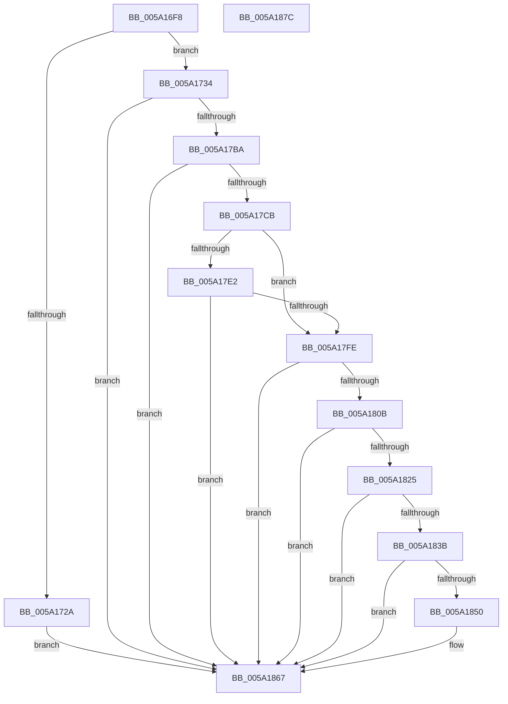

# IopAddMiniDumpPagesToPartialKernelDump

- RVA: `0x005A16F8`–`0x005A187D` (길이 `389` bytes)
- VA: `0x00000001405A16F8`
- 실행 섹션: `.text`
- PDB 이름 있음: `예`; PDB Function 태그: `아니요`
- unwind 정보 RVA: `0x000C7D3C`
- 디코드: `95`개 명령, `389/389` bytes 표시
- 미해석 바이트: `0` (있으면 어셈블리에 `.byte`로 보존)

> 이 문서는 커널 이미지의 기계어와 PDB 기호를 분석해 생성했습니다. 4번과 5번은 함수 원형과 자료형을 바이너리 사용 방식에서 추정한 C 해석이며 원본 소스 복구 결과는 아닙니다.

## 1. Dependencies

- 직접 호출 지점: **10**; 고유 호출 대상: **8**
- 직접 호출자로 확인된 함수: **1**
- RIP 상대 이미지 참조: **4**

### Outgoing calls
- `0x005A17A4` → [IopUpdateMinidumpContext](../59/IopUpdateMinidumpContext_function_00596360.md) (function, `0x00596360`)
- `0x005A17AD` → [MmAddUnloadedDriverInformationToCrashDump](../67/MmAddUnloadedDriverInformationToCrashDump_function_0067D9D8.md) (function, `0x0067D9D8`)
- `0x005A17BE` → [IopMarkPagesForLoadedDriverInformation](IopMarkPagesForLoadedDriverInformation_function_005A20DC.md) (function, `0x005A20DC`)
- `0x005A17D9` → [IopCalculateStackInformation](IopCalculateStackInformation_function_005A1954.md) (function, `0x005A1954`)
- `0x005A17F5` → [IopMarkPagesForRunTimeTriageDataBlocks](IopMarkPagesForRunTimeTriageDataBlocks_function_005A2394.md) (function, `0x005A2394`)
- `0x005A1802` → [IopMarkPagesForDpcData](IopMarkPagesForDpcData_function_005A1C90.md) (function, `0x005A1C90`)
- `0x005A181C` → [MmAddRangeToCrashDump](../67/MmAddRangeToCrashDump_function_0067D8B0.md) (function, `0x0067D8B0`)
- `0x005A1832` → [MmAddRangeToCrashDump](../67/MmAddRangeToCrashDump_function_0067D8B0.md) (function, `0x0067D8B0`)
- `0x005A1847` → [MmAddRangeToCrashDump](../67/MmAddRangeToCrashDump_function_0067D8B0.md) (function, `0x0067D8B0`)
- `0x005A1862` → [IopAddTriageDumpDataToPartialKernelDump](IopAddTriageDumpDataToPartialKernelDump_function_005A18B8.md) (function, `0x005A18B8`)

### Direct callers
- [IoAddPagesForPartialKernelDump](IoAddPagesForPartialKernelDump_function_005A0F3C.md) at `0x005A101F`

### Static image references
- `0x005A1720` → RVA `0x00E66198` (`.data`; read)
- `0x005A1734` → RVA `0x00E66050` (`.data`; read)
- `0x005A1773` → RVA `0x005931F0` (`IoSetDumpRange`; read)
- `0x005A177E` → RVA `0x00E0A9B4` (`.data`; read)

## 2. Other-region calls and transfers

- 다른 실행 섹션으로 향하는 call: **0**
- 별도 외부 분기/꼬리 이동을 확인하지 못했습니다.

## 3. Assembly (complete function range)

```asm
005A16F8  48 89 74 24 08                  mov qword ptr [rsp + 8], rsi
005A16FD  48 89 7C 24 10                  mov qword ptr [rsp + 0x10], rdi
005A1702  55                              push rbp
005A1703  48 8D 6C 24 C9                  lea rbp, [rsp - 0x37]
005A1708  48 81 EC A0 00 00 00            sub rsp, 0xa0
005A170F  48 83 65 27 00                  and qword ptr [rbp + 0x27], 0
005A1714  44 8B D1                        mov r10d, ecx
005A1717  48 83 65 E7 00                  and qword ptr [rbp - 0x19], 0
005A171C  83 65 7F 00                     and dword ptr [rbp + 0x7f], 0
005A1720  48 83 3D 70 4A 8C 00 00         cmp qword ptr [rip + 0x8c4a70], 0
005A1728  75 0A                           jne 0x1405a1734
005A172A  B8 23 00 00 C0                  mov eax, 0xc0000023
005A172F  E9 33 01 00 00                  jmp 0x1405a1867
005A1734  48 8B 05 15 49 8C 00            mov rax, qword ptr [rip + 0x8c4915]
005A173B  48 8B 7D 77                     mov rdi, qword ptr [rbp + 0x77]
005A173F  48 8B 75 6F                     mov rsi, qword ptr [rbp + 0x6f]
005A1743  48 8B 48 08                     mov rcx, qword ptr [rax + 8]
005A1747  48 8B 41 30                     mov rax, qword ptr [rcx + 0x30]
005A174B  48 83 65 07 00                  and qword ptr [rbp + 7], 0
005A1750  83 4D 27 03                     or dword ptr [rbp + 0x27], 3
005A1754  48 89 45 EF                     mov qword ptr [rbp - 0x11], rax
005A1758  48 8D 41 38                     lea rax, [rcx + 0x38]
005A175C  48 89 45 F7                     mov qword ptr [rbp - 9], rax
005A1760  48 8D 45 EF                     lea rax, [rbp - 0x11]
005A1764  48 89 45 0F                     mov qword ptr [rbp + 0xf], rax
005A1768  48 8D 05 29 4A 8C 00            lea rax, [rip + 0x8c4a29]
005A176F  48 89 45 1F                     mov qword ptr [rbp + 0x1f], rax
005A1773  48 8D 05 76 1A FF FF            lea rax, [rip - 0xe58a]
005A177A  48 89 45 FF                     mov qword ptr [rbp - 1], rax
005A177E  8A 05 30 92 86 00               mov al, byte ptr [rip + 0x869230]
005A1784  24 08                           and al, 8
005A1786  48 89 4D 17                     mov qword ptr [rbp + 0x17], rcx
005A178A  88 44 24 40                     mov byte ptr [rsp + 0x40], al
005A178E  41 8B CA                        mov ecx, r10d
005A1791  48 8B 45 67                     mov rax, qword ptr [rbp + 0x67]
005A1795  48 89 7C 24 30                  mov qword ptr [rsp + 0x30], rdi
005A179A  48 89 74 24 28                  mov qword ptr [rsp + 0x28], rsi
005A179F  48 89 44 24 20                  mov qword ptr [rsp + 0x20], rax
005A17A4  E8 B7 4B FF FF                  call 0x140596360
005A17A9  48 8D 4D FF                     lea rcx, [rbp - 1]
005A17AD  E8 26 C2 0D 00                  call 0x14067d9d8
005A17B2  85 C0                           test eax, eax
005A17B4  0F 88 AD 00 00 00               js 0x1405a1867
005A17BA  48 8D 4D FF                     lea rcx, [rbp - 1]
005A17BE  E8 19 09 00 00                  call 0x1405a20dc
005A17C3  85 C0                           test eax, eax
005A17C5  0F 88 9C 00 00 00               js 0x1405a1867
005A17CB  4C 8D 4D 7F                     lea r9, [rbp + 0x7f]
005A17CF  48 8B D6                        mov rdx, rsi
005A17D2  4C 8D 45 E7                     lea r8, [rbp - 0x19]
005A17D6  48 8B CF                        mov rcx, rdi
005A17D9  E8 76 01 00 00                  call 0x1405a1954
005A17DE  84 C0                           test al, al
005A17E0  74 1C                           je 0x1405a17fe
005A17E2  44 8B 4D 7F                     mov r9d, dword ptr [rbp + 0x7f]
005A17E6  48 8D 4D FF                     lea rcx, [rbp - 1]
005A17EA  4C 03 4D E7                     add r9, qword ptr [rbp - 0x19]
005A17EE  48 8B D6                        mov rdx, rsi
005A17F1  4C 8B 45 E7                     mov r8, qword ptr [rbp - 0x19]
005A17F5  E8 9A 0B 00 00                  call 0x1405a2394
005A17FA  85 C0                           test eax, eax
005A17FC  78 69                           js 0x1405a1867
005A17FE  48 8D 4D FF                     lea rcx, [rbp - 1]
005A1802  E8 89 04 00 00                  call 0x1405a1c90
005A1807  85 C0                           test eax, eax
005A1809  78 5C                           js 0x1405a1867
005A180B  48 8B 97 B8 00 00 00            mov rdx, qword ptr [rdi + 0xb8]
005A1812  48 8D 4D FF                     lea rcx, [rbp - 1]
005A1816  41 B8 40 08 00 00               mov r8d, 0x840
005A181C  E8 8F C0 0D 00                  call 0x14067d8b0
005A1821  85 C0                           test eax, eax
005A1823  78 42                           js 0x1405a1867
005A1825  41 B8 98 07 00 00               mov r8d, 0x798
005A182B  48 8D 4D FF                     lea rcx, [rbp - 1]
005A182F  48 8B D7                        mov rdx, rdi
005A1832  E8 79 C0 0D 00                  call 0x14067d8b0
005A1837  85 C0                           test eax, eax
005A1839  78 2C                           js 0x1405a1867
005A183B  44 8B 45 7F                     mov r8d, dword ptr [rbp + 0x7f]
005A183F  48 8D 4D FF                     lea rcx, [rbp - 1]
005A1843  48 8B 55 E7                     mov rdx, qword ptr [rbp - 0x19]
005A1847  E8 64 C0 0D 00                  call 0x14067d8b0
005A184C  85 C0                           test eax, eax
005A184E  78 17                           js 0x1405a1867
005A1850  48 8B 15 F9 47 8C 00            mov rdx, qword ptr [rip + 0x8c47f9]
005A1857  48 8D 4D FF                     lea rcx, [rbp - 1]
005A185B  48 8B 92 88 05 00 00            mov rdx, qword ptr [rdx + 0x588]
005A1862  E8 51 00 00 00                  call 0x1405a18b8
005A1867  4C 8D 9C 24 A0 00 00 00         lea r11, [rsp + 0xa0]
005A186F  49 8B 73 10                     mov rsi, qword ptr [r11 + 0x10]
005A1873  49 8B 7B 18                     mov rdi, qword ptr [r11 + 0x18]
005A1877  49 8B E3                        mov rsp, r11
005A187A  5D                              pop rbp
005A187B  C3                              ret
005A187C  CC                              int3
```

## 4. C-style interpretation (structured pseudocode)

```c
__int64 __fastcall IopAddMiniDumpPagesToPartialKernelDump(int a1, __int64 a2, __int64 a3, __int64 a4, __int64 a5, __int64 a6, __int64 a7, unsigned int a8)
{
    __int64 result;
    __int64 v_rsp;
    unsigned __int64 v_stack_m18;
    unsigned __int64 v_stack_m20;
    unsigned __int64 v_stack_m28;
    unsigned __int64 v_stack_m30;
    unsigned __int64 v_stack_m38;
    unsigned __int64 v_stack_m3F;
    unsigned __int64 v_stack_m40;
    unsigned __int64 v_stack_m48;
    unsigned __int64 v_stack_m50;
    unsigned __int64 v_stack_m58;
    unsigned __int8 v_stack_m68;
    unsigned __int64 v_stack_m78;
    unsigned __int64 v_stack_m8;
    unsigned __int64 v_stack_m80;
    unsigned __int64 v_stack_m88;
    unsigned __int64 v_stack_p10;
    unsigned __int64 v_stack_p8;

    v_stack_p8 = v_rsi;
    v_stack_p10 = v_rdi;
    v_rsp = (v_rsp) - (160);
    if ((*(unsigned __int64 *)(v_rip + 9194096)) != 0) goto loc_005A1734;
    goto loc_005A1867;
loc_005A1734:
    v_stack_m50 = *(unsigned __int64 *)(*(unsigned __int64 *)(*(unsigned __int64 *)(v_rip + 9193749) + 8) + 48);
    v_stack_m48 = *(unsigned __int64 *)(*(unsigned __int64 *)(v_rip + 9193749) + 8) + 56;
    v_stack_m30 = v_stack_m50;
    v_stack_m20 = v_rip + 9194025;
    v_stack_m40 = v_rip - 58762;
    result = (unsigned __int8)((*(unsigned __int8 *)(v_rip + 8819248)) & (8));
    v_stack_m28 = *(unsigned __int64 *)(*(unsigned __int64 *)(v_rip + 9193749) + 8);
    v_stack_m68 = (unsigned __int8)(result);
    v_stack_m78 = a7;
    v_stack_m80 = a6;
    v_stack_m88 = a5;
    result = IopUpdateMinidumpContext((unsigned int)((unsigned int)((unsigned int)(a1))), a2, a3, a4);
    result = MmAddUnloadedDriverInformationToCrashDump(v_stack_m40, a2, a3, a4);
    if (sign_flag) goto loc_005A1867;
    result = IopMarkPagesForLoadedDriverInformation(v_stack_m40, a2, a3, a4);
    if (sign_flag) goto loc_005A1867;
    result = IopCalculateStackInformation(a7, a6, v_stack_m58, a8);
    if ((unsigned __int8)(result) == 0) goto loc_005A17FE;
    a4 = ((unsigned int)(a8)) + (v_stack_m58);
    result = IopMarkPagesForRunTimeTriageDataBlocks(v_stack_m40, a6, v_stack_m58, a4);
    if (sign_flag) goto loc_005A1867;
loc_005A17FE:
    result = IopMarkPagesForDpcData(v_stack_m40, a6, v_stack_m58, a4);
    if (sign_flag) goto loc_005A1867;
    result = MmAddRangeToCrashDump(v_stack_m40, *(unsigned __int64 *)(a7 + 184), (unsigned int)(0x840ULL), a4);
    if (sign_flag) goto loc_005A1867;
    result = MmAddRangeToCrashDump(v_stack_m40, a7, (unsigned int)(0x798ULL), a4);
    if (sign_flag) goto loc_005A1867;
    result = MmAddRangeToCrashDump(v_stack_m40, v_stack_m58, (unsigned int)(a8), a4);
    if (!(sign_flag)) {
        a2 = *(unsigned __int64 *)(v_rip + 9193465);
        a1 = v_stack_m40;
        a2 = *(unsigned __int64 *)(a2 + 1416);
        result = IopAddTriageDumpDataToPartialKernelDump(a1, a2, (unsigned int)(a8), a4);
    }
    return result;
}
```

## 5. (Beta) C Style

```c
int64_t IopAddMiniDumpPagesToPartialKernelDump(int32_t Arg1, int64_t Arg2, int64_t Arg3, int64_t Arg4, int64_t Arg5, int64_t Arg6, void *Arg7, uint32_t Arg8)
{
    uint8_t *arg7 = (uint8_t *)Arg7;

    int64_t result;
    int64_t local_rsp;
    uint64_t v_stack_m18;
    uint64_t v_stack_m20;
    uint64_t v_stack_m28;
    uint64_t v_stack_m30;
    uint64_t v_stack_m38;
    uint64_t v_stack_m3F;
    uint64_t v_stack_m40;
    uint64_t v_stack_m48;
    uint64_t v_stack_m50;
    uint64_t v_stack_m58;
    uint8_t v_stack_m68;
    uint64_t v_stack_m78;
    uint64_t v_stack_m8;
    uint64_t v_stack_m80;
    uint64_t v_stack_m88;
    uint64_t v_stack_p10;
    uint64_t v_stack_p8;

    v_stack_p8 = local_rsi;
    v_stack_p10 = local_rdi;
    local_rsp = (local_rsp) - (160);
    if ((*(uint64_t *)(v_rip + 0x8C4A70)) != 0) goto loc_005A1734;
    goto loc_005A1867;
loc_005A1734:
    v_stack_m50 = *(uint64_t *)(*(uint64_t *)(*(uint64_t *)(v_rip + 0x8C4915) + 0x8) + 0x30);
    v_stack_m48 = *(uint64_t *)(*(uint64_t *)(v_rip + 0x8C4915) + 0x8) + 56;
    v_stack_m30 = v_stack_m50;
    v_stack_m20 = v_rip + 9194025;
    v_stack_m40 = v_rip - 58762;
    result = (uint8_t)((*(uint8_t *)(v_rip + 0x869230)) & (8));
    v_stack_m28 = *(uint64_t *)(*(uint64_t *)(v_rip + 0x8C4915) + 0x8);
    v_stack_m68 = (uint8_t)(result);
    v_stack_m78 = Arg7;
    v_stack_m80 = Arg6;
    v_stack_m88 = Arg5;
    result = IopUpdateMinidumpContext((uint32_t)((uint32_t)((uint32_t)(Arg1))), Arg2, Arg3, Arg4);
    result = MmAddUnloadedDriverInformationToCrashDump(v_stack_m40, Arg2, Arg3, Arg4);
    if (sign_flag) goto loc_005A1867;
    result = IopMarkPagesForLoadedDriverInformation(v_stack_m40, Arg2, Arg3, Arg4);
    if (sign_flag) goto loc_005A1867;
    result = IopCalculateStackInformation(Arg7, Arg6, v_stack_m58, Arg8);
    if ((uint8_t)(result) == 0) goto loc_005A17FE;
    Arg4 = ((uint32_t)(Arg8)) + (v_stack_m58);
    result = IopMarkPagesForRunTimeTriageDataBlocks(v_stack_m40, Arg6, v_stack_m58, Arg4);
    if (sign_flag) goto loc_005A1867;
loc_005A17FE:
    result = IopMarkPagesForDpcData(v_stack_m40, Arg6, v_stack_m58, Arg4);
    if (sign_flag) goto loc_005A1867;
    result = MmAddRangeToCrashDump(v_stack_m40, *(uint64_t *)(arg7 + 0xB8), (uint32_t)(0x840ULL), Arg4);
    if (sign_flag) goto loc_005A1867;
    result = MmAddRangeToCrashDump(v_stack_m40, Arg7, (uint32_t)(0x798ULL), Arg4);
    if (sign_flag) goto loc_005A1867;
    result = MmAddRangeToCrashDump(v_stack_m40, v_stack_m58, (uint32_t)(Arg8), Arg4);
    if (!(sign_flag)) {
        Arg2 = *(uint64_t *)(v_rip + 0x8C47F9);
        Arg1 = v_stack_m40;
        Arg2 = *(uint64_t *)(Arg2 + 0x588);
        result = IopAddTriageDumpDataToPartialKernelDump(Arg1, Arg2, (uint32_t)(Arg8), Arg4);
    }
    return result;
}
```

### 관측된 메모리 오프셋

구조체 형식이 확인되지 않은 접근은 인자 기준의 오프셋으로만 기록했습니다.

| 기준 인자 | 오프셋 표현 | 폭 (bit) | 접근 |
|---|---:|---:|---|
| `Arg7` | `+ 0xB8` | `64` | `R` |

## 6. Execution-region graph

[열기: 2D/3D 그래프와 함수 탐색 컨트롤 패널](../../../control-panel.html?section=text&rva=0x005A16F8&view=graph)

- 2D 그래프는 위에서 아래로 흐르고, 3D 그래프는 빈 공간을 드래그해 회전합니다. Shift+드래그는 이동, 휠은 확대·축소, 함수 노드 선택은 대상 보고서 이동입니다.

### Static fallback


