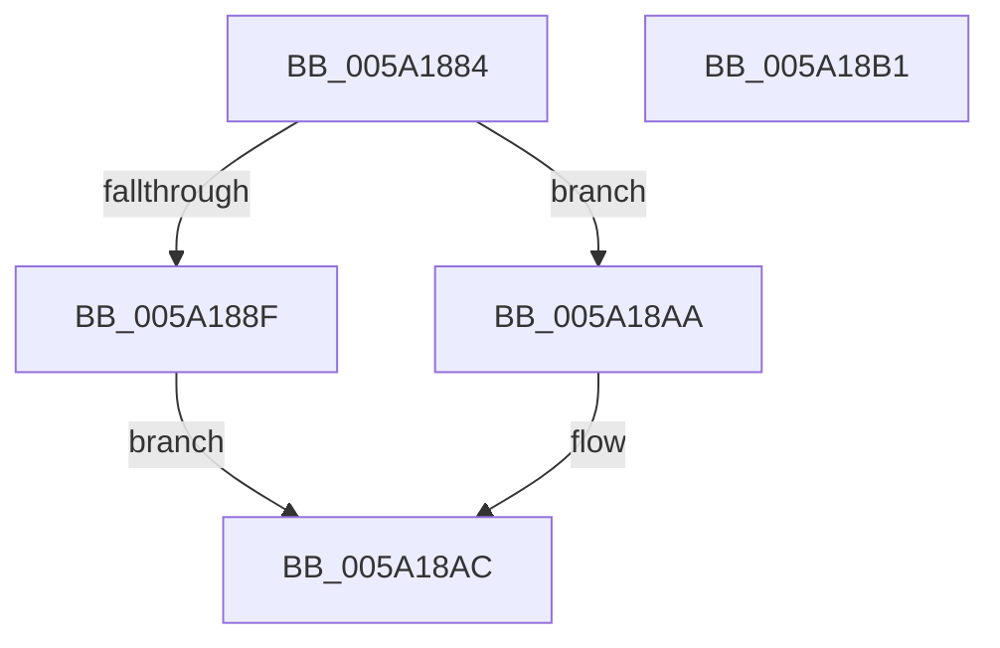

# IopAddStackSegmentKernelShadowStackToDump

- RVA: `0x005A1884`–`0x005A18B2` (길이 `46` bytes)
- VA: `0x00000001405A1884`
- 실행 섹션: `.text`
- PDB 이름 있음: `예`; PDB Function 태그: `아니요`
- unwind 정보 RVA: `0x0005C788`
- 디코드: `13`개 명령, `46/46` bytes 표시
- 미해석 바이트: `0` (있으면 어셈블리에 `.byte`로 보존)

> 이 문서는 커널 이미지의 기계어와 PDB 기호를 분석해 생성했습니다. 4번과 5번은 함수 원형과 자료형을 바이너리 사용 방식에서 추정한 C 해석이며 원본 소스 복구 결과는 아닙니다.

## 1. Dependencies

- 직접 호출 지점: **1**; 고유 호출 대상: **1**
- 직접 호출자로 확인된 함수: **2**
- RIP 상대 이미지 참조: **0**

### Outgoing calls
- `0x005A18A3` → [MmAddRangeToCrashDump](../67/MmAddRangeToCrashDump_function_0067D8B0.md) (function, `0x0067D8B0`)

### Direct callers
- [IoAddThreadStackToDump](IoAddThreadStackToDump_function_005A1210.md) at `0x005A1246`
- [IopMarkPagesForProcessorData](IopMarkPagesForProcessorData_function_005A21C8.md) at `0x005A22BB`

### Static image references
- 디코드된 RIP-relative 메모리 참조가 없습니다.

## 2. Other-region calls and transfers

- 다른 실행 섹션으로 향하는 call: **0**
- 별도 외부 분기/꼬리 이동을 확인하지 못했습니다.

## 3. Assembly (complete function range)

```asm
005A1884  48 83 EC 28                     sub rsp, 0x28
005A1888  48 83 7A 30 00                  cmp qword ptr [rdx + 0x30], 0
005A188D  74 1B                           je 0x1405a18aa
005A188F  48 8B 52 28                     mov rdx, qword ptr [rdx + 0x28]
005A1893  41 B8 00 10 00 00               mov r8d, 0x1000
005A1899  48 81 E2 00 F0 FF FF            and rdx, 0xfffffffffffff000
005A18A0  49 03 D0                        add rdx, r8
005A18A3  E8 08 C0 0D 00                  call 0x14067d8b0
005A18A8  EB 02                           jmp 0x1405a18ac
005A18AA  33 C0                           xor eax, eax
005A18AC  48 83 C4 28                     add rsp, 0x28
005A18B0  C3                              ret
005A18B1  CC                              int3
```

## 4. C-style interpretation (structured pseudocode)

```c
__int64 __fastcall IopAddStackSegmentKernelShadowStackToDump(__int64 a1, __int64 a2)
{
    __int64 result;
    __int64 v_rsp;

    v_rsp = (v_rsp) - (40);
    if ((*(unsigned __int64 *)(a2 + 48)) == 0) goto loc_005A18AA;
    a2 = (*(unsigned __int64 *)(a2 + 40)) & (0xFFFFFFFFFFFFF000ULL);
    a2 = (a2) + ((unsigned int)(0x1000ULL));
    result = MmAddRangeToCrashDump(a1, a2, (unsigned int)(0x1000ULL), a4);
    goto loc_005A18AC;
loc_005A18AA:
    result = 0;
loc_005A18AC:
    v_rsp = (v_rsp) + (40);
    return result;
}
```

## 5. (Beta) C Style

```c
int64_t IopAddStackSegmentKernelShadowStackToDump(int64_t Arg1, void *Arg2)
{
    uint8_t *arg2 = (uint8_t *)Arg2;

    int64_t result;
    int64_t local_rsp;

    local_rsp = (local_rsp) - (40);
    if ((*(uint64_t *)(arg2 + 0x30)) == 0) goto loc_005A18AA;
    Arg2 = (*(uint64_t *)(arg2 + 0x28)) & (0xFFFFFFFFFFFFF000ULL);
    Arg2 = (Arg2) + ((uint32_t)(0x1000ULL));
    result = MmAddRangeToCrashDump(Arg1, Arg2, (uint32_t)(0x1000ULL), a4);
    goto loc_005A18AC;
loc_005A18AA:
    result = 0;
loc_005A18AC:
    local_rsp = (local_rsp) + (40);
    return result;
}
```

### 관측된 메모리 오프셋

구조체 형식이 확인되지 않은 접근은 인자 기준의 오프셋으로만 기록했습니다.

| 기준 인자 | 오프셋 표현 | 폭 (bit) | 접근 |
|---|---:|---:|---|
| `Arg2` | `+ 0x28` | `64` | `R` |
| `Arg2` | `+ 0x30` | `64` | `R` |

## 6. Execution-region graph

[열기: 2D/3D 그래프와 함수 탐색 컨트롤 패널](../../../control-panel.html?section=text&rva=0x005A1884&view=graph)

- 2D 그래프는 위에서 아래로 흐르고, 3D 그래프는 빈 공간을 드래그해 회전합니다. Shift+드래그는 이동, 휠은 확대·축소, 함수 노드 선택은 대상 보고서 이동입니다.

### Static fallback


