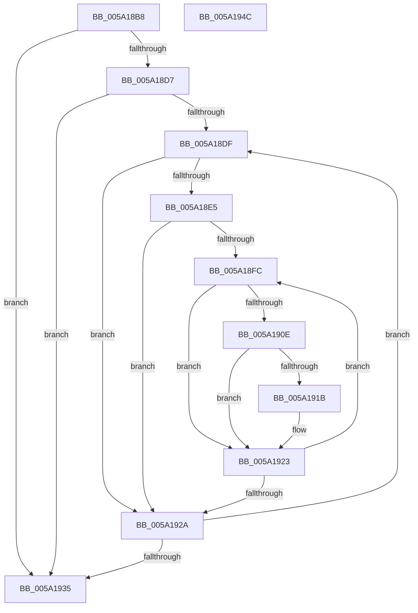

# IopAddTriageDumpDataToPartialKernelDump

- RVA: `0x005A18B8`–`0x005A194D` (길이 `149` bytes)
- VA: `0x00000001405A18B8`
- 실행 섹션: `.text`
- PDB 이름 있음: `예`; PDB Function 태그: `아니요`
- unwind 정보 RVA: `0x0005C954`
- 디코드: `48`개 명령, `149/149` bytes 표시
- 미해석 바이트: `0` (있으면 어셈블리에 `.byte`로 보존)

> 이 문서는 커널 이미지의 기계어와 PDB 기호를 분석해 생성했습니다. 4번과 5번은 함수 원형과 자료형을 바이너리 사용 방식에서 추정한 C 해석이며 원본 소스 복구 결과는 아닙니다.

## 1. Dependencies

- 직접 호출 지점: **2**; 고유 호출 대상: **1**
- 직접 호출자로 확인된 함수: **1**
- RIP 상대 이미지 참조: **0**

### Outgoing calls
- `0x005A18F0` → [MmAddRangeToCrashDump](../67/MmAddRangeToCrashDump_function_0067D8B0.md) (function, `0x0067D8B0`)
- `0x005A191E` → [MmAddRangeToCrashDump](../67/MmAddRangeToCrashDump_function_0067D8B0.md) (function, `0x0067D8B0`)

### Direct callers
- [IopAddMiniDumpPagesToPartialKernelDump](IopAddMiniDumpPagesToPartialKernelDump_function_005A16F8.md) at `0x005A1862`

### Static image references
- 디코드된 RIP-relative 메모리 참조가 없습니다.

## 2. Other-region calls and transfers

- 다른 실행 섹션으로 향하는 call: **0**
- 별도 외부 분기/꼬리 이동을 확인하지 못했습니다.

## 3. Assembly (complete function range)

```asm
005A18B8  48 89 5C 24 08                  mov qword ptr [rsp + 8], rbx
005A18BD  48 89 6C 24 10                  mov qword ptr [rsp + 0x10], rbp
005A18C2  48 89 74 24 18                  mov qword ptr [rsp + 0x18], rsi
005A18C7  57                              push rdi
005A18C8  48 83 EC 20                     sub rsp, 0x20
005A18CC  48 8B FA                        mov rdi, rdx
005A18CF  48 8B E9                        mov rbp, rcx
005A18D2  48 85 D2                        test rdx, rdx
005A18D5  74 5E                           je 0x1405a1935
005A18D7  48 8B 1A                        mov rbx, qword ptr [rdx]
005A18DA  48 3B DA                        cmp rbx, rdx
005A18DD  74 56                           je 0x1405a1935
005A18DF  83 7B 10 00                     cmp dword ptr [rbx + 0x10], 0
005A18E3  76 45                           jbe 0x1405a192a
005A18E5  44 8B 43 20                     mov r8d, dword ptr [rbx + 0x20]
005A18E9  48 8B CD                        mov rcx, rbp
005A18EC  48 8B 53 28                     mov rdx, qword ptr [rbx + 0x28]
005A18F0  E8 BB BF 0D 00                  call 0x14067d8b0
005A18F5  33 F6                           xor esi, esi
005A18F7  39 73 10                        cmp dword ptr [rbx + 0x10], esi
005A18FA  76 2E                           jbe 0x1405a192a
005A18FC  48 8D 46 03                     lea rax, [rsi + 3]
005A1900  8B CE                           mov ecx, esi
005A1902  48 03 C0                        add rax, rax
005A1905  48 8B 14 C3                     mov rdx, qword ptr [rbx + rax*8]
005A1909  48 85 D2                        test rdx, rdx
005A190C  74 15                           je 0x1405a1923
005A190E  48 03 C9                        add rcx, rcx
005A1911  4C 8B 44 CB 38                  mov r8, qword ptr [rbx + rcx*8 + 0x38]
005A1916  4D 85 C0                        test r8, r8
005A1919  74 08                           je 0x1405a1923
005A191B  48 8B CD                        mov rcx, rbp
005A191E  E8 8D BF 0D 00                  call 0x14067d8b0
005A1923  FF C6                           inc esi
005A1925  3B 73 10                        cmp esi, dword ptr [rbx + 0x10]
005A1928  72 D2                           jb 0x1405a18fc
005A192A  48 8B 03                        mov rax, qword ptr [rbx]
005A192D  48 8B D8                        mov rbx, rax
005A1930  48 3B C7                        cmp rax, rdi
005A1933  75 AA                           jne 0x1405a18df
005A1935  48 8B 5C 24 30                  mov rbx, qword ptr [rsp + 0x30]
005A193A  33 C0                           xor eax, eax
005A193C  48 8B 6C 24 38                  mov rbp, qword ptr [rsp + 0x38]
005A1941  48 8B 74 24 40                  mov rsi, qword ptr [rsp + 0x40]
005A1946  48 83 C4 20                     add rsp, 0x20
005A194A  5F                              pop rdi
005A194B  C3                              ret
005A194C  CC                              int3
```

## 4. C-style interpretation (structured pseudocode)

```c
__int64 __fastcall IopAddTriageDumpDataToPartialKernelDump(__int64 a1, __int64 a2)
{
    __int64 result;
    __int64 v_rsi;
    __int64 v_rsp;
    unsigned __int64 v_stack_p10;
    unsigned __int64 v_stack_p18;
    unsigned __int64 v_stack_p8;

    v_stack_p8 = v_rbx;
    v_stack_p10 = v_rbp;
    v_stack_p18 = v_rsi;
    v_rsp = (v_rsp) - (32);
    if (a2 == 0) goto loc_005A1935;
    if ((*(unsigned __int64 *)(a2)) == a2) goto loc_005A1935;
loc_005A18DF:
    if ((*(unsigned int *)(*(unsigned __int64 *)(a2) + 16)) <= 0) goto loc_005A192A;
    result = MmAddRangeToCrashDump(a1, *(unsigned __int64 *)(*(unsigned __int64 *)(a2) + 40), (unsigned int)(*(unsigned int *)(*(unsigned __int64 *)(a2) + 32)), a4);
    v_rsi = 0;
    if ((*(unsigned int *)(*(unsigned __int64 *)(a2) + 16)) <= 0) goto loc_005A192A;
loc_005A18FC:
    result = (v_rsi + 3) + (v_rsi + 3);
    if (*(unsigned __int64 *)(*(unsigned __int64 *)(a2) + result * 8) == 0) goto loc_005A1923;
    a1 = (0) + (0);
    if (*(unsigned __int64 *)(*(unsigned __int64 *)(a2) + a1 * 8 + 56) != 0) {
        a1 = a1;
        result = MmAddRangeToCrashDump(a1, *(unsigned __int64 *)(*(unsigned __int64 *)(a2) + result * 8), *(unsigned __int64 *)(*(unsigned __int64 *)(a2) + a1 * 8 + 56), a4);
    }
    v_rsi = (unsigned int)((v_rsi) + 1);
    if (((unsigned int)(v_rsi)) < (*(unsigned int *)(*(unsigned __int64 *)(a2) + 16))) goto loc_005A18FC;
loc_005A192A:
    if ((*(unsigned __int64 *)(*(unsigned __int64 *)(a2))) != a2) goto loc_005A18DF;
loc_005A1935:
    result = 0;
    v_rsp = (v_rsp) + (32);
    return result;
}
```

## 5. (Beta) C Style

```c
int64_t IopAddTriageDumpDataToPartialKernelDump(int64_t Arg1, int64_t Arg2)
{
    int64_t result;
    int64_t local_rsi;
    int64_t local_rsp;
    uint64_t v_stack_p10;
    uint64_t v_stack_p18;
    uint64_t v_stack_p8;

    v_stack_p8 = local_rbx;
    v_stack_p10 = local_rbp;
    v_stack_p18 = local_rsi;
    local_rsp = (local_rsp) - (32);
    if (Arg2 == 0) goto loc_005A1935;
    if ((*(uint64_t *)(Arg2)) == Arg2) goto loc_005A1935;
loc_005A18DF:
    if ((*(uint32_t *)(*(uint64_t *)(Arg2) + 0x10)) <= 0) goto loc_005A192A;
    result = MmAddRangeToCrashDump(Arg1, *(uint64_t *)(*(uint64_t *)(Arg2) + 0x28), (uint32_t)(*(uint32_t *)(*(uint64_t *)(Arg2) + 0x20)), a4);
    local_rsi = 0;
    if ((*(uint32_t *)(*(uint64_t *)(Arg2) + 0x10)) <= 0) goto loc_005A192A;
loc_005A18FC:
    result = (local_rsi + 3) + (local_rsi + 3);
    if (*(uint64_t *)(*(uint64_t *)(Arg2) + result * 8) == 0) goto loc_005A1923;
    Arg1 = (0) + (0);
    if (*(uint64_t *)(*(uint64_t *)(Arg2) + Arg1 * 8 + 0x38) != 0) {
        Arg1 = Arg1;
        result = MmAddRangeToCrashDump(Arg1, *(uint64_t *)(*(uint64_t *)(Arg2) + result * 8), *(uint64_t *)(*(uint64_t *)(Arg2) + Arg1 * 8 + 0x38), a4);
    }
    local_rsi = (uint32_t)((local_rsi) + 1);
    if (((uint32_t)(local_rsi)) < (*(uint32_t *)(*(uint64_t *)(Arg2) + 0x10))) goto loc_005A18FC;
loc_005A192A:
    if ((*(uint64_t *)(*(uint64_t *)(Arg2))) != Arg2) goto loc_005A18DF;
loc_005A1935:
    result = 0;
    local_rsp = (local_rsp) + (32);
    return result;
}
```

## 6. Execution-region graph

[열기: 2D/3D 그래프와 함수 탐색 컨트롤 패널](../../../control-panel.html?section=text&rva=0x005A18B8&view=graph)

- 2D 그래프는 위에서 아래로 흐르고, 3D 그래프는 빈 공간을 드래그해 회전합니다. Shift+드래그는 이동, 휠은 확대·축소, 함수 노드 선택은 대상 보고서 이동입니다.

### Static fallback


