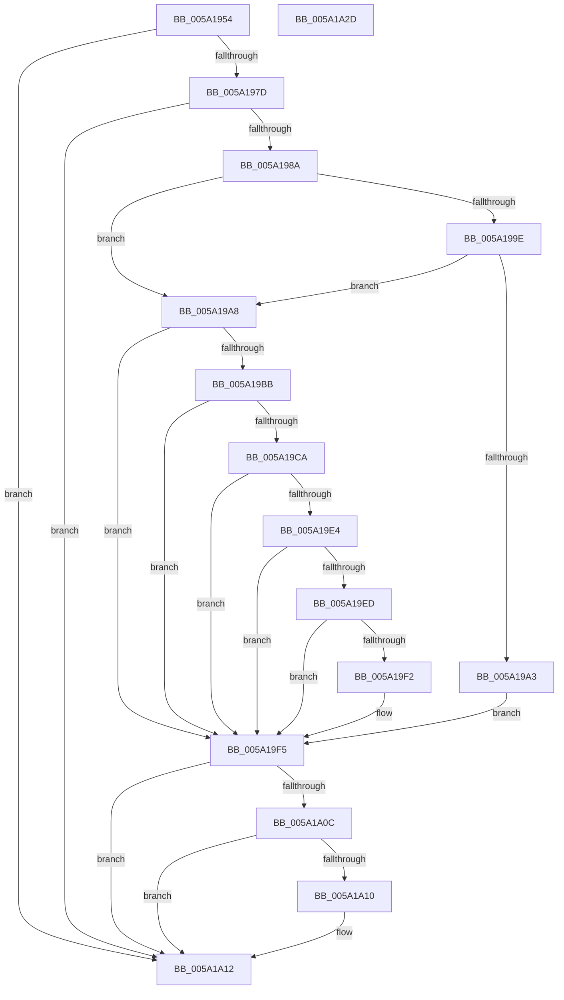

# IopCalculateStackInformation

- RVA: `0x005A1954`–`0x005A1A2E` (길이 `218` bytes)
- VA: `0x00000001405A1954`
- 실행 섹션: `.text`
- PDB 이름 있음: `예`; PDB Function 태그: `아니요`
- unwind 정보 RVA: `0x00060300`
- 디코드: `64`개 명령, `218/218` bytes 표시
- 미해석 바이트: `0` (있으면 어셈블리에 `.byte`로 보존)

> 이 문서는 커널 이미지의 기계어와 PDB 기호를 분석해 생성했습니다. 4번과 5번은 함수 원형과 자료형을 바이너리 사용 방식에서 추정한 C 해석이며 원본 소스 복구 결과는 아닙니다.

## 1. Dependencies

- 직접 호출 지점: **2**; 고유 호출 대상: **2**
- 직접 호출자로 확인된 함수: **1**
- RIP 상대 이미지 참조: **0**

### Outgoing calls
- `0x005A19DB` → [IopIsAddressRangeValid](../4B/IopIsAddressRangeValid_function_004B6CBC.md) (function, `0x004B6CBC`)
- `0x005A19FF` → [IopGetMaxValidMemorySize](../59/IopGetMaxValidMemorySize_function_0059559C.md) (function, `0x0059559C`)

### Direct callers
- [IopAddMiniDumpPagesToPartialKernelDump](IopAddMiniDumpPagesToPartialKernelDump_function_005A16F8.md) at `0x005A17D9`

### Static image references
- 디코드된 RIP-relative 메모리 참조가 없습니다.

## 2. Other-region calls and transfers

- 다른 실행 섹션으로 향하는 call: **0**
- 별도 외부 분기/꼬리 이동을 확인하지 못했습니다.

## 3. Assembly (complete function range)

```asm
005A1954  48 89 5C 24 08                  mov qword ptr [rsp + 8], rbx
005A1959  48 89 6C 24 10                  mov qword ptr [rsp + 0x10], rbp
005A195E  48 89 74 24 18                  mov qword ptr [rsp + 0x18], rsi
005A1963  57                              push rdi
005A1964  41 56                           push r14
005A1966  41 57                           push r15
005A1968  48 83 EC 20                     sub rsp, 0x20
005A196C  33 DB                           xor ebx, ebx
005A196E  4D 8B F9                        mov r15, r9
005A1971  49 8B F8                        mov rdi, r8
005A1974  48 85 C9                        test rcx, rcx
005A1977  0F 84 95 00 00 00               je 0x1405a1a12
005A197D  F7 41 78 00 00 02 00            test dword ptr [rcx + 0x78], 0x20000
005A1984  0F 84 88 00 00 00               je 0x1405a1a12
005A198A  48 8B 82 98 00 00 00            mov rax, qword ptr [rdx + 0x98]
005A1991  4C 8B 71 30                     mov r14, qword ptr [rcx + 0x30]
005A1995  48 8B 71 38                     mov rsi, qword ptr [rcx + 0x38]
005A1999  4C 3B F0                        cmp r14, rax
005A199C  77 0A                           ja 0x1405a19a8
005A199E  48 3B C6                        cmp rax, rsi
005A19A1  73 05                           jae 0x1405a19a8
005A19A3  49 89 00                        mov qword ptr [r8], rax
005A19A6  EB 4D                           jmp 0x1405a19f5
005A19A8  48 8B 41 30                     mov rax, qword ptr [rcx + 0x30]
005A19AC  49 89 00                        mov qword ptr [r8], rax
005A19AF  65 8A 04 25 3C 3A 00 00         mov al, byte ptr gs:[0x3a3c]
005A19B7  A8 01                           test al, 1
005A19B9  74 3A                           je 0x1405a19f5
005A19BB  65 48 8B 04 25 20 00 00 00      mov rax, qword ptr gs:[0x20]
005A19C4  48 3B 48 18                     cmp rcx, qword ptr [rax + 0x18]
005A19C8  74 2B                           je 0x1405a19f5
005A19CA  65 48 8B 2C 25 20 3A 00 00      mov rbp, qword ptr gs:[0x3a20]
005A19D3  BA 50 00 00 00                  mov edx, 0x50
005A19D8  48 8B CD                        mov rcx, rbp
005A19DB  E8 DC 52 F1 FF                  call 0x1404b6cbc
005A19E0  84 C0                           test al, al
005A19E2  74 11                           je 0x1405a19f5
005A19E4  48 8B 45 40                     mov rax, qword ptr [rbp + 0x40]
005A19E8  4C 3B F0                        cmp r14, rax
005A19EB  77 08                           ja 0x1405a19f5
005A19ED  48 3B C6                        cmp rax, rsi
005A19F0  73 03                           jae 0x1405a19f5
005A19F2  48 89 07                        mov qword ptr [rdi], rax
005A19F5  2B 37                           sub esi, dword ptr [rdi]
005A19F7  48 8B 0F                        mov rcx, qword ptr [rdi]
005A19FA  8B D6                           mov edx, esi
005A19FC  41 89 37                        mov dword ptr [r15], esi
005A19FF  E8 98 3B FF FF                  call 0x14059559c
005A1A04  41 89 07                        mov dword ptr [r15], eax
005A1A07  48 39 1F                        cmp qword ptr [rdi], rbx
005A1A0A  76 06                           jbe 0x1405a1a12
005A1A0C  85 C0                           test eax, eax
005A1A0E  74 02                           je 0x1405a1a12
005A1A10  B3 01                           mov bl, 1
005A1A12  48 8B 6C 24 48                  mov rbp, qword ptr [rsp + 0x48]
005A1A17  8A C3                           mov al, bl
005A1A19  48 8B 5C 24 40                  mov rbx, qword ptr [rsp + 0x40]
005A1A1E  48 8B 74 24 50                  mov rsi, qword ptr [rsp + 0x50]
005A1A23  48 83 C4 20                     add rsp, 0x20
005A1A27  41 5F                           pop r15
005A1A29  41 5E                           pop r14
005A1A2B  5F                              pop rdi
005A1A2C  C3                              ret
005A1A2D  CC                              int3
```

## 4. C-style interpretation (structured pseudocode)

```c
__int64 __fastcall IopCalculateStackInformation(__int64 a1, __int64 a2, __int64 a3, __int64 a4)
{
    __int64 result;
    __int64 v_rbx;
    __int64 v_rsi;
    __int64 v_rsp;
    unsigned __int64 v_stack_p10;
    unsigned __int64 v_stack_p18;
    unsigned __int64 v_stack_p8;

    v_stack_p8 = v_rbx;
    v_stack_p10 = v_rbp;
    v_stack_p18 = v_rsi;
    v_rsp = (v_rsp) - (32);
    v_rbx = 0;
    if (a1 == 0) goto loc_005A1A12;
    if (((*(unsigned int *)(a1 + 120)) & (0x20000ULL)) == 0) goto loc_005A1A12;
    if ((*(unsigned __int64 *)(a1 + 48)) > (*(unsigned __int64 *)(a2 + 152))) goto loc_005A19A8;
    if ((*(unsigned __int64 *)(a2 + 152)) >= (*(unsigned __int64 *)(a1 + 56))) goto loc_005A19A8;
    *(unsigned __int64 *)(a3) = *(unsigned __int64 *)(a2 + 152);
    goto loc_005A19F5;
loc_005A19A8:
    *(unsigned __int64 *)(a3) = *(unsigned __int64 *)(a1 + 48);
    if ((((unsigned __int8)(*(unsigned __int8 *)(gs_base + (0 + 14908)))) & (1)) == 0) goto loc_005A19F5;
    if (a1 == (*(unsigned __int64 *)(*(unsigned __int64 *)(gs_base + (0 + 32)) + 24))) goto loc_005A19F5;
    result = IopIsAddressRangeValid(*(unsigned __int64 *)(gs_base + (0 + 14880)), 80, a3, a4);
    if ((unsigned __int8)(result) == 0) goto loc_005A19F5;
    if ((*(unsigned __int64 *)(a1 + 48)) > (*(unsigned __int64 *)(*(unsigned __int64 *)(gs_base + (0 + 14880)) + 64))) goto loc_005A19F5;
    if ((*(unsigned __int64 *)(*(unsigned __int64 *)(gs_base + (0 + 14880)) + 64)) < (*(unsigned __int64 *)(a1 + 56))) {
        *(unsigned __int64 *)(a3) = *(unsigned __int64 *)(*(unsigned __int64 *)(gs_base + (0 + 14880)) + 64);
    }
    v_rsi = (unsigned int)((*(unsigned __int64 *)(a1 + 56)) - (*(unsigned int *)(a3)));
    *(unsigned int *)(a4) = (unsigned int)(v_rsi);
    result = IopGetMaxValidMemorySize(*(unsigned __int64 *)(a3), (unsigned int)((unsigned int)(v_rsi)), a3, a4);
    *(unsigned int *)(a4) = (unsigned int)(result);
    if ((*(unsigned __int64 *)(a3)) <= 0) goto loc_005A1A12;
    if ((unsigned int)(result) != 0) {
        v_rbx = 1;
    }
    v_rsp = (v_rsp) + (32);
    return (unsigned __int8)(v_rbx);
}
```

## 5. (Beta) C Style

```c
int64_t IopCalculateStackInformation(int64_t Arg1, void *Arg2, void *Arg3, void *Arg4)
{
    uint8_t *arg2 = (uint8_t *)Arg2;
    uint8_t *arg3 = (uint8_t *)Arg3;
    uint8_t *arg4 = (uint8_t *)Arg4;

    int64_t result;
    int64_t local_rbx;
    int64_t local_rsi;
    int64_t local_rsp;
    uint64_t v_stack_p10;
    uint64_t v_stack_p18;
    uint64_t v_stack_p8;

    v_stack_p8 = local_rbx;
    v_stack_p10 = local_rbp;
    v_stack_p18 = local_rsi;
    local_rsp = (local_rsp) - (32);
    local_rbx = 0;
    if (Arg1 == 0) goto loc_005A1A12;
    if (((*(uint32_t *)(Arg1 + 0x78)) & (0x20000ULL)) == 0) goto loc_005A1A12;
    if ((*(uint64_t *)(Arg1 + 0x30)) > (*(uint64_t *)(arg2 + 0x98))) goto loc_005A19A8;
    if ((*(uint64_t *)(arg2 + 0x98)) >= (*(uint64_t *)(Arg1 + 0x38))) goto loc_005A19A8;
    *(uint64_t *)(arg3) = *(uint64_t *)(arg2 + 0x98);
    goto loc_005A19F5;
loc_005A19A8:
    *(uint64_t *)(arg3) = *(uint64_t *)(Arg1 + 0x30);
    if ((((uint8_t)(*(uint8_t *)(gs_base + (0 + 0x3A3C)))) & (1)) == 0) goto loc_005A19F5;
    if (Arg1 == (*(uint64_t *)(*(uint64_t *)(gs_base + (0 + 0x20)) + 0x18))) goto loc_005A19F5;
    result = IopIsAddressRangeValid(*(uint64_t *)(gs_base + (0 + 0x3A20)), 80, Arg3, Arg4);
    if ((uint8_t)(result) == 0) goto loc_005A19F5;
    if ((*(uint64_t *)(Arg1 + 0x30)) > (*(uint64_t *)(*(uint64_t *)(gs_base + (0 + 0x3A20)) + 0x40))) goto loc_005A19F5;
    if ((*(uint64_t *)(*(uint64_t *)(gs_base + (0 + 0x3A20)) + 0x40)) < (*(uint64_t *)(Arg1 + 0x38))) {
        *(uint64_t *)(arg3) = *(uint64_t *)(*(uint64_t *)(gs_base + (0 + 0x3A20)) + 0x40);
    }
    local_rsi = (uint32_t)((*(uint64_t *)(Arg1 + 0x38)) - (*(uint32_t *)(arg3)));
    *(uint32_t *)(arg4) = (uint32_t)(local_rsi);
    result = IopGetMaxValidMemorySize(*(uint64_t *)(arg3), (uint32_t)((uint32_t)(local_rsi)), Arg3, Arg4);
    *(uint32_t *)(arg4) = (uint32_t)(result);
    if ((*(uint64_t *)(arg3)) <= 0) goto loc_005A1A12;
    if ((uint32_t)(result) != 0) {
        local_rbx = 1;
    }
    local_rsp = (local_rsp) + (32);
    return (uint8_t)(local_rbx);
}
```

### 관측된 메모리 오프셋

구조체 형식이 확인되지 않은 접근은 인자 기준의 오프셋으로만 기록했습니다.

| 기준 인자 | 오프셋 표현 | 폭 (bit) | 접근 |
|---|---:|---:|---|
| `Arg2` | `+ 0x98` | `64` | `R` |
| `Arg3` | `+ 0x0` | `32` | `R` |
| `Arg3` | `+ 0x0` | `64` | `R` |
| `Arg3` | `+ 0x0` | `64` | `W` |
| `Arg4` | `+ 0x0` | `32` | `W` |

## 6. Execution-region graph

[열기: 2D/3D 그래프와 함수 탐색 컨트롤 패널](../../../control-panel.html?section=text&rva=0x005A1954&view=graph)

- 2D 그래프는 위에서 아래로 흐르고, 3D 그래프는 빈 공간을 드래그해 회전합니다. Shift+드래그는 이동, 휠은 확대·축소, 함수 노드 선택은 대상 보고서 이동입니다.

### Static fallback


