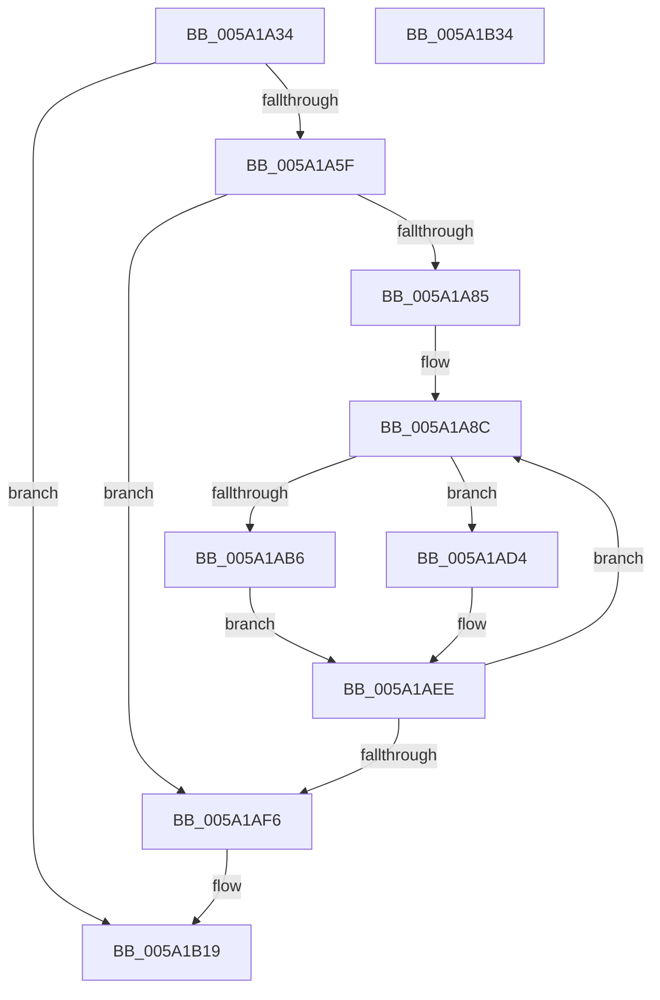

# IopCompactRemovePagesArray

- RVA: `0x005A1A34`–`0x005A1B35` (길이 `257` bytes)
- VA: `0x00000001405A1A34`
- 실행 섹션: `.text`
- PDB 이름 있음: `예`; PDB Function 태그: `아니요`
- unwind 정보 RVA: `0x0005E6B4`
- 디코드: `74`개 명령, `257/257` bytes 표시
- 미해석 바이트: `0` (있으면 어셈블리에 `.byte`로 보존)

> 이 문서는 커널 이미지의 기계어와 PDB 기호를 분석해 생성했습니다. 4번과 5번은 함수 원형과 자료형을 바이너리 사용 방식에서 추정한 C 해석이며 원본 소스 복구 결과는 아닙니다.

## 1. Dependencies

- 직접 호출 지점: **2**; 고유 호출 대상: **2**
- 직접 호출자로 확인된 함수: **2**
- RIP 상대 이미지 참조: **2**

### Outgoing calls
- `0x005A1A70` → [qsort](../50/qsort_function_005009F0.md) (function, `0x005009F0`)
- `0x005A1B12` → [memset](../6C/memset_function_006C6C40.md) (function, `0x006C6C40`)

### Direct callers
- [IoAddPagesForPartialKernelDump](IoAddPagesForPartialKernelDump_function_005A0F3C.md) at `0x005A0FE8`
- [IopAddAddressRangeToRemovePagesArray](IopAddAddressRangeToRemovePagesArray_function_005A1260.md) at `0x005A12AC`

### Static image references
- `0x005A1A4D` → RVA `0x00E661A0` (`.data`; read)
- `0x005A1A61` → RVA `0x005A24E0` (`IopRemovePagesRunsSort`; read)

## 2. Other-region calls and transfers

- 다른 실행 섹션으로 향하는 call: **0**
- 별도 외부 분기/꼬리 이동을 확인하지 못했습니다.

## 3. Assembly (complete function range)

```asm
005A1A34  48 8B C4                        mov rax, rsp
005A1A37  48 89 58 08                     mov qword ptr [rax + 8], rbx
005A1A3B  48 89 68 10                     mov qword ptr [rax + 0x10], rbp
005A1A3F  48 89 70 18                     mov qword ptr [rax + 0x18], rsi
005A1A43  48 89 78 20                     mov qword ptr [rax + 0x20], rdi
005A1A47  41 56                           push r14
005A1A49  48 83 EC 20                     sub rsp, 0x20
005A1A4D  48 8B 0D 4C 47 8C 00            mov rcx, qword ptr [rip + 0x8c474c]
005A1A54  33 F6                           xor esi, esi
005A1A56  48 85 C9                        test rcx, rcx
005A1A59  0F 84 BA 00 00 00               je 0x1405a1b19
005A1A5F  8B 11                           mov edx, dword ptr [rcx]
005A1A61  4C 8D 0D 78 0A 00 00            lea r9, [rip + 0xa78]
005A1A68  48 83 C1 08                     add rcx, 8
005A1A6C  44 8D 46 10                     lea r8d, [rsi + 0x10]
005A1A70  E8 7B EF F5 FF                  call 0x1405009f0
005A1A75  48 8B 3D 24 47 8C 00            mov rdi, qword ptr [rip + 0x8c4724]
005A1A7C  8D 4E 01                        lea ecx, [rsi + 1]
005A1A7F  8B 07                           mov eax, dword ptr [rdi]
005A1A81  3B C1                           cmp eax, ecx
005A1A83  76 71                           jbe 0x1405a1af6
005A1A85  48 8D 57 08                     lea rdx, [rdi + 8]
005A1A89  4C 8B C7                        mov r8, rdi
005A1A8C  4C 8B 12                        mov r10, qword ptr [rdx]
005A1A8F  4D 8B 58 10                     mov r11, qword ptr [r8 + 0x10]
005A1A93  4D 03 DA                        add r11, r10
005A1A96  44 8B C9                        mov r9d, ecx
005A1A99  4D 03 C9                        add r9, r9
005A1A9C  4D 8D 73 FF                     lea r14, [r11 - 1]
005A1AA0  4A 8B 5C CF 08                  mov rbx, qword ptr [rdi + r9*8 + 8]
005A1AA5  4A 8B 6C CF 10                  mov rbp, qword ptr [rdi + r9*8 + 0x10]
005A1AAA  48 03 EB                        add rbp, rbx
005A1AAD  48 8D 43 FF                     lea rax, [rbx - 1]
005A1AB1  4C 3B F0                        cmp r14, rax
005A1AB4  72 1E                           jb 0x1405a1ad4
005A1AB6  4C 3B D3                        cmp r10, rbx
005A1AB9  48 8D 45 FF                     lea rax, [rbp - 1]
005A1ABD  4C 0F 43 D3                     cmovae r10, rbx
005A1AC1  4C 3B F0                        cmp r14, rax
005A1AC4  4C 89 12                        mov qword ptr [rdx], r10
005A1AC7  4C 0F 46 DD                     cmovbe r11, rbp
005A1ACB  4D 2B DA                        sub r11, r10
005A1ACE  4D 89 58 10                     mov qword ptr [r8 + 0x10], r11
005A1AD2  EB 1A                           jmp 0x1405a1aee
005A1AD4  42 0F 10 44 CF 08               movups xmm0, xmmword ptr [rdi + r9*8 + 8]
005A1ADA  FF C6                           inc esi
005A1ADC  44 8B C6                        mov r8d, esi
005A1ADF  49 C1 E0 04                     shl r8, 4
005A1AE3  4C 03 C7                        add r8, rdi
005A1AE6  49 8D 50 08                     lea rdx, [r8 + 8]
005A1AEA  F3 0F 7F 02                     movdqu xmmword ptr [rdx], xmm0
005A1AEE  8B 07                           mov eax, dword ptr [rdi]
005A1AF0  FF C1                           inc ecx
005A1AF2  3B C8                           cmp ecx, eax
005A1AF4  72 96                           jb 0x1405a1a8c
005A1AF6  2B C6                           sub eax, esi
005A1AF8  8D 5E 01                        lea ebx, [rsi + 1]
005A1AFB  8B CB                           mov ecx, ebx
005A1AFD  33 D2                           xor edx, edx
005A1AFF  48 C1 E1 04                     shl rcx, 4
005A1B03  48 83 C1 08                     add rcx, 8
005A1B07  44 8D 40 FF                     lea r8d, [rax - 1]
005A1B0B  48 03 CF                        add rcx, rdi
005A1B0E  49 C1 E0 04                     shl r8, 4
005A1B12  E8 29 51 12 00                  call 0x1406c6c40
005A1B17  89 1F                           mov dword ptr [rdi], ebx
005A1B19  48 8B 5C 24 30                  mov rbx, qword ptr [rsp + 0x30]
005A1B1E  48 8B 6C 24 38                  mov rbp, qword ptr [rsp + 0x38]
005A1B23  48 8B 74 24 40                  mov rsi, qword ptr [rsp + 0x40]
005A1B28  48 8B 7C 24 48                  mov rdi, qword ptr [rsp + 0x48]
005A1B2D  48 83 C4 20                     add rsp, 0x20
005A1B31  41 5E                           pop r14
005A1B33  C3                              ret
005A1B34  CC                              int3
```

## 4. C-style interpretation (structured pseudocode)

```c
__int64 __fastcall IopCompactRemovePagesArray(void)
{
    __int64 result;
    __int64 v_r10;
    __int64 v_r11;
    __int64 v_rbp;
    __int64 v_rsi;
    __int64 v_rsp;
    unsigned __int64 v_stack_p10;
    unsigned __int64 v_stack_p18;
    unsigned __int64 v_stack_p20;
    unsigned __int64 v_stack_p8;

    *(unsigned __int64 *)(v_rsp + 8) = v_rbx;
    *(unsigned __int64 *)(v_rsp + 16) = v_rbp;
    *(unsigned __int64 *)(v_rsp + 24) = v_rsi;
    *(unsigned __int64 *)(v_rsp + 32) = v_rdi;
    v_rsp = (v_rsp) - (32);
    v_rsi = 0;
    if (*(unsigned __int64 *)(v_rip + 9193292) == 0) goto loc_005A1B19;
    a1 = (*(unsigned __int64 *)(v_rip + 9193292)) + (8);
    result = qsort(a1, (unsigned int)(*(unsigned int *)(*(unsigned __int64 *)(v_rip + 9193292))), v_rsi + 16, v_rip + 2680);
    if (((unsigned int)((unsigned int)(*(unsigned int *)(*(unsigned __int64 *)(v_rip + 9193252))))) <= ((unsigned int)(v_rsi + 1))) goto loc_005A1AF6;
loc_005A1A8C:
    v_r11 = (*(unsigned __int64 *)(*(unsigned __int64 *)(v_rip + 9193252) + 16)) + (*(unsigned __int64 *)(*(unsigned __int64 *)(v_rip + 9193252) + 8));
    a4 = ((unsigned int)((unsigned int)(v_rsi + 1))) + ((unsigned int)((unsigned int)(v_rsi + 1)));
    v_rbp = (*(unsigned __int64 *)(*(unsigned __int64 *)(v_rip + 9193252) + a4 * 8 + 16)) + (*(unsigned __int64 *)(*(unsigned __int64 *)(v_rip + 9193252) + a4 * 8 + 8));
    if ((v_r11 - 1) < (*(unsigned __int64 *)(*(unsigned __int64 *)(v_rip + 9193252) + a4 * 8 + 8) - 1)) goto loc_005A1AD4;
    v_r10 = *(unsigned __int64 *)(*(unsigned __int64 *)(v_rip + 9193252) + 8);
    if ((*(unsigned __int64 *)(*(unsigned __int64 *)(v_rip + 9193252) + 8)) >= (*(unsigned __int64 *)(*(unsigned __int64 *)(v_rip + 9193252) + a4 * 8 + 8))) { v_r10 = *(unsigned __int64 *)(*(unsigned __int64 *)(v_rip + 9193252) + a4 * 8 + 8); }
    *(unsigned __int64 *)(*(unsigned __int64 *)(v_rip + 9193252) + 8) = v_r10;
    if ((v_r11 - 1) <= (v_rbp - 1)) { v_r11 = v_rbp; }
    v_r11 = (v_r11) - (v_r10);
    *(unsigned __int64 *)(*(unsigned __int64 *)(v_rip + 9193252) + 16) = v_r11;
    goto loc_005A1AEE;
loc_005A1AD4:
    v_rsi = (unsigned int)((v_rsi) + 1);
    a3 = ((unsigned int)((unsigned int)(v_rsi))) << (4);
    a3 = (a3) + (*(unsigned __int64 *)(v_rip + 9193252));
    *(unsigned __int64 *)(a3 + 8) = v_xmm0;
loc_005A1AEE:
    a1 = (unsigned int)((v_rsi + 1) + 1);
    if (((unsigned int)(a1)) < ((unsigned int)((unsigned int)(*(unsigned int *)(*(unsigned __int64 *)(v_rip + 9193252)))))) goto loc_005A1A8C;
loc_005A1AF6:
    result = (unsigned int)(((unsigned int)(*(unsigned int *)(*(unsigned __int64 *)(v_rip + 9193252)))) - ((unsigned int)(v_rsi)));
    a2 = 0;
    a1 = ((unsigned int)((unsigned int)(v_rsi + 1))) << (4);
    a1 = (a1) + (8);
    a1 = (a1) + (*(unsigned __int64 *)(v_rip + 9193252));
    a3 = (result - 1) << (4);
    result = memset(a1, a2, a3, a4);
    *(unsigned int *)(*(unsigned __int64 *)(v_rip + 9193252)) = (unsigned int)(v_rsi + 1);
loc_005A1B19:
    v_rsp = (v_rsp) + (32);
    return result;
}
```

## 5. (Beta) C Style

```c
void IopCompactRemovePagesArray(void)
{
    int64_t result;
    int64_t local_r10;
    int64_t local_r11;
    int64_t local_rbp;
    int64_t local_rsi;
    int64_t local_rsp;
    uint64_t v_stack_p10;
    uint64_t v_stack_p18;
    uint64_t v_stack_p20;
    uint64_t v_stack_p8;

    *(uint64_t *)(local_rsp + 0x8) = local_rbx;
    *(uint64_t *)(local_rsp + 0x10) = local_rbp;
    *(uint64_t *)(local_rsp + 0x18) = local_rsi;
    *(uint64_t *)(local_rsp + 0x20) = local_rdi;
    local_rsp = (local_rsp) - (32);
    local_rsi = 0;
    if (*(uint64_t *)(v_rip + 0x8C474C) == 0) goto loc_005A1B19;
    a1 = (*(uint64_t *)(v_rip + 0x8C474C)) + (8);
    result = qsort(a1, (uint32_t)(*(uint32_t *)(*(uint64_t *)(v_rip + 0x8C474C))), local_rsi + 16, v_rip + 2680);
    if (((uint32_t)((uint32_t)(*(uint32_t *)(*(uint64_t *)(v_rip + 0x8C4724))))) <= ((uint32_t)(local_rsi + 1))) goto loc_005A1AF6;
loc_005A1A8C:
    local_r11 = (*(uint64_t *)(*(uint64_t *)(v_rip + 0x8C4724) + 0x10)) + (*(uint64_t *)(*(uint64_t *)(v_rip + 0x8C4724) + 0x8));
    a4 = ((uint32_t)((uint32_t)(local_rsi + 1))) + ((uint32_t)((uint32_t)(local_rsi + 1)));
    local_rbp = (*(uint64_t *)(*(uint64_t *)(v_rip + 0x8C4724) + a4 * 8 + 0x10)) + (*(uint64_t *)(*(uint64_t *)(v_rip + 0x8C4724) + a4 * 8 + 0x8));
    if ((local_r11 - 1) < (*(uint64_t *)(*(uint64_t *)(v_rip + 0x8C4724) + a4 * 8 + 0x8) - 1)) goto loc_005A1AD4;
    local_r10 = *(uint64_t *)(*(uint64_t *)(v_rip + 0x8C4724) + 0x8);
    if ((*(uint64_t *)(*(uint64_t *)(v_rip + 0x8C4724) + 0x8)) >= (*(uint64_t *)(*(uint64_t *)(v_rip + 0x8C4724) + a4 * 8 + 0x8))) { local_r10 = *(uint64_t *)(*(uint64_t *)(v_rip + 0x8C4724) + a4 * 8 + 0x8); }
    *(uint64_t *)(*(uint64_t *)(v_rip + 0x8C4724) + 0x8) = local_r10;
    if ((local_r11 - 1) <= (local_rbp - 1)) { local_r11 = local_rbp; }
    local_r11 = (local_r11) - (local_r10);
    *(uint64_t *)(*(uint64_t *)(v_rip + 0x8C4724) + 0x10) = local_r11;
    goto loc_005A1AEE;
loc_005A1AD4:
    local_rsi = (uint32_t)((local_rsi) + 1);
    a3 = ((uint32_t)((uint32_t)(local_rsi))) << (4);
    a3 = (a3) + (*(uint64_t *)(v_rip + 0x8C4724));
    *(uint64_t *)(a3 + 0x8) = v_xmm0;
loc_005A1AEE:
    a1 = (uint32_t)((local_rsi + 1) + 1);
    if (((uint32_t)(a1)) < ((uint32_t)((uint32_t)(*(uint32_t *)(*(uint64_t *)(v_rip + 0x8C4724)))))) goto loc_005A1A8C;
loc_005A1AF6:
    result = (uint32_t)(((uint32_t)(*(uint32_t *)(*(uint64_t *)(v_rip + 0x8C4724)))) - ((uint32_t)(local_rsi)));
    a2 = 0;
    a1 = ((uint32_t)((uint32_t)(local_rsi + 1))) << (4);
    a1 = (a1) + (8);
    a1 = (a1) + (*(uint64_t *)(v_rip + 0x8C4724));
    a3 = (result - 1) << (4);
    result = memset(a1, a2, a3, a4);
    *(uint32_t *)(*(uint64_t *)(v_rip + 0x8C4724)) = (uint32_t)(local_rsi + 1);
loc_005A1B19:
    local_rsp = (local_rsp) + (32);
    return result;
}
```

## 6. Execution-region graph

[열기: 2D/3D 그래프와 함수 탐색 컨트롤 패널](../../../control-panel.html?section=text&rva=0x005A1A34&view=graph)

- 2D 그래프는 위에서 아래로 흐르고, 3D 그래프는 빈 공간을 드래그해 회전합니다. Shift+드래그는 이동, 휠은 확대·축소, 함수 노드 선택은 대상 보고서 이동입니다.

### Static fallback


