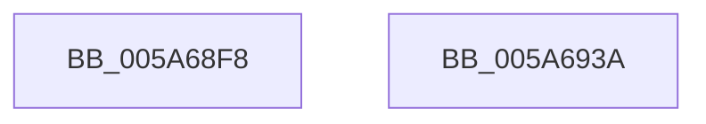

# IopDebugPrint

- RVA: `0x005A68F8`–`0x005A693B` (길이 `67` bytes)
- VA: `0x00000001405A68F8`
- 실행 섹션: `.text`
- PDB 이름 있음: `예`; PDB Function 태그: `아니요`
- unwind 정보 RVA: `0x000C8754`
- 디코드: `20`개 명령, `67/67` bytes 표시
- 미해석 바이트: `0` (있으면 어셈블리에 `.byte`로 보존)

> 이 문서는 커널 이미지의 기계어와 PDB 기호를 분석해 생성했습니다. 4번과 5번은 함수 원형과 자료형을 바이너리 사용 방식에서 추정한 C 해석이며 원본 소스 복구 결과는 아닙니다.

## 1. Dependencies

- 직접 호출 지점: **1**; 고유 호출 대상: **1**
- 직접 호출자로 확인된 함수: **2**
- RIP 상대 이미지 참조: **1**

### Outgoing calls
- `0x005A692D` → [vDbgPrintExWithPrefixInternal](../35/vDbgPrintExWithPrefixInternal_function_00359314.md) (function, `0x00359314`)

### Direct callers
- [PnpCollectOpenHandles](../../page/73/PnpCollectOpenHandles_function_00737E54.md) at `0x00737E7E`
- [PnpCollectOpenHandles](../../page/73/PnpCollectOpenHandles_function_00737E54.md) at `0x00737ED3`
- [PnpCollectOpenHandlesCallBack](../../page/73/PnpCollectOpenHandlesCallBack_function_00737EF0.md) at `0x00737F28`

### Static image references
- `0x005A6926` → RVA `0x006CB370` (` ?? ::FNODOBFM::`string'`; read)

## 2. Other-region calls and transfers

- 다른 실행 섹션으로 향하는 call: **0**
- 별도 외부 분기/꼬리 이동을 확인하지 못했습니다.

## 3. Assembly (complete function range)

```asm
005A68F8  4C 8B DC                        mov r11, rsp
005A68FB  49 89 53 10                     mov qword ptr [r11 + 0x10], rdx
005A68FF  4D 89 43 18                     mov qword ptr [r11 + 0x18], r8
005A6903  4D 89 4B 20                     mov qword ptr [r11 + 0x20], r9
005A6907  53                              push rbx
005A6908  48 83 EC 40                     sub rsp, 0x40
005A690C  8B D9                           mov ebx, ecx
005A690E  C6 44 24 28 01                  mov byte ptr [rsp + 0x28], 1
005A6913  49 8D 43 18                     lea rax, [r11 + 0x18]
005A6917  4C 8B CA                        mov r9, rdx
005A691A  44 8B C1                        mov r8d, ecx
005A691D  49 89 43 D8                     mov qword ptr [r11 - 0x28], rax
005A6921  BA 20 00 00 00                  mov edx, 0x20
005A6926  48 8D 0D 43 4A 12 00            lea rcx, [rip + 0x124a43]
005A692D  E8 E2 29 DB FF                  call 0x140359314
005A6932  8B C3                           mov eax, ebx
005A6934  48 83 C4 40                     add rsp, 0x40
005A6938  5B                              pop rbx
005A6939  C3                              ret
005A693A  CC                              int3
```

## 4. C-style interpretation (structured pseudocode)

```c
__int64 __fastcall IopDebugPrint(int a1, __int64 a2, __int64 a3, __int64 a4)
{
    __int64 result;
    __int64 v_rsp;
    unsigned __int8 v_stack_m20;

    *(unsigned __int64 *)(v_rsp + 16) = a2;
    *(unsigned __int64 *)(v_rsp + 24) = a3;
    *(unsigned __int64 *)(v_rsp + 32) = a4;
    v_rsp = (v_rsp) - (64);
    v_stack_m20 = 1;
    *(unsigned __int64 *)(v_rsp - 40) = v_rsp + 24;
    result = vDbgPrintExWithPrefixInternal(v_rip + 1198659, 32, (unsigned int)(a1), a2);
    v_rsp = (v_rsp) + (64);
    return (unsigned int)((unsigned int)((unsigned int)(a1)));
}
```

## 5. (Beta) C Style

```c
int64_t IopDebugPrint(int32_t Arg1, int64_t Arg2, int64_t Arg3, int64_t Arg4)
{
    int64_t result;
    int64_t local_rsp;
    uint8_t v_stack_m20;

    *(uint64_t *)(local_rsp + 0x10) = Arg2;
    *(uint64_t *)(local_rsp + 0x18) = Arg3;
    *(uint64_t *)(local_rsp + 0x20) = Arg4;
    local_rsp = (local_rsp) - (64);
    v_stack_m20 = 1;
    *(uint64_t *)(local_rsp - 0x28) = local_rsp + 24;
    result = vDbgPrintExWithPrefixInternal(v_rip + 1198659, 32, (uint32_t)(Arg1), Arg2);
    local_rsp = (local_rsp) + (64);
    return (uint32_t)((uint32_t)((uint32_t)(Arg1)));
}
```

## 6. Execution-region graph

[열기: 2D/3D 그래프와 함수 탐색 컨트롤 패널](../../../control-panel.html?section=text&rva=0x005A68F8&view=graph)

- 2D 그래프는 위에서 아래로 흐르고, 3D 그래프는 빈 공간을 드래그해 회전합니다. Shift+드래그는 이동, 휠은 확대·축소, 함수 노드 선택은 대상 보고서 이동입니다.

### Static fallback


